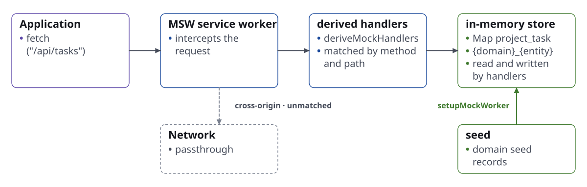

<p align="center">
  
</p>

# @simplix-react/mock

**English** | [한국어](/ko/packages/mock/README.md)

MSW mock handlers and in-memory stores derived from an `@simplix-react/contract` contract.

> **Prerequisites:** Requires a contract defined with `@simplix-react/contract`. See [`@simplix-react/contract`](/en/packages/contract/README.md) first.

## Installation

```bash
pnpm add @simplix-react/mock
```

Peer dependencies:

| Package | Required | Notes |
| --- | --- | --- |
| `@simplix-react/contract` | Yes | Provides the API contract definition |
| `zod` | Yes | `>=4.0.0` |
| `msw` | Optional | `>=2.0.0`, needed for the mock handlers and the worker |
| `vite` | Optional | `>=5.0.0`, needed for the Vite plugin |

## Quick Example

```ts
import { defineApi, simpleQueryBuilder } from "@simplix-react/contract";
import { setupMockWorker, deriveMockHandlers } from "@simplix-react/mock";
import { z } from "zod";

// 1. Define your contract
const projectContract = defineApi({
  domain: "project",
  basePath: "/api",
  entities: {
    task: {
      schema: z.object({
        id: z.number(),
        title: z.string(),
        status: z.enum(["todo", "done"]),
        createdAt: z.string(),
      }),
      operations: {
        list: { method: "GET", path: "/tasks" },
        get: { method: "GET", path: "/tasks/:id" },
        create: { method: "POST", path: "/tasks", input: z.object({ title: z.string() }) },
        update: {
          method: "PATCH",
          path: "/tasks/:id",
          input: z.object({ status: z.enum(["todo", "done"]).optional() }),
        },
        delete: { method: "DELETE", path: "/tasks/:id" },
      },
    },
  },
  queryBuilder: simpleQueryBuilder,
});

// 2. Derive handlers and bootstrap
await setupMockWorker({
  domains: [
    {
      name: "project",
      handlers: deriveMockHandlers(projectContract.config),
      seed: {
        project_task: [
          { id: 1, title: "Sample Task", status: "todo", createdAt: "2025-01-01T00:00:00Z" },
        ],
      },
    },
  ],
});
```

After `setupMockWorker` resolves, every `fetch("/api/tasks")` call in your application is intercepted by MSW and served from the in-memory store.



## API Overview

### Core

| Export | Description |
| --- | --- |
| `setupMockWorker(config)` | Bootstraps in-memory stores + MSW in one call |
| `deriveMockHandlers(config, mockConfig?, options?)` | Derives MSW handlers for the entity operations of a contract config |
| `stopMocking(options?)` | Unregisters a mock service worker left from an earlier session |
| `MockServerConfig` | Domain-based configuration for `setupMockWorker` |
| `MockDomainConfig` | Per-domain mock configuration (handlers, seed, toggle) |
| `MockEntityConfig` | Per-entity mock configuration (limits, sort, relations, resolvers) |
| `MockHandlerOptions` | Options for `deriveMockHandlers` (`responseWrapper`) |
| `MockResponseWrapper` | Builds the success and error response bodies |
| `StopMockingOptions` | Options for `stopMocking` (`storePrefix`) |

### In-Memory Store

| Export | Description |
| --- | --- |
| `getEntityStore(storeName)` | Returns the `Map` for the given store (creates lazily) |
| `getNextId(storeName)` | Returns the next auto-increment numeric ID |
| `seedEntityStore(storeName, records)` | Loads records into a store and sets the ID counter |
| `resetStore()` | Clears all stores and counters |
| `createMockEntityStore(seeds, idField?)` | Creates a standalone typed store with list, paging, CRUD and reset |
| `MockEntityStore`, `PagedResult` | Interface of that store and its Spring-style page result |

### Result Types

| Export | Description |
| --- | --- |
| `MockResult<T>` | Success/failure result type |
| `mockSuccess(data)` | Creates a success result |
| `mockFailure(error)` | Creates a failure result |

### Tree Builder

| Export | Description |
| --- | --- |
| `buildTreeFromFlatRows(rows, identityField?)` | Converts flat rows with `parentId` to `TreeNode` objects (`{ data, children }`) |
| `buildEmbeddedTree(rows, identityField?, parentField?)` | Converts flat rows to rows with an embedded `children` array |

### Vite Plugin

| Export | Description |
| --- | --- |
| `mswPlugin()` from `@simplix-react/mock/vite` | Serves `mockServiceWorker.js` without copying it to `public/` |

## Key Concepts

### In-Memory Store

Each entity gets its own `Map<string | number, Record<string, unknown>>`, keyed by a store name following the `{domain}_{snake_case_entity}` convention (entity `task` in domain `project` → `"project_task"`, entity `taskComment` → `"project_task_comment"`).

The store is fully synchronous:

- **Read**: iterate or look up by ID from the Map
- **Write**: set/delete entries directly
- **ID generation**: `getNextId` provides auto-increment numeric IDs
- **Seeding**: `seedEntityStore` populates records and adjusts the counter to the max existing numeric ID
- **Reset**: `resetStore` clears all stores and counters (called automatically by `setupMockWorker`)

Data lives in memory only and is lost on page reload, making it ideal for development and testing.

### MSW Handler Derivation

`deriveMockHandlers` reads your contract's entity definitions and derives one handler per operation, at `{basePath}{operation path}` with the operation's own method. The operation's role decides what the handler does:

| Role | Handler behaviour | Success status |
| --- | --- | --- |
| `list` | Lists records with filter, sort and pagination | 200 |
| `get` | Returns the record with the `id` param (or the last path param), with relations | 200 |
| `create` | Inserts the body; sets `id` from `getNextId`, `createdAt` and `updatedAt` when missing | 201 |
| `update` | Merges the body into the record (PATCH or PUT, as defined) and sets `updatedAt` | 200 |
| `delete` | Removes the record | 200 |
| `tree` | Returns the records as a tree | 200 |

For child entities with a `parent` definition, the list and create handlers are registered at `{basePath}{parent path}/:{parent param}{operation path}`: the list is filtered by the parent ID and a created record gets the parent ID in its `parent.param` field.

An operation without a CRUD role is handled by its method and whether its path has a param:

| Method | Path param | Behaviour |
| --- | --- | --- |
| `GET` | no | Like `list` |
| `GET` | yes | Like `get`, by the last path param |
| `POST`, `PUT`, `PATCH` | no | Like `create`; an array body inserts every item |
| `POST`, `PUT`, `PATCH` | yes | Like `update`, by the last path param |
| `DELETE` | yes | Like `delete`, by the last path param |
| `DELETE` | no | Returns `{ data: null }` |

Custom resolvers can replace any entity operation. Top-level operations (`config.operations`) get no derived handler; add your own MSW handler for them.

#### Response Shape

A success body is `{ data: <result> }`. An operation whose `output` is a `wired` schema is wrapped with its `wrap` function, and `options.responseWrapper` replaces the default wrapping for every other operation:

```ts
const handlers = deriveMockHandlers(contract.config, undefined, {
  responseWrapper: {
    success: (data) => ({ type: "SUCCESS", body: data }),
    error: (error) => ({ type: "ERROR", errorCode: error?.code, message: error?.message }),
  },
});
```

#### Query Parameters

List endpoints support the following query parameters:

| Parameter | Example | Description |
| --- | --- | --- |
| `sort` | `sort=title:asc,createdAt:desc` | Comma-separated `field:direction` (or `field.direction`) pairs; defaults to `defaultSort` (`createdAt:desc`) |
| `page` | `page=2` | Offset-based page number, starting at 0 |
| `cursor` | `cursor=abc` | Turns pagination on; the page offset still comes from `page` |
| `limit` or `size` | `limit=20` | Rows per page; defaults to `defaultLimit` (50), capped by `maxLimit` (100) |
| `{field}` | `status=done` | Equality filter on any field |

Without `page` or `cursor`, the list returns every matching row:

```json
{ "data": { "data": [] } }
```

When `page` or `cursor` is present, the response includes pagination metadata:

```json
{
  "data": {
    "data": [],
    "meta": { "total": 100, "page": 2, "limit": 20, "hasNextPage": true }
  }
}
```

#### Relation Loading

Configure `belongsTo` relations in `MockEntityConfig` to automatically join related data on GET-by-ID requests:

```ts
const handlers = deriveMockHandlers(contract.config, {
  task: {
    relations: {
      project: {
        entity: "project",
        localKey: "projectId",
        foreignKey: "id", // defaults to "id"
        type: "belongsTo",
      },
    },
  },
});
```

When fetching a task, the related `project` record is looked up from the `{domain}_project` store and embedded in the response.

#### Tree Queries

An operation with the `tree` role returns the store's rows as a tree. The handler converts flat rows with `parentId` fields into `{ data, children }` nodes using `buildTreeFromFlatRows`.

Pass `rootId` as a query parameter to retrieve a subtree starting from a specific node:

```text
GET /api/categories/tree?rootId=cat-1
```

#### Custom Resolvers

Override any entity operation, by its operation name, with a custom resolver for logic that goes beyond standard CRUD:

```ts
import { HttpResponse } from "msw";

const handlers = deriveMockHandlers(contract.config, {
  task: {
    resolvers: {
      batchCreate: async ({ request }) => {
        const tasks = await request.json();
        // Custom batch logic...
        return HttpResponse.json({ data: created }, { status: 201 });
      },
    },
  },
});
```

### Domain-Based Configuration

`setupMockWorker` organizes handlers by domain with per-domain toggling:

```ts
await setupMockWorker({
  domains: [
    {
      name: "project",
      enabled: true, // default
      handlers: deriveMockHandlers(projectContract.config),
      seed: {
        project_task: [
          { id: 1, title: "Task 1", status: "todo", createdAt: "2025-01-01T00:00:00Z" },
        ],
      },
    },
    {
      name: "user",
      enabled: false, // disabled: handlers are not registered
      handlers: deriveMockHandlers(userContract.config),
    },
  ],
});
```

The bootstrap sequence:

1. Filters domains to only those with `enabled !== false`, and returns without starting a worker when none is left
2. Resets all in-memory stores
3. Seeds each entity store from domain `seed` data
4. Starts the MSW service worker with combined handlers; cross-origin requests and requests no handler matches pass through to the network

### Error Handling

Failed operations return `{ code, message }` (or the `responseWrapper.error` body) with an HTTP status for the error code:

| Error Code | HTTP Status | Description |
| --- | --- | --- |
| `not_found` | 404 | Record does not exist |
| `unique_violation` | 409 | Duplicate key conflict |
| `foreign_key_violation` | 422 | Referenced record missing |
| `bad_request` | 400 | An `update` request without a valid JSON body |
| Other | 500 | Unexpected error |

### Vite Plugin

The `mswPlugin` eliminates the need to manually copy `mockServiceWorker.js` into your `public/` directory:

```ts
// vite.config.ts
import { defineConfig } from "vite";
import { mswPlugin } from "@simplix-react/mock/vite";

export default defineConfig({
  plugins: [mswPlugin()],
});
```

- **Dev mode**: serves the worker script via middleware at `/mockServiceWorker.js`
- **Build mode**: emits it as a static asset in the output directory, except in a build with `mode: "production"`

The plugin serves the app's own `msw` copy of the worker when the app installs `msw`, and the framework's copy otherwise.

## Guides

### Seeding Data

Seed data is provided per entity store in the domain config. Store names follow the `{domain}_{snake_case_entity}` convention:

```ts
import type { MockDomainConfig } from "@simplix-react/mock";

const projectDomain: MockDomainConfig = {
  name: "project",
  handlers: deriveMockHandlers(projectContract.config),
  seed: {
    project_task: [
      { id: 1, title: "Design mockups", status: "done", createdAt: "2025-01-01T00:00:00Z" },
      { id: 2, title: "Implement API", status: "todo", createdAt: "2025-01-02T00:00:00Z" },
    ],
    project_project: [
      { id: 1, name: "Acme Project", createdAt: "2025-01-01T00:00:00Z" },
    ],
  },
};
```

You can also seed stores programmatically:

```ts
import { seedEntityStore } from "@simplix-react/mock";

seedEntityStore("project_task", [
  { id: 1, title: "Task 1", status: "todo" },
  { id: 2, title: "Task 2", status: "done" },
]);
```

### Custom Handlers

For endpoints beyond the derived handlers, write MSW handlers that use the in-memory store directly:

```ts
import { http, HttpResponse } from "msw";
import { getEntityStore } from "@simplix-react/mock";

const overdueHandler = http.get("/api/tasks/overdue", () => {
  const store = getEntityStore("project_task");
  const weekAgo = new Date(Date.now() - 7 * 24 * 60 * 60 * 1000).toISOString();

  const overdue = Array.from(store.values()).filter(
    (task) => task.status !== "done" && (task.createdAt as string) < weekAgo,
  );

  return HttpResponse.json({ data: overdue });
});
```

Include custom handlers alongside derived ones in your domain config. Put a handler with a literal path before a derived handler whose path has a param at the same position, because MSW uses the first match:

```ts
const projectDomain: MockDomainConfig = {
  name: "project",
  handlers: [overdueHandler, ...deriveMockHandlers(projectContract.config)],
};
```

### Standalone Typed Store

`createMockEntityStore` keeps its own array of records, independent of the stores above. It suits handwritten handlers for an Orval-generated domain package:

```ts
import { createMockEntityStore } from "@simplix-react/mock";

const pets = createMockEntityStore([
  { id: 1, name: "Rex" },
  { id: 2, name: "Tom" },
]);

pets.create({ name: "Kit" });            // → { id: 3, name: "Kit" }
pets.listPaged(0, 20, "name.asc");       // → { content, totalElements, totalPages, number, size, first, last, empty }
pets.reset();                            // back to the seeds
```

### Stopping a Stale Worker

A browser keeps a registered service worker after the app stops calling `setupMockWorker`. `stopMocking` unregisters every worker whose script is `mockServiceWorker.js`, removes `localStorage` keys that start with `storePrefix`, and reloads the page when such a worker controlled it. It returns `true` when it reloads:

```ts
import { stopMocking } from "@simplix-react/mock";

if (!import.meta.env.VITE_ENABLE_MOCK) {
  await stopMocking({ storePrefix: "app:" });
}
```

### Testing

Reset stores between tests to ensure isolation:

```ts
import { resetStore, seedEntityStore, getEntityStore } from "@simplix-react/mock";
import { afterEach, beforeEach, describe, it, expect } from "vitest";

describe("task store", () => {
  beforeEach(() => {
    resetStore();
    seedEntityStore("project_task", [
      { id: 1, title: "Test Task", status: "todo" },
    ]);
  });

  afterEach(() => {
    resetStore();
  });

  it("retrieves seeded data", () => {
    const store = getEntityStore("project_task");
    expect(store.get(1)).toEqual({ id: 1, title: "Test Task", status: "todo" });
  });
});
```

## Related Packages

| Package | Description |
| --- | --- |
| [`@simplix-react/contract`](/en/packages/contract/README.md) | Define type-safe API contracts consumed by this package |
| [`@simplix-react/react`](/en/packages/react/README.md) | React Query hooks derived from the same contract |
| [`@simplix-react/testing`](/en/packages/testing/README.md) | Test utilities for contract-based mocking |

---

<p class="page-source"><a href="https://github.com/simplix-framework/simplix-react/blob/main/packages/mock/README.md" target="_blank" rel="noopener noreferrer">View source</a></p>
