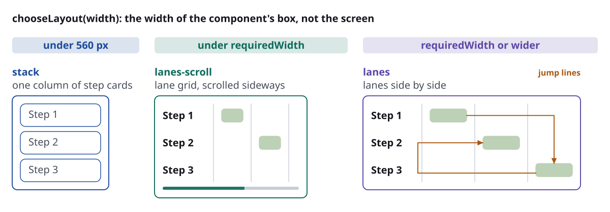

# @simplix-react/process

**English** | [한국어](/ko/packages/process/README.md)

A procedure drawn from its definition: steps and acts on a grid of lanes with jumps, parallel runs and conditions, laid out as one column in a narrow box. The editor and the comparison of two versions are a separate entry point, so a screen that only draws a procedure loads no editing code.

The model is `@simplix-react/process-core`.

## Installation

```bash
pnpm add @simplix-react/process @simplix-react/process-core
```

```css
@import "@simplix-react/process/styles.css";
```

## Drawing a procedure

```tsx
import { ProcessLanes } from "@simplix-react/process";

<ProcessLanes definition={definition} facts={{ large: true }} run={runState} selected={selected} onSelect={setSelected} />;
```



- The layout follows the width of the component's own box, never the screen: lanes side by side where they fit, the same grid scrolled sideways where they do not, and one column of step cards in a narrow box.
- `facts` says which conditions hold for the case. A step whose condition is undecided (its fact is not given) is marked conditional. A step or an act the case leaves out keeps its place, drawn faint and named as not applicable, so a procedure has one shape whatever the facts; `leftOut="folded"` draws a left-out step as one line and drops a lane only left-out acts stand in.
- A jump ahead runs down the right of the lanes. A jump back and a rework line leave leftwards and rise in the nearest lane left of their acts that is clear on the rows they pass, or in a track left of the lanes where none is. A rework line goes straight up into the first act where the step's acts stand on one row and the first act stands left of the last.
- `run` marks how far a case has come; the act in progress carries a ring that spreads and fades.
- `highlightLanes` tints the lanes the reader holds, and `marks` sets a word on a step, an act or a jump as `data-mark`.
- Colours, type sizes and radii are the theme tokens of `@simplix-react/ui`; the markup is the same under every design.

| Prop | Type | Default | Description |
| --- | --- | --- | --- |
| `definition` | `ProcessDefinition` | required | A definition `validateDefinition` finds nothing wrong with |
| `facts` | `Facts` | | The facts of the case. Left out, every condition is undecided |
| `run` | `ProcessRunState` | | The progress of a running case |
| `layout` | `"auto" \| "lanes" \| "stack"` | `"auto"` | `auto` chooses from the width of the box; the others keep one layout |
| `defaultLayout` | `LayoutMode` | `"lanes"` | The layout drawn before the box is measured, on a server or on the first paint |
| `metrics` | `Partial<LayoutMetrics>` | | Widths the layout is chosen from, where they differ from the defaults |
| `visibleLanes` | `readonly Id[]` | every lane | The lanes to draw. Left out, the component keeps the choice itself |
| `onVisibleLanesChange` | `(lanes) => void` | | Called with the lanes to draw when the reader changes them |
| `laneFilter` | `boolean` | `false` | Draws the row of lane toggles above the procedure |
| `highlightLanes` | `readonly Id[]` | | The lanes the reader holds |
| `leftOut` | `"drawn" \| "folded"` | `"drawn"` | What is done with the steps and acts the case leaves out |
| `marks` | `Record<Id, string>` | | A word per step, act or jump, set as `data-mark`; `added`, `changed` and `moved` are styled by the package |
| `selected` | `ProcessTarget \| null` | | What is picked now |
| `onSelect` | `(target) => void` | | Called when the reader picks a step, an act or a jump |
| `renderDetail` | `(target) => ReactNode` | | What to draw for the picked target, under the grid or inside the step's card |
| `scrollToActive` | `boolean` | `true` | Scrolls the step in progress into view when first drawn |
| `className` | `string` | | |

## Editing a procedure

```tsx
import { ProcessEditor, useProcessEditing } from "@simplix-react/process/edit";
import type { ProcessDefinition } from "@simplix-react/process-core";

function Settings({ stored }: { stored: ProcessDefinition }) {
  const editing = useProcessEditing(stored);
  return <ProcessEditor editing={editing} problems={ownRules(editing.definition)} />;
}
```

- The editor draws the procedure and, beside it, a panel that edits the part picked on the drawing. In a narrow box the panel stands under the drawing.
- Every change is one operation of `process-core`, so it can be undone. An operation that would leave a problem is refused, and its reason is shown above the drawing.
- `problems` lists what the caller's own rules find beside the problems of the format, and `renderFields` draws the caller's own fields for the part picked. `facts` draws the procedure for a case.
- `useProcessEditing(initial, options?)` returns the definition, `apply`, `undo`, `redo`, `canUndo`, `canRedo`, the last `refusal` and `consequences`, and `reset`.
- `scope="wording"` with `useProcessEditing(stored, { keepFlow: true })` is for a product whose flow is fixed elsewhere: names, notes, the wording of conditions and who is named for an act can be changed, and `lanesFor` says which lanes an act may be given to.
- `ProcessProblems` is the list of problems on its own, for a check before publishing; `onShow` is called with the part a problem names. `useProcessProblems(definition, problems)` returns the same list as data.

## Comparing two versions

```tsx
import { ProcessDiff } from "@simplix-react/process/edit";

<ProcessDiff before={published} after={draft} />;
```

The later version is drawn with its added, changed and moved parts marked, and every difference is listed under it by the name of its part. `facts` draws it for a case, and `fieldLabel` names a member of the caller's own in the list.

## Translations

The package registers English, Korean and Japanese under the `simplix-process` namespace when it is imported. The editing texts load when an editing component is first drawn.

---

<p class="page-source"><a href="https://github.com/simplix-framework/simplix-react/blob/main/packages/process/README.md" target="_blank" rel="noopener noreferrer">View source</a></p>
