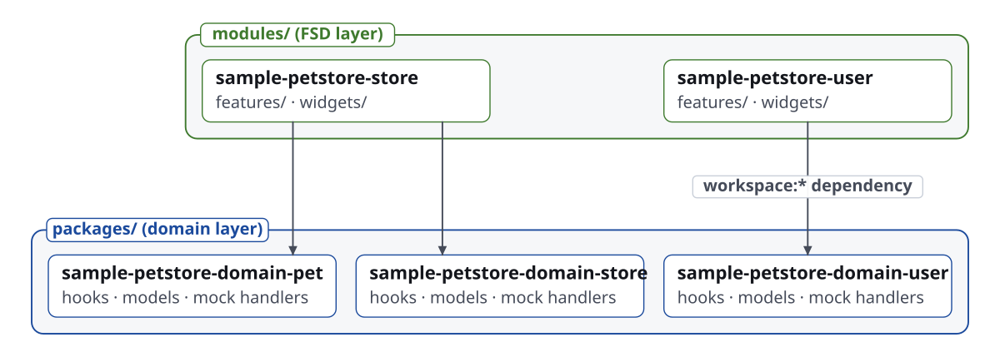
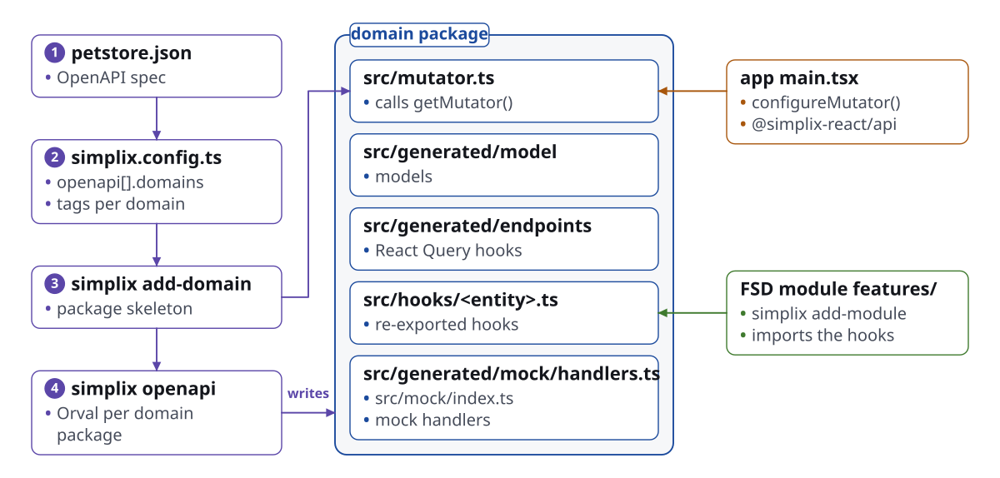

# Build a Petstore API Client from OpenAPI

**English** | [한국어](/ko/tutorials/petstore-openapi.md)

> After completing this tutorial, you will have a typed multi-domain monorepo
> generated from the Swagger Petstore OpenAPI spec, with TypeScript models,
> React Query hooks, and MSW mock handlers generated by `simplix openapi`.

## Prerequisites

- Node.js 20 or later
- pnpm 9 or later
- `@simplix-react/cli` installed globally or run via `pnpm dlx`

```bash
pnpm add -g @simplix-react/cli
```

## Step 1: Initialize the Project

Create a new simplix-react monorepo:

```bash
simplix init sample-petstore -y
cd sample-petstore
```

With `-y`, the scope is `@sample-petstore` and the demo app, i18n (`en`, `ko`, `ja`), auth and access control are all included. This generates the following structure:

```text
sample-petstore/
  apps/
    sample-petstore-demo/     # Vite + React demo application
  config/
    typescript/               # Shared TypeScript configs
  modules/                    # FSD modules (empty)
  simplix.config.ts           # Project configuration
  package.json                # Root monorepo config
  pnpm-workspace.yaml
  turbo.json
  tsconfig.json
```

Key file, `simplix.config.ts` (comments omitted):

```ts
import { defineConfig } from "@simplix-react/cli";

export default defineConfig({
  plugins: ["@simplix-react-ext/simplix-boot-cli-plugin"],
  api: {
    baseUrl: "/api",
  },
  http: {
    environments: {
      development: { baseUrl: "http://localhost:3000" },
    },
  },
  i18n: {
    locales: ["en", "ko", "ja"],
    defaultLocale: "en",
  },
  codegen: {
    header: true,
  },
});
```

The `plugins` entry registers the spec profiles of the SimpliX Boot backend. This tutorial uses no spec profile, so the entry has no effect here and can stay.

Install dependencies:

```bash
pnpm install
```

Verify the initial build:

```bash
pnpm build
```

The build finishes without errors.

## Step 2: Download the OpenAPI Spec

Download the Swagger Petstore 3.0 spec into the project root:

```bash
curl -sL "https://petstore3.swagger.io/api/v3/openapi.json" -o petstore.json
```

Inspect the available tags:

```bash
node -e "
  const s = JSON.parse(require('fs').readFileSync('petstore.json','utf8'));
  console.log('Title:', s.info.title);
  console.log('Tags:', s.tags.map(t => t.name).join(', '));
"
```

Expected output:

```text
Title: Swagger Petstore - OpenAPI 3.0
Tags: pet, store, user
```

Each tag becomes one domain package.

## Step 3: Configure Domain Splitting

Edit `simplix.config.ts` to add an `openapi` entry. `openapi` is an array of
per-spec configs; in each entry, `spec` is the spec path relative to the project
root, and in its `domains` map the key is a domain name and the value is an array
of OpenAPI tag patterns (an exact tag or a `/regex/`) to include:

```ts
import { defineConfig } from "@simplix-react/cli";

export default defineConfig({
  plugins: ["@simplix-react-ext/simplix-boot-cli-plugin"],
  api: {
    baseUrl: "/api",
  },
  http: {
    environments: {
      development: { baseUrl: "http://localhost:3000" },
    },
  },
  i18n: {
    locales: ["en", "ko", "ja"],
    defaultLocale: "en",
  },
  codegen: {
    header: true,
  },
  openapi: [
    {
      spec: "petstore.json",
      domains: {
        pet: ["pet"],
        store: ["store"],
        user: ["user"],
      },
    },
  ],
});
```

The `openapi[].domains` mapping tells the CLI to split OpenAPI operations
by their tag into separate domain packages.

## Step 4: Create the Domain Packages

`simplix openapi` writes into domain packages that already exist. Create one
package per domain:

```bash
simplix add-domain pet -y
simplix add-domain store -y
simplix add-domain user -y
```

Because `simplix.config.ts` maps each domain to tags of a spec that exists,
`add-domain` writes the OpenAPI skeleton: `package.json` with `orval` as a
dev dependency and a `codegen` script, `src/index.ts`, `src/mutator.ts`, and
the i18n files. Expected output for the first package:

```text
✔ Domain package created: @sample-petstore/sample-petstore-domain-pet
  → Location: packages/sample-petstore-domain-pet/
  → i18n: locales/ with en, ko, ja
```

Install the dependencies of the new packages, which brings in Orval:

```bash
pnpm install
```

## Step 5: Generate Domain Code

Run the OpenAPI code generator:

```bash
simplix openapi petstore.json -y
```

Expected output (the spec version may differ):

```text
✔ Loaded: Swagger Petstore - OpenAPI 3.0 v1.0.27
i Multi-domain mode: pet(1), store(2), user(1)
✔ Generated code for: @sample-petstore/sample-petstore-domain-pet
  → Location: packages/sample-petstore-domain-pet/
  → Entities: pet
  → Generated: src/generated/, src/hooks/, src/mock/
```

The `store` and `user` packages follow with the same lines. The `store` tag
holds the entities `order` and `inventory`; `pet` and `user` hold one each.
Each package now has this layout:

```text
packages/
  sample-petstore-domain-pet/
    package.json
    tsup.config.ts
    tsconfig.json
    vitest.config.ts
    crud.config.ts                    # CRUD role → hook name map
    .openapi-snapshot.json            # Snapshot compared on the next run
    src/
      index.ts                        # Package entry point
      mutator.ts                      # Request function the generated code calls
      translations.ts
      locales/                        # en.json, ko.json, ja.json
      generated/
        endpoints/                    # Orval React Query hooks and request functions
        model/                        # Orval TypeScript models
        mock/
          handlers.ts                 # MSW handler factories
      hooks/
        pet.ts                        # Re-exports the hooks of the pet entity
        index.ts
      mock/
        index.ts                      # Mock entry point (createPetMock)
        seeds.ts                      # Mock seed data
    http/
      pet.http                        # HTTP request samples
      http-client.env.json
  sample-petstore-domain-store/
    ...  (same structure)
  sample-petstore-domain-user/
    ...  (same structure)
```

### What gets generated

| File | Written | Description |
| --- | --- | --- |
| `src/generated/endpoints/` | Every run | Orval React Query hooks and request functions, one hook per operation |
| `src/generated/model/` | Every run | Orval TypeScript models for the schemas the endpoints use |
| `src/generated/mock/handlers.ts` | Every run | MSW handler factories per entity |
| `src/hooks/` | Every run | One file per entity re-exporting its hooks |
| `http/` | Every run, unless `--no-http` | HTTP request samples and environments |
| `src/index.ts` | Every run | Package entry; export lines you add are kept |
| `src/mock/index.ts` | First run, then while its override region is empty | Mock entry point wiring stores and handlers |
| `src/mock/seeds.ts` | First run only | Seed data for the in-memory stores |
| `crud.config.ts` | First run, or with `-f` | CRUD role map that `simplix scaffold-crud` reads |
| `src/mutator.ts` | When missing | Request function that calls `getMutator()` from `@simplix-react/api` |

## Step 6: Build

Build all packages:

```bash
pnpm build
```

Every domain package and the demo app build without errors.

## Step 7: Inspect the Generated Code

### Hooks (`src/hooks/`)

Orval writes one React Query hook per operation and names it `use` + the
operation ID of the spec. A `GET` operation becomes a query hook, any other
method a mutation hook. For the `pet` domain:

| Operation ID | Method and path | Hook |
| --- | --- | --- |
| `findPetsByStatus` | `GET /pet/findByStatus` | `useFindPetsByStatus` (query) |
| `findPetsByTags` | `GET /pet/findByTags` | `useFindPetsByTags` (query) |
| `getPetById` | `GET /pet/{petId}` | `useGetPetById` (query) |
| `addPet` | `POST /pet` | `useAddPet` (mutation) |
| `updatePet` | `PUT /pet` | `useUpdatePet` (mutation) |
| `updatePetWithForm` | `POST /pet/{petId}` | `useUpdatePetWithForm` (mutation) |
| `deletePet` | `DELETE /pet/{petId}` | `useDeletePet` (mutation) |
| `uploadFile` | `POST /pet/{petId}/uploadImage` | `useUploadFile` (mutation) |

`src/hooks/pet.ts` re-exports these hooks, and the package entry exports
`./hooks` and `./generated/model`, so a consumer imports a hook and its types
from the package name.

### Request function (`src/mutator.ts`)

Every generated request goes through `customFetch` in `src/mutator.ts`, which
calls `getMutator()` from `@simplix-react/api`. The application registers that
request function once with `configureMutator()` (Step 9).

### Mock handlers (`src/mock/index.ts`)

The mock entry exports `createPetMock()` (`createStoreMock()` and
`createUserMock()` in the other packages), which returns a `MockDomainConfig`
from `@simplix-react/mock` with the handlers of `src/generated/mock/handlers.ts`.
Handlers you add above the generated ones in its override region are kept when
the code is regenerated.

## Step 8: Re-generate After Spec Changes (optional)

When the OpenAPI spec is updated, re-run the same command:

```bash
simplix openapi petstore.json -y
```

The CLI compares the new spec against the `.openapi-snapshot.json` saved in each
domain package. A package with no change reports
`No changes detected. Package is up-to-date.`; for a changed one it prints the
diff and regenerates `src/generated/` and `src/hooks/`. Without `-y` it asks
before regenerating. `src/mock/seeds.ts` and the export lines you added to
`src/index.ts` are kept. Pass `-f, --force` to regenerate even when no changes
are detected; `-f` also rewrites `crud.config.ts`. Pass `-d, --domain <name>`
to regenerate one domain only.

## Step 9: Create FSD Modules

Domain packages provide typed hooks and models. FSD (Feature-Sliced
Design) modules consume these domain packages and organize the application
into independent, feature-based units.

Create a `store` module for the pet and store domains, and a `user` module for
the user domain:

```bash
simplix add-module store -y
simplix add-module user -y
```

Expected output:

```text
✔ Module created: @sample-petstore/sample-petstore-store
  → Location: modules/sample-petstore-store/
  → FSD layers: features/ widgets/ shared/
  → i18n: locales/ with en, ko, ja

✔ Module created: @sample-petstore/sample-petstore-user
  → Location: modules/sample-petstore-user/
  → FSD layers: features/ widgets/ shared/
  → i18n: locales/ with en, ko, ja
```

The modules are created under `modules/`:

```text
modules/
  sample-petstore-store/
    package.json
    tsup.config.ts
    tsconfig.json
    vitest.config.ts
    src/
      index.ts              # Module entry point
      features/index.ts     # Feature layer: domain-driven use cases
      widgets/index.ts      # Widget layer: compose features into UI blocks
      shared/               # Shared layer: lib, ui, config
      locales/              # i18n translations (features/, widgets/)
  sample-petstore-user/
    ...  (same structure)
```

### Domain and module relationship

Modules consume domain packages to build features. The `store` module uses
both the `pet` and `store` domain packages, and the `user` module uses the
`user` domain package.



To use domain hooks inside a module, add the domain packages to the
`dependencies` of the module's `package.json`:

```json
{
  "dependencies": {
    "@sample-petstore/sample-petstore-domain-pet": "workspace:*",
    "@sample-petstore/sample-petstore-domain-store": "workspace:*"
  }
}
```

Then call the hooks in your feature code:

```tsx
// modules/sample-petstore-store/src/features/available-pets.tsx
import { useFindPetsByStatus } from "@sample-petstore/sample-petstore-domain-pet";

export function AvailablePets() {
  const { data: pets } = useFindPetsByStatus({ status: "available" });

  return (
    <ul>
      {pets?.map((pet) => <li key={pet.id}>{pet.name}</li>)}
    </ul>
  );
}
```

Register the request function once in the app, before it renders, for example
at the top of `apps/sample-petstore-demo/src/main.tsx`. Add
`@simplix-react/api` to the app's dependencies if it is not there yet:

```ts
import { configureMutator } from "@simplix-react/api";

configureMutator(async (url, options) => {
  const res = await fetch(`https://petstore3.swagger.io/api/v3${url}`, options);
  if (!res.ok) throw new Error(`Request failed: ${res.status}`);
  return res.json();
});
```

Install and build:

```bash
pnpm install
pnpm build
```

## Summary

In this tutorial, you:

1. **Initialized** a simplix-react monorepo with `simplix init`
2. **Downloaded** the Swagger Petstore OpenAPI spec
3. **Configured** tag-based domain splitting in `simplix.config.ts`
4. **Created** the `pet`, `store` and `user` domain packages with `simplix add-domain`
5. **Generated** their models, hooks and mock handlers with `simplix openapi`
6. **Built** the entire project successfully
7. **Inspected** the generated hooks, request function and mock entry
8. **Re-generated** after spec changes using snapshot-based diffing
9. **Created** the `store` and `user` FSD modules with `simplix add-module` and called a domain hook from a feature

### Generated Pipeline



### Next Steps

- [Build a Full-Stack Mock Application](/en/tutorials/full-stack-mock.md): use
  hooks and mock handlers in a React application
- [CLI Reference](/en/guides/cli-usage.md): explore all available CLI commands and flags

---

<p class="page-source"><a href="https://github.com/simplix-framework/simplix-react/blob/main/docs/en/tutorials/petstore-openapi.md" target="_blank" rel="noopener noreferrer">View source</a></p>
