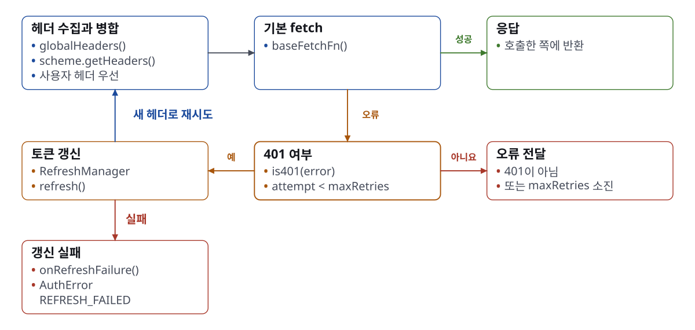
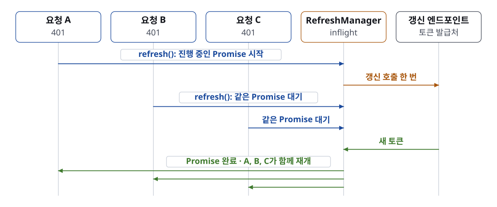

# 인증

[English](/en/core-concepts/authentication.md) | **한국어**

## 개요

simplix-react의 인증(authentication)은 `@simplix-react/auth`가 담당합니다. 이 패키지는 API 계약(contract)과 HTTP 계층 사이에 위치하는 미들웨어입니다. 요청마다 토큰을 직접 넣지 않아도 되도록 전략 기반 구조를 제공하며, 인증 방식을 한 번 선언하면 `defineApi`에 바로 넣을 수 있는 인증된 `fetchFn`을 받습니다.

바탕이 되는 관찰은 인증이 API 계약과 독립적이라는 것입니다. 엔티티 정의와 오퍼레이션(operation)은 요청을 어떻게 인증하는지 알 필요가 없습니다. 인증을 별도 계층으로 분리하면 같은 계약을 환경마다 다른 인증 전략과 함께 씁니다. 예를 들어 운영 환경에서는 Bearer 토큰, 스테이징에서는 API 키, 테스트에서는 인증 없이 같은 계약을 사용합니다.

## 동작 방식

인증 패키지는 전략 패턴을 따릅니다. 인증 방식마다 `AuthScheme`으로 캡슐화하며, `AuthScheme`은 HTTP 헤더를 만들고, 자격 증명을 갱신하고, 인증 상태를 알리는 객체입니다.

| 팩토리 | 만드는 결과 |
| --- | --- |
| `bearerScheme()` | `Authorization: Bearer <token>`. 갱신은 선택 |
| `apiKeyScheme()` | 헤더나 쿼리 매개변수에 넣는 API 키 |
| `oauth2Scheme()` | OAuth2 `refresh_token` 그랜트를 쓰는 Bearer 헤더 |
| `customScheme()` | 사용자가 정의한 헤더와 갱신 |

`AuthScheme`에는 `name`, `getHeaders()`, `isAuthenticated()`, `clear()`가 있고, 선택 항목으로 `refresh()`와 `tokensChanged()`가 있습니다.

여러 방식을 조합하려면 `schemes`에 나열하거나 `composeSchemes(...schemes)`를 사용하세요. 헤더는 순서대로 병합하므로 같은 이름의 헤더는 뒤에 있는 방식의 값이 적용됩니다. 갱신할 때 `createAuthFetch`는 `refresh()`가 있는 방식을 순서대로 시도해 하나가 성공하면 멈추고, `composeSchemes`는 `refresh()`가 있는 첫 번째 방식만 호출합니다.

### fetch 래퍼

`createAuthFetch(config, baseFetchFn?)` 함수는 기본 `FetchFn`(기본값은 `defaultFetch`)을 인증 로직으로 감쌉니다. `createAuth(config)`는 이 함수를 호출해 `AuthInstance`를 반환하며, 그 `fetchFn`을 `defineApi`에 전달합니다.



래퍼는 요청마다 다음 순서로 동작합니다.

1. `globalHeaders()`가 지정되어 있으면 그 헤더를, 이어서 구성된 모든 인증 방식의 헤더를 모읍니다
2. 인증 헤더를 사용자가 지정한 헤더보다 **먼저** 병합합니다(그래서 다른 사용자로 대신 요청할 때는 사용자 헤더가 인증 헤더를 덮어씁니다)
3. 기본 fetch 함수를 호출합니다
4. 401 응답을 받으면(`is401`로 판정하며 기본값은 `error.status === 401` 확인) `RefreshManager`로 토큰 갱신(token refresh)을 시작합니다
5. 새 자격 증명으로 원래 요청을 다시 보냅니다. 최대 `maxRetries`회(기본값 `1`)까지 시도합니다
6. 갱신에 실패하면 `onRefreshFailure`를 호출하고, 코드가 `REFRESH_FAILED`인 `AuthError`를 발생시킵니다

### 동시 갱신 요청의 단일화

여러 요청이 동시에 401로 실패해도 `RefreshManager`는 갱신을 한 번만 실행합니다. 뒤이어 호출한 쪽은 진행 중인 같은 Promise를 기다립니다. 그래서 동시에 들어온 수십 개의 갱신 요청이 인증 서버에 몰리는 문제를 막습니다.



### 토큰 저장소

토큰은 키-값 저장소를 추상화한 `TokenStore`에 저장합니다. 패키지가 제공하는 구현은 다음과 같습니다.

| 저장소 | 유지 범위 | 용도 |
| --- | --- | --- |
| `memoryStore()` | 없음(프로세스가 실행되는 동안) | 테스트, SSR |
| `localStorageStore(prefix?)` | 세션이 바뀌어도 유지 | 대부분의 웹 앱 |
| `sessionStorageStore(prefix?)` | 현재 탭에서만 유지 | 보안이 중요한 앱 |

웹 스토리지 저장소는 같은 스토리지의 다른 데이터와 충돌하지 않도록 키 앞에 접두사를 추가하며, 접두사는 인자로 지정합니다(기본값 `"auth:"`). `createRememberMe(namespace)`는 로그인 유지 설정을 저장하고, 그 설정에 맞는 토큰 저장소를 제공합니다.

### 세션 도우미

세션을 유지하거나 탭 사이에서 맞추는 도우미도 제공합니다.

| 내보내는 항목 | 역할 |
| --- | --- |
| `AutoRefreshScheduler` | 접근 토큰이 만료되기 전에 타이머로 갱신합니다 |
| `createActivityTracker()` | 사용자의 마지막 조작 시각을 기록해 활동에 따른 갱신에 씁니다 |
| `createCrossTabSync()` | `storage` 이벤트로 다른 탭의 로그아웃과 토큰 갱신을 이 탭에 반영합니다 |
| `openOAuth2Popup()` | 팝업 창에서 OAuth2 인가 흐름을 실행합니다 |
| `createOidcClient()` | 인가 코드 흐름과 PKCE를 쓰는 공개 OpenID Connect 클라이언트 |

## 설계 결정

### 전략 패턴을 쓰는 이유

simplix-react의 파생 모델과 일관되도록 전략 패턴을 선택했습니다. 계약에서 클라이언트와 훅을 파생하듯, 인증 구성에서 인증된 fetch 함수를 파생합니다. 전략을 조합하면 계약 계층을 바꾸지 않고 Bearer와 API 키를 함께 사용합니다.

검토한 대안은 다음과 같습니다.

- **미들웨어 체인**(Express 방식): 더 유연하지만, 클라이언트에서 쓰기에는 타입 지정과 조합이 어렵습니다
- **데코레이터 패턴**: 결과는 비슷하지만 조합 순서가 덜 명시적입니다
- **단일 인증 클래스**: 인증 방식을 섞거나 환경마다 전략을 바꿀 수 없습니다

### 헤더를 비동기로 받는 이유

대부분의 구현이 동기 값을 반환하지만 `AuthScheme.getHeaders()`는 비동기입니다. 의도한 설계입니다. 토큰 갱신, JWE 복호화 같은 자격 증명 작업은 본래 비동기입니다. 처음부터 인터페이스를 비동기로 정하면 비동기 작업이 필요해져도 호환성을 깨는 변경을 하지 않아도 됩니다.

### 인증 헤더를 사용자 헤더보다 먼저 적용하는 이유

헤더를 병합할 때 인증 헤더를 먼저 적용하고, 사용자가 지정한 헤더(`RequestInit.headers`)가 이를 덮어씁니다.

```ts
{
  ...authHeaders,      // auth provides defaults
  ...options?.headers, // user can override
}
```

이 순서 덕분에 인증 구성을 바꾸지 않고도 요청 단위로 다른 사용자로 대신 요청(`Authorization: Bearer <admin-token>`)합니다.

### React를 선택 사항으로 둔 이유

핵심 인증 패키지(`@simplix-react/auth`)는 React 없이 동작합니다. `createAuth`가 반환하는 `AuthInstance`는 `subscribe` 메서드가 있는 일반 객체이므로 어떤 프레임워크와도, 프레임워크 없이도 동작합니다. React 바인딩은 별도 진입점(`@simplix-react/auth/react`)으로 제공합니다. `AuthProvider`가 핵심 인스턴스를 컨텍스트에 넣고 `useSyncExternalStore`로 구독하며, `useAuth`, `useAuthContext`, `useAuthFetch`가 그 컨텍스트에서 값을 읽습니다.

이렇게 분리하면 다음과 같은 이점이 있습니다.

- 서버 쪽 코드는 `createAuthFetch`를 바로 사용합니다
- React가 아닌 프레임워크(Vue, Svelte)도 핵심 인증 인스턴스를 사용합니다
- React 앱은 이식성을 잃지 않고 편리한 훅을 사용합니다

### 쿠키 인증을 내장하지 않은 이유

쿠키 기반 인증(세션 쿠키, CSRF 토큰)은 일부러 넣지 않았습니다. HttpOnly 플래그, SameSite 정책, CSRF 토큰 엔드포인트처럼 서버 쪽과 맞춰야 할 부분이 백엔드마다 크게 다르기 때문입니다. 쿠키 기반 흐름에는 `customScheme` 함수를 사용하세요.

## 영향

### 애플리케이션 개발자에게

- 인증은 한 번 구성해 `fetchFn`으로 `defineApi`에 넣습니다
- 토큰 갱신, 재시도, 중복 갱신 방지는 자동으로 처리합니다
- React 컴포넌트는 props를 여러 단계로 전달하지 않고 훅으로 인증 상태를 읽습니다
- 인증 전략을 바꿀 때(예: Bearer에서 OAuth2로) 애플리케이션 코드가 아니라 인증 방식 구성만 바꿉니다

### 테스트

- 토큰을 미리 넣은 `memoryStore()`로 인증된 요청을 테스트하세요
- `refreshFn`을 목(mock)으로 바꿔 갱신 흐름을 테스트하세요
- 인증 인스턴스의 `subscribe` 메서드로 상태 변화를 테스트하세요

## 관련 문서

- [인증 가이드](/ko/guides/authentication.md): 앱에 인증을 설정하는 방법
- [보호된 앱 만들기](/ko/tutorials/auth-protected-app.md): 단계별 튜토리얼
- [사용자 정의 fetch 함수](/ko/guides/custom-fetch.md): 더 낮은 수준의 fetch 사용자 정의
- [API 계약](/ko/core-concepts/api-contracts.md): 계약과 `fetchFn`이 함께 동작하는 방식

---

<p class="page-source"><a href="https://github.com/simplix-framework/simplix-react/blob/main/docs/ko/core-concepts/authentication.md" target="_blank" rel="noopener noreferrer">원본 보기</a></p>
