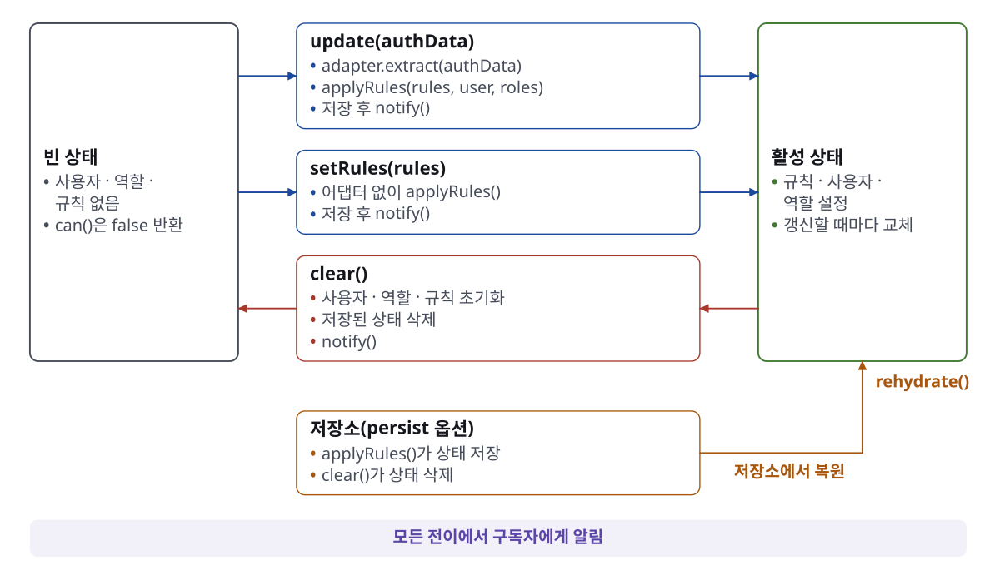
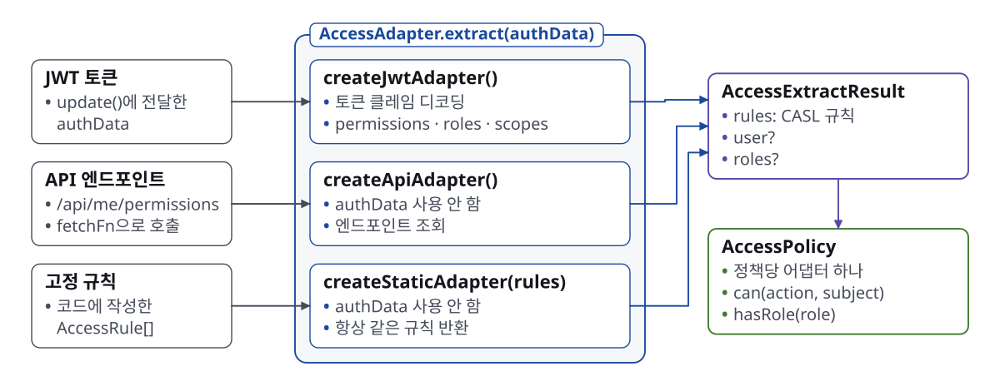

# 인가

[English](/en/core-concepts/authorization.md) | **한국어**

## 개요

simplix-react의 인가(authorization)는 `@simplix-react/access` 패키지가 담당합니다. 이 패키지는 CASL 라이브러리를 감싸 규칙 기반의 선언적 접근 제어를 제공합니다. 권한 검사를 애플리케이션 곳곳에 흩어 두지 않고 `AccessPolicy`를 한 번 선언하면, 현재 사용자가 할 수 있는 일과 할 수 없는 일을 그 정책 하나가 결정합니다. 정책의 규칙은 인증 소스에서 규칙을 추출하는 어댑터(adapter)가 공급합니다.

인가 규칙은 거의 언제나 외부 소스(JWT 토큰, API 엔드포인트, 정적 설정)에서 오며, 프론트엔드가 평가할 수 있는 같은 형식으로 바꿔야 합니다. access 패키지는 이 변환을 어댑터 패턴으로 정리합니다. 어댑터마다 특정 인증 소스에서 CASL 규칙을 추출하는 방법을 알고, 정책은 규칙이 어디서 왔든 같은 방식으로 평가합니다.

그래서 같은 애플리케이션 코드가 서로 다른 인가 백엔드(어떤 환경에서는 JWT 클레임, 다른 환경에서는 API 엔드포인트, 테스트에서는 정적 규칙)에서 권한 검사 로직을 바꾸지 않고 동작합니다.

## 동작 방식

### CASL 기반

CASL은 클라이언트와 서버에서 같은 방식으로 동작하는 JavaScript 인가 라이브러리입니다. 권한을 규칙 목록으로 표현하며, 규칙 하나는 **액션**(사용자가 하려는 일)과 **대상**(작업할 리소스)을 짝지은 것입니다.

```ts
{ action: "view", subject: "Pet" }
{ action: "edit", subject: "Order" }
{ action: "manage", subject: "all" }  // wildcard: all actions on all subjects
```

`@simplix-react/access`는 CASL의 `MongoAbility` 타입을 `AccessAbility`로, 원시 규칙을 `AccessRule`로 감쌉니다. `DefaultActions` 타입은 표준 액션 동사를 제공합니다.

| 액션 | 용도 |
| --- | --- |
| `list` | 컬렉션 조회 |
| `view` | 레코드 하나 조회 |
| `create` | 새 레코드 생성 |
| `edit` | 기존 레코드 수정 |
| `delete` | 레코드 삭제 |
| `export` | 데이터 내보내기 |
| `import` | 데이터 가져오기 |
| `approve` | 업무 흐름 단계 승인 |
| `manage` | 와일드카드: 모든 액션 |

`TActions`와 `TSubjects`는 제네릭 매개변수입니다. 애플리케이션의 유니언 타입으로 좁혀 타입 검사를 엄격하게 하거나, `string`으로 두어 유연하게 쓸 수 있습니다.

### AccessPolicy 생성과 수명 주기

`createAccessPolicy` 함수로 중심이 되는 정책 인스턴스를 만듭니다.

```ts
import { createAccessPolicy, createApiAdapter } from "@simplix-react/access";

const policy = createAccessPolicy({
  adapter: createApiAdapter({ endpoint: "/api/v1/permissions" }),
  isSuperAdmin: (user) => user.roles.includes("ROLE_SYSTEM_ADMIN"),
  persist: { storage: localStorage },
});
```

설정에는 `publicAccess`도 넣을 수 있습니다. 로그인한 사용자가 없을 때 적용할 규칙, 또는 `null`을 인자로 호출할 어댑터입니다.

정책은 사용자, 역할, 규칙이 모두 없는 빈 상태로 시작합니다. `update(authData)`는 인증 데이터를 어댑터에 전달하고 추출된 규칙을 적용합니다. 상태가 바뀔 때마다 구독자에게 알리고, `clear()`는 정책을 빈 상태로 되돌리며 저장된 상태를 삭제합니다.



정책의 주요 멤버는 다음과 같습니다.

| 멤버 | 용도 |
| --- | --- |
| `update(authData)` | 인증 데이터를 어댑터에 전달하고 추출된 규칙을 적용 |
| `setRules(rules, user?, roles?)` | 어댑터를 거치지 않고 규칙을 직접 설정 |
| `can(action, subject)` | 액션이 허용되면 `true` 반환 |
| `cannot(action, subject)` | 액션이 거부되면 `true` 반환 |
| `hasRole(role)` | 사용자에게 역할이 있는지 확인(접두사 무관) |
| `hasAnyRole(roles)` | 주어진 역할 중 하나라도 있는지 확인 |
| `clear()` | 모든 상태와 저장된 데이터 삭제 |
| `loadPublicAccess()` | 설정의 `publicAccess` 규칙 적용 |
| `rehydrate()` | 저장소에서 상태 복원, 복원한 내용이 있으면 `true` 반환 |
| `subscribe(listener)` | 상태 변경 구독(React 연동용) |
| `getSnapshot()` | `useSyncExternalStore`용으로 참조가 유지되는 스냅샷 반환 |
| `ability`, `user`, `roles` | 읽기 전용: 현재 CASL ability, `AccessUser`(또는 `null`), 역할 이름 |

### 어댑터 패턴

어댑터는 인증 데이터 소스와 CASL 규칙을 연결합니다. 모든 어댑터는 `AccessAdapter` 인터페이스를 구현합니다.

```ts
interface AccessAdapter<TActions, TSubjects> {
  extract(authData: unknown): Promise<AccessExtractResult<TActions, TSubjects>>;
}
```

`extract` 메서드는 원시 인증 데이터를 받아 규칙, 사용자 정보, 역할을 반환합니다. 기본 제공 어댑터로 흔한 경우를 처리합니다. `createJwtAdapter()`는 JWT 페이로드를 디코딩하고, `createApiAdapter()`는 API 엔드포인트에서 규칙을 가져오고, `createStaticAdapter()`는 고정된 규칙을 반환합니다.



**JWT 어댑터**(`createJwtAdapter`): JWT 토큰을 클라이언트에서 디코딩하고(서명은 검증하지 않음) 클레임을 CASL 규칙으로 변환합니다. 권한 형식은 `permissionFormat`으로 지정하며 기본값은 `"map"`입니다.

| 형식 | 구조 | 예시 |
| --- | --- | --- |
| `"map"` | `{ Resource: [actions] }` | `{ Pet: ["list", "view"] }` |
| `"flat"` | `["RESOURCE:action"]` | `["PET:list", "PET:view"]` |
| `"scopes"` | 공백으로 구분한 문자열 | `"pet:read pet:write"` |

클레임 키(`rolesKey` 기본값 `"roles"`, `permissionsKey` 기본값 `"permissions"`, `superAdminKey` 기본값 `"isSuperAdmin"`, `userIdKey` 기본값 `"sub"`, `usernameKey` 기본값 `"username"`)와 `flatSeparator`(기본값 `":"`)를 바꿀 수 있어 Spring Security, Keycloak, Auth0, 자체 JWT 구조에 맞출 수 있습니다. `decode`는 페이로드 디코더를 교체하고, `transform` 함수를 쓰면 표준에서 벗어난 토큰 구조도 직접 처리할 수 있습니다.

**API 어댑터**(`createApiAdapter`): 서버 엔드포인트(기본값 `"/api/me/permissions"`)에서 권한을 가져옵니다. 기본 응답 형식은 `{ permissions: PermissionMap }`이고, `{ body: { permissions } }`처럼 중첩된 구조도 자동으로 처리합니다. `fetchFn`(보통 `@simplix-react/auth`의 인증된 fetch)과 표준에서 벗어난 응답을 바꾸는 `transformResponse` 함수를 받습니다.

**정적 어댑터**(`createStaticAdapter`): `extract`를 호출할 때마다 같은 고정 규칙과 선택 항목인 사용자를 반환합니다. 테스트, 개발, 그리고 `publicAccess` 설정으로 공개 접근 규칙을 정의할 때 씁니다.

### 규칙 정규화

백엔드마다 권한을 표현하는 형식이 다릅니다. 정규화 도우미 함수가 이를 같은 CASL 규칙으로 변환합니다.

| 도우미 | 입력 | 출력 |
| --- | --- | --- |
| `normalizePermissionMap` | `{ Pet: ["list", "view"] }` | `[{ action: "list", subject: "Pet" }, ...]` |
| `normalizeFlatPermissions` | `["PET:list", "PET:view"]` | `[{ action: "list", subject: "PET" }, ...]` |
| `normalizeScopePermissions` | `"pet:read pet:write"` | `[{ action: "read", subject: "pet" }, ...]` |

구분자가 없는 flat 권한(예: `"ROLE_ADMIN"`)은 그 문자열을 대상으로, 액션을 `"manage"`로 처리합니다.

### 역할 유틸리티

Spring Security가 쓰는 `ROLE_` 접두사 관례에 맞춰 역할을 정규화합니다.

| 도우미 | 동작 |
| --- | --- |
| `normalizeRole(role)` | `ROLE_` 접두사를 붙임: `"ADMIN"` → `"ROLE_ADMIN"` |
| `hasRole(roles, role)` | 접두사와 무관하게 비교 |
| `hasAnyRole(roles, targetRoles)` | 대상 역할 중 하나라도 일치하면 `true` 반환 |

> ℹ **백엔드 전용 역할 객체:** 일반 문자열과 Spring Security 역할 객체(`{ roleCode, roleName, name }`)가 섞인 배열을 정규화하는 `normalizeRoles(roles)`와 `RoleInput` 타입은 `@simplix-react-ext/simplix-boot-access` 확장(extension)에 있으며 핵심 패키지 `@simplix-react/access`에는 없습니다. 이 객체 구조는 SimpliX(Spring Security) 백엔드 전용이므로 백엔드와 무관한 핵심 패키지 대신 백엔드 어댑터 쪽에 둡니다.

### 최고 관리자 우회

사용자가 최고 관리자로 판정되면 정책은 추출된 규칙을 모두 와일드카드 규칙 하나로 바꿉니다.

```ts
[{ action: "manage", subject: "all" }]
```

이 규칙은 모든 리소스에 제한 없는 접근을 허용합니다. 판정에는 정책 설정의 `isSuperAdmin` 함수를 쓰고, 이 함수가 없으면 `AccessUser` 객체의 `user.isSuperAdmin` 플래그를 씁니다.

### 저장과 복원

`persist`를 설정하면 정책은 상태(규칙, 사용자, 역할)를 직렬화해 `Storage`(기본값 `localStorage`)에 저장합니다. 키는 바꿀 수 있으며 기본값은 `"simplix-access"`입니다.

애플리케이션이 시작될 때 `rehydrate()`가 저장된 상태를 복원하므로, 인증 어댑터가 새 규칙을 가져오기 전에도 정책이 바로 동작합니다. 그래서 페이지를 불러오는 동안 권한 없는 화면이 잠깐 보이는 일이 없습니다.

### 구독 모델

정책은 React의 `useSyncExternalStore`와 호환되는 `subscribe`/`getSnapshot` 패턴을 구현합니다. 스냅샷 참조(`AccessSnapshot`)는 상태가 실제로 바뀔 때만 갱신되므로 무한 재렌더링이 일어나지 않습니다.

```text
policy.subscribe(listener) → listener called on every state change
policy.getSnapshot()        → returns cached AccessSnapshot (reference-stable)
```

### React 연동

React 바인딩은 별도 진입점(`@simplix-react/access/react`)으로 제공합니다.

**AccessProvider**: 컴포넌트 트리를 정책 컨텍스트로 감쌉니다. 자동 동기화를 위해 `AuthLike` 인스턴스(`@simplix-react/auth`와 호환)를 선택적으로 받습니다. 마운트할 때 정책을 복원하고, 사용자가 로그인하면 액세스 토큰으로 정책을 갱신하며, 로그아웃하면 정책을 비우고 공개 접근 규칙을 불러옵니다.

```tsx
<AccessProvider policy={policy} auth={auth}>
  <App />
</AccessProvider>
```

**useCan(action, subject)**: 상태 변경에 반응하는 불리언을 반환합니다. `AccessProvider` 밖에서 쓰면 접근 제어를 선택적으로 적용할 수 있도록 항상 `true`를 반환합니다.

```tsx
const canEdit = useCan("edit", "Pet");
```

**useCanWith(decide)**: `decide`가 계산한 불리언을 반환하며, 상태 변경에 반응합니다. `decide`는 `can(action, subject)` 함수를 받습니다. 여러 검사를 구독 하나로 묶을 때 쓰세요. `AccessProvider` 밖에서는 모든 `can` 호출이 `true`를 반환합니다.

**useAccess()**: `AccessPolicy` 객체 전체를 반환합니다. `AccessProvider` 밖에서 쓰면 오류를 발생시킵니다.

```tsx
const access = useAccess();
access.user?.displayName;
access.hasRole("ADMIN");
```

**Can 컴포넌트**: 선언적 접근 가드입니다. `I`(액션), `a`(대상), 결과를 뒤집는 선택 항목 `not`, 대체 내용 `fallback`을 받습니다.

```tsx
<Can I="edit" a="Pet" fallback={<span>Read only</span>}>
  <EditButton />
</Can>
```

**requireAccess(policy, options)**: 경로 단위 보호를 위한 명령형 가드로, TanStack Router의 `beforeLoad`에서 쓰도록 설계했습니다. 검사에 실패하면 `AccessDeniedError`(`@simplix-react/access`에서 내보냄)를 발생시킵니다. 정책을 아직 복원하지 않았을 때 `localStorage`를 읽는 `storageFallback` 옵션(`{ key, check }`)을 지원합니다.

```ts
requireAccess(policy, { action: "view", subject: "BACKOFFICE_ACCESS" });
```

**useMenuFilter(items)**: 각 항목의 `permission` 속성(`{ action, subject }`)에 따라 메뉴 트리를 재귀적으로 거릅니다. `permission`이 없는 항목은 항상 표시합니다. 상위 항목의 하위 항목이 모두 걸러지면 상위 항목도 제거합니다.

```tsx
const filtered = useMenuFilter(menuItems);
```

## 설계 결정

### CASL을 쓰는 이유

CASL은 충분히 검증된 인가 모델과 깔끔한 규칙 형식을 제공합니다. `MongoAbility`는 단순한 액션/대상 검사와 함께 조건, 필드 단위 권한 같은 고급 기능도 지원하므로 애플리케이션이 커져도 그대로 쓸 수 있습니다. 규칙 형식(`{ action, subject }`)은 REST 엔드포인트와 UI 권한 검사에 모두 자연스럽게 대응합니다.

검토한 대안은 다음과 같습니다.

- **자체 권한 맵**: 더 단순하지만 CASL이 제공하는 조합성과 조건 지원이 없습니다
- **역할만 검사**: 리소스 단위의 세밀한 권한을 표현할 수 없습니다
- **서버에서만 검사**: UI 상호작용마다 지연이 생기고 네트워크 연결이 필요합니다

### 어댑터 패턴을 쓰는 이유

인가 데이터는 JWT 클레임, API 응답, 정적 설정, SSO 제공자 등 여러 형식으로 들어옵니다. 어댑터 패턴은 규칙 추출과 규칙 평가를 분리하므로, 애플리케이션 코드를 바꾸지 않고 같은 정책 인스턴스를 다른 인증 백엔드와 함께 쓸 수 있습니다.

### 접근 제어를 선택적으로 적용하는 이유

`useCan`은 `AccessProvider` 밖에서 `true`를 반환합니다. 그래서 접근 제어를 선택적으로 적용할 수 있습니다. 모든 컴포넌트 트리를 프로바이더로 감싸지 않고도 인가를 단계적으로 추가할 수 있고, `useCan`을 쓰는 컴포넌트는 접근 제어가 있는 곳과 없는 곳 모두에서 동작합니다.

### 인증과 분리한 이유

access 패키지는 최소 인터페이스 `AuthLike`(메서드 `isAuthenticated`, `getAccessToken`, `subscribe`)를 통해서만 `@simplix-react/auth`에 의존합니다. 그래서 강한 의존 관계가 생기지 않고, 이 인터페이스를 만족하는 인증 구현이면 무엇과도 함께 쓸 수 있습니다.

## 영향

### 애플리케이션 개발자

- 인가는 `createAccessPolicy`로 한 번 선언하고 `AccessProvider`로 주입합니다
- 컴포넌트의 권한 검사에는 `useCan`(반응형)이나 `Can`(선언형)을 씁니다
- 경로 단위 보호는 라우터 가드에서 `requireAccess`로 합니다
- 메뉴는 `useMenuFilter`로 자동으로 거릅니다
- 인증 백엔드를 바꿀 때(JWT에서 API로) 권한 검사 코드는 그대로 두고 어댑터만 바꿉니다

### 테스트

- 권한에 따라 달라지는 UI는 고정 규칙을 넣은 `createStaticAdapter`로 테스트합니다
- 테스트에서는 정책의 `setRules` 메서드로 상태를 직접 바꿀 수 있습니다
- `useCan`이 프로바이더 밖에서 `true`를 반환하므로 접근 설정 없이도 컴포넌트가 정상적으로 렌더링됩니다

## 관련 문서

- [인증](/ko/core-concepts/authentication.md): 인증 토큰을 관리하고 갱신하는 방법
- [API 계약](/ko/core-concepts/api-contracts.md): 접근 제어가 보호하는 엔티티를 계약(contract)이 정의하는 방법

---

<p class="page-source"><a href="https://github.com/simplix-framework/simplix-react/blob/main/docs/ko/core-concepts/authorization.md" target="_blank" rel="noopener noreferrer">GitHub에서 편집</a></p>
