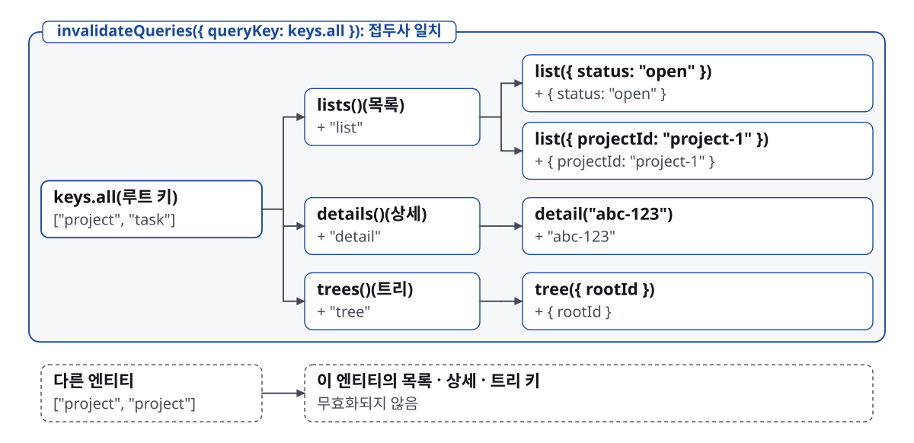

# 캐시 무효화

[English](/en/core-concepts/cache-invalidation.md) | **한국어**

## 개요

simplix-react의 캐시 무효화(cache invalidation)는 규칙에 따라 자동으로 이루어집니다. 생성, 수정, 삭제 뮤테이션(mutation)이 성공하면 프레임워크가 관련된 TanStack Query 캐시 항목을 무효화하므로 개발자가 따로 처리하지 않아도 됩니다. 이 동작은 파생한 훅에 내장되어 있고 쿼리 키 구조를 따릅니다.

캐시 무효화가 해결하는 문제는 뮤테이션 뒤에도 화면의 데이터를 서버와 일치시키는 것입니다. 자동 무효화가 없으면 개발자가 뮤테이션마다 다시 가져올 쿼리를 직접 지정해야 하는데, 이 작업은 번거롭고 실수하기 쉬우며 자주 빠뜨립니다. simplix-react는 무효화 규칙을 파생 과정 자체에 넣어 이 부담을 없앱니다.

전략은 일부러 보수적으로 정했습니다. 뮤테이션은 필요한 항목만 골라 무효화하지 않고 넓게 무효화합니다. 작업 하나를 수정하면 바뀐 항목이 들어 있는 목록이나 상세만이 아니라 그 엔티티의 모든 목록과 상세 쿼리를 오래된 것으로 표시합니다. 불필요한 재요청이 조금 늘어나는 대신, 화면에 오래된 데이터가 표시되지 않습니다.

## 동작 방식

### 쿼리 키 구조

simplix-react의 모든 쿼리 키(query key)는 계약의 `domain`과 엔티티 이름에서 시작하는 계층 구조를 따릅니다.

```text
[domain, entityName]                          // all (root)
[domain, entityName, "list"]                  // all lists
[domain, entityName, "list", { ...params }]   // specific list with filters
[domain, entityName, "detail"]                // all details
[domain, entityName, "detail", id]            // specific detail by ID
[domain, entityName, "tree"]                  // all trees
[domain, entityName, "tree", { ...params }]   // specific tree with parameters
```

예를 들어 `domain: "project"`이고 엔티티 이름이 `task`이면 키는 다음과 같습니다.

```ts
queryKeys.task.all              // ["project", "task"]
queryKeys.task.lists()          // ["project", "task", "list"]
queryKeys.task.list({ status: "open" })
                                // ["project", "task", "list", { status: "open" }]
queryKeys.task.details()        // ["project", "task", "detail"]
queryKeys.task.detail("abc-123")
                                // ["project", "task", "detail", "abc-123"]
queryKeys.task.trees()          // ["project", "task", "tree"]
```

`useInfiniteList`는 목록 매개변수에 `infinite: true`를 추가하고, 엔티티의 사용자 정의 `GET` 오퍼레이션은 `list({ operation: <name>, ...params })`를 쓰므로 둘 다 엔티티의 루트 키 아래에 있습니다.

이 계층 구조가 중요한 이유는 TanStack Query의 `invalidateQueries`가 기본적으로 접두사 일치로 동작하기 때문입니다. `["project", "task"]`를 무효화하면 `project`와 `task`로 시작하는 모든 키, 즉 그 엔티티의 모든 목록, 상세, 트리 키가 대상이 됩니다.



### 엔티티 뮤테이션의 무효화

파생한 엔티티 훅(`useCreate`, `useUpdate`, `useDelete`)은 모두 엔티티의 루트 키인 `keys.all`로 무효화합니다.

```ts
// useCreate - invalidates on success
onSuccess: () => {
  queryClient.invalidateQueries({ queryKey: keys.all });
}

// useUpdate - invalidates on settlement (success or error)
onSettled: () => {
  queryClient.invalidateQueries({ queryKey: keys.all });
}

// useDelete - invalidates on success
onSuccess: () => {
  queryClient.invalidateQueries({ queryKey: keys.all });
}
```

그래서 엔티티에 뮤테이션이 일어나면 **그 엔티티의 모든 쿼리**가 오래된 것으로 표시되고, 컴포넌트가 다음에 그 쿼리를 구독할 때 다시 가져옵니다.

### 낙관적 업데이트

`useUpdate` 훅에는 서버 응답 전에 화면을 바로 갱신하는 `optimistic` 모드가 있습니다. `optimistic: true`를 전달하면 훅이 낙관적 업데이트를 적용하지만, 이 옵션이 훅의 타입에 없으므로 타입 검사를 거치는 호출에서는 전달할 수 없습니다.

낙관적 업데이트(optimistic update) 모드를 켜면 뮤테이션은 다음 순서로 진행합니다.

1. **onMutate**: 엔티티의 진행 중인 쿼리를 취소하고, 모든 목록 데이터의 스냅샷을 저장한 뒤, 모든 목록 캐시에서 해당 항목을 미리 수정합니다
2. **onError**: 모든 목록 캐시를 스냅샷으로 되돌립니다
3. **onSettled**: 성공 여부와 관계없이 `keys.all`을 무효화해 서버 데이터를 다시 가져와 맞춥니다

화면은 바로 갱신되고, 최종 상태는 항상 서버 응답과 같습니다.

### 오퍼레이션의 무효화

최상위 오퍼레이션과 엔티티의 사용자 정의 오퍼레이션은 계약에 선언한 `invalidates` 함수를 사용합니다.

```ts
const assignTask = {
  method: "POST",
  path: "/tasks/:taskId/assign",
  input: z.object({ userId: z.string() }),
  output: z.object({ id: z.string(), assigneeId: z.string() }),
  invalidates: (queryKeys, params) => [
    queryKeys.task.all,
  ],
};
```

`invalidates` 함수는 쿼리 키 팩토리와 경로 매개변수 객체를 받아 무효화할 쿼리 키 배열을 반환합니다. 최상위 오퍼레이션의 파생 `useMutation` 훅은 뮤테이션이 성공하면 모든 엔티티의 쿼리 키 팩토리와 빈 매개변수 객체를 전달해 이 함수를 호출합니다.

```ts
onSuccess: () => {
  if (operation.invalidates) {
    const keysToInvalidate = operation.invalidates(allQueryKeys, {});
    for (const key of keysToInvalidate) {
      queryClient.invalidateQueries({ queryKey: key });
    }
  }
}
```

엔티티의 사용자 정의 뮤테이션 오퍼레이션에 `invalidates`가 없으면 그 엔티티의 `keys.all`을 무효화하고, `invalidates`가 없는 최상위 오퍼레이션은 아무것도 무효화하지 않습니다. 엔티티의 사용자 정의 오퍼레이션이면 훅은 오퍼레이션 이름을 키로 하고 그 엔티티의 쿼리 키 팩토리를 값으로 하는 항목 하나만 든 맵과 빈 매개변수 객체로 `invalidates`를 호출합니다. 예를 들어 `archive` 오퍼레이션 안에서 `queryKeys.archive.all`은 그 엔티티의 `all` 키이며, 다른 엔티티의 키는 이 맵에 없습니다. 그래서 아래의 여러 엔티티 무효화 예제는 최상위 오퍼레이션에 해당합니다.

오퍼레이션은 이 함수로 여러 엔티티에 걸친 무효화를 세밀하게 지정할 수 있습니다. 작업과 프로젝트를 함께 바꾸는 오퍼레이션이라면 둘 다 무효화합니다.

```ts
invalidates: (queryKeys) => [
  queryKeys.task.all,
  queryKeys.project.all,
],
```

### 상위-하위 엔티티의 키 관계

엔티티에 상위 엔티티가 있으면 목록 쿼리 키의 매개변수 객체에 상위 엔티티의 ID가 포함됩니다.

```ts
// task has parent: { param: "projectId", path: "/projects" }
hooks.task.useList("project-1");
// query key: ["project", "task", "list", { projectId: "project-1" }]

hooks.task.useList("project-2");
// query key: ["project", "task", "list", { projectId: "project-2" }]
```

무효화 대상이 `keys.all`(`["project", "task"]`)이므로 작업 하나에 뮤테이션이 일어나면 **모든** 상위 엔티티 범위의 작업 목록이 무효화됩니다. 오래된 캐시를 놓치는 것보다 넓게 무효화하는 편이 안전하므로 의도한 동작입니다. 작업을 한 프로젝트에서 다른 프로젝트로 이동하면 두 프로젝트의 작업 목록을 모두 다시 가져와야 합니다.

## 설계 결정

### 필요한 항목만 갱신하지 않고 넓게 무효화하는 이유

필요한 항목만 갱신하는 방식은 뮤테이션의 영향을 받는 캐시 항목만 고칩니다(예: 바뀐 항목이 들어 있는 목록 하나만 갱신하거나 해당 ID의 상세 캐시만 수정). 효율은 더 좋지만 쉽게 깨집니다.

- 바뀐 항목이 어느 목록에 들어 있는지 알아야 하고, 이는 필터 매개변수에 따라 달라집니다
- 정렬 순서나 필터 포함 여부에 영향을 주는 필드가 바뀌면 동작하지 않습니다
- 새 목록 쿼리를 추가하고 무효화 로직을 고치지 않으면 찾기 어려운 버그가 생깁니다

넓은 무효화(`keys.all`)는 기본 상태에서 정확합니다. 재요청이 몇 번 늘어나는 비용은 대부분의 애플리케이션에서 무시할 만합니다. TanStack Query는 동시에 들어온 같은 요청을 하나로 합치고, 마운트된 컴포넌트가 구독 중인 쿼리만 다시 가져오기 때문입니다.

### 낙관적 업데이트를 선택 사항으로 둔 이유

낙관적 업데이트는 스냅샷 관리, 되돌리기 로직, 서버 데이터와의 조정으로 복잡도를 높입니다. 체감 지연 시간이 중요한, 자주 반복하는 상호작용에는 쓸모가 있지만 대부분의 CRUD 오퍼레이션에는 필요하지 않습니다. 선택 사항(`optimistic: true`)으로 두면 기본 경로는 단순하게 유지하고, 필요한 경우에만 이 기능을 쓸 수 있습니다.

### 오퍼레이션이 무효화 대상을 선언하는 이유

엔티티 뮤테이션의 무효화 대상은 그 엔티티 자신으로 예측할 수 있으므로 프레임워크가 자동으로 처리합니다. 오퍼레이션은 어떤 엔티티 조합에도 영향을 줄 수 있고, 어느 엔티티인지는 개발자만 압니다. 프레임워크는 추측하지 않고 `invalidates` 함수를 선언 방식의 탈출구로 제공합니다.

그래서 무효화 규칙이 컴포넌트 코드에 흩어지지 않고 오퍼레이션 정의 옆에 있으며, 계약이 유일한 기준으로 남습니다.

## `useInvalidateEntity`로 직접 무효화하기

파생 훅을 거치지 않는 Orval 생성 엔드포인트(예: 사용자 정의 PUT 엔드포인트, 일괄 처리)에는 `useInvalidateEntity` 훅으로 접두사 기반 무효화를 직접 실행합니다.

### 기본 사용법

```ts
import { useInvalidateEntity } from "@simplix-react/ui";

const invalidate = useInvalidateEntity("/api/v1/holiday-type");
```

반환된 함수는 첫 번째 키 요소가 지정한 URL 접두사로 시작하는 문자열인 쿼리를 모두 무효화합니다. `readsUnder(apiPrefix)`는 같은 판정을 `invalidateQueries`용 조건 함수로 제공합니다. SimpliX Meta로 생성한 도메인은 엔티티마다 접두사를 `<entity>EntityPath`로 내보내므로 경로를 직접 입력하지 말고 그 값을 전달하세요. 반환된 함수는 `Promise<void>`를 반환하며, 일치하는 쿼리를 모두 다시 가져오면 이행됩니다.

### 기다리지 않는 호출(CrudForm, 스캐폴딩한 코드)

저장 후 컴포넌트가 다른 화면으로 이동하면 기다릴 필요가 없습니다.

```ts
// OK: component unmounts after save, no stale flash risk
adaptOrvalCreate(_create, { onSettled: invalidate });
adaptOrvalUpdate(_update, "id", { onSettled: invalidate });
```

### 기다리는 호출(인라인 편집기)

저장 후에도 컴포넌트가 마운트된 상태로 로컬 상태를 초기화하면, 오래된 캐시 데이터가 잠깐 표시되지 않도록 무효화를 **반드시** 기다려야 합니다.

```ts
// REQUIRED: inline editor that resets draft state after save
await saveAll.mutateAsync({ data: { items } });
await invalidate();   // wait for refetch to complete
reset();              // now safe: UI shows fresh server data
```

`await`가 없으면 다시 가져오기가 끝나기 전에 `reset()`이 실행되어 컴포넌트가 한 프레임 동안 오래된 캐시 데이터로 렌더링됩니다.

## 영향

### 화면 일관성

표준 CRUD 오퍼레이션에서는 개발자가 캐시 무효화를 신경 쓰지 않아도 됩니다. 파생한 훅이 자동으로 처리합니다. `useCreate` 뮤테이션이 성공하면 그 엔티티의 `useList`나 `useGet`을 쓰는 마운트된 컴포넌트는 다시 가져오기를 호출하지 않아도 최신 데이터를 표시합니다.

### 성능

넓게 무효화하므로 불필요한 재요청이 일부 생길 수 있습니다. 실제로는 다음 이유로 문제가 되는 경우가 드뭅니다.

- TanStack Query는 구독 중인 쿼리(마운트된 컴포넌트가 있는 쿼리)만 다시 가져옵니다
- 오래된 쿼리는 백그라운드에서 다시 가져오므로, 그동안 화면에는 캐시 데이터가 바로 표시됩니다
- 같은 네트워크 요청은 하나로 합칩니다

### 사용자 정의 오퍼레이션

엔티티 경계를 넘는 오퍼레이션(예: 작업에도 영향을 주는 「프로젝트 보관」)은 `invalidates` 함수로 무효화 대상을 명시해야 합니다. 개발자가 캐시 무효화를 직접 판단하는 곳은 여기뿐이며, 프레임워크가 쿼리 키 팩토리를 제공하므로 어렵지 않습니다.

---

<p class="page-source"><a href="https://github.com/simplix-framework/simplix-react/blob/main/docs/ko/core-concepts/cache-invalidation.md" target="_blank" rel="noopener noreferrer">원본 보기</a></p>
