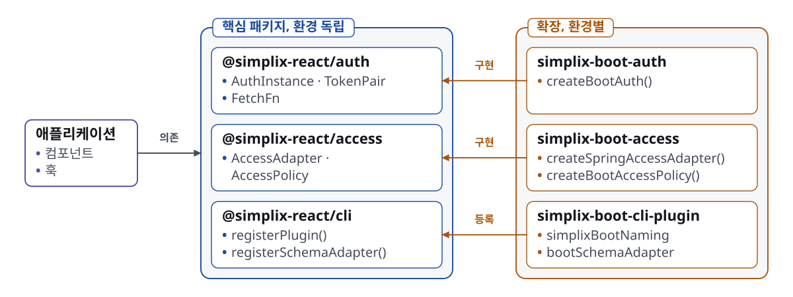

# 확장

[English](/en/core-concepts/extensions.md) | **한국어**

## 개요

확장(extension)은 simplix-react 핵심 패키지가 정의한 추상 인터페이스를 특정 환경에 맞게 구현합니다. 핵심 패키지(`packages/`)는 어떤 환경에서도 쓸 수 있도록 환경에 의존하지 않게 설계하고, 확장은 특정 백엔드 플랫폼, 서버 프레임워크, 인프라 구성에 필요한 부분을 맡습니다.

핵심 패키지는 사용자 인증, 권한 확인, OpenAPI 명세에서 코드 생성처럼 _무엇을_ 해야 하는지는 정의하지만, 특정 백엔드에서 _어떻게_ 하는지는 정의하지 않습니다. 확장은 구체적인 환경에 맞춰 이 추상 계약을 구현해 그 차이를 메우고, 애플리케이션 코드를 백엔드가 바뀌어도 그대로 쓸 수 있게 유지합니다.

## 동작 방식

확장은 제공자 패턴을 따릅니다. 핵심 패키지가 추상 인터페이스를 정의하고, 확장이 구체적인 구현을 제공합니다.



| 핵심 패키지 | 인터페이스 | simplix-boot 패키지 | 구현 |
| --- | --- | --- | --- |
| `@simplix-react/auth` | `AuthInstance`, `TokenPair`, `FetchFn` | `@simplix-react-ext/simplix-boot-auth` | `createBootAuth()` |
| `@simplix-react/access` | `AccessAdapter`, `AccessPolicy` | `@simplix-react-ext/simplix-boot-access` | `createSpringAccessAdapter()`, `createBootAccessPolicy()` |
| `@simplix-react/cli` | `registerPlugin()`, `registerSchemaAdapter()` | `@simplix-react-ext/simplix-boot-cli-plugin` | `simplixBootNaming`, `bootSchemaAdapter` |

`simplix-boot-cli-plugin`은 인터페이스를 구현하지 않습니다. 진입점에서 `registerPlugin()`과 `registerSchemaAdapter()`로 CLI에 등록합니다.

컴포넌트와 훅은 핵심 인터페이스에 의존하고, 애플리케이션의 부트스트랩 파일이 확장을 가져와 그 구현을 연결합니다. 나중에 백엔드를 바꾸면(예: Spring Boot에서 다른 프레임워크로) 확장만 교체하며, 컴포넌트와 훅은 그대로 둡니다.

### 이름 규칙

백엔드 확장 패키지는 `@simplix-react-ext/` 스코프 접두사를 사용합니다.

```text
@simplix-react-ext/<extension>-<sub-package>
```

예를 들어 simplix-boot 확장의 패키지는 다음과 같습니다.

- `@simplix-react-ext/simplix-boot-auth`
- `@simplix-react-ext/simplix-boot-access`
- `@simplix-react-ext/simplix-boot-cli-plugin`
- `@simplix-react-ext/simplix-boot-stream`
- `@simplix-react-ext/simplix-boot-utils`

백엔드가 아니라 React Native를 대상으로 하는 native 확장은 별도 스코프를 사용합니다. 핵심 패키지는 `@simplix-react-native/*`, 기기 계층 패키지는 `@simplix-react-native-ext/*`, 메타 패키지는 `simplix-react-native`입니다.

### 디렉터리 구조

확장은 모노레포 루트의 `extensions/` 아래에 있습니다. 확장마다 하위 패키지를 포함하는 독립된 pnpm 워크스페이스입니다.

```text
simplix-react/
  packages/                         # Core packages (universal)
    auth/                           #   Abstract auth interfaces
    access/                         #   Abstract access control
    cli/                            #   CLI with plugin registry
    ...
  extensions/                       # Environment-specific implementations
    simplix-boot/                   #   Spring Boot adapters
      package.json                  #     Workspace root (private: true)
      pnpm-workspace.yaml           #     packages: ["packages/*"]
      packages/
        auth/                       #     Boot authentication
        access/                     #     Boot access control
        cli-plugin/                 #     CLI spec profile
        stream/                     #     SSE streaming hooks
        utils/                      #     Boot-specific utilities
```

### 워크스페이스 등록

확장의 하위 패키지는 루트 `pnpm-workspace.yaml`에 등록해 모노레포의 빌드와 의존성 그래프에 포함합니다.

```yaml
packages:
  - packages/*
  - apps/*
  - extensions/simplix-boot/packages/*
  - extensions/native/packages/*
```

그래서 `pnpm build`, `pnpm test`, Turborepo 파이프라인이 확장 패키지를 자동으로 포함합니다.

### 피어 의존성 모델

확장 패키지는 바탕이 되는 핵심 패키지를 직접 의존성이 아닌 `peerDependencies`로 선언합니다. 그래서 버전이 중복되지 않고, 확장과 애플리케이션이 같은 핵심 패키지 인스턴스를 사용합니다.

```json
{
  "peerDependencies": {
    "@simplix-react/auth": "workspace:*",
    "@simplix-react/contract": "workspace:*"
  }
}
```

애플리케이션은 핵심 패키지와 확장을 함께 설치합니다. 확장은 애플리케이션의 `node_modules`에서 핵심 패키지를 찾으므로 인스턴스 하나를 공유합니다.

### CLI 플러그인 로딩

CLI는 특정 백엔드에 의존하지 않으며 어떤 확장도 코드에 고정하지 않습니다. 프로젝트마다 `simplix.config.ts`의 `plugins` 필드에 불러올 확장 플러그인을 선언합니다.

```ts
// simplix.config.ts
import { defineConfig } from "@simplix-react/cli";

export default defineConfig({
  plugins: ["@simplix-react-ext/simplix-boot-cli-plugin"],
  // ...
});
```

CLI는 시작할 때 `config.plugins`를 읽고 선언된 모듈을 하나씩 동적으로 가져옵니다. 플러그인의 진입점은 `@simplix-react/cli`의 `registerPlugin()`과 `registerSchemaAdapter()`를 호출해 명세 프로필과 스키마 어댑터를 CLI의 전역 레지스트리에 등록합니다. `openapi` 명세가 참조하는 `profile`의 플러그인이 목록에 없거나 찾을 수 없으면, `openapi` 명령은 잘못된 코드를 생성하지 않고 오류를 보고한 뒤 종료합니다.

그래서 CLI는 컴파일 시점에 확장을 전혀 알 필요가 없습니다. 어떤 확장이든 플러그인 패키지를 배포해 CLI 기능을 추가하고, 프로젝트는 `plugins`에 그 패키지를 나열해 사용합니다.

## 제공하는 확장

### simplix-boot (Spring Boot)

SimpleCORE의 Spring Boot 기반 백엔드 프레임워크인 SimpliX용 어댑터입니다. SimpliX의 Spring Security API에 맞춰 simplix-react 핵심 인터페이스를 구현합니다.

| 패키지 | 핵심 패키지 | 설명 |
| --- | --- | --- |
| `@simplix-react-ext/simplix-boot-auth` | `@simplix-react/auth` | Spring Security 인증: 토큰 발급, 갱신, 폐기, 사용자 프로필, Boot 응답 봉투 처리, `ApiResponseError` |
| `@simplix-react-ext/simplix-boot-access` | `@simplix-react/access` | Spring Security 인가: 권한을 CASL 규칙으로 변환, `AccessAdapter` 구현 |
| `@simplix-react-ext/simplix-boot-cli-plugin` | `@simplix-react/cli` | CLI 명세 프로필: Boot 이름 규칙, 응답 어댑터(응답 봉투 형식), 스키마 어댑터(응답 봉투 해제) |
| `@simplix-react-ext/simplix-boot-stream` | (독립, React) | SSE 스트리밍: `StreamProvider`, `useStreamSubscription`, `useStreamStatus`, 오래된 데이터 감지 |
| `@simplix-react-ext/simplix-boot-utils` | `@simplix-react/api` | Spring 열거형 객체를 처리하는 `resolveBootEnum()` 같은 Boot 전용 유틸리티 |

인증 패키지의 `createBootAuth()`는 자동 갱신, 탭 간 동기화, Boot 응답 봉투(envelope) 해제를 포함한 Bearer 토큰 인증을 한 번의 호출로 구성합니다. 인가(authorization) 패키지의 `createSpringAccessAdapter()`와 `createBootAccessPolicy()`는 Spring Security 권한 응답을 CASL 규칙으로 변환합니다. CLI 플러그인은 `simplix-boot` 명세 프로필을 등록하므로, `simplix openapi`가 Boot 형식의 OpenAPI 명세에서 도메인 패키지를 생성합니다.

### native (React Native)

Expo로 만드는 React Native 앱을 위한 모바일 UI 키트, Expo 런타임 연결 코드, 기기 계층 패키지(촬영, 키오스크, QR, 서명)입니다. `extensions/native/` 아래의 별도 워크스페이스이며, 자세한 내용은 [해당 README](/ko/extensions/native/README.md)를 참고하세요.

## 새 확장 만들기

새 백엔드 환경용 확장을 만드는 순서는 다음과 같습니다.

1. **디렉터리 구조를 만듭니다.** `extensions/<extension-name>/` 아래에 비공개 `package.json`, `pnpm-workspace.yaml`, `packages/` 디렉터리를 둡니다.

2. **루트 워크스페이스에 등록합니다.** 루트 `pnpm-workspace.yaml`에 `"extensions/<extension-name>/packages/*"`를 추가합니다.

3. **하위 패키지를 구현합니다.** 핵심 인터페이스의 구체적인 구현을 제공하고, 하위 패키지마다 관련 핵심 패키지를 `peerDependency`로 선언합니다.

4. **CLI와 연동하려면** 진입점에서 `registerPlugin()`과 `registerSchemaAdapter()`를 호출하는 CLI 플러그인 패키지를 만듭니다. 프로젝트는 `simplix.config.ts`의 `plugins` 배열에 그 패키지 이름을 추가해 불러옵니다.

5. **이름 규칙을 따릅니다.** `@simplix-react-ext/<extension-name>-<sub-package>` 형식을 사용합니다.

확장은 루트 Turborepo 파이프라인에 자동으로 포함됩니다.

```bash
# Build all (including extensions)
pnpm build

# Test a specific extension package
pnpm --filter @simplix-react-ext/simplix-boot-access test
```

## 설계 결정

### 핵심 패키지와 분리하는 이유

핵심 패키지는 모든 사용자가 쓸 수 있도록 환경에 의존하지 않아야 합니다. `@simplix-react/auth`에 Spring Boot 전용 로직을 넣으면 Boot를 쓰지 않는 사용자도 관계없는 코드와 의존성까지 설치해야 합니다. 확장으로 분리하면 핵심 패키지를 가볍게 유지하면서도 특정 백엔드와 완전하게 연동할 수 있습니다.

### 피어 의존성을 쓰는 이유

피어 의존성은 버전 중복을 막습니다. 확장이 `@simplix-react/auth` 사본을 따로 포함하면 애플리케이션에 인증 인스턴스가 앱의 것과 확장의 것으로 나뉘어 상태가 갈라지고 찾기 어려운 버그가 생깁니다. 피어 의존성을 쓰면 인스턴스 하나를 공유합니다.

### 구성에 따라 플러그인을 불러오는 이유

정적으로 가져오면 CLI가 빌드 시점에 모든 확장에 의존하게 됩니다. 대신 프로젝트마다 필요한 플러그인을 `simplix.config.ts`에 선언하고, CLI는 시작할 때 이를 동적으로 가져옵니다. 그래서 CLI는 특정 백엔드에 의존하지 않고(확장 이름을 코드에 고정하지 않음) 의존성도 최소한으로 유지하며, 참조한 명세 프로필의 플러그인이 없으면 오류를 분명하게 보고합니다.

## 관련 문서

- [확장 가이드](/ko/guides/extensions.md): Boot 확장을 설정하고 사용하는 방법
- [인증 구조](/ko/core-concepts/authentication.md): 확장이 구현하는 핵심 인증 설계
- [API 계약](/ko/core-concepts/api-contracts.md): 계약과 `fetchFn`이 함께 동작하는 방식

---

<p class="page-source"><a href="https://github.com/simplix-framework/simplix-react/blob/main/docs/ko/core-concepts/extensions.md" target="_blank" rel="noopener noreferrer">원본 보기</a></p>
