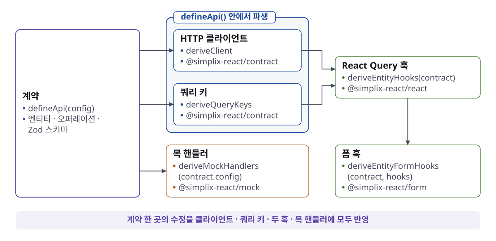

# 스키마 파생

[English](/en/core-concepts/schema-derivation.md) | **한국어**

## 개요

스키마 파생은 선언적으로 작성한 API 계약(contract) 하나에서 API를 호출하는 코드를 얻는 과정입니다. HTTP 클라이언트, 쿼리 키 팩토리, React Query 훅, 폼 훅, MSW 목(mock) 핸들러가 그 대상입니다. `defineApi()`를 한 번 호출하면 각 계층을 그 계약의 Zod 스키마와 오퍼레이션(operation) 경로에서 파생합니다.

그래서 모든 계층이 같은 타입, 같은 URL, 같은 검증 규칙을 사용합니다. Zod 스키마를 바꾸면 클라이언트, 훅, 목 핸들러가 함께 바뀝니다. 모두 같은 정의를 읽기 때문입니다.

계층을 손으로 따로 작성할 때 생기는 결함도 사라집니다. 응답과 타입이 달라진 훅, 엔티티 이름을 바꾼 뒤에 그대로 남은 쿼리 키, API에서 없어진 엔드포인트에 계속 응답하는 목 핸들러가 그런 결함입니다.

## 동작 방식



입력은 계약 하나뿐입니다. `defineApi()`는 계약을 조립하면서 클라이언트와 쿼리 키를 파생하고, 나머지 패키지는 그 계약에서 각자의 계층을 파생합니다.

| 단계 | 함수 | 패키지 | 파생 결과 |
| --- | --- | --- | --- |
| 1 | `defineApi` | `@simplix-react/contract` | 계약: `config`, `client`, `queryKeys` |
| 2 | `deriveClient` | `@simplix-react/contract` | 오퍼레이션마다 타입이 지정된 함수 |
| 3 | `deriveQueryKeys` | `@simplix-react/contract` | 엔티티마다 쿼리 키 팩토리 |
| 4 | `deriveEntityHooks` | `@simplix-react/react` | 오퍼레이션마다 React Query 훅 |
| 5 | `deriveEntityFormHooks` | `@simplix-react/form` | 생성 · 수정 오퍼레이션의 TanStack Form 훅 |
| 6 | `deriveMockHandlers` | `@simplix-react/mock` | 오퍼레이션마다 MSW 핸들러 |

### 1단계: defineApi (계약 조립)

`defineApi()`가 진입점입니다. 도메인 이름, 기본 경로, 엔티티, 선택 항목인 최상위 오퍼레이션과 쿼리 빌더를 담은 `ApiContractConfig`를 받습니다. `deriveClient()`와 `deriveQueryKeys()`를 호출하고, `config`, `client`, `queryKeys` 속성이 있는 계약을 반환합니다.

```ts
// packages/contract/src/define-api.ts
export function defineApi(config, options?) {
  return {
    config,
    client: deriveClient(config, options?.fetchFn),
    queryKeys: deriveQueryKeys(config),
  };
}
```

엔티티는 Zod 스키마 하나와 오퍼레이션 맵으로 구성합니다. 오퍼레이션마다 HTTP 메서드와 경로를 적습니다.

```ts
import { z } from "zod";
import { defineApi, simpleQueryBuilder } from "@simplix-react/contract";

const taskSchema = z.object({ id: z.string(), title: z.string(), status: z.enum(["open", "done"]) });

export const api = defineApi({
  domain: "project",
  basePath: "/api",
  entities: {
    task: {
      schema: taskSchema,
      operations: {
        list: { method: "GET", path: "/tasks" },
        get: { method: "GET", path: "/tasks/:id" },
        create: { method: "POST", path: "/tasks", input: taskSchema.omit({ id: true }) },
        update: { method: "PATCH", path: "/tasks/:id", input: taskSchema.partial().omit({ id: true }) },
        delete: { method: "DELETE", path: "/tasks/:id" },
        archive: { method: "POST", path: "/tasks/:id/archive" },
      },
    },
  },
  queryBuilder: simpleQueryBuilder,
});
```

### 오퍼레이션의 역할

이후의 모든 단계는 오퍼레이션의 역할을 보고 무엇을 파생할지 정합니다. 이름이 `list`, `get`, `create`, `update`, `delete`, `tree`인 오퍼레이션은 그 이름이 역할입니다. 다른 이름의 오퍼레이션은 `role`로 역할을 지정했을 때만 그 역할을 갖고, 지정하지 않으면 사용자 정의 오퍼레이션입니다. 위 계약에서는 `archive`가 사용자 정의 오퍼레이션입니다.

### 2단계: deriveClient (HTTP 클라이언트 파생)

`deriveClient()`는 엔티티의 오퍼레이션마다, 그리고 최상위 오퍼레이션마다 함수를 하나씩 파생합니다. 함수의 형태는 역할에 따라 정해집니다.

```ts
api.client.task.list({ filters: { status: "open" } }); // GET /api/tasks with the filters as query parameters
api.client.task.get(id);                               // GET /api/tasks/:id
api.client.task.create(dto);                           // POST /api/tasks
api.client.task.update(id, dto);                       // PATCH /api/tasks/:id
api.client.task.delete(id);                            // DELETE /api/tasks/:id

// A custom operation takes its path parameters in order, then its input.
api.client.task.archive(id);                           // POST /api/tasks/:id/archive
```

- **상위 엔티티를 반영한 URL**: 엔티티에 `parent`가 있으면 `list`와 `create`는 상위 엔티티의 ID를 첫 인자로 받고 상위 경로를 앞에 추가합니다(`/projects/:projectId/tasks`).
- **쿼리 매개변수**: `list`는 필터, 정렬, 페이지네이션을 계약에 지정한 쿼리 빌더의 `buildSearchParams()`에 전달합니다.
- **요청과 응답 형식**: `contentType: "multipart"`인 사용자 정의 오퍼레이션은 입력을 `FormData`로 전송하고, `responseType: "blob"`인 오퍼레이션은 바이너리 데이터를 반환합니다. `transformRequest`와 `transformResponse`를 지정하면 기본 직렬화 대신 사용합니다.
- **fetch 교체**: `defineApi()`의 `fetchFn` 옵션으로 HTTP 함수를 교체합니다. 인증 헤더를 추가할 때 사용합니다.

### 3단계: deriveQueryKeys (쿼리 키 팩토리 파생)

`deriveQueryKeys()`는 엔티티마다 `QueryKeyFactory`를 만듭니다. 키는 TanStack Query가 권장하는 계층 구조입니다.

```ts
api.queryKeys.task.all;              // ["project", "task"]
api.queryKeys.task.lists();          // ["project", "task", "list"]
api.queryKeys.task.list({ status }); // ["project", "task", "list", { status }]
api.queryKeys.task.details();        // ["project", "task", "detail"]
api.queryKeys.task.detail(id);       // ["project", "task", "detail", id]
api.queryKeys.task.trees();          // ["project", "task", "tree"]
api.queryKeys.task.tree(params);     // ["project", "task", "tree", params]
```

`queryKeys.task.all`을 무효화하면 그 엔티티의 모든 쿼리가 무효화됩니다. `queryKeys.task.lists()`를 무효화하면 목록 쿼리만 무효화되고 상세 쿼리는 유지됩니다.

### 4단계: deriveEntityHooks (React Query 훅 파생)

`@simplix-react/react`의 `deriveEntityHooks()`는 계약을 받아 오퍼레이션마다 훅을 하나씩 파생합니다. 훅 이름은 `use`로 시작하고 오퍼레이션 이름이 이어집니다.

| 역할 | 훅 | TanStack 기본 훅 | 동작 |
| --- | --- | --- | --- |
| `list` | `useList` | `useQuery` | 목록을 조회합니다. 상위 엔티티 ID, 필터, 정렬, 페이지네이션을 받습니다 |
| `list` | `useInfiniteList` | `useInfiniteQuery` | `useList`와 함께 파생되며 무한 스크롤에 사용합니다 |
| `get` | `useGet` | `useQuery` | ID로 엔티티 하나를 조회합니다 |
| `create` | `useCreate` | `useMutation` | 엔티티를 생성하고 `queryKeys.<entity>.all`을 무효화합니다 |
| `update` | `useUpdate` | `useMutation` | 엔티티를 수정하고 `queryKeys.<entity>.all`을 무효화합니다. `optimistic: true`를 주면 낙관적 업데이트를 적용하지만, 이 옵션은 훅의 타입에 없습니다 |
| `delete` | `useDelete` | `useMutation` | 엔티티를 삭제하고 `queryKeys.<entity>.all`을 무효화합니다 |
| `tree` | `useTree` | `useQuery` | 엔티티를 계층 구조로 조회합니다 |
| 사용자 정의, `GET` | `use<Operation>` | `useQuery` | 오퍼레이션을 쿼리로 실행합니다 |
| 사용자 정의, 그 밖의 메서드 | `use<Operation>` | `useMutation` | 오퍼레이션을 실행하고 `invalidates`가 반환한 키를 무효화합니다. `invalidates`가 없으면 `queryKeys.<entity>.all`을 무효화합니다 |

최상위 오퍼레이션에는 `hooks.<operation>.useMutation()`이 파생되며, `invalidates`가 반환한 키를 무효화합니다.

모든 훅은 TanStack Query 옵션을 받습니다. 쿼리의 `queryKey`와 `queryFn`, 뮤테이션의 `mutationFn`은 파생 계층이 지정합니다.

### 5단계: deriveEntityFormHooks (폼 훅 파생)

`@simplix-react/form`의 `deriveEntityFormHooks()`는 계약과 4단계의 훅을 받습니다. `create` 오퍼레이션이 있는 엔티티에는 `useCreateForm`을, `update` 오퍼레이션이 있는 엔티티에는 `useUpdateForm`을 파생합니다. 폼 훅은 TanStack Form을 뮤테이션에 연결하고, 수정할 때는 바뀐 필드만 전송하며, 서버의 검증 오류를 해당 필드에 표시합니다.

### 6단계: deriveMockHandlers (MSW 핸들러 파생)

`@simplix-react/mock`의 `deriveMockHandlers()`는 `contract.config`를 읽어 오퍼레이션마다 MSW 핸들러를 파생합니다. 핸들러는 인메모리 저장소에서 데이터를 읽고 씁니다.

| 역할 | 핸들러 |
| --- | --- |
| `list` | 쿼리 매개변수에 따라 필터링하고, 정렬하고, 오프셋 기준으로 페이지를 나눕니다 |
| `get` | 레코드 하나를 반환합니다. 목 설정에 `belongsTo` 관계를 선언했으면 관계 데이터를 함께 반환합니다 |
| `create` | 레코드를 저장합니다. 요청에 `id`가 없으면 숫자 `id`를 부여하고 `createdAt`과 `updatedAt`을 기록합니다 |
| `update` | 요청 내용을 레코드에 병합하고 `updatedAt`을 갱신합니다 |
| `delete` | `id`에 해당하는 레코드를 삭제합니다 |
| `tree` | 레코드를 계층 구조로 반환합니다 |
| 사용자 정의 | 200으로 응답합니다. 목 설정에 그 오퍼레이션의 리졸버가 있으면 리졸버를 실행합니다 |

## 설계 결정

### 직접 연결하지 않고 파생하는 이유

직접 연결하면 엔드포인트마다 HTTP 호출, 쿼리 키, React 훅, 목 핸들러를 따로 작성해야 합니다. 그러면 다음 결함이 생깁니다.

- **타입 불일치**: 훅의 반환 타입이 실제 응답과 달라집니다.
- **낡은 키**: 복사해 둔 쿼리 키를 엔드포인트가 바뀔 때 고치지 않습니다.
- **불완전한 목**: 목 핸들러에 API 변경이 늦게 반영됩니다.

파생하면 이 결함이 발생하지 않습니다. 모든 계층이 같은 Zod 스키마와 같은 경로를 읽으므로 계층끼리 어긋날 수 없습니다. 대신 컴포넌트와 HTTP 호출 사이에 추상화 계층이 하나 더 생깁니다.

### 단계마다 함수를 분리한 이유

파이프라인은 서로 독립된 함수로 구성됩니다.

- **패키지 분리**: `deriveClient`와 `deriveQueryKeys`는 `@simplix-react/contract`에, `deriveEntityHooks`는 `@simplix-react/react`에, `deriveEntityFormHooks`는 `@simplix-react/form`에, `deriveMockHandlers`는 `@simplix-react/mock`에 있습니다. 사용하는 패키지만 설치하면 됩니다.
- **트리 셰이킹**: 프로덕션에서 목을 사용하지 않는 애플리케이션의 번들에는 `@simplix-react/mock`이 포함되지 않습니다.
- **확장성**: 새 파생 대상은 계약을 읽는 새 패키지로 추가하며, 기존 패키지는 수정하지 않습니다.

### 계약 객체에 config, client, queryKeys를 함께 담는 이유

계약을 사용하는 쪽마다 필요한 부분이 다릅니다. `deriveEntityHooks()`는 `config`의 오퍼레이션, `client`의 쿼리 함수와 뮤테이션 함수, `queryKeys`의 캐시 키를 모두 사용합니다. `deriveEntityFormHooks()`에는 `config`와 파생된 훅이, `deriveMockHandlers()`에는 `config`만 필요합니다. 객체 하나만 전달하면 되고, 타입은 TypeScript가 끝까지 전달합니다.

## 영향

### 엔티티 추가

엔티티를 추가하려면 `entities`에 스키마와 오퍼레이션을 담은 항목 하나를 추가합니다. 클라이언트 함수, 쿼리 키, 훅, 폼 훅, 목 핸들러는 그 항목에서 파생됩니다. 따로 등록할 것이 없고 코드 생성 단계도 실행하지 않습니다.

### 스키마 변경

Zod 스키마를 변경하면 그 변경에 맞지 않는 컴포넌트마다 TypeScript 오류가 발생합니다. `update`의 입력에 필수 필드를 추가하면, 그 필드를 보내지 않는 `useUpdate` 호출을 컴파일러가 모두 알려 줍니다.

### 사용자 정의 동작 추가

표준 역할에 해당하지 않는 엔드포인트는 엔티티의 `operations`에 고유한 이름으로 추가합니다. 어느 엔티티에도 속하지 않으면 계약의 최상위 `operations`에 추가합니다. 입력 스키마와 출력 스키마, `invalidates` 함수를 지정합니다. 이렇게 추가한 오퍼레이션에도 클라이언트 함수, 훅, 목 핸들러가 파생됩니다.

---

<p class="page-source"><a href="https://github.com/simplix-framework/simplix-react/blob/main/docs/ko/core-concepts/schema-derivation.md" target="_blank" rel="noopener noreferrer">원본 보기</a></p>
