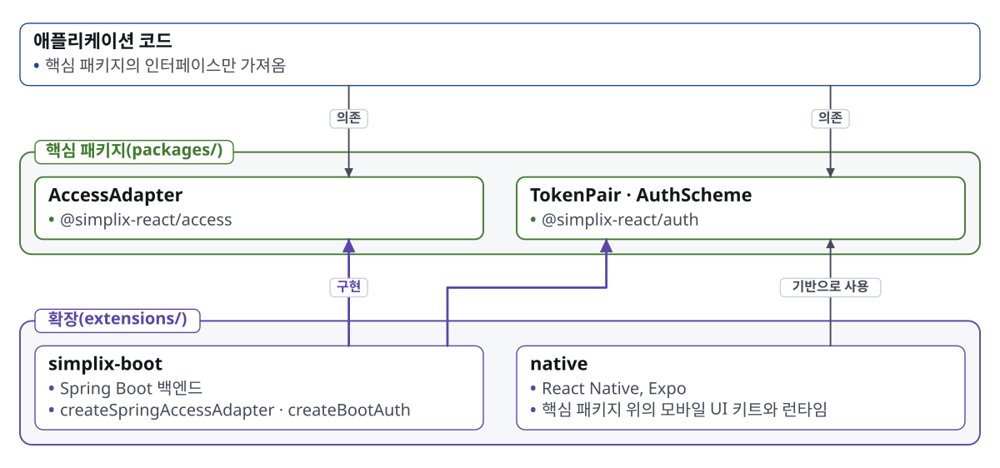

# 확장

[English](/en/extensions/README.md) | **한국어**

확장(extension)은 핵심 `simplix-react` 프레임워크가 범용으로 다룰 수 없는 환경별 구현을 제공합니다. 핵심 패키지(`packages/`)는 어느 환경에서나 쓸 수 있게 설계하고, 확장은 특정 플랫폼, 서버 프레임워크, 인프라 구성에 필요한 부분을 맡습니다.

각 확장은 `extensions/` 아래 자체 워크스페이스에 있으며 환경 하나를 맡습니다. simplix-boot는 핵심 인터페이스를 Spring Boot용으로 구현하고(CLI 플러그인은 구현 대신 CLI에 등록합니다), native는 핵심 인터페이스를 구현하지 않고 핵심 패키지를 React Native에서 재사용합니다.

## 구조

```text
simplix-react/
  packages/           # Core packages (universal, environment-agnostic)
    auth/             #   Abstract auth interfaces
    access/           #   Abstract access control interfaces
    ...
  extensions/         # Environment-specific implementations
    simplix-boot/     #   Spring Boot / Spring Security adapters
```



핵심 패키지는 추상 계약(예: `AccessAdapter`, `TokenPair`)을 정의합니다. simplix-boot는 이 계약을 Spring Boot용으로 구현하므로 컴포넌트와 훅은 환경을 바꿔도 그대로 쓸 수 있고, 확장을 가져오는 곳은 부트스트랩 파일뿐입니다.

## 제공하는 확장

| 확장 | 대상 환경 | 패키지 | 설명 |
| --- | --- | --- | --- |
| [simplix-boot](/ko/extensions/simplix-boot/README.md) | SimpliX (Spring Boot) | `@simplix-react-ext/simplix-boot-access`, `@simplix-react-ext/simplix-boot-auth`, `@simplix-react-ext/simplix-boot-cli-plugin`, `@simplix-react-ext/simplix-boot-stream`, `@simplix-react-ext/simplix-boot-utils` | SimpliX Spring Security 인증·인가 어댑터, CLI 명세 프로필, SSE 스트리밍, Boot 유틸리티 |
| [native](/ko/extensions/native/README.md) | React Native (Expo) | `@simplix-react-native/ui`, `@simplix-react-native/runtime`, `@simplix-react-native-ext/*`, `simplix-react-native` | 모바일 UI 키트, Expo 런타임 연결 코드, 기기 계층 패키지 |

## 새 확장 만들기

확장은 `extensions/` 안에 중첩된 독립 pnpm 워크스페이스입니다. 각 확장은 다음 조건을 갖춥니다.

1. 자체 `pnpm-workspace.yaml`과 `package.json`이 있습니다
2. `packages/` 아래에 하위 패키지를 하나 이상 둡니다
3. 핵심 패키지를 `peerDependencies`로 선언합니다
4. 루트 `pnpm-workspace.yaml`에 등록합니다

### 디렉터리 구조

```text
extensions/
  <extension-name>/
    package.json            # Workspace root (private: true)
    pnpm-workspace.yaml     # packages: ["packages/*"]
    tsconfig.json           # Shared compiler options
    packages/
      <sub-package>/
        package.json        # Published package
        tsconfig.json
        tsup.config.ts
        vitest.config.ts
        src/
          index.ts          # Public API exports
          types.ts          # Extension-specific types
          ...
```

### 등록

루트 `pnpm-workspace.yaml`에 확장의 패키지를 추가하세요.

```yaml
packages:
  - "packages/*"
  - "apps/*"
  - "extensions/<extension-name>/packages/*"
```

### 피어 의존성

확장 패키지는 버전 충돌을 막기 위해 핵심 패키지를 피어 의존성으로 선언합니다.

```json
{
  "peerDependencies": {
    "@simplix-react/auth": "workspace:*",
    "@simplix-react/contract": "workspace:*"
  }
}
```

## 빌드와 테스트

확장은 루트 Turborepo 파이프라인에 함께 참여합니다.

```bash
# Build all (including extensions)
pnpm build

# Test all (including extensions)
pnpm test

# Build/test a specific extension package
pnpm --filter @simplix-react-ext/simplix-boot-access build
pnpm --filter @simplix-react-ext/simplix-boot-access test
```

---

<p class="page-source"><a href="https://github.com/simplix-framework/simplix-react/blob/main/extensions/README.ko.md" target="_blank" rel="noopener noreferrer">원본 보기</a></p>
