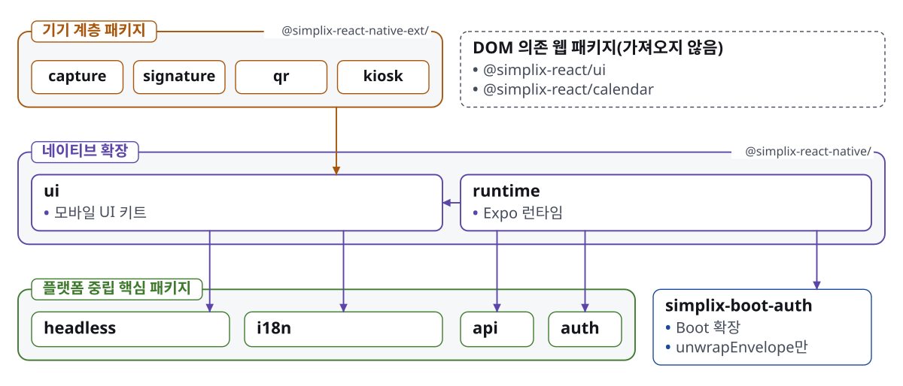

# simplix-react-native

[English](/en/extensions/native/README.md) | **한국어**

simplix-react의 React Native 확장(extension)입니다. 패키지 우선, OpenAPI 기반, 파생 훅, FSD라는 프레임워크 원칙을 React Native(Expo)에 적용하므로, 네이티브 앱도 웹 앱과 같은 계약(contract)과 규칙에서 시작합니다.

플랫폼에 의존하지 않는 계층(계약, 코드 생성, Boot 응답 봉투(envelope)를 처리하는 뮤테이터 로직, i18n 핵심 기능, MSW 목(mock), 헤드리스 목록 · 필터 로직)은 핵심 `packages/`의 패키지를 그대로 사용합니다. 이 확장은 플랫폼에 따라 달라지는 부분만 추가합니다. 모바일 UI 키트, Expo 런타임 연결 코드, 기기 계층 패키지가 그 대상입니다.



## 패키지

| 패키지 | 설명 |
| --- | --- |
| [`@simplix-react-native/ui`](/ko/extensions/native/packages/ui/README.md) | 표준 키트: 레이아웃 프리미티브, 페이지 골격(`Screen`, `StepFlow`, `MasterDetail`), 컨트롤, 시트 우선 오버레이, `FormFields` / `DetailFields`, `EntityList` + `useEntityFeed`, 테마 토큰 시트, 내장 en/ko/ja 로케일 |
| [`@simplix-react-native/runtime`](/ko/extensions/native/packages/runtime/README.md) | 토큰 저장소 어댑터(`expo-secure-store`, AsyncStorage), 뮤테이터 조립, 앱 부팅(오류 정책을 적용한 쿼리 클라이언트, 오류 대화상자, i18n 등록, `msw/native` 연결) |
| [`@simplix-react-native-ext/capture`](/ko/extensions/native/packages/capture/README.md) | 카메라 미리보기, 기기 내 얼굴 감지 연결 지점, 자동 촬영 세션(안내 프레임, 카운트다운, 다시 찍기), 업로드용 사진 form-data 파트 |
| [`@simplix-react-native-ext/signature`](/ko/extensions/native/packages/signature/README.md) | 손글씨 · 입력 서명을 PNG로 업로드(웹 `SignaturePad`와 같은 페이로드 규약) |
| [`@simplix-react-native-ext/qr`](/ko/extensions/native/packages/qr/README.md) | 정적 QR 렌더링과 순환 출입 토큰 QR 표시(주기적 재발급, 남은 유효 시간 표시) |
| [`@simplix-react-native-ext/kiosk`](/ko/extensions/native/packages/kiosk/README.md) | 화면 꺼짐 방지, Android Lock Task Mode, 무입력 초기화 타이머, 네트워크 복구 화면 |
| [`simplix-react-native`](/ko/extensions/native/packages/meta/README.md) | `@simplix-react-native/ui`와 `@simplix-react-native/runtime`을 의존성 하나로 설치하는 메타 패키지 |

## 사용 방식

컴파일된 `dist`를 배포하는 웹 패키지와 달리 RN 패키지는 **소스**를 배포합니다. `main`/`exports`가 `src/`를 가리키고, Metro가 TypeScript를 변환하며, NativeWind는 사용하는 앱의 Tailwind 설정에 지정된 패키지 소스를 읽어 `className` 유틸리티를 추출합니다. 이 패키지들에는 빌드 단계가 없고 `typecheck`, `lint`, `test`만 있습니다.

RN 패키지는 DOM에 의존하는 웹 패키지(`@simplix-react/ui`, `@simplix-react/calendar`)를 가져오지 않습니다. 가져오는 핵심 패키지는 모두 플랫폼 중립입니다. `@simplix-react/api`, `@simplix-react/i18n`, `@simplix-react/auth`, `@simplix-react/headless`가 그 목록입니다. `@simplix-react-native/runtime`은 Boot 응답 봉투를 풀기 위해 Boot 확장 `@simplix-react-ext/simplix-boot-auth`의 `unwrapEnvelope`도 가져옵니다.

## 화면 문법(웹 화면을 RN으로 옮기지 않음)

계약과 로직은 재사용하고, 화면 문법은 모바일에 맞춰 따로 설계합니다. 웹 컴포넌트 이름은 가져오지 않습니다.

| 웹 문법 | RN 문법 |
| --- | --- |
| `CrudList.Table` 열 + FilterBar + 페이지 이동 | `EntityList`: 카드 행, 검색창, 필터 시트, 무한 스크롤 |
| `ListDetail` 측면 패널 | 전체 화면으로 여는 상세 화면 + 하단 고정 작업 표시줄(태블릿 가로 모드는 `MasterDetail`을 선택할 수 있음) |
| `CrudForm` 페이지 + 팝오버 선택기 | 전체 화면 폼: 키보드를 피하는 스크롤, 시트 선택기, 긴 폼에는 `StepFlow` |
| 대화상자 중심 상호작용 | 시트 우선: `AlertDialog`는 파괴적 작업 확인에만 사용 |
| `usePageHeader` 등록 방식 | expo-router 스택 헤더 |

## CLI

- `simplix add-app <name> --native`는 `apps/<name>` 아래에 expo-router 앱 골격(NativeWind, 부팅 연결, `EXPO_PUBLIC_ENABLE_MOCKS`로 켜는 목 전환)을 생성하고, 워크스페이스 `.npmrc`에 `@simplix-react-native/*`와 `@simplix-react-native-ext/*`의 `public-hoist-pattern` 줄을 추가합니다. `add-app`은 네이티브 앱만 생성하며 `--native` 없이 실행하면 실패합니다.
- `simplix scaffold <entity> --native [--module <dir>] [--app <dir>]`는 OpenAPI로 생성한 도메인 패키지에서 엔티티 화면 묶음(`EntityList` 화면, 상세 화면, 전체 화면 폼, expo-router 라우트, 로케일 골격)을 생성합니다. `--module`은 대상 모듈을 지정하며, 워크스페이스에 모듈이 하나뿐이면 자동으로 찾습니다. `--app`은 라우트 파일을 받을 `apps/` 아래 Expo 앱을 지정합니다. Expo 앱이 하나뿐이면 자동으로 찾고, 하나도 없으면 모듈 화면만 생성합니다.

## 빌드와 테스트

```bash
# Typecheck / lint / test all native packages
pnpm --filter "@simplix-react-native/*" typecheck
pnpm --filter "@simplix-react-native-ext/*" typecheck

# Root pipeline includes these packages automatically
pnpm typecheck && pnpm test
```

---

<p class="page-source"><a href="https://github.com/simplix-framework/simplix-react/blob/main/extensions/native/README.ko.md" target="_blank" rel="noopener noreferrer">GitHub에서 편집</a></p>
