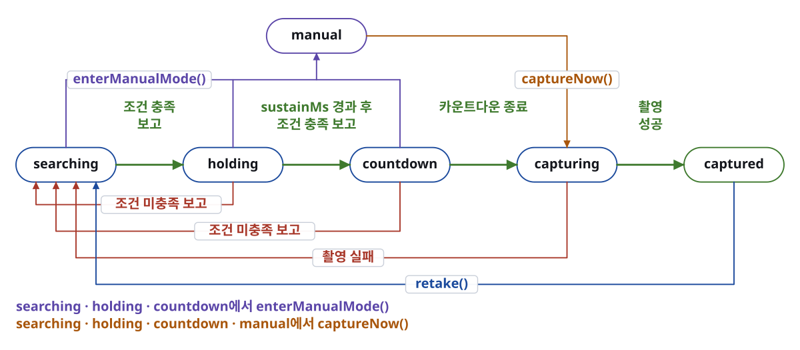

# @simplix-react-native-ext/capture

[English](/en/extensions/native/packages/capture/README.md) | **한국어**

simplix-react-native의 자동 촬영 세션입니다. 카메라 미리보기, 기기 내 얼굴 감지 연결 지점, 구도 판정, 유지 시간, 카운트다운, 다시 찍기, 수동 전환, 사진 업로드용 form-data 파트를 제공합니다. 이 패키지는 특정 얼굴 감지기를 포함하지 않습니다. 앱이 감지기를 주입하며, 감지는 기기 안에서만 실행합니다.

## 설치

```bash
pnpm add @simplix-react-native-ext/capture
```

> **사전 요구 사항:** 피어 의존성은 `@simplix-react-native/ui`, `@simplix-react/i18n`, `expo-camera`(>=16), `react`(>=18), `react-native`(>=0.76)입니다.

## 사용법

화면이 카메라 권한을 관리하고, 감지기를 세션에 연결하고, 사진을 찍을 때까지 미리보기 위에 안내 프레임을 표시합니다.

```tsx
import { useCallback, useRef } from "react";
import {
  CameraPreview,
  CapturePreview,
  GuideFrame,
  useAutoCaptureSession,
  useDetectorPolling,
  type CameraPreviewHandle,
  type FaceDetectorAdapter,
} from "@simplix-react-native-ext/capture";

export function ArrivalPhoto({ detector, onUpload }: { detector: FaceDetectorAdapter; onUpload: (uri: string) => void }) {
  const cameraRef = useRef<CameraPreviewHandle | null>(null);
  const takePicture = useCallback(async () => {
    const photo = await cameraRef.current!.takePictureAsync();
    return photo.uri;
  }, []);

  const session = useAutoCaptureSession({ takePhoto: takePicture });

  useDetectorPolling({
    detector,
    takeSnapshot: takePicture,
    onFaces: session.reportFaces,
    onDetectorFailure: session.enterManualMode,
    enabled: session.phase === "searching" || session.phase === "holding",
  });

  if (session.phase === "captured" && session.photoUri) {
    return (
      <CapturePreview
        photoUri={session.photoUri}
        onRetake={session.retake}
        onUse={() => onUpload(session.photoUri!)}
      />
    );
  }

  return (
    <CameraPreview cameraRef={cameraRef}>
      <GuideFrame
        phase={session.phase}
        countdown={session.countdown}
        failure={session.failure}
        onCaptureNow={session.captureNow}
      />
    </CameraPreview>
  );
}
```

결과를 직접 보내는 감지기(프레임 프로세서)는 `session.reportFaces`를 바로 호출하며 `useDetectorPolling`을 쓰지 않습니다. 미리보기를 표시하기 전에 `useCameraPermissions()`로 권한을 요청하세요. 카메라를 쓸 수 없으면 화면에서 사진 촬영을 건너뛸 수 있습니다.

## 세션 단계



| 단계 | 의미 |
| --- | --- |
| `searching` | 구도 조건을 만족하는 얼굴 보고를 기다립니다 |
| `holding` | 구도가 유지되고 있습니다. `sustainMs`가 지난 뒤 조건을 만족하는 보고가 오면 카운트다운을 시작합니다 |
| `countdown` | `countdownFrom`부터 `countdownTickMs`마다 하나씩 셉니다. 조건을 만족하지 않는 보고가 오면 `searching`으로 돌아갑니다 |
| `capturing` | `takePhoto`를 실행하고 있습니다 |
| `captured` | `photoUri`에 사진이 있습니다. `retake()`를 호출하면 `searching`으로 돌아갑니다 |
| `manual` | 얼굴 보고를 무시하고 `captureNow()`로 사진을 찍습니다 |

`takePhoto`가 실패하면 `onCaptureError`를 호출하고 세션을 `searching`으로 되돌립니다.

## API 레퍼런스

### `useAutoCaptureSession(options)`

옵션(`UseAutoCaptureSessionOptions`, `CompositionConfig`의 모든 필드도 받습니다):

| 옵션 | 타입 | 기본값 | 설명 |
| --- | --- | --- | --- |
| `takePhoto` | `() => Promise<string>` | 필수 | 사진을 찍고 로컬 URI를 반환합니다 |
| `sustainMs` | `number` | `1000` | 카운트다운 전에 구도가 유지되어야 하는 시간 |
| `countdownFrom` | `number` | `3` | 카운트다운 시작 값 |
| `countdownTickMs` | `number` | `1000` | 카운트다운 한 단계의 길이 |
| `onCaptured` | `(photoUri: string) => void` | 없음 | 촬영에 성공하면 호출합니다 |
| `onCaptureError` | `(error: unknown) => void` | 없음 | `takePhoto`가 실패하면 호출합니다 |

결과(`UseAutoCaptureSessionResult`): `phase`(`AutoCapturePhase`), `countdown`, `photoUri`, `failure`(`CompositionFailure | null`), `reportFaces(faces)`, `captureNow()`, `retake()`, `enterManualMode()`.

### `evaluateComposition(faces, config?)`

`faces`(`FaceBox[]`, 왼쪽 위를 원점으로 `0..1`로 정규화한 값) 가운데 가장 큰 얼굴로 구도를 판정하는 순수 함수입니다. `CompositionResult`인 `{ ok, reason?, face? }`를 반환하며, `reason`은 `CompositionFailure`(`"no-face"`, `"off-center"`, `"too-small"`, `"too-large"`)입니다.

| `CompositionConfig` 필드 | 기본값 | 설명 |
| --- | --- | --- |
| `centerTolerance` | `0.18` | 축마다 허용하는 얼굴 중심과 목표 지점 사이의 최대 거리 |
| `targetX` | `0.5` | 목표 지점의 X |
| `targetY` | `0.5` | 목표 지점의 Y. 안내 프레임이 화면 위쪽 카메라 근처에 있으면 값을 낮추세요 |
| `minFaceRatio` | `0.18` | 얼굴 상자의 긴 변이 프레임에서 차지하는 최소 비율 |
| `maxFaceRatio` | `0.6` | 얼굴 상자의 긴 변이 프레임에서 차지하는 최대 비율 |

### `useDetectorPolling(options)`

일정한 간격으로 미리보기 프레임을 가져와 정지 이미지용 `FaceDetectorAdapter`(`detect(imageUri): Promise<FaceBox[]>`)를 실행하고, 감지한 얼굴을 `onFaces`에 전달합니다.

| 옵션 | 타입 | 기본값 | 설명 |
| --- | --- | --- | --- |
| `detector` | `FaceDetectorAdapter` | 필수 | 앱이 제공하는 감지기 |
| `takeSnapshot` | `() => Promise<string>` | 필수 | 프레임을 가져와 로컬 URI를 반환합니다 |
| `onFaces` | `(faces: FaceBox[]) => void` | 필수 | 보통 `session.reportFaces` |
| `onDetectorFailure` | `(error: unknown) => void` | 없음 | 연속 실패가 `failureThreshold`번에 이른 뒤로는 실패할 때마다 호출합니다. 보통 `session.enterManualMode` |
| `intervalMs` | `number` | `800` | 프레임을 가져오는 간격 |
| `failureThreshold` | `number` | `3` | `onDetectorFailure`를 호출하기 전까지 허용하는 연속 실패 횟수 |
| `enabled` | `boolean` | `true` | `false`이면 프레임 수집을 멈춥니다 |

### 컴포넌트

| 컴포넌트 | props | 설명 |
| --- | --- | --- |
| `CameraPreview` | `cameraRef`, `facing`(기본값 `"front"`, 또는 `"back"`), `mirror`(전면 카메라에서 기본값 `true`), `onCameraReady`, `children`, `className` | `expo-camera` 미리보기. `children`은 미리보기 위에 겹쳐 표시합니다. `CameraPreviewHandle`은 `takePictureAsync`를 호출할 ref의 타입입니다 |
| `GuideFrame` | `phase`, `countdown`, `failure`, `onCaptureNow`, `anchor`(기본값 `"center"`, 또는 `"top"`), `className` | 얼굴 안내선, 상태 문구, 카운트다운, 수동 모드의 촬영 버튼 |
| `CapturePreview` | `photoUri`, `onRetake`, `onUse`, `busy`, `className` | 찍은 사진과 다시 찍기 · 이 사진 사용 버튼 |

`useCameraPermissions`는 `expo-camera`의 것을 그대로 다시 내보냅니다.

### `capturePhotoFormDataPart(photoUri, fileName?)`

multipart 업로드에 쓸 `{ uri, name, type }`을 반환합니다. `fileName`의 기본값은 `"arrival-photo.jpg"`이고, 이름이 `.png`로 끝나면 타입은 `image/png`, 아니면 `image/jpeg`입니다. 업로드 엔드포인트는 앱의 생성된 도메인 훅이 담당합니다.

### 타입

위 API의 props · 옵션 타입을 함께 내보냅니다. `CameraPreviewProps`, `GuideFrameProps`, `CapturePreviewProps`, `UseDetectorPollingOptions`, `UseAutoCaptureSessionOptions`, `UseAutoCaptureSessionResult`, `AutoCapturePhase`, `FaceBox`, `FaceDetectorAdapter`, `CompositionConfig`, `CompositionFailure`, `CompositionResult`.

## 플랫폼 참고 사항

- 이 패키지를 가져오면 en/ko/ja 문구를 `simplix/native-capture` 네임스페이스에 등록합니다.
- 컴포넌트가 NativeWind `className` 유틸리티를 사용하므로, 앱의 Tailwind `content`에 패키지의 `src` 폴더를 추가하세요.

---

<p class="page-source"><a href="https://github.com/simplix-framework/simplix-react/blob/main/extensions/native/packages/capture/README.ko.md" target="_blank" rel="noopener noreferrer">GitHub에서 편집</a></p>
