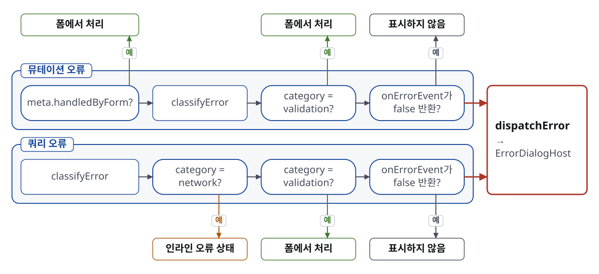

# @simplix-react-native/runtime

[English](/en/extensions/native/packages/runtime/README.md) | **한국어**

simplix-react-native 앱의 Expo 런타임 연결 코드입니다. 기기 저장소를 사용하는 토큰 저장소, 생성된 도메인 패키지가 쓰는 `boot` 전략 뮤테이터, 표준 오류 정책을 적용한 쿼리 클라이언트, 로케일을 저장하는 i18n 초기화, 루트 프로바이더, `msw/native` 목(mock) 연결을 제공합니다.

## 설치

```bash
pnpm add @simplix-react-native/runtime
```

> **사전 요구 사항:** 피어 의존성은 `@simplix-react-native/ui`, `@simplix-react/api`, `@simplix-react/auth`, `@simplix-react/i18n`, `@simplix-react-ext/simplix-boot-auth`, `@tanstack/react-query`(>=5), `@react-native-async-storage/async-storage`(>=2), `expo-localization`(>=16), `expo-secure-store`(>=14), `react`(>=18), `react-native`(>=0.76), `react-native-safe-area-context`(>=5)입니다. `msw`(>=2)는 선택 사항이며 `startNativeMocks`를 쓸 때만 필요합니다.

## 사용법

부팅 모듈에서 토큰 저장소를 만들고, 뮤테이터를 등록하고, 루트 프로바이더가 첫 화면을 그리기 전에 기다릴 조건을 모읍니다.

```ts
// src/bootstrap/boot.ts
import {
  configureNativeBootMutator,
  createNativeI18n,
  createNativeQueryClient,
  createSecureTokenStore,
} from "@simplix-react-native/runtime";

export const i18n = createNativeI18n({
  defaultLocale: "ko",
  supportedLocales: ["en", "ko", "ja"],
});

export const tokenStore = createSecureTokenStore();

configureNativeBootMutator({
  baseUrl: process.env.EXPO_PUBLIC_API_URL ?? "http://localhost:8080",
  getToken: () => (tokenStore.hydrated ? tokenStore.get("access_token") : null),
});

export const queryClient = createNativeQueryClient();

export const bootReady = Promise.all([i18n.i18nReady, tokenStore.hydrate()]);
```

루트 레이아웃에 프로바이더를 배치합니다.

```tsx
// app/_layout.tsx
import { SimplixNativeProvider } from "@simplix-react-native/runtime";
import { Stack } from "expo-router";

import { bootReady, i18n, queryClient } from "../src/bootstrap/boot";

export default function RootLayout() {
  return (
    <SimplixNativeProvider queryClient={queryClient} i18nAdapter={i18n.adapter} ready={bootReady}>
      <Stack />
    </SimplixNativeProvider>
  );
}
```

`simplix add-app --native`는 두 파일을 이 형태로 생성합니다.

## API 레퍼런스

### 토큰 저장소

`NativeTokenStore`는 `@simplix-react/auth`의 동기식 `TokenStore`(`get`, `set`, `remove`, `clear`)에 `hydrate(): Promise<void>`와 읽기 전용 `hydrated` 플래그를 더한 타입입니다. 네이티브 저장소는 비동기이므로 저장소는 메모리 캐시를 두고 쓰기를 저장소에 즉시 반영합니다. 부팅 중에 `hydrate()`를 한 번 호출하세요. 호출이 끝나기 전에는 `get`, `set`, `remove`, `clear`가 예외를 발생시킵니다. 쓰기에 실패하면 콘솔에 기록하고, 해당 세션 동안은 메모리의 값을 그대로 사용합니다.

| 함수 | 저장소 | 옵션 |
| --- | --- | --- |
| `createSecureTokenStore(options?)` | 기기 키체인(`expo-secure-store`). 이 저장소는 키 목록을 조회할 수 없으므로 자체 키 색인을 저장하고, 키에서 `[A-Za-z0-9._-]` 밖의 문자를 `_`로 바꿉니다 | `keyPrefix`(기본값 `"simplix.token."`) |
| `createAsyncStorageTokenStore(options?)` | AsyncStorage. 비밀이 아닌 값(환경설정, 기기 ID)에 사용합니다 | `keyPrefix`(기본값 `"simplix.store."`) |

### 뮤테이터

`createNativeBootMutator(options)`는 `boot` 전략의 `OrvalMutator`를 반환합니다. `configureNativeBootMutator(options)`는 뮤테이터를 만들고 `configureMutator("boot", ...)`로 등록하는 일을 한 번에 처리합니다. 생성된 도메인 패키지는 `getMutator("boot")`로 이 뮤테이터를 찾습니다.

| 옵션 | 타입 | 기본값 | 설명 |
| --- | --- | --- | --- |
| `baseUrl` | `string` | 필수 | API 출처. 네이티브 앱에는 항상 절대 주소가 필요합니다(예: `"http://10.0.2.2:8080"`) |
| `getToken` | `() => string \| null` | 없음 | 현재 토큰을 반환합니다 |
| `tokenHeader` | `string` | `"Authorization"` | 토큰을 담는 헤더 |
| `tokenScheme` | `string \| null` | `"Bearer"` | 토큰 값 앞에 추가하는 스킴. `null`이면 토큰만 보냅니다 |
| `onUnauthorized` | `(context: UnauthorizedContext) => void` | 없음 | 401 응답을 받으면 `{ status, url }`과 함께 호출합니다 |

요청마다 헤더가 없으면 요청 로케일을 `Accept-Language`로 보냅니다. 성공한 응답은 Boot 응답 봉투(envelope)에서 꺼냅니다(`unwrapEnvelope`, SUCCESS가 아닌 응답 봉투에서는 예외를 발생시킵니다). 2xx가 아닌 응답에서는 본문의 `message`나 상태 텍스트로 `HttpError`를 발생시킵니다. 401이면 먼저 `onUnauthorized`를 호출한 뒤 마찬가지로 예외를 발생시킵니다.

### 쿼리 클라이언트와 오류 대화상자

`createNativeQueryClient(options?)`는 `QueryClient`(쿼리 설정: `retry: 1`, `refetchOnWindowFocus: false`)를 반환합니다. 이 클라이언트의 캐시는 `@simplix-react/api`의 `classifyError`로 오류를 분류해 다음과 같이 처리합니다.

- `meta.handledByForm`이 있는 뮤테이션은 폼에서 처리합니다.
- `"validation"` 분류의 이벤트는 폼 필드에서 처리합니다.
- `"network"` 분류의 쿼리 오류는 화면의 인라인 오류 상태에서 처리합니다.
- `options.onErrorEvent(event)`가 `false`를 반환하면 대화상자를 열지 않습니다.
- 나머지 이벤트는 모두 `dispatchError`로 보냅니다.



| 내보내는 항목 | 설명 |
| --- | --- |
| `dispatchError(event)` | `ServerErrorEvent`를 전역 오류 대화상자에 표시합니다. 새 이벤트가 오면 표시 중인 이벤트를 대체합니다 |
| `clearError()` | 표시 중인 이벤트를 닫습니다 |
| `useErrorEvent()` | 표시 중인 이벤트를 구독합니다(없으면 `null`) |
| `ErrorDialogHost` | 서버 메시지를 설명으로, 오류 코드를 보조 텍스트로 표시하는 대화상자. `SimplixNativeProvider`가 배치합니다 |

### i18n

`createNativeI18n(options)`는 `@simplix-react/i18n`의 `createI18nConfig` 옵션에서 `detection`을 뺀 옵션과 다음 옵션을 받습니다.

| 옵션 | 타입 | 기본값 | 설명 |
| --- | --- | --- | --- |
| `persistLocale` | `boolean` | `true` | 선택한 로케일을 AsyncStorage에 저장합니다. 기본 언어로 시작해야 하는 공용 기기나 무인 기기에서는 끄세요 |
| `storageKey` | `string` | `"simplix.i18n.locale"` | 저장한 로케일의 AsyncStorage 키 |

이 함수는 `{ adapter, i18nReady }`를 동기적으로 반환합니다. `i18nReady` 안에서 로케일은 저장한 로케일, 기기 언어(`expo-localization`), `defaultLocale` 순서로 정해지며, `supportedLocales`에 없는 후보는 건너뜁니다. 로케일이 바뀔 때마다 `Accept-Language`에 쓸 요청 로케일도 바꿉니다.

### SimplixNativeProvider

루트 프로바이더입니다. 안전 영역, `QueryClientProvider`, `I18nProvider`, `SimplixThemeProvider`, `ToastHost`, `ErrorDialogHost`, `OverlayPortalHost`를 구성합니다.

| prop | 타입 | 설명 |
| --- | --- | --- |
| `queryClient` | `QueryClient` | 보통 `createNativeQueryClient()`의 결과 |
| `i18nAdapter` | `II18nAdapter` | 보통 `createNativeI18n(...).adapter` |
| `ready` | `Promise<unknown> \| Promise<unknown>[]` | 부팅 조건. 모두 끝날 때까지 가운데에 스피너를 표시하고, 거부된 조건은 예외를 발생시킵니다 |
| `theme` | `Omit<SimplixThemeProviderProps, "children">` | `SimplixThemeProvider`에 전달합니다 |
| `children` | `ReactNode` | 앱 콘텐츠 |

### 목 연결

`startNativeMocks(options)`는 지정한 핸들러로 `msw/native` 서버를 시작하고, `stop()`이 있는 `NativeMockServer`를 반환합니다. `onUnhandledRequest`는 `"bypass" | "warn" | "error"` 중 하나이며 기본값은 `"bypass"`입니다. 그래서 목으로 대신하지 않은 엔드포인트는 실제 서버로 요청합니다. `msw`는 동적으로 가져오므로 이 함수를 호출하지 않는 빌드에는 포함되지 않습니다.

```ts
import { startNativeMocks } from "@simplix-react-native/runtime";

if (process.env.EXPO_PUBLIC_ENABLE_MOCKS === "true") {
  await startNativeMocks({ handlers: mockHandlers });
}
```

### 타입

위 API의 props · 옵션 타입을 함께 내보냅니다. `NativeTokenStore`, `SecureTokenStoreOptions`, `AsyncStorageTokenStoreOptions`, `NativeBootMutatorOptions`, `UnauthorizedContext`, `CreateNativeQueryClientOptions`, `CreateNativeI18nOptions`, `SimplixNativeProviderProps`, `StartNativeMocksOptions`, `NativeMockServer`.

## 플랫폼 참고 사항

- `startNativeMocks`를 호출하기 전에 진입 파일에서 msw에 필요한 React Native 폴리필(`react-native-url-polyfill/auto`, `fast-text-encoding`)을 불러오세요.
- 401 응답을 받아도 이동할 로그인 페이지가 없습니다. 앱에 필요한 복구 동작(예: 기기 재등록 화면)을 `onUnauthorized`에 등록하세요.

---

<p class="page-source"><a href="https://github.com/simplix-framework/simplix-react/blob/main/extensions/native/packages/runtime/README.ko.md" target="_blank" rel="noopener noreferrer">원본 보기</a></p>
