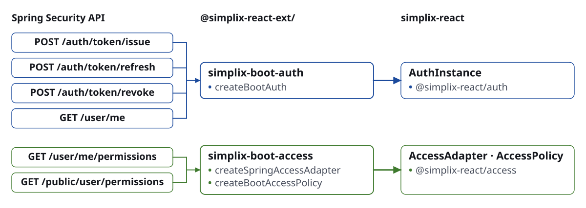

# simplix-boot

[English](/en/extensions/simplix-boot/README.md) | **한국어**

SimpleCORE Inc.의 Spring Boot 기반 백엔드 프레임워크인 SimpliX용 확장(extension)입니다. SimpliX의 Spring Security API에 맞춰 simplix-react 핵심 인터페이스를 구현한 어댑터(adapter) 패키지를 제공합니다.

> **확장이란?** 핵심 패키지(`packages/`)는 환경에 의존하지 않는 추상 인터페이스를 정의합니다. 확장(`extensions/`)은 특정 백엔드 플랫폼에 맞는 구현을 제공하므로 사용하는 쪽의 코드는 환경을 바꿔도 그대로 쓸 수 있습니다. 자세한 내용은 [extensions/README.ko.md](/ko/extensions/README.md)를 참고하세요.

## 패키지

| 패키지 | 설명 |
| --- | --- |
| [@simplix-react-ext/simplix-boot-access](https://github.com/simplix-framework/simplix-react/tree/main/extensions/simplix-boot/packages/access) | `@simplix-react/access`용 Spring Security 인가(권한 어댑터, Boot 접근 정책, 본인 접근 정책) |
| [@simplix-react-ext/simplix-boot-auth](https://github.com/simplix-framework/simplix-react/tree/main/extensions/simplix-boot/packages/auth) | Spring Security 인증 계약(토큰, 사용자 프로필, 권한) |
| [@simplix-react-ext/simplix-boot-cli-plugin](https://github.com/simplix-framework/simplix-react/tree/main/extensions/simplix-boot/packages/cli-plugin) | CLI 명세 프로필: Boot 이름 규칙, 응답 어댑터(응답 봉투), 스키마 어댑터, i18n 내려받기 |
| [@simplix-react-ext/simplix-boot-stream](https://github.com/simplix-framework/simplix-react/tree/main/extensions/simplix-boot/packages/stream) | SimpliX Boot SSE 스트리밍(EventSource 관리, 구독, 지연 감지) |
| [@simplix-react-ext/simplix-boot-utils](https://github.com/simplix-framework/simplix-react/tree/main/extensions/simplix-boot/packages/utils) | Boot 전용 유틸리티(`resolveBootEnum`, `toLabeledEnum`, `transformSearchableFilters`, `bootBody`, `bootPage`, `updateBody`) |

## 동작 방식

SimpliX 백엔드는 Spring Security 기반의 토큰 엔드포인트와 권한 엔드포인트를 자체 응답 형식으로 제공합니다. 이 확장은 그 형식을 `@simplix-react/auth`와 `@simplix-react/access`가 정의한 추상 인터페이스로 변환하므로 React 애플리케이션은 백엔드에 묶이지 않습니다.



## 빠른 시작

### 인증

```ts
import { createBootAuth } from "@simplix-react-ext/simplix-boot-auth";

// High-level factory: Bearer auth with automatic refresh, cross-tab sync,
// and Boot envelope handling. Default basePath: "/api/v1".
const { auth, authClient, getToken } = createBootAuth({
  basePath: "/api/v1",
  storePrefix: "myapp:",
});
```

목(mock) 설정은 다음과 같습니다.

```ts
import { createAuthMock } from "@simplix-react-ext/simplix-boot-auth/mock";

// Default basePath: "/api/v1"
const authMock = createAuthMock({
  users: {
    admin: {
      user: { userId: "1", username: "admin", displayName: "Admin", email: "admin@example.com", roles: [], isSuperAdmin: true },
      permissions: { permissions: {}, roles: [], isSuperAdmin: true },
      password: "admin",
    },
  },
});
```

### 인가

```ts
import { createAccessPolicy } from "@simplix-react/access";
import { createSpringAccessAdapter } from "@simplix-react-ext/simplix-boot-access";

const adapter = createSpringAccessAdapter({
  permissionsEndpoint: "/api/v1/user/me/permissions",
  fetchFn: bootMutator,
});

const accessPolicy = createAccessPolicy({ adapter });
```

### 전체 연동

인증과 인가를 함께 연결하는 운영 환경용 구성입니다. `createBootAccessPolicy()`는 Spring 어댑터를 만들고, fetch 함수가 Boot 응답 봉투(envelope)를 반환하면 그 봉투를 풀며, 로그아웃 상태의 공개 접근에도 같은 어댑터를 사용합니다. `auth.fetchFn`을 전달하면 권한 요청에 인증 토큰이 자동으로 포함됩니다.

```ts
// shared/config/access.ts
import { createBootAccessPolicy } from "@simplix-react-ext/simplix-boot-access";
import { auth } from "./auth";

export const accessPolicy = createBootAccessPolicy({
  fetchFn: auth.fetchFn,
  isSuperAdmin: (user) => user.isSuperAdmin === true,
  persist: { key: "myapp-access" },
});
```

## SimpliX 엔드포인트 요건

### 인증 엔드포인트

| 메서드 | 기본 경로 | 설명 |
| --- | --- | --- |
| POST | `/api/v1/auth/token/issue` | 액세스 토큰과 리프레시 토큰 발급(Basic 인증) |
| POST | `/api/v1/auth/token/refresh` | 액세스 토큰 갱신 |
| POST | `/api/v1/auth/token/revoke` | 현재 토큰 폐기 |
| GET | `/api/v1/user/me` | 현재 사용자 프로필 조회 |

### 권한 엔드포인트

| 메서드 | 기본 경로 | 설명 |
| --- | --- | --- |
| GET | `/api/v1/user/me/permissions` | 인증된 사용자의 권한 |
| GET | `/api/v1/public/user/permissions` | 인증 전 공개 권한 |

모든 엔드포인트 경로는 옵션으로 바꿀 수 있습니다.

## 개발

```bash
# Build
pnpm --filter "@simplix-react-ext/simplix-boot-*" build

# Test
pnpm --filter "@simplix-react-ext/simplix-boot-*" test

# Typecheck
pnpm --filter "@simplix-react-ext/simplix-boot-*" typecheck
```

## 오류 처리

접근 어댑터에는 `fetchFn`이 반드시 필요하며, 전달하지 않으면 오류를 발생시킵니다. 어댑터 자체에는 재시도나 오류 변환이 없으므로 `fetchFn`이 발생시킨 오류는 호출한 쪽으로 그대로 전달됩니다. 인증 패키지는 Boot 오류 응답을 `ApiResponseError`로 변환합니다([인증 패키지의 오류 처리 절](/ko/extensions/simplix-boot/packages/auth/README.md#오류-처리) 참고).

- **네트워크 오류와 그 밖의 HTTP 오류:** `fetchFn`이 발생시킨 오류는 호출하는 곳에서 `try/catch`로 처리하세요.
- **오류 처리 사용자 지정:** 오류 인터셉터를 넣은 fetch 함수를 `fetchFn` 옵션으로 전달하세요.

## 사전 요구 사항

> 패키지마다 피어 의존성이 다릅니다. `simplix-boot-auth`에는 `@simplix-react/api`, `@simplix-react/auth`, `@simplix-react/contract`, `@simplix-react/i18n`, `zod`가 필요하고, `simplix-boot-access`에는 `@simplix-react/access`, `@simplix-react/api`, `react`가, `simplix-boot-cli-plugin`에는 `@simplix-react/cli`가, `simplix-boot-stream`에는 `react`가, `simplix-boot-utils`에는 `@simplix-react/api`가 필요합니다.

---

<p class="page-source"><a href="https://github.com/simplix-framework/simplix-react/blob/main/extensions/simplix-boot/README.ko.md" target="_blank" rel="noopener noreferrer">원본 보기</a></p>
