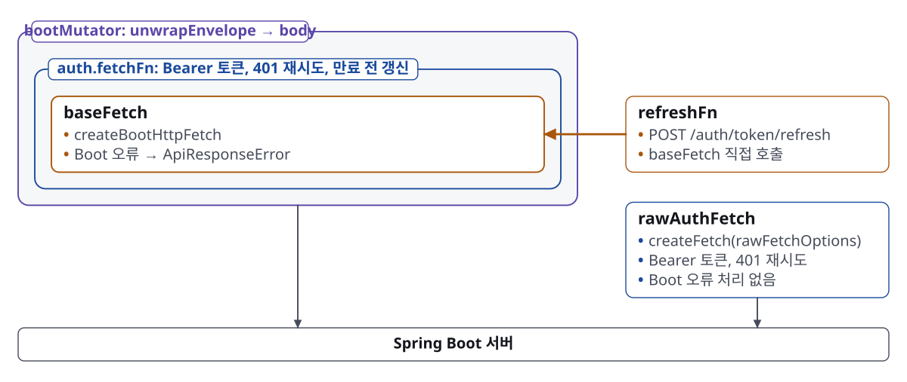

# @simplix-react-ext/simplix-boot-auth

[English](/en/extensions/simplix-boot/packages/auth/README.md) | **한국어**

`simplix-boot`용 Spring Security 인증(authentication) 패키지입니다. 토큰 발급·갱신·폐기, 만료 전 자동 토큰 갱신(token refresh), 탭 간 동기화, SimpliX Boot 응답 봉투(envelope)를 묶어 바로 쓸 수 있는 fetch 함수와 인증 클라이언트로 제공합니다.

## 설치

```bash
pnpm add @simplix-react-ext/simplix-boot-auth
```

> **사전 요구 사항:** 피어 의존성으로 `@simplix-react/api`, `@simplix-react/auth`, `@simplix-react/contract`, `@simplix-react/i18n`, `zod`(`^4.0.0`)가 필요합니다.

## 사용법

### 인증 클라이언트 만들기

`createBootAuth()`는 상위 수준 팩토리입니다. 앱을 시작할 때 한 번 호출하면 Bearer 방식 인증 인스턴스, 토큰 저장소, SimpliX Boot 엔드포인트에 맞춘 fetch 함수 여러 개를 만듭니다.

```ts
import { createBootAuth } from "@simplix-react-ext/simplix-boot-auth";

const {
  auth,
  authClient,
  store,
  baseFetch,
  rawAuthFetch,
  bootMutator,
  getToken,
} = createBootAuth({
  basePath: "/api/v1",
  refreshBeforeExpiry: 60,
});

// Log in: returns a TokenPair (does not persist tokens itself)
const tokens = await authClient.loginFn("admin", "secret");
auth.set(tokens);

// Read the current access token
const token = getToken();
```

기본 설정에서 클라이언트는 사용자가 페이지에서 활동하는 동안에만(`activityAware`) 백그라운드 토큰 갱신을 예약하고(`autoSchedule`), 탭 간 로그아웃·토큰 동기화와 탭 전체가 공유하는 갱신 한 번을 켜며(`crossTabSync`), 갱신이 실패하면 `/login`으로 이동합니다. 각 동작은 `BootAuthOptions`로 바꿀 수 있습니다.

### 도메인 패키지에 Boot 뮤테이터 연결하기

`bootMutator`는 인증을 거치는 fetch 함수로, SimpliX Boot 응답 봉투도 풀어 줍니다. 그래서 생성된 Boot 도메인 패키지(domain package)는 `body`만 받습니다.



```ts
import { createBootAuth } from "@simplix-react-ext/simplix-boot-auth";

const { bootMutator } = createBootAuth();

// Pass bootMutator as the fetch function to a Boot domain contract.
// Each response is unwrapped from { type, message, body, ... } to its body.
const pets = await bootMutator<Pet[]>("/api/v1/pets", { method: "GET" });
```

### 외부 발급자의 토큰 사용하기

OpenID Connect 제공자 같은 외부 발급자가 토큰을 발급하면 `tokenClient`를 전달하세요. 갱신과 폐기는 `tokenClient`를 거치고, 로그인은 발급자 쪽에서 하므로 `authClient.loginFn`은 오류를 발생시킵니다.

```ts
import { createBootAuth } from "@simplix-react-ext/simplix-boot-auth";

const { auth } = createBootAuth({
  tokenClient: {
    refresh: (refreshToken) => oidc.refresh(refreshToken),
    revoke: (refreshToken) => oidc.revoke(refreshToken),
  },
  onExternalLogout: () => {
    window.location.href = "/login";
  },
});
```

### 첨부 파일 올리기와 내려받기

`uploadWithProgress()`는 업로드 진행률을 알 수 있도록 XHR로 `FormData`를 전송하고, `fetchAttachmentBlob()`은 파일을 `Blob`으로 내려받습니다. 두 함수 모두 인증 헤더를 추가하고, `401`을 받으면 토큰을 갱신한 뒤 한 번 다시 요청합니다.

```ts
const { uploadWithProgress, fetchAttachmentBlob } = createBootAuth();

const saved = await uploadWithProgress<{ id: string }>("/api/v1/attachments", formData, {
  onProgress: (percent) => setProgress(percent),
});
const blob = await fetchAttachmentBlob(`/api/v1/attachments/${saved.id}`);
```

### 응답 봉투 감싸기와 풀기

SimpliX Boot는 모든 응답을 `BootEnvelope`로 감쌉니다. 봉투를 만들 때는 `wrapEnvelope()`를, `body`를 꺼낼 때는 `unwrapEnvelope()`를 사용하세요.

```ts
import { wrapEnvelope, unwrapEnvelope } from "@simplix-react-ext/simplix-boot-auth";

const wire = wrapEnvelope({ id: 1, name: "Rex" });
// { type: "SUCCESS", message: "OK", body: { id: 1, name: "Rex" }, timestamp, errorCode: null, errorDetail: null }

const body = unwrapEnvelope<{ id: number; name: string }>(wire);
// { id: 1, name: "Rex" }
```

### Spring 페이지 응답 검증하기

`pageOf()`는 Spring `Page` 스키마에 타입이 지정된 `content` 배열을 더해 계약(contract)에서 쓸 수 있게 합니다.

```ts
import { z } from "zod";
import { pageOf } from "@simplix-react-ext/simplix-boot-auth";

const petSchema = z.object({ id: z.number(), name: z.string() });
const petPageSchema = pageOf(petSchema);

const page = petPageSchema.parse(response);
// page.content: { id: number; name: string }[]
// page.totalElements, page.totalPages, page.first, page.last, ...
```

### 인증 엔드포인트 목 만들기

`/mock` 하위 경로의 `createAuthMock()`은 토큰·사용자 엔드포인트용 MSW 핸들러를 담은 `MockDomainConfig`를 반환합니다.

```ts
import { createAuthMock } from "@simplix-react-ext/simplix-boot-auth/mock";

const authMock = createAuthMock({
  basePath: "/api/v1",
  users: {
    admin: {
      user: {
        userId: "1",
        username: "admin",
        displayName: "Admin",
        email: "admin@example.com",
        roles: [{ roleCode: "ROLE_ADMIN", roleName: "Admin" }],
        isSuperAdmin: true,
      },
      permissions: {
        permissions: { Pet: ["list", "view"] },
        roles: [{ roleCode: "ROLE_ADMIN", roleName: "Admin" }],
        isSuperAdmin: true,
      },
      password: "admin",
    },
  },
});
```

## API 레퍼런스

### `createBootAuth(options?)`

SimpliX Boot 인증 구성을 만듭니다. Bearer 방식 `AuthInstance`, 토큰 저장소, 인증 클라이언트, Boot에 맞춘 fetch 함수가 들어 있습니다.

**옵션(`BootAuthOptions`):**

| 속성 | 타입 | 기본값 | 설명 |
| --- | --- | --- | --- |
| `storePrefix` | `string` | `"simplix:"` | 기본 `localStorage` 토큰 저장소의 키 접두사 |
| `store` | `TokenStore` | `localStorageStore(storePrefix)` | 사용자 지정 토큰 저장소 |
| `basePath` | `string` | `"/api/v1"` | 인증 엔드포인트의 기본 경로 |
| `fetchFn` | `FetchFn` | `createBootHttpFetch(fetchOptions)` | 토큰 요청에 쓰는 기본 fetch 함수 |
| `fetchOptions` | `BootFetchOptions` | - | 기본 `createBootHttpFetch`에 전달하는 옵션 |
| `refreshBeforeExpiry` | `number` | `60` | 액세스 토큰 만료 몇 초 전에 미리 갱신할지 |
| `onRefreshFailure` | `(error: Error) => void` | `/login`으로 이동 | 갱신이 실패했을 때 토큰을 지운 뒤 호출 |
| `maxRetries` | `number` | - | 인증 설정에 전달하는 최대 재시도 횟수 |
| `rawFetchOptions` | `{ baseUrl?: string }` | - | 지정하면 Boot가 아닌 명세용 `rawAuthFetch`를 만듭니다(401 재시도 포함, Boot 오류 처리 제외) |
| `autoSchedule` | `boolean` | `true` | 백그라운드 자동 토큰 갱신 |
| `crossTabSync` | `boolean` | `true` | 탭 간 로그아웃·토큰 동기화와 탭 전체가 공유하는 갱신 한 번 |
| `activityAware` | `boolean` | 브라우저에서 `true` | 사용자가 페이지에서 활동하는 동안에만 백그라운드 갱신 실행 |
| `onExternalLogout` | `() => void` | - | 다른 탭에서 로그아웃해 이 탭의 토큰을 지운 뒤 호출 |
| `tokenClient` | `ExternalTokenClient` | - | 외부 발급자가 발급한 토큰을 갱신·폐기합니다. 지정하면 `loginFn`이 오류를 발생시킵니다 |

**동작:**

- 갱신 흐름은 `X-Refresh-Token` 헤더를 추가해 `${basePath}/auth/token/refresh`로 POST 요청을 보냅니다. 이때 인증 래퍼를 거치지 않고 `baseFetch`를 직접 사용합니다.
- `onRefreshFailure`는 사용자 콜백보다 먼저 만료된 토큰을 지우도록 감싸므로, 페이지를 다시 불러와도 갱신이 끝없이 반복되지 않습니다.
- `rawFetchOptions`를 생략하면 `rawAuthFetch`는 `baseFetch`와 같습니다.
- `crossTabSync`를 켜면 다른 탭의 로그아웃이 이 인스턴스의 토큰을 지운 뒤 `onExternalLogout`을 호출합니다.
- `tokenClient`를 지정하면 `refreshFn`은 Boot 엔드포인트 대신 `tokenClient.refresh(refreshToken)`을, `revokeFn`은 `tokenClient.revoke(refreshToken)`을 호출합니다.

**반환값(`BootAuthResult`):**

| 필드 | 타입 | 설명 |
| --- | --- | --- |
| `auth` | `AuthInstance` | `@simplix-react/auth`의 인증 인스턴스 |
| `authClient` | `BootAuthClient` | 로그인·갱신·폐기·사용자 정보 함수 |
| `store` | `TokenStore` | 결정된 토큰 저장소 |
| `baseFetch` | `FetchFn` | Boot 오류 변환을 적용한 기본 fetch 함수(응답 봉투는 풀지 않음) |
| `rawAuthFetch` | `FetchFn` | Boot 오류 처리 없이 인증을 거치는 fetch 함수(401 재시도와 만료 전 갱신 포함) |
| `bootMutator` | `FetchFn` | 인증을 거치고 Boot 응답 봉투를 푸는 fetch 함수(Boot 도메인 패키지용) |
| `getToken` | `() => string \| null` | 저장소에서 현재 액세스 토큰을 읽습니다 |
| `uploadWithProgress` | `<T>(url: string, formData: FormData, opts?: { onProgress?: (percent: number) => void; signal?: AbortSignal }) => Promise<T>` | 진행률, 인증 헤더, 401 갱신 후 재시도, 응답 봉투 풀기를 갖춘 XHR 멀티파트 업로드 |
| `fetchAttachmentBlob` | `(url: string) => Promise<Blob>` | 401 갱신 후 재시도를 갖춘 인증 Blob 내려받기 |

### `createBootHttpFetch(options?)`

HTTP 요청을 보내고 실패 응답을 `ApiResponseError`로 바꾸는 `FetchFn`을 만듭니다. 응답 봉투는 풀지 **않습니다**.

**옵션(`BootFetchOptions`):**

| 속성 | 타입 | 기본값 | 설명 |
| --- | --- | --- | --- |
| `baseUrl` | `string` | - | 요청 경로 앞에 추가하는 기본 URL |
| `getToken` | `() => string \| null` | - | `Authorization` 헤더에 넣을 Bearer 토큰을 제공합니다 |

**동작:**

- 오류 응답을 받으면 `bootResponseAdapter.toError(body, status)`로 본문을 변환해 발생시킵니다.

### `bootResponseAdapter`

Boot 오류 응답을 `ApiResponseError`로 바꾸는 `toError(raw, status)` 메서드 하나만 있는 어댑터(adapter) 객체입니다.

**동작:**

- `raw`가 `type` 필드가 있는 객체이면 `BootEnvelope`로 보고 `type`, `message`, `timestamp`, `errorCode`, `errorDetail`을 오류에 옮깁니다.
- 그 밖의 경우에는 일반 `ApiResponseError(status, "ERROR", "HTTP {status}", <now>)`를 만듭니다.

### `wrapEnvelope(body)`

값을 성공 `BootEnvelope`로 감쌉니다.

**매개변수:**

| 매개변수 | 타입 | 설명 |
| --- | --- | --- |
| `body` | `T` | 감쌀 데이터 |

`type: "SUCCESS"`, `message: "OK"`, 현재 `timestamp`, `null`인 `errorCode`와 `errorDetail`을 담은 `BootEnvelope<T>`를 반환합니다.

### `unwrapEnvelope(wire)`

`BootEnvelope`에서 `body`를 꺼냅니다.

**매개변수:**

| 매개변수 | 타입 | 설명 |
| --- | --- | --- |
| `wire` | `unknown` | `BootEnvelope` 또는 가공하지 않은 값 |

**동작:**

- `wire`가 Boot 응답 봉투(`type`이 있고, `body`가 있거나 `message`와 `timestamp`가 모두 있는 객체)이고 `type`이 `"SUCCESS"`가 아니면 상태 코드 `400`인 `ApiResponseError`를 발생시킵니다.
- `wire`가 `"SUCCESS"` 봉투이면 `body`를 반환합니다.
- `wire`가 봉투가 아니면 그대로 반환합니다.

### `envelopeSchema(bodySchema)`

`body` 필드에 `bodySchema`를 쓰는 `BootEnvelope`용 Zod 스키마를 만듭니다. 이 스키마는 `type`, `message`, `body`, `timestamp`와, 생략하거나 `null`일 수 있는 `errorCode`, `errorDetail`을 검증합니다.

```ts
import { z } from "zod";
import { envelopeSchema } from "@simplix-react-ext/simplix-boot-auth";

const petEnvelopeSchema = envelopeSchema(z.object({ id: z.number() }));
```

### `pageOf(itemSchema)`

`springPageSchema`에 `content: itemSchema[]` 필드를 더해 주어진 항목 타입의 Spring `Page` 스키마를 만듭니다.

**매개변수:**

| 매개변수 | 타입 | 설명 |
| --- | --- | --- |
| `itemSchema` | `z.ZodType` | 페이지 항목 하나의 스키마 |

### `springPageSchema`

Spring `Page` 페이지네이션 메타데이터(`totalPages`, `totalElements`, `first`, `last`, `size`, `number`, `numberOfElements`, `empty`, 생략할 수 있는 `sort`와 `pageable` 객체)용 Zod 스키마입니다. `content`는 들어 있지 않으므로 `pageOf()`로 추가하세요.

### `createAuthMock(options)`

`@simplix-react-ext/simplix-boot-auth/mock` 하위 경로에서 가져옵니다. 토큰 발급·갱신·폐기, `user/me`, `user/me/permissions`, 공개 권한을 다루는 MSW 핸들러를 담은 `MockDomainConfig`를 반환합니다.

**옵션(`AuthMockOptions`):**

| 속성 | 타입 | 기본값 | 설명 |
| --- | --- | --- | --- |
| `basePath` | `string` | `"/api/v1"` | 목 엔드포인트의 기본 경로 |
| `users` | `Record<string, MockUserProfile>` | - | 사용자 이름을 키로 하는 목 사용자 프로필 |

**동작:**

- `POST ${basePath}/auth/token/issue`는 `Authorization: Basic` 헤더를 해당 사용자의 `password`와 비교해, 일치하면 토큰 응답을, 일치하지 않으면 `401`을 반환합니다.
- 인증이 필요한 핸들러(`user/me`, `user/me/permissions`)는 `Bearer mock-access-<username>-...` 토큰에서 사용자 이름을 읽고 응답을 Boot 봉투로 감쌉니다.
- `GET ${basePath}/public/user/permissions`는 빈 권한을 담은 봉투를 반환합니다.

### 스키마

`schemas.js`에서 다시 내보냅니다. 모두 계약에 조합해 쓸 수 있는 Zod 스키마입니다.

| 내보내는 이름 | 형태 |
| --- | --- |
| `loginInputSchema` | `{ username: string; password: string }` |
| `tokenResponseSchema` | `{ accessToken; refreshToken; accessTokenExpiry; refreshTokenExpiry }`(모두 문자열) |
| `roleSchema` | `string \| { roleCode: string; roleName: string }` |
| `userProfileSchema` | `{ userId; username; displayName; email; roles: roleSchema[]; isSuperAdmin }` |
| `permissionsSchema` | `{ permissions: Record<string, string[]>; roles: roleSchema[]; isSuperAdmin }` |

## 타입

### `BootAuthOptions`

[createBootAuth 옵션](#createbootauthoptions)을 참고하세요.

### `BootAuthClient`

```ts
interface BootAuthClient {
  loginFn: (username: string, password: string) => Promise<TokenPair>;
  refreshFn: () => Promise<TokenPair>;
  revokeFn: () => Promise<void>;
  userInfoFn: () => Promise<unknown>;
}
```

`loginFn`은 Basic 인증 자격 증명을 현재 요청 로케일(`Accept-Language`)과 함께 `${basePath}/auth/token/issue`로 POST 요청하고, 파싱한 `TokenPair`를 반환합니다. 토큰을 저장하지는 않으므로 `auth.set(...)`을 호출해 저장하세요. `revokeFn`은 리프레시 토큰을 `X-Refresh-Token`에 담아 `${basePath}/auth/token/revoke`로 POST 요청합니다. `userInfoFn`은 `${basePath}/user/me`를 조회해 봉투를 푼 본문을 반환합니다.

### `ExternalTokenClient`

```ts
interface ExternalTokenClient {
  refresh(refreshToken: string): Promise<TokenPair>;
  revoke?(refreshToken: string | null): Promise<void>;
}
```

### `BootAuthResult`

[createBootAuth 반환값](#createbootauthoptions)을 참고하세요.

### `BootFetchOptions`

```ts
interface BootFetchOptions {
  baseUrl?: string;
  getToken?: () => string | null;
}
```

### `BootEnvelope`

```ts
interface BootEnvelope<T = unknown> {
  type: string;
  message: string;
  body: T;
  timestamp: string;
  errorCode?: string | null;
  errorDetail?: ErrorDetail | null;
}
```

### `SpringPage`

```ts
type SpringPage<T> = {
  content: T[];
  totalPages: number;
  totalElements: number;
  first: boolean;
  last: boolean;
  size: number;
  number: number;
  numberOfElements: number;
  empty: boolean;
};
```

### `ErrorDetail`

```ts
type ErrorDetail =
  | Array<{ field: string; message: string }>
  | Record<string, unknown>;
```

## 오류 처리

이 패키지는 백엔드 오류를 모두 `ApiResponseError` 하나로 전달합니다.

`ApiResponseError`는 `Error`를 확장하며 Boot 오류 응답의 구조화된 필드를 담습니다.

| 필드 | 타입 | 설명 |
| --- | --- | --- |
| `status` | `number` | HTTP 상태 코드 |
| `type` | `string` | Boot 응답 유형(예: `"ERROR"`) |
| `errorMessage` | `string` | 사람이 읽는 메시지(`Error.message`와 같음) |
| `timestamp` | `string` | 응답의 ISO 타임스탬프 |
| `errorCode` | `string \| undefined` | 애플리케이션 오류 코드(선택) |
| `errorDetail` | `ErrorDetail \| undefined` | 필드별 상세 정보 또는 자유 형식 레코드(선택) |

오류는 두 경로에서 발생합니다.

- **전송 오류:** `createBootHttpFetch()`는 실패 응답마다 `bootResponseAdapter.toError(body, status)`를 호출해 만든 `ApiResponseError`를 발생시킵니다. `baseFetch`와 `createBootAuth`의 토큰 요청이 이 fetch 함수를 사용합니다.
- **봉투 오류:** 응답 봉투의 `type`이 `"SUCCESS"`가 아니면 `unwrapEnvelope()`가 상태 코드 `400`인 `ApiResponseError`를 발생시킵니다. `bootMutator`는 모든 응답의 봉투를 풀므로 실패 봉투는 `ApiResponseError`로 호출한 쪽에 전달됩니다.

화면에 보여 줄 메시지는 호출하는 곳에서 `ApiResponseError`를 잡아 `status`, `errorCode`, `errorDetail`을 읽어 만드세요.

```ts
import { ApiResponseError } from "@simplix-react-ext/simplix-boot-auth";

try {
  await bootMutator("/api/v1/pets", { method: "GET" });
} catch (error) {
  if (error instanceof ApiResponseError) {
    console.error(error.status, error.errorCode, error.errorDetail);
  }
}
```

## 관련 문서

- [simplix-boot 확장 개요](/ko/extensions/simplix-boot/README.md)
- [@simplix-react-ext/simplix-boot-access](/ko/extensions/simplix-boot/packages/access/README.md)

---

<p class="page-source"><a href="https://github.com/simplix-framework/simplix-react/blob/main/extensions/simplix-boot/packages/auth/README.ko.md" target="_blank" rel="noopener noreferrer">원본 보기</a></p>
