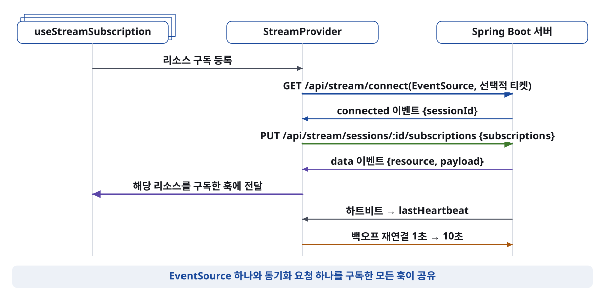

# @simplix-react-ext/simplix-boot-stream

[English](/en/extensions/simplix-boot/packages/stream/README.md) | **한국어**

EventSource 관리, 구독, 지연 감지를 갖춘 SimpliX Boot SSE 스트리밍 기반 패키지입니다. 앱을 `StreamProvider`로 감싼 뒤 React 훅(hook)으로 실시간 리소스 갱신을 받으세요.

## 설치

```bash
pnpm add @simplix-react-ext/simplix-boot-stream
```

> **사전 요구 사항:** 피어 의존성으로 `react`(>=18)가 필요합니다. 프로바이더는 기본적으로 SimpliX Boot(Spring Boot) SSE 백엔드에 연결하고 SimpliX-stream 봉투 형식을 파싱합니다. 그래서 이 패키지는 핵심 패키지가 아니라 `simplix-boot` 확장(extension)에 들어 있습니다. 다른 백엔드를 쓰려면 `StreamProvider`의 `protocol`, `url`, `subscriptionSync` props를 재정의(override)하세요.

## 사용법

### 앱 감싸기

앱 루트 가까이에 `StreamProvider`를 두세요. 프로바이더는 `EventSource` 연결 하나를 열고, 지수 백오프로 재연결을 관리하며, 컨텍스트로 하위 훅에 연결을 제공합니다.



```tsx
import { StreamProvider } from "@simplix-react-ext/simplix-boot-stream";

function App() {
  return (
    <StreamProvider url="/api/stream/connect">
      <Dashboard />
    </StreamProvider>
  );
}
```

`disabled` prop으로 인증 준비 여부에 따라 연결을 제어하세요. 인증 상태를 복원하는 동안에는 `true`로 두고, 인증을 확인한 뒤 `false`로 바꾸면 `EventSource`가 만료된 세션 쿠키로 연결하지 않습니다.

```tsx
<StreamProvider url="/api/stream/connect" disabled={!isAuthReady}>
  <Dashboard />
</StreamProvider>
```

### 쿠키 없이 인증하기

`EventSource`는 요청 헤더를 보낼 수 없습니다. 세션이 쿠키가 아닌 헤더(Bearer 토큰)로 전달되면 `ticketUrl`을 지정하세요. 프로바이더는 먼저 일반 요청으로 그 엔드포인트에서 일회용 연결 티켓을 받고, 연결 URL에 `ticket`으로 추가합니다. 티켓 요청에 앱의 인증 헤더가 필요하면 `requestTicket`을, 구독 동기화도 인증하려면 `subscriptionSync.headers`를 전달하세요.

```tsx
<StreamProvider
  url="/api/stream/connect"
  ticketUrl="/api/stream/ticket"
  requestTicket={async (url) => {
    const res = await fetch(url, { method: "POST", headers: { Authorization: `Bearer ${getToken()}` } });
    return res.ok ? ((await res.json()) as { ticket?: string }).ticket ?? null : null;
  }}
  subscriptionSync={{
    url: (sessionId) => `/api/stream/sessions/${sessionId}/subscriptions`,
    headers: () => ({ Authorization: `Bearer ${getToken()}` }),
  }}
>
  <Dashboard />
</StreamProvider>
```

### 연결 상태 읽기

`useStreamStatus`로 현재 연결 상태를 읽으세요. 상태나 세션이 바뀔 때만 다시 렌더링하며 하트비트로는 다시 렌더링하지 않습니다.

```tsx
import { useStreamStatus } from "@simplix-react-ext/simplix-boot-stream";

function ConnectionBadge() {
  const { connectionStatus, sessionId } = useStreamStatus();
  return <span>{connectionStatus} ({sessionId ?? "no session"})</span>;
}
```

### 리소스 구독하기

`useStreamSubscription`은 마운트할 때 서버 쪽 구독을 등록하고 언마운트할 때 해제하며, 해당 리소스로 받은 최신 데이터를 반환합니다.

```tsx
import { useStreamSubscription } from "@simplix-react-ext/simplix-boot-stream";

interface HealthPayload {
  status: "UP" | "DOWN";
}

function HealthWidget() {
  const health = useStreamSubscription<HealthPayload>("middleware-health");
  return <span>{health?.status ?? "..."}</span>;
}
```

서버 쪽 등록이 필요 없는 푸시(브로드캐스트) 리소스에는 `subscribe: false`를 전달하세요.

```tsx
const events = useStreamSubscription("audit-events", { subscribe: false });
```

### 지연과 최신 상태 감지하기

`useStaleDetection`은 마지막 하트비트 이후 흐른 시간으로 지연 수준을 정합니다.

```tsx
import { useStaleDetection } from "@simplix-react-ext/simplix-boot-stream";

function StalenessIndicator() {
  const { level, elapsedMs } = useStaleDetection();
  // level: "fresh" | "warning" | "critical" | "stale"
  return <span>{level} ({Math.round(elapsedMs / 1000)}s)</span>;
}
```

`useTimestampFreshness`는 임의의 타임스탬프부터 흐른 시간을 사용자 지정 임곗값과 비교하는 하위 수준 기본 함수입니다.

```tsx
import {
  useTimestampFreshness,
  type FreshnessThreshold,
} from "@simplix-react-ext/simplix-boot-stream";

const thresholds: FreshnessThreshold<"recent" | "old">[] = [
  { seconds: 30, level: "recent" },
  { seconds: 300, level: "old" },
];

function RowAge({ updatedAt }: { updatedAt: number }) {
  const { level } = useTimestampFreshness(updatedAt, thresholds, "live");
  return <span data-level={level} />;
}
```

### 스트림 로그 확인하기

로그는 기본적으로 꺼져 있습니다. 실행 중에 켜고 끄며 수집한 항목을 화면에 표시할 수 있어 개발자용 디버그 패널에 쓸 수 있습니다.

```tsx
import {
  useStreamLogs,
  setStreamLogEnabled,
  clearStreamLogs,
} from "@simplix-react-ext/simplix-boot-stream";

function StreamLogPanel() {
  const logs = useStreamLogs();
  return (
    <div>
      <button onClick={() => setStreamLogEnabled(true)}>Enable</button>
      <button onClick={() => setStreamLogEnabled(false)}>Disable</button>
      <button onClick={clearStreamLogs}>Clear</button>
      <ul>
        {logs.map((entry) => (
          <li key={entry.id}>
            {entry.type} {entry.resource} {entry.summary}
          </li>
        ))}
      </ul>
    </div>
  );
}
```

> **참고:** `setStreamLogEnabled(false)`를 호출하면 기존 로그 버퍼도 지웁니다. 버퍼에는 최근 200개 항목까지만 남습니다.

## API 레퍼런스

### `StreamProvider`

하위 훅에 SSE 연결을 제공합니다. `EventSource` 하나를 열고, 리소스 이벤트를 구독자에게 전달하며, 구독을 서버와 동기화하고, 지수 백오프(1s → 2s → 4s → 8s → 상한 10s, +/-25% 지터)로 재연결을 관리합니다.

**Props:**

| Prop | 타입 | 기본값 | 설명 |
| --- | --- | --- | --- |
| `children` | `ReactNode` | - | 스트림을 사용하는 앱 하위 트리 |
| `url` | `string` | `"/api/stream/connect"` | SSE 엔드포인트 URL |
| `mock` | `MockStreamConfig` | - | 목(mock) 모드 설정. 켜면 실제 연결을 건너뛰고 생성한 데이터를 내보냅니다 |
| `protocol` | `StreamProtocol` | SimpliX-stream 봉투 파서 | SSE 이벤트 데이터를 파싱하는 어댑터. 함수 단위로 기본값 위에 병합합니다 |
| `subscriptionSync` | `SubscriptionSyncConfig \| false` | SimpliX Boot 동기화(`PUT /api/stream/sessions/:id/subscriptions`) | 활성 구독을 서버와 동기화하는 방법. `false`이면 서버 쪽 동기화를 하지 않습니다 |
| `eventNames` | `StreamEventNames` | `connected` / `reconnected` / `data` / `heartbeat` / `gap` / `error` | 서버가 기본값과 다른 SSE 이벤트 이름을 쓸 때 재정의합니다 |
| `heartbeatTimeoutMs` | `number` | `10000` | 하트비트 감시 제한 시간. 이 시간 안에 활동이 없으면 프로바이더가 강제로 재연결합니다 |
| `disabled` | `boolean` | `false` | `true`이면 컨텍스트만 마운트하고 SSE 연결은 하지 않습니다(인증 준비 여부로 제어) |
| `ticketUrl` | `string` | - | 세션이 쿠키로 전달되지 않는 앱을 위한 일회용 연결 티켓 발급 엔드포인트. 티켓은 연결 URL에 추가합니다 |
| `requestTicket` | `(url: string) => Promise<string \| null>` | `{ ticket }`을 읽는 같은 출처 `POST` | 연결 티켓을 요청하는 방법. 앱의 인증 헤더가 필요한 요청에 사용합니다 |
| `maxConsecutiveRetries` | `number` | `20` | 연속 재연결 실패 허용 횟수. 넘으면 프로바이더가 재연결을 멈추고 감시도 중지합니다(기본 백오프로 약 3분). 다시 시도하려면 새로 고치거나 다시 마운트해야 합니다 |

### `useStreamContext()`

가장 가까운 `StreamProvider`의 `StreamContextValue`를 반환합니다. 프로바이더 밖에서 호출하면 오류를 발생시킵니다. `lastHeartbeat`를 담고 있어 하트비트마다 호출한 컴포넌트를 다시 렌더링하므로, 그 값을 읽지 않는다면 아래의 범위가 좁은 훅 두 개를 사용하세요.

**반환값(`StreamContextValue`):**

| 필드 | 타입 | 설명 |
| --- | --- | --- |
| `sessionId` | `string \| null` | 서버가 부여한 세션 ID. connected 이벤트 뒤에 설정됩니다 |
| `connectionStatus` | `ConnectionStatus` | 현재 연결 상태 |
| `lastHeartbeat` | `number` | 마지막 하트비트나 활동의 타임스탬프(ms) |
| `registerSubscription` | `(id: string, request: SubscriptionRequest) => void` | 전역 레지스트리에 구독을 등록합니다 |
| `unregisterSubscription` | `(id: string) => void` | 레지스트리에서 구독을 제거합니다 |
| `addEventListener` | `(resource: string, callback: (data: unknown) => void) => () => void` | 리소스 데이터를 수신합니다. 구독 해제 함수를 반환합니다 |

### `useStreamApi()`

가장 가까운 `StreamProvider`의 구독 함수만 반환하므로 하트비트로 호출한 컴포넌트를 다시 렌더링하지 않습니다. 반환값은 프로바이더가 살아 있는 동안 같은 참조를 유지합니다. 프로바이더 밖에서 호출하면 오류를 발생시킵니다.

**반환값(`StreamApiValue`):**

| 필드 | 타입 | 설명 |
| --- | --- | --- |
| `registerSubscription` | `(id: string, request: SubscriptionRequest) => void` | 전역 레지스트리에 구독을 등록합니다 |
| `unregisterSubscription` | `(id: string) => void` | 레지스트리에서 구독을 제거합니다 |
| `addEventListener` | `(resource: string, callback: (data: unknown) => void) => () => void` | 리소스 데이터를 수신합니다. 구독 해제 함수를 반환합니다 |

### `useStreamStatus()`

가장 가까운 `StreamProvider`의 `{ connectionStatus, sessionId }`를 반환합니다. 두 값이 바뀔 때만 새 값을 반환하며 하트비트로는 바뀌지 않습니다. 프로바이더 밖에서 호출하면 오류를 발생시킵니다.

**반환값(`StreamStatusValue`):**

| 필드 | 타입 | 설명 |
| --- | --- | --- |
| `connectionStatus` | `ConnectionStatus` | 현재 연결 상태 |
| `sessionId` | `string \| null` | 서버가 부여한 세션 ID. connected 이벤트 뒤에 설정됩니다 |

### `useStreamSubscription(resource, options?)`

SSE 리소스를 구독하고 받은 최신 데이터를 반환합니다. 마운트할 때 서버 쪽 구독을 등록하고(`subscribe`가 `false`이면 등록하지 않음) 언마운트할 때 해제합니다.

**매개변수:**

| 매개변수 | 타입 | 기본값 | 설명 |
| --- | --- | --- | --- |
| `resource` | `string` | - | 수신할 리소스 이름(예: `"middleware-health"`) |
| `options.params` | `Record<string, string>` | - | 구독과 함께 보내는 매개변수(선택) |
| `options.subscribe` | `boolean` | `true` | 서버 쪽 구독을 등록할지 여부. 브로드캐스트 푸시 리소스는 `false`로 지정하세요 |

**반환값:** `T | null`: 받은 최신 데이터. 첫 이벤트가 오기 전까지는 `null`입니다.

### `useStaleDetection(thresholds?)`

마지막 하트비트 이후 흐른 시간으로 SSE 연결의 지연을 감시합니다.

**매개변수:**

| 매개변수 | 타입 | 기본값 | 설명 |
| --- | --- | --- | --- |
| `thresholds.warningSeconds` | `number` | `5` | `"warning"` 수준이 되기까지의 초 |
| `thresholds.criticalSeconds` | `number` | `10` | `"critical"` 수준이 되기까지의 초 |
| `thresholds.staleSeconds` | `number` | `20` | `"stale"` 수준이 되기까지의 초 |

**반환값:** `{ level: StalenessLevel; elapsedMs: number }`. `warningSeconds` 미만이면 `level`은 `"fresh"`입니다.

### `useTimestampFreshness(timestamp, thresholds, defaultLevel)`

타임스탬프부터 흐른 시간을 추적해 이름 붙은 수준으로 바꾸는 하위 수준 기본 함수입니다. 1초마다 확인하며, 조건을 만족하는 마지막 임곗값을 적용합니다(임곗값은 `seconds` 오름차순으로 정렬해야 합니다).

**매개변수:**

| 매개변수 | 타입 | 설명 |
| --- | --- | --- |
| `timestamp` | `number` | 기준 타임스탬프(ms). `0`을 전달하면 항상 `elapsedMs`가 `0`인 `defaultLevel`을 반환합니다 |
| `thresholds` | `readonly FreshnessThreshold<L>[]` | `{ seconds, level }` 항목의 오름차순 목록 |
| `defaultLevel` | `L` | 흐른 시간이 모든 임곗값보다 작을 때 반환하는 수준 |

**반환값:** `{ level: L; elapsedMs: number }`.

### 스트림 로그 함수

| 함수 | 시그니처 | 설명 |
| --- | --- | --- |
| `useStreamLogs` | `() => readonly StreamLogEntry[]` | 메모리 로그 버퍼(최대 200개 항목)를 구독합니다 |
| `setStreamLogEnabled` | `(value: boolean) => void` | 로그를 켜거나 끕니다. 끄면 버퍼도 지웁니다 |
| `clearStreamLogs` | `() => void` | 수집한 로그 항목을 모두 지웁니다 |

## 타입

### `ConnectionStatus`

```ts
type ConnectionStatus = "connecting" | "connected" | "reconnecting" | "disconnected";
```

### `StalenessLevel`

```ts
type StalenessLevel = "fresh" | "warning" | "critical" | "stale";
```

### `SSEEventType`

```ts
type SSEEventType = "CONNECTED" | "DATA" | "HEARTBEAT" | "ERROR" | "RECONNECTED" | "GAP";
```

### `StreamProtocol`

프로바이더를 특정 SSE 봉투 형식에서 분리하는 어댑터(adapter)입니다. 각 함수는 `MessageEvent.data` 원본 문자열을 받습니다. 생략한 함수는 기본 SimpliX-stream 파서를 사용합니다.

```ts
interface StreamProtocol {
  parseConnected?: (data: string) => ParsedConnectedEvent;
  parseData?: (data: string) => ParsedDataEvent;
  parseGap?: (data: string) => ParsedGapEvent;
}

interface ParsedConnectedEvent {
  sessionId: string;
}

interface ParsedDataEvent {
  resource: string;
  payload: unknown;
}

interface ParsedGapEvent {
  resource: string;
  reason: string;
}
```

### `SubscriptionSyncConfig`

활성 구독을 서버와 동기화하는 방법을 프로바이더에 알려 줍니다. 동기화를 끄려면 `subscriptionSync` prop을 `false`로 지정하세요.

```ts
interface SubscriptionSyncConfig {
  /** Build the URL for subscription sync. Receives the session ID. */
  url: (sessionId: string) => string;
  /** HTTP method. Default: "PUT" */
  method?: string;
  /** Build the request body. Default: `{ subscriptions }` */
  body?: (subscriptions: SubscriptionRequest[]) => unknown;
  /** Extra request headers, resolved per sync. */
  headers?: () => Record<string, string>;
}
```

### `MockStreamConfig`

목 모드를 설정합니다. `enabled`이면 프로바이더가 실제 연결을 건너뛰고 `"connected"` 상태를 보고하며, 일정 간격으로 생성한 데이터를 내보냅니다.

```ts
interface MockStreamConfig {
  enabled: boolean;
  generators?: Record<string, () => unknown>;
  intervalMs?: number;
}
```

### `StreamEventNames`

```ts
interface StreamEventNames {
  connected?: string;
  reconnected?: string;
  data?: string;
  heartbeat?: string;
  gap?: string;
  error?: string;
}
```

### `StreamLogEntry`

```ts
interface StreamLogEntry {
  id: number;
  timestamp: number;
  type: "connected" | "reconnected" | "data" | "heartbeat" | "gap" | "error" | "mock-data";
  resource?: string;
  summary?: string;
}
```

### `FreshnessThreshold`

```ts
interface FreshnessThreshold<L extends string> {
  readonly seconds: number;
  readonly level: L;
}
```

### 서버 전송 타입

서버가 보내는 원본 데이터와 구독 요청을 나타내는 타입입니다. `SubscriptionRequest`, `StreamContextValue`, `StalenessThresholds`도 내보내며 위 API 레퍼런스에 형태가 나와 있습니다.

```ts
interface SSEDataPayload<T = unknown> {
  resource: string;
  params: Record<string, string>;
  data: T;
}

interface SSEConnectedPayload {
  sessionId: string;
}

interface SSEGapPayload {
  resource: string;
  reason: string;
}

interface SubscriptionRequest {
  resource: string;
  params?: Record<string, string>;
}
```

## 관련 문서

- [SimpliX Boot 확장](/ko/extensions/simplix-boot/README.md)

---

<p class="page-source"><a href="https://github.com/simplix-framework/simplix-react/blob/main/extensions/simplix-boot/packages/stream/README.ko.md" target="_blank" rel="noopener noreferrer">원본 보기</a></p>
