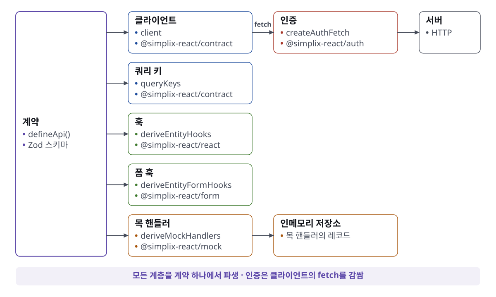

# 개요

[English](/en/getting-started/overview.md) | **한국어**

## simplix-react란

simplix-react는 OpenAPI 명세에서 재사용할 수 있는 도메인 패키지를 자동으로 생성하는 **패키지 우선 React 프레임워크**입니다. API 계약(contract) 정의 하나에서 시작해 타입 안전한 HTTP 클라이언트, React Query 훅(hook), 폼 훅, MSW 목(mock) 핸들러를 파생하는 파이프라인을 제공합니다. 반복 코드가 줄고 데이터 계층 전체가 같은 정의를 따릅니다.

## 핵심 원칙: 한 번 정의하고 모두 파생하기

simplix-react는 API 계약을 **단일 기준 정의**로 삼습니다. 엔티티(entity)와 그 오퍼레이션(operation)을 Zod 스키마로 한 번 정의하면 나머지는 프레임워크가 파생합니다.



API 타입, 클라이언트 함수, 쿼리 훅, 목 데이터를 손으로 맞춰 둘 필요가 없습니다. 계약을 바꾸면 파생한 계층이 타입 안전성을 유지한 채 함께 바뀝니다.

## 파이프라인

**1단계: 계약 정의**

`defineApi`와 Zod 스키마로 엔티티(CRUD 자원)를 기술합니다. 엔티티에는 스키마와 오퍼레이션 맵이 있고, 오퍼레이션마다 HTTP 메서드와 경로를 적습니다. 이름이 `list`, `get`, `create`, `update`, `delete`, `tree`인 오퍼레이션은 그 CRUD 역할을 맡고, 다른 이름은 사용자 정의 오퍼레이션입니다. `defineApi`는 `config`, 타입이 지정된 `client`, `queryKeys` 팩토리를 담은 계약을 반환합니다.

```ts
import { defineApi, simpleQueryBuilder } from "@simplix-react/contract";
import { z } from "zod";

const taskSchema = z.object({ id: z.number(), title: z.string(), status: z.string() });

const projectApi = defineApi({
  domain: "project",
  basePath: "/api/v1",
  entities: {
    task: {
      schema: taskSchema,
      operations: {
        list: { method: "GET", path: "/tasks" },
        get: { method: "GET", path: "/tasks/:id" },
        create: { method: "POST", path: "/tasks", input: taskSchema.omit({ id: true }) },
        update: { method: "PATCH", path: "/tasks/:id", input: taskSchema.partial().omit({ id: true }) },
        delete: { method: "DELETE", path: "/tasks/:id" },
      },
    },
  },
  queryBuilder: simpleQueryBuilder,
});
```

**2단계: 훅 파생**

계약을 `deriveEntityHooks`에 전달하면 엔티티마다 React Query 훅을 얻습니다. 훅 이름은 `use`에 오퍼레이션 이름을 이어 쓴 것이고, `list` 오퍼레이션에서는 `useInfiniteList`도 함께 파생합니다.

```ts
import { deriveEntityHooks } from "@simplix-react/react";

const hooks = deriveEntityHooks(projectApi);

// hooks.task.useList()
// hooks.task.useInfiniteList()
// hooks.task.useGet(id)
// hooks.task.useCreate()
// hooks.task.useUpdate()
// hooks.task.useDelete()
```

**3단계: 백엔드 목 구성**

같은 계약에서 MSW 요청 핸들러를 파생합니다. 인메모리 저장소와 함께 쓰면 서버를 준비하지 않고도 동작하는 목 백엔드를 얻습니다. 초기 데이터의 키는 저장소 이름인 `<domain>_<snake_case 엔티티 이름>`입니다.

```ts
import { deriveMockHandlers, setupMockWorker } from "@simplix-react/mock";

await setupMockWorker({
  domains: [{
    name: "project",
    handlers: deriveMockHandlers(projectApi.config),
    seed: { project_task: [{ id: 1, title: "Sample", status: "todo" }] },
  }],
});
```

## 대상 사용자

simplix-react는 다음과 같은 React 개발자를 위해 설계했습니다.

- REST 백엔드를 쓰는 **API 중심 애플리케이션**을 만드는 개발자
- 데이터 계층 전체(계약 → 클라이언트 → 훅 → 목)에서 **타입 안전성**이 필요한 개발자
- 반복 코드를 줄이려고 **설정보다 관례**를 선호하는 개발자
- 프론트엔드 우선 개발, 시연, 오프라인 사용을 위해 **목 데이터 계층**이 필요한 개발자
- 서버 상태 관리에 **TanStack Query**를 쓰는 개발자

## 패키지 개요

| 패키지 | 설명 |
| --- | --- |
| `@simplix-react/contract` | Zod 기반의 타입 안전한 API 계약 정의. `defineApi`의 진입점입니다. |
| `@simplix-react/react` | `deriveEntityHooks`로 계약에서 TanStack Query 훅을 파생합니다. |
| `@simplix-react/form` | `deriveEntityFormHooks`로 계약에서 TanStack Form 훅을 파생합니다. |
| `@simplix-react/mock` | 계약에서 파생한 MSW 핸들러와 인메모리 저장소. |
| `@simplix-react/auth` | Bearer, API Key, OAuth2, 사용자 정의 방식을 지원하는 인증 미들웨어. |
| `@simplix-react/access` | CASL 기반 인가와 접근 제어. |
| `@simplix-react/i18n` | i18next 기반 국제화 프레임워크. |
| `@simplix-react/ui` | CRUD UI 컴포넌트(목록, 폼, 상세, 트리, 필터). |
| `@simplix-react/api` | 생성된 도메인 패키지가 쓰는 Orval mutator 싱글턴. |
| `@simplix-react/headless` | 웹과 네이티브 UI 키트가 함께 쓰는 플랫폼 중립 로직. |
| `@simplix-react/calendar` | 도메인에 묶이지 않는 달력 컴포넌트(월간, 주간, 일간, 연간, 일정 목록, 타임라인 보기). |
| `@simplix-react/gantt-core` | 프레임워크에 의존하지 않는 프로젝트 일정 엔진. |
| `@simplix-react/gantt` | 일정 엔진 위의 React 간트 차트. |
| `@simplix-react/process-core` | 프레임워크에 의존하지 않는 절차 모델. |
| `@simplix-react/process` | 절차 모델 위의 React 절차 레인. |
| `@simplix-react/testing` | simplix-react 애플리케이션용 테스트 유틸리티. |
| `@simplix-react/cli` | 프로젝트 스캐폴딩과 검증용 CLI. |

메타 패키지 `simplix-react`는 `headless`를 제외한 이 패키지를 모두 의존성으로 포함합니다.

## 다음 단계

- [설치](/ko/getting-started/installation.md): 프로젝트에 simplix-react를 설치합니다
- [빠른 시작](/ko/getting-started/quick-start.md): 계약 기반 기능을 처음 만들어 봅니다
- [TypeScript 설정](/ko/getting-started/typescript.md): 타입 추론에 맞게 TypeScript를 설정합니다

---

<p class="page-source"><a href="https://github.com/simplix-framework/simplix-react/blob/main/docs/ko/getting-started/overview.md" target="_blank" rel="noopener noreferrer">원본 보기</a></p>
