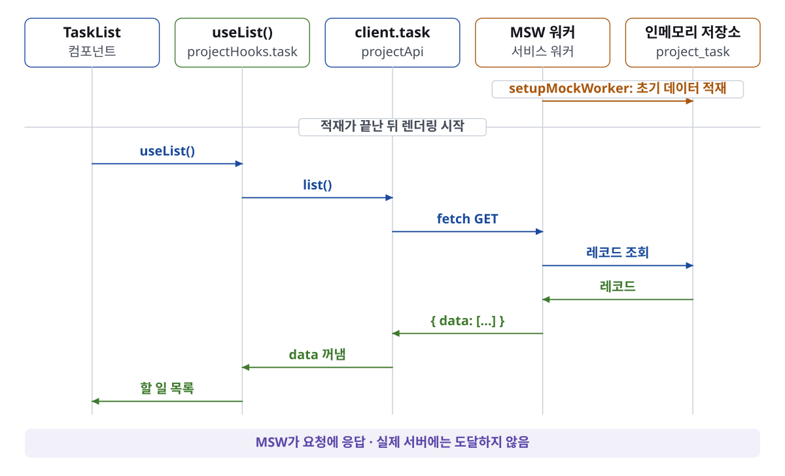

# 빠른 시작

[English](/en/getting-started/quick-start.md) | **한국어**

계약 기반 기능 하나를 처음부터 끝까지 만들어 봅니다. 계약(contract) 정의, 훅(hook) 파생, React에서 데이터 표시, 목(mock) 백엔드 추가까지 simplix-react 파이프라인 전체를 차례로 다룹니다.

## 1단계: 의존성 설치

```bash
# Runtime
pnpm add @simplix-react/contract @simplix-react/react \
  zod @tanstack/react-query @tanstack/react-query-persist-client \
  @tanstack/query-sync-storage-persister react react-dom

# Dev (mock layer)
pnpm add -D @simplix-react/mock msw
```

## 2단계: 계약 정의

`task` 엔티티(entity)를 기술하는 계약을 만드세요. 엔티티 모양을 나타내는 Zod 스키마 하나와 CRUD 역할마다 오퍼레이션(operation) 하나를 적고, `create`와 `update`에는 요청 스키마를 `input`으로 지정합니다.

```ts
// src/contracts/project.ts
import { z } from "zod";
import { defineApi, simpleQueryBuilder } from "@simplix-react/contract";

const taskSchema = z.object({
  id: z.number(),
  title: z.string(),
  status: z.string(),
  createdAt: z.string(),
});

const taskCreateSchema = taskSchema.pick({ title: true, status: true });
const taskUpdateSchema = taskCreateSchema.partial();

export const projectApi = defineApi({
  domain: "project",
  basePath: "/api/v1",
  entities: {
    task: {
      schema: taskSchema,
      operations: {
        list: { method: "GET", path: "/tasks" },
        get: { method: "GET", path: "/tasks/:id" },
        create: { method: "POST", path: "/tasks", input: taskCreateSchema },
        update: { method: "PATCH", path: "/tasks/:id", input: taskUpdateSchema },
        delete: { method: "DELETE", path: "/tasks/:id" },
      },
    },
  },
  queryBuilder: simpleQueryBuilder,
});

// Inferred types: no manual type definitions needed
export type Task = z.infer<typeof taskSchema>;
export type TaskCreate = z.infer<typeof taskCreateSchema>;
export type TaskUpdate = z.infer<typeof taskUpdateSchema>;
```

이 정의 하나로 다음을 얻습니다.

- 타입 안전한 HTTP 클라이언트(`projectApi.client.task`)
- 캐시 관리용 쿼리 키 팩토리(`projectApi.queryKeys.task`)

## 3단계: 훅 파생

계약을 `deriveEntityHooks`에 전달하면 오퍼레이션마다 TanStack Query 훅을 얻습니다.

```ts
// src/hooks/project-hooks.ts
import { deriveEntityHooks } from "@simplix-react/react";
import { projectApi } from "../contracts/project";

export const projectHooks = deriveEntityHooks(projectApi);

// Available hooks:
// projectHooks.task.useList()          fetch all tasks
// projectHooks.task.useInfiniteList()  paginated list
// projectHooks.task.useGet(id)         fetch one task
// projectHooks.task.useCreate()        create a task
// projectHooks.task.useUpdate()        update a task: mutate({ id, dto })
// projectHooks.task.useDelete()        delete a task: mutate(id)
```

## 4단계: React 컴포넌트에서 사용

파생한 훅을 컴포넌트에서 쓰세요. 훅은 `data`, `isLoading`, `error`, `mutate` 등 TanStack Query의 표준 결과를 반환합니다.

```tsx
// src/components/task-list.tsx
import { projectHooks } from "../hooks/project-hooks";

export function TaskList() {
  const { data: tasks, isLoading, error } = projectHooks.task.useList();
  const createTask = projectHooks.task.useCreate();
  const deleteTask = projectHooks.task.useDelete();

  if (isLoading) return <p>Loading tasks...</p>;
  if (error) return <p>Error: {error.message}</p>;

  return (
    <div>
      <h1>Tasks</h1>

      <button
        onClick={() =>
          createTask.mutate({
            title: "New Task",
            status: "pending",
          })
        }
      >
        Add Task
      </button>

      <ul>
        {tasks?.map((task) => (
          <li key={task.id}>
            {task.title}: {task.status}
            <button onClick={() => deleteTask.mutate(task.id)}>Delete</button>
          </li>
        ))}
      </ul>
    </div>
  );
}
```

애플리케이션을 TanStack Query 프로바이더로 감싸세요.

```tsx
// src/app.tsx
import { QueryClient, QueryClientProvider } from "@tanstack/react-query";
import { TaskList } from "./components/task-list";

const queryClient = new QueryClient();

export function App() {
  return (
    <QueryClientProvider client={queryClient}>
      <TaskList />
    </QueryClientProvider>
  );
}
```

## 5단계: 목 데이터 계층 추가

`@simplix-react/mock`으로 MSW와 인메모리 저장소 기반의 브라우저 안 백엔드를 만듭니다. 실제 서버는 필요하지 않습니다.



### 5a. 핸들러 파생과 워커 시작

초기 데이터의 키는 저장소 이름입니다. 도메인과 snake_case 엔티티 이름을 연결한 것으로, 이 예제에서는 `project_task`입니다. 핸들러는 생성한 레코드에 다음 순번의 숫자 `id`를 지정하고 `createdAt`과 `updatedAt`에 생성 시각을 기록합니다.

```ts
// src/mocks/setup.ts
import { deriveMockHandlers, setupMockWorker } from "@simplix-react/mock";
import { projectApi } from "../contracts/project";

export async function startMockWorker(): Promise<void> {
  await setupMockWorker({
    domains: [
      {
        name: "project",
        handlers: deriveMockHandlers(projectApi.config),
        seed: {
          project_task: [
            { id: 1, title: "Design the API contract", status: "done" },
            { id: 2, title: "Implement the frontend", status: "in-progress" },
            { id: 3, title: "Write tests", status: "pending" },
          ],
        },
      },
    ],
  });
}
```

MSW의 서비스 워커 스크립트를 public 디렉터리에 두세요.

```bash
npx msw init public/ --save
```

### 5b. 렌더링 전 초기화

```tsx
// src/main.tsx
import { createRoot } from "react-dom/client";
import { App } from "./app";

async function bootstrap() {
  if (import.meta.env.DEV) {
    const { startMockWorker } = await import("./mocks/setup");
    await startMockWorker();
  }

  createRoot(document.getElementById("root")!).render(<App />);
}

bootstrap();
```

## 완성한 결과

파일 몇 개로 다음을 갖추었습니다.

- ✔ Zod 스키마로 검증하는 **타입 안전한 API 계약**
- ✔ `list`, `get`, `create`, `update`, `delete` 메서드가 있는 **HTTP 클라이언트**
- ✔ 캐시를 자동으로 무효화하는 **React Query 훅**
- ✔ MSW와 인메모리 저장소로 동작하는 **브라우저 안 목 백엔드**
- ✔ **손으로 쓴 타입 정의 없음**: 모든 타입을 계약에서 추론합니다

## 다음 단계

- [TypeScript 설정](/ko/getting-started/typescript.md): TypeScript 설정을 다듬습니다
- [개요](/ko/getting-started/overview.md): 프레임워크 구조를 더 알아봅니다

---

<p class="page-source"><a href="https://github.com/simplix-framework/simplix-react/blob/main/docs/ko/getting-started/quick-start.md" target="_blank" rel="noopener noreferrer">원본 보기</a></p>
