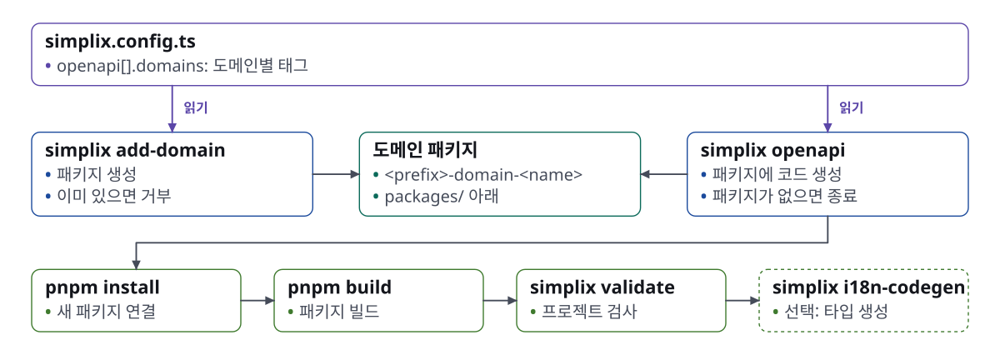

# simplix CLI 사용 방법

[English](/en/guides/cli-usage.md) | **한국어**

> `simplix` 명령줄 도구로 프로젝트를 생성하고, 도메인과 모듈을 추가하고, 구조를 검증하고, i18n 타입을 생성하고, OpenAPI 명세를 가져옵니다.

## 시작하기 전에

- Node.js 18 이상과 pnpm을 설치하세요.
- CLI를 전역으로 설치하거나 `npx`로 실행하세요.

```bash
pnpm add -g @simplix-react/cli

# or use without installing
npx @simplix-react/cli <command>
```

## 해결 방법

모든 명령은 작업 디렉터리나 그 상위에서 `simplix.config.ts`가 있는 가장 가까운 디렉터리를 프로젝트 루트로 찾습니다. 전역 옵션 `--root <dir>`를 주면 그 디렉터리를 루트로 사용하고, 명령을 실행하기 전에 그 루트의 설정에 선언된 플러그인을 불러옵니다.



### simplix init: 새 프로젝트 생성

루트 설정, 핵심 패키지, 선택 항목인 데모 앱이 들어 있는 모노레포 전체를 생성합니다.

```bash
simplix init my-project
```

대화형 질문 항목은 다음과 같습니다.

| 질문 | 기본값 | 설명 |
| --- | --- | --- |
| npm scope | `@my-project` | 패키지 범위(예: `@mycompany`) |
| Include demo app? | `true` | `apps/my-project-demo/`를 생성 |
| Enable i18n? | `true` | 로케일 파일과 i18n 설정을 구성 |
| Enable auth? | `true` | 인증을 구성 |
| Enable access control? | `true` | 인가를 구성 |
| Select locales | en, ko, ja | 내장 로케일 중 여러 개 선택(i18n을 켠 경우에만 질문) |

비대화형 모드는 모든 기본값을 그대로 사용합니다.

```bash
simplix init my-project -y
```

범위를 지정하려면 다음과 같이 실행하세요.

```bash
simplix init my-project --scope @mycompany
```

선택 기능을 빼려면 다음과 같이 실행하세요.

```bash
simplix init my-project --no-demo --no-i18n --no-auth --no-access
```

| 옵션 | 설명 |
| --- | --- |
| `-s, --scope <scope>` | 패키지의 npm 범위(`@`가 없으면 붙임) |
| `--no-demo` | 데모 앱을 생성하지 않음 |
| `--no-i18n` | i18n을 구성하지 않음 |
| `--no-auth` | 인증을 구성하지 않음 |
| `--no-access` | 접근 제어를 구성하지 않음 |
| `-y, --yes` | 모든 기본값 사용(비대화형) |

대상 디렉터리가 이미 있으면 명령을 중단합니다.

생성되는 구조는 다음과 같습니다.

```text
my-project/
  package.json
  pnpm-workspace.yaml
  turbo.json
  tsconfig.json
  .gitignore
  .claude/CLAUDE.md
  config/typescript/
    base.json
    react.json
  packages/my-project-core/
    src/
      index.ts
      api/
      mock/
      react/
      types/
  apps/my-project-demo/          # if --demo
    src/
      main.tsx
      app/
        i18n/                    # if --i18n
      locales/                   # if --i18n
      routes/
  modules/
```

생성한 뒤에 다음 명령을 실행하세요.

```bash
cd my-project
pnpm install
pnpm build
pnpm dev
```

### simplix add-domain: 도메인 패키지 추가

`packages/` 아래에 도메인 패키지의 기본 구성을 `<prefix>-domain-<name>` 이름으로 생성합니다. prefix는 `simplix.config.ts`의 `packages.prefix`이고, 없으면 루트 패키지 이름입니다.

```bash
simplix add-domain inventory
```

| 옵션 | 설명 |
| --- | --- |
| `--no-i18n` | i18n 번역을 구성하지 않음 |
| `-y, --yes` | 모든 기본값 사용(비대화형) |

기본 구성의 내용은 `simplix.config.ts`의 `openapi` 항목에 따라 달라집니다.

- `openapi` 항목의 `domains`에 이 도메인 이름이 있으면 생성 코드를 받을 수 있도록 패키지를 준비합니다(`src/mutator.ts`와 코드 생성 스크립트). 코드는 `simplix openapi`로 생성하고, 항목에 `meta` 블록이 있으면 `simplix meta`로 생성합니다.
- 그렇지 않으면 엔티티(entity) 이름을 묻고(쉼표로 구분, 기본값 `inventory`. `-y`를 주면 도메인 이름 하나를 엔티티로 사용), 그 엔티티의 계약, 훅, 목 계층을 직접 작성하는 형태로 생성합니다.

패키지가 이미 있으면 명령을 중단하고, 코드를 다시 생성하는 명령을 출력합니다.

`openapi` 항목이 없을 때 생성되는 구조는 다음과 같습니다.

```text
packages/my-project-domain-inventory/
  package.json
  tsup.config.ts
  vitest.config.ts
  tsconfig.json
  src/
    index.ts
    schemas.ts
    contract.ts
    hooks.ts
    translations.ts      # if i18n enabled
    locales/             # if i18n enabled
      en.json
      ko.json
      ja.json
    mock/
      index.ts
      handlers.ts
      seed.ts
```

생성한 뒤에 다음 명령을 실행하세요.

```bash
pnpm install
pnpm build
```

그다음 앱에 의존성을 추가하세요.

```json
{
  "dependencies": {
    "@mycompany/my-project-domain-inventory": "workspace:*"
  }
}
```

### simplix add-module: FSD 모듈 추가

`modules/` 아래에 features, widgets, shared 계층과 선택 항목인 i18n이 들어 있는 Feature-Sliced Design 모듈을 생성합니다.

```bash
simplix add-module editor
```

| 옵션 | 설명 |
| --- | --- |
| `--no-i18n` | 로케일 파일을 생성하지 않음 |
| `-y, --yes` | 비대화형 모드 |

생성되는 구조는 다음과 같습니다.

```text
modules/my-project-editor/
  package.json
  tsup.config.ts
  vitest.config.ts
  tsconfig.json
  src/
    index.ts
    features/
      index.ts
    widgets/
      index.ts
    shared/
      lib/
      ui/
      config/
    locales/           # if i18n enabled
      index.ts
      widgets/
        en.json
        ko.json
        ja.json
      features/
        en.json
        ko.json
        ja.json
```

### simplix validate: 프로젝트 구조 검증

워크스페이스 루트, `packages/`, `modules/`, `apps/`에 검증 규칙을 적용합니다.

```bash
simplix validate
```

| 규칙 묶음 | 범위 | 검사 내용 |
| --- | --- | --- |
| Root Rules | 워크스페이스 루트 | `turbo.json`, 스크립트, catalog, `tsconfig` |
| Package Rules | packages/, modules/ | `package.json` 필드, exports, 의존성, 빌드 설정 |
| Contract Rules | packages/ | API 계약 스키마의 유효성, 엔티티 정의 |
| FSD Rules | modules/, apps/ | Feature-Sliced Design 계층 구조와 규칙 |
| Import Rules | modules/ | 계층을 넘는 import 위반 |
| i18n Rules | modules/ | 누락된 로케일 키, 로케일 파일 간 일치 |

자동 수정을 지원하는 문제는 고칠 수 있습니다. 값 없이 `--fix`만 주면 패키지 exports만 고칩니다. 더 고치려면 검사 이름을 쉼표로 구분해 지정하거나 `all`을 지정하세요.

```bash
simplix validate --fix
simplix validate --fix exports,dependencies,i18n
simplix validate --fix all
```

`--fix`에 지정할 수 있는 검사는 `exports`, `dependencies`, `tsup`, `i18n`, `fsd`, `root`, `tsconfig`, `expo`입니다. `simplix.config.ts`의 `i18n.localeOnlyKeys`에 적은 키는 남는 키로 보고하지 않고 `--fix`로 지우지도 않습니다.

출력 예시는 다음과 같습니다.

```text
simplix validate

  packages/my-project-core
    ✔ package.json has required fields
    ✔ tsconfig.json exists
    ✔ Build config valid

  modules/my-project-editor
    ✔ FSD layers present
    ⚠ Missing locale key: "save_button" in ko.json
    ✖ Import violation: widgets/ imports from features/

  Summary: 1 error, 1 warning, 4 checks passed
```

오류가 있으면 종료 코드가 `1`이므로 CI 파이프라인에서 사용할 수 있습니다.

```bash
simplix validate || exit 1
```

### simplix i18n-codegen: 로케일 파일에서 TypeScript 타입 생성

`modules/` 아래 모듈의 로케일 디렉터리마다 `keys.d.ts` 타입 정의를 생성합니다. 키는 `en.json`에서 읽고, `en.json`이 없으면 첫 번째 JSON 파일에서 읽습니다. 타입 이름은 디렉터리 이름에서 정합니다(`locales`이면 `LocalesKeys`).

```bash
simplix i18n-codegen
```

모듈에 다음 `src/locales/en.json`이 있다고 가정합니다.

```json
{
  "title": "Editor",
  "actions": {
    "save": "Save",
    "cancel": "Cancel"
  }
}
```

명령은 다음 `src/locales/keys.d.ts`를 생성합니다.

```ts
// Auto-generated by simplix i18n-codegen
// Do not edit manually

export type LocalesKeys =
  | "title"
  | "actions.save"
  | "actions.cancel";
```

감시 모드는 파일이 바뀔 때마다 다시 생성합니다.

```bash
simplix i18n-codegen --watch
```

### simplix openapi: OpenAPI 명세에서 도메인 코드 생성

OpenAPI 명세를 분석해 Orval로 도메인 패키지의 스키마, 클라이언트, 훅, 목 계층, `.http` 테스트 파일을 생성합니다. 패키지가 먼저 있어야 하므로 `simplix add-domain`으로 만드세요.

```bash
simplix openapi ./specs/petstore.yaml
```

```bash
simplix openapi https://api.example.com/openapi.json --domain pets
```

| 옵션 | 설명 |
| --- | --- |
| `-d, --domain <name>` | 생성할 도메인(기본값: 모든 도메인) |
| `-e, --entities <names>` | 생성할 엔티티(쉼표로 구분, 기본값: 전체) |
| `-o, --output <dir>` | 출력 디렉터리(기본값: `packages/`) |
| `-f, --force` | 바뀐 내용이 없어도 다시 생성 |
| `--no-http` | `.http` 파일을 생성하지 않음 |
| `--offline` | 서버 대신 설정한 `meta.snapshot`에서 SimpliX Meta를 읽음 |
| `-y, --yes` | 질문 없이 자동 확인 |

다시 실행하면 `.openapi-snapshot.json` 파일과 비교해 바뀐 내용을 찾고, 생성 코드(`src/generated/`, `src/hooks/`, `src/mock/`)만 다시 생성합니다. `src/index.ts`에 직접 추가한 export는 유지합니다. 바뀐 내용이 없어도 다시 생성하려면 `-f, --force`를 사용하세요.

#### 다중 도메인 모드

OpenAPI 명세의 오퍼레이션(operation)에 서로 다른 도메인의 태그가 지정되어 있으면 출력을 여러 패키지로 나눌 수 있습니다. `simplix.config.ts`에 `domains`가 있는 `openapi` 항목을 추가하세요. `openapi`는 명세마다 설정 하나를 담는 배열입니다.

```ts
// simplix.config.ts
import { defineConfig } from "@simplix-react/cli";

export default defineConfig({
  openapi: [
    {
      spec: "./specs/petstore.yaml",
      domains: {
        pet: ["pet"],
        store: ["store"],
        user: ["user"],
      },
    },
  ],
});
```

키는 도메인 이름이고, 값은 태그 패턴의 배열입니다. 패턴은 정확히 일치하는 문자열이나 `/`로 감싼 정규 표현식입니다.

```ts
// Exact match + regex patterns
domains: {
  iam: ["IAM", "Authentication", "/^Auth.*/"],
  billing: ["Billing", "/^Payment.*/"],
}
```

이 설정으로 `simplix openapi`를 실행하면 일치하는 도메인마다 패키지 하나에 코드를 생성합니다.

```bash
simplix openapi https://petstore.swagger.io/v2/swagger.json -y
# → packages/myapp-domain-pet/
# → packages/myapp-domain-store/
# → packages/myapp-domain-user/
```

설정한 어느 도메인에도 태그가 일치하지 않는 오퍼레이션은 명세 제목을 이름으로 하는 대체 도메인으로 묶습니다. 이 도메인에는 패키지가 없으므로 명령은 안내 문구를 출력하고 해당 오퍼레이션을 건너뜁니다. 일치하는 엔티티가 없는 도메인도 건너뜁니다.

### 기타 명령

| 명령 | 설명 |
| --- | --- |
| `simplix add-app <name>` | 워크스페이스에 앱 셸 추가(`--native`이면 Expo 앱) |
| `simplix init-ui` | shadcn/ui와 연동하도록 `@simplix-react/ui` 초기화 |
| `simplix scaffold <entity>` | FSD 모듈의 `widgets/` 계층에 CRUD 위젯 생성 |
| `simplix add-page <kind> <name>` | 페이지 템플릿에서 지정한 종류의 페이지 추가 |
| `simplix generated [paths...]` | 생성된 파일마다 현재 템플릿과 비교해 그대로인지, 고쳤는지, 낡았는지 보고. `--all`이면 다시 생성 |
| `simplix kit-fence` | UI 키트가 차단하는 프레임워크 import를 린트 설정이 정확히 거부하는지 검사 |
| `simplix meta` | Orval 없이 SimpliX Meta에서 도메인 패키지 생성 |
| `simplix meta-diff <domain>` | 도메인의 Orval 출력과 SimpliX Meta 출력을 비교해 다른 곳을 보고 |
| `simplix meta-info <entity>` | 커밋된 SimpliX Meta 기준으로 엔티티 화면에 제공되는 목록, 정렬, 검색, 필터, 동작, 필드를 출력 |
| `simplix check-screen [entity...]` | 생성된 화면 파일을 커밋된 SimpliX Meta와 대조해 판정하고, 오류가 있으면 1로 종료 |
| `simplix cycles [roots...]` | 소스 파일 사이의 import 순환과 워크스페이스 패키지 사이의 의존성 순환을 보고 |
| `simplix meta-removals [roots...]` | 코드가 아직 참조하는 타입, 필드, 오퍼레이션, enum 값이 SimpliX Meta 스냅샷에서 빠지면 실패. git 리비전(`--base`, 기본값 `HEAD`)과 비교 |

명령마다 옵션은 `simplix <command> --help`로 확인하세요.

## 변형

### 설정 파일

CLI 동작을 바꾸려면 프로젝트 루트에 `simplix.config.ts`를 만드세요.

```ts
// simplix.config.ts
import { defineConfig } from "@simplix-react/cli";

export default defineConfig({
  plugins: ["@simplix-react-ext/simplix-boot-cli-plugin"],
  packages: {
    prefix: "myapp",
  },
  http: {
    environments: {
      dev: { baseUrl: "http://localhost:3000" },
      staging: { baseUrl: "https://staging.example.com" },
      production: { baseUrl: "https://api.example.com" },
    },
  },
  codegen: {
    header: true,
  },
  openapi: [
    {
      spec: "./specs/api.json",
      profile: "simplix-boot",
      domains: {
        iam: ["IAM", "/^Auth.*/"],
        billing: ["Billing"],
      },
    },
  ],
});
```

| 필드 | 설명 |
| --- | --- |
| `plugins` | 불러올 CLI 확장 플러그인 모듈 ID(예: `@simplix-react-ext/simplix-boot-cli-plugin`). `openapi` 항목이 `profile`을 참조하면 필수 |
| `api.baseUrl` | 직접 작성하는 도메인 패키지의 API 기본 URL(기본값 `/api`) |
| `packages.prefix` | 생성되는 패키지 이름의 짧은 접두사 |
| `http.environments` | `.http` 파일 생성에 사용하는 이름 있는 환경 |
| `codegen.header` | 생성 파일 맨 앞에 자동 생성 안내 주석 추가(기본값 `true`) |
| `i18n.locales` | 지원하는 로케일 코드(기본값 `["en", "ko", "ja"]`) |
| `i18n.defaultLocale` | 기본 로케일 코드(기본값 `"en"`) |
| `i18n.localeOnlyKeys` | 기준 로케일에는 없고 특정 로케일에만 있을 수 있는 키(로케일 코드별) |
| `openapi[].spec` | OpenAPI 명세 파일 경로(프로젝트 루트 기준) 또는 URL |
| `openapi[].profile` | 플러그인이 등록한 명세 프로필 이름(예: `simplix-boot`) |
| `openapi[].domains` | 태그 기준 도메인 분할: 도메인 이름 → 태그 패턴(정확히 일치 또는 `/regex/`) |
| `openapi[].meta` | SimpliX Meta 원본과 `snapshot` 경로. `simplix meta`와 `--offline`이 읽음 |

### CI 연동

CI 파이프라인에서 검증과 타입 검사를 실행하세요.

```bash
#!/bin/bash
set -e

pnpm install
pnpm build
simplix validate
pnpm typecheck
pnpm lint
pnpm test
```

### 새 도메인 작업에서 명령 조합

새 API 도메인을 추가하는 일반적인 순서입니다. `simplix.config.ts`의 `openapi[].domains`에 `inventory`가 있다고 가정합니다.

```bash
# 1. Create the domain package
simplix add-domain inventory -y

# 2. Generate from OpenAPI spec
simplix openapi ./specs/inventory.yaml --domain inventory -y

# 3. Install dependencies
pnpm install

# 4. Build the new package
pnpm build

# 5. Validate the project
simplix validate

# 6. Generate i18n types if the domain has locale files
simplix i18n-codegen
```

## 관련 문서

- [국제화](/ko/guides/internationalization.md): `simplix init`이 구성하는 i18n 설정
- [목으로 테스트하기](/ko/guides/testing-with-mocks.md): 도메인 패키지의 목 핸들러로 테스트하기
- [@simplix-react/cli 소스](https://github.com/simplix-framework/simplix-react/tree/main/packages/cli/src)

---

<p class="page-source"><a href="https://github.com/simplix-framework/simplix-react/blob/main/docs/ko/guides/cli-usage.md" target="_blank" rel="noopener noreferrer">GitHub에서 편집</a></p>
