# `@simplix-react/ui` 디자인 사용자 지정 가이드

[English](/en/guides/consumer-design-customization.md) | **한국어**

> **사전 조건:** [`consumer-styling-setup.md`](/ko/guides/consumer-styling-setup.md)의 초기 스타일 설정을 마치세요. 이 가이드를 따르기 전에 Tailwind가 연결되어 있고 `@simplix-react/ui/theme.css`를 가져온 상태여야 합니다.

이 가이드는 `@simplix-react/ui`를 사용하는 앱에서 **디자인을 바꾸는 방법**을 설명합니다. 바꾸려는 범위에 따라 수정할 파일과 방법이 달라집니다.

관련 문서: [`consumer-styling-setup.md`](/ko/guides/consumer-styling-setup.md)(초기 설정과 디자인 토큰 참조), [`designs.md`](/ko/guides/designs.md)(디자인 선택)

---

## 목차

- [디자인 변경과 수정할 파일](#디자인-변경과-수정할-파일)
  - [1. 색상, 글꼴, 모서리 반경만 바꾸는 경우](#_1-색상-글꼴-모서리-반경만-바꾸는-경우)
  - [2. 여러 색상 팔레트를 두고 전환하는 경우](#_2-여러-색상-팔레트를-두고-전환하는-경우)
  - [3. 한 컴포넌트의 모양을 앱 전체에서 바꾸는 경우](#_3-한-컴포넌트의-모양을-앱-전체에서-바꾸는-경우예-button만-회사-스타일로)
  - [4. 특정 인스턴스 하나만 조금 다르게 표시하는 경우](#_4-특정-인스턴스-하나만-조금-다르게-표시하는-경우)
  - [5. 표 스크롤바 스타일을 바꾸는 경우](#_5-표-스크롤바-스타일을-바꾸는-경우)
  - [6. 컴포넌트 구조 자체를 바꾸는 경우](#_6-컴포넌트-구조-자체를-바꾸는-경우레이아웃-·-동작)
- [결정 표 요약](#결정-표-요약)
- [theme/base.css에 포함된 내용](#themebasecss에-포함된-내용)
  - [모서리 반경 정의](#모서리-반경-정의)
  - [theme/base.css 전체 구조](#themebasecss-전체-구조)
- [단계별 테마 적용 가이드](#단계별-테마-적용-가이드)
  - [시나리오 A: 브랜드 색상 하나로 통일(가장 흔한 경우)](#시나리오-a-브랜드-색상-하나로-통일가장-흔한-경우)
  - [시나리오 B: 사용자가 테마를 고르는 다중 테마 앱](#시나리오-b-사용자가-테마를-고르는-다중-테마-앱)
  - [시나리오 C: 시스템 다크 모드 자동 감지](#시나리오-c-시스템-다크-모드-자동-감지)
  - [핵심 정리](#핵심-정리)
- [테마 선택의 동작 방식(Storybook 예제 해설)](#테마-선택의-동작-방식storybook-예제-해설)
  - [한 줄로 본 동작 원리](#한-줄로-본-동작-원리)
  - [Storybook의 구성](#storybook의-구성)
  - [처리 흐름](#처리-흐름)
  - [동작 원리 대응표](#동작-원리-대응표)

---

## 디자인 변경과 수정할 파일

### 1. 색상, 글꼴, 모서리 반경만 바꾸는 경우

**복사할 파일은 없습니다.** `theme.css`가 모든 토큰을 이미 정의합니다. 바꿀 토큰만 앱의 `src/index.css`에서 `theme.css`를 가져온 다음에 재정의(override)하세요.

**수정 방법**:
- `:root { --primary, --background, --foreground, ... }`에서 바꿀 값만 지정하세요.
- 글꼴을 바꾸려면 `:root`에서 `--font-sans`, `--font-display`, `--font-mono`를 지정하세요(`theme/base.css`가 inline이 아닌 `@theme`으로 이 변수를 `:root`에 출력합니다).
- 모서리 둥글기는 `--radius` 값 하나만 바꾸세요. `--radius-sm/md/lg/xl`은 이 값에서 계산됩니다.
- 다크 모드 값은 `.dark { ... }` 블록에도 지정하세요.

값을 지정하면 **Button, Input, Card, Badge 등 모든 컴포넌트에 반영됩니다**(컴포넌트 코드는 수정하지 않습니다).

### 2. 여러 색상 팔레트를 두고 전환하는 경우

`theme.css`에는 색상 프리셋이 이미 들어 있습니다: `blue`, `clear`, `cobalt`, `forest`, `fresh`, `grape`, `graphite`, `green`, `krds`, `orange`, `rose`, `violet`(`packages/ui/src/theme/presets/`. 선택 화면에 쓸 목록은 `THEMES`에 있습니다). `<html data-color-theme="blue">`를 지정하면 해당 프리셋이 적용됩니다.

직접 만든 팔레트를 쓰려면 다음과 같이 하세요.

**복사**: `packages/ui/src/theme/presets/blue.css`(또는 가장 비슷한 프리셋)

**수정 방법**:
- 선택자 이름을 바꾸세요: `:root[data-color-theme='blue']` → `:root[data-color-theme='mybrand']`. `.dark` 선택자도 함께 바꿉니다.
- 토큰 값을 바꾸세요.
- `theme.css` 다음에 이 파일을 가져오고, 앱에서 `<html data-color-theme="mybrand">`를 지정하세요.

### 3. 한 컴포넌트의 모양을 앱 전체에서 바꾸는 경우(예: Button만 회사 스타일로)

**복사할 파일은 없습니다**. `UIProvider` 재정의를 사용하세요. `createOverrides`는 팩토리에 기본 구현을 전달하고, `withOverride`는 기본 구현을 기본 props와 `className`으로 감쌉니다.

```tsx
import { createOverrides, UIProvider, withOverride } from "@simplix-react/ui";
import { MyDialogContent } from "./my-dialog-content";

const overrides = createOverrides((d) => ({
  Button: withOverride(d.Button, { className: "rounded-full" }),
  Dialog: { Content: MyDialogContent },
}));

<UIProvider overrides={overrides}>
  <App />
</UIProvider>
```

재정의할 수 있는 항목은 `UIComponents`의 키입니다: `Input`, `Textarea`, `Label`, `Switch`, `Checkbox`, `Badge`, `Calendar`, `Button`, `Skeleton`, `Stack`, `Flex`, `Grid`, `Heading`, `Text`, `Card`, `SectionShell`, `QueryFallback`, `CrudDelete`, `FieldWrapper`, `DetailFieldWrapper`, 그리고 복합 컴포넌트 `Select`, `RadioGroup`, `Dialog`, `Sheet`, `Popover`, `Tooltip`, `DropdownMenu`, `Tabs`, `Command`, `Table`. 복합 컴포넌트의 일부만 재정의하면(`Dialog: { Content }`) 나머지 하위 컴포넌트는 그대로 유지됩니다(`packages/ui/src/provider/types.ts`).

### 4. 특정 인스턴스 하나만 조금 다르게 표시하는 경우

**복사할 파일은 없습니다**. `className` prop으로 재정의하세요.

```tsx
<Button className="bg-emerald-600 hover:bg-emerald-700">Save</Button>
```

`cn()` 유틸리티가 `tailwind-merge`로 충돌하는 클래스를 자동으로 정리합니다.

### 5. 표 스크롤바 스타일을 바꾸는 경우

**복사할 파일은 없습니다**. `theme.css`가 `styles.css`를 가져오므로 이 파일을 다른 파일로 바꿀 수 없습니다. `packages/ui/src/styles.css`를 참고해 `src/index.css`에서 `theme.css`를 가져온 다음에 `[data-slot="table-container"]`(와 `[data-crud-slot="body"]`) 규칙을 직접 작성하세요.

### 6. 컴포넌트 구조 자체를 바꾸는 경우(레이아웃 · 동작)

**복사할 파일은 없습니다**. 방법은 다음과 같습니다.
- (a) `UIProvider` 재정의로 컴포넌트 전체를 교체합니다(재정의할 수 있는 컴포넌트만 해당).
- (b) 해당 경우에는 simplix 컴포넌트를 쓰지 않고 직접 작성합니다.

소스를 포크하는 방법은 권장하지 않습니다. 이 패키지는 자주 갱신되므로 포크는 병합 비용이 큽니다.

---

## 결정 표 요약

| 원하는 것 | 수정할 파일 | 수정 위치 |
|---|---|---|
| 전체 톤, 색상, 글꼴 | `src/index.css` | `theme.css` 가져오기 다음의 토큰 값 |
| 제공되는 색상 테마 | (파일 없음) | `<html>`의 `data-color-theme` |
| 직접 만든 색상 테마 | `packages/ui/src/theme/presets/blue.css`의 사본 | 선택자와 토큰 |
| 다른 디자인(`clarity`) | (파일 없음) | `<UIProvider design={...}>`([designs.md](/ko/guides/designs.md)) |
| 한 컴포넌트를 전체에서 교체 | (복사 없음) | `<UIProvider overrides={...}>` |
| 인스턴스 하나 | (복사 없음) | `className` prop |
| 표 스크롤바 | `src/index.css` | `theme.css` 가져오기 다음의 규칙 |

대부분은 **1번 방법(`theme.css`를 가져온 다음 토큰 재정의)만으로 충분합니다.**

---

## theme/base.css에 포함된 내용

`theme.css`가 가져오는 `packages/ui/src/theme/base.css`에는 모든 컴포넌트가 읽는 기본 토큰이 있습니다.

### 모서리 반경 정의

**`:root` 안(18행)**:

```css
--radius: 0.375rem;
```

**`@theme` 안(304~307행)에서 계산**:

```css
--radius-sm: calc(var(--radius) - 4px);
--radius-md: calc(var(--radius) - 2px);
--radius-lg: var(--radius);
--radius-xl: calc(var(--radius) + 4px);
```

**`--radius` 값 하나만 바꾸면** `rounded-sm/md/lg/xl` 유틸리티가 모두 그 값을 따릅니다. `sm` · `md` · `lg` · `xl` 값을 따로 정의할 필요가 없습니다.

### theme/base.css 전체 구조

| 분류 | 정의 위치 |
|---|---|
| 색상 토큰 짝(background, primary, muted, destructive, border 등)과 상태 색상 | `:root` |
| 사이드바 토큰 | `:root`(72~79행) |
| 차트 색상 `--chart-1` ~ `--chart-5` | `:root`(91행부터) |
| 다크 모드 재정의 | `.dark { ... }`(223행부터) |
| **`--radius` 기준값과 sm/md/lg/xl 계산값** | `:root`와 `@theme` |
| 글꼴 패밀리(`--font-sans`, `--font-display`, `--font-mono`) | `@theme`(309~313행) |
| Tailwind `--color-*` 별칭 매핑 | `@theme inline`(318행부터) |

---

## 단계별 테마 적용 가이드

simplix-react 컴포넌트에 테마를 적용하는 전체 흐름입니다.

### 시나리오 A: 브랜드 색상 하나로 통일(가장 흔한 경우)

#### 1단계. 토큰 값 재정의(`src/index.css`)

```css
@import "tailwindcss";
@import "@simplix-react/ui/theme.css";

:root {
  --radius: 0.5rem;                          /* corner rounding */
  --primary: oklch(0.55 0.22 240);           /* brand blue */
  --primary-foreground: oklch(0.98 0 0);     /* text color on top of primary */
  --ring: oklch(0.55 0.22 240);              /* focus ring follows along too */
}

.dark {
  --primary: oklch(0.65 0.20 240);           /* slightly lighter for dark mode */
}

@layer base {
  body { @apply m-0 font-sans antialiased text-foreground bg-background; }
}
```

#### 2단계. main.tsx

```ts
import "./index.css";
import "@simplix-react/ui";
```

**완료입니다.** Button, Input, Card 등 모든 컴포넌트에 브랜드 색상이 반영됩니다. 속성을 전환할 필요가 없습니다.

---

### 시나리오 B: 사용자가 테마를 고르는 다중 테마 앱

#### 1단계. 프리셋 가져오기

제공되는 프리셋은 모두 `theme.css`에 들어 있으므로 진입 CSS에 추가할 내용이 없습니다. 직접 만든 프리셋은 그 다음에 가져오세요.

```css
@import "tailwindcss";
@import "@simplix-react/ui/theme.css";   /* base tokens + every shipped preset */
@import "./styles/themes/mybrand.css";   /* :root[data-color-theme='mybrand'], optional */
```

#### 2단계. 테마 전환 훅(`src/hooks/use-theme.ts`)

```ts
import { useEffect, useState } from "react";

type Theme = "default" | "blue" | "green" | "rose";
type Mode = "light" | "dark";

export function useTheme() {
  const [theme, setTheme] = useState<Theme>(
    () => (localStorage.getItem("theme") as Theme) || "default"
  );
  const [mode, setMode] = useState<Mode>(
    () => (localStorage.getItem("mode") as Mode) || "light"
  );

  useEffect(() => {
    const root = document.documentElement;
    root.dataset.colorTheme = theme;
    root.classList.toggle("dark", mode === "dark");
    localStorage.setItem("theme", theme);
    localStorage.setItem("mode", mode);
  }, [theme, mode]);

  return { theme, setTheme, mode, setMode };
}
```

`"default"`와 일치하는 프리셋은 없으므로 기본 토큰이 적용됩니다.

#### 3단계. 선택 UI(`src/components/theme-switcher.tsx`)

```tsx
import { Select, SelectContent, SelectItem, SelectTrigger, SelectValue } from "@simplix-react/ui";
import { useTheme } from "../hooks/use-theme";

export function ThemeSwitcher() {
  const { theme, setTheme, mode, setMode } = useTheme();

  return (
    <div className="flex gap-2">
      <Select value={theme} onValueChange={(v) => setTheme(v as any)}>
        <SelectTrigger className="w-32">
          <SelectValue />
        </SelectTrigger>
        <SelectContent>
          <SelectItem value="default">Default</SelectItem>
          <SelectItem value="blue">Blue</SelectItem>
          <SelectItem value="green">Green</SelectItem>
          <SelectItem value="rose">Rose</SelectItem>
        </SelectContent>
      </Select>

      <button onClick={() => setMode(mode === "light" ? "dark" : "light")}>
        {mode === "light" ? "Dark" : "Light"}
      </button>
    </div>
  );
}
```

#### 4단계. 원하는 위치에 배치

```tsx
function App() {
  return (
    <UIProvider>
      <header>
        <ThemeSwitcher />     {/* the user selects here */}
      </header>
      <main>
        {/* every component switches colors according to the selected theme/mode */}
      </main>
    </UIProvider>
  );
}
```

---

### 시나리오 C: 시스템 다크 모드 자동 감지

`useTheme` 훅이 운영 체제 설정을 따르게 하세요.

```ts
useEffect(() => {
  const mq = window.matchMedia("(prefers-color-scheme: dark)");
  const apply = () => {
    document.documentElement.classList.toggle("dark", mq.matches);
  };
  apply();
  mq.addEventListener("change", apply);
  return () => mq.removeEventListener("change", apply);
}, []);
```

---

### 핵심 정리

| 원하는 것 | 할 일 |
|---|---|
| 브랜드 색상 하나 | `theme.css`를 가져온 다음 `:root` 토큰 재정의 |
| 다중 테마 선택 | `<html>`의 `data-color-theme` 전환 |
| 다크 · 라이트 전환 | `<html>`의 `.dark` 클래스 전환 |
| 사용자 선택 유지 | `localStorage`와 `useEffect` |

**어느 시나리오에서도 simplix-react 컴포넌트 코드는 수정하지 않습니다.** CSS 변수를 갖춘 뒤에는 속성을 전환하는 것만으로 처리됩니다.

프리셋은 `:root[data-color-theme='<name>']` 범위로 작성되어 있으므로 `<html>` 아래의 래퍼 요소에 `data-color-theme`을 지정하면 적용되지 않습니다.

---

## 테마 선택의 동작 방식(Storybook 예제 해설)

다음은 Storybook의 테마 선택 UI가 동작하는 방식에 대한 배경 설명이며, 일반 React 앱에서도 같은 패턴을 쓸 수 있습니다. 필수 설정 단계가 아니라 원리를 보여 주기 위한 내용입니다. 참고 파일: `apps/storybook/.storybook/preview.tsx`

### 한 줄로 본 동작 원리

상태 → DOM 속성 → CSS 캐스케이드 → 토큰 → Tailwind → 화면



React 상태가 바뀌면 DOM 속성이 바뀌고, 그 다음은 모두 **CSS만으로** 처리됩니다. 컴포넌트는 자신의 색상을 알지 못하고 `bg-primary`만 선언합니다.

### Storybook의 구성

#### (1) 선택 메뉴 정의(51~66행)

```ts
globalTypes: {
  colorTheme: {
    description: "Color theme",
    toolbar: {
      title: "Theme",
      icon: "paintbrush",
      items: [
        { value: "default", title: "Default" },
        { value: "blue",    title: "Blue" },
        { value: "green",   title: "Green" },
        { value: "rose",    title: "Rose" },
        { value: "orange",  title: "Orange" },
        { value: "violet",  title: "Violet" },
      ],
      dynamicTitle: true,
    },
  },
}
```

`value`가 `data-color-theme` 값이 되는 문자열입니다.

#### (2) 초깃값(93~97행)

```ts
initialGlobals: {
  colorTheme: "default",
  mode: "light",
  locale: "en",
}
```

#### (3) 데코레이터: 렌더링할 때마다 속성을 다시 지정(98~121행, 공급자 생략)

```tsx
decorators: [
  (Story, context) => {
    const colorTheme = context.globals.colorTheme || "default";
    const mode = context.globals.mode || "light";

    return (
      <div
        data-color-theme={colorTheme}
        className={mode === "dark" ? "dark bg-background text-foreground" : "bg-background text-foreground"}
      >
        <Story />
      </div>
    );
  },
]
```

### 처리 흐름

1. 사용자가 도구 모음에서 "Blue"를 선택합니다.
2. Storybook이 `context.globals.colorTheme = "blue"`로 갱신하고 데코레이터를 **다시 실행**합니다.
3. 데코레이터가 `<div data-color-theme="blue">`로 다시 렌더링합니다.
4. 브라우저가 CSS 캐스케이드를 다시 계산합니다. 제공되는 프리셋은 `:root[data-color-theme='blue']` 범위이므로 `<html>`에 지정된 속성에만 일치합니다. 앱이 `document.documentElement`에 속성을 지정하면 프리셋이 `--primary` 같은 토큰을 파란색 값으로 바꿉니다. Storybook 데코레이터의 래퍼 `<div>`는 어느 프리셋과도 일치하지 않습니다.
5. `var(--primary)`를 읽는 Tailwind 유틸리티(`bg-primary`, `text-primary` 등)가 모두 바로 새 색상을 표시합니다.

### 동작 원리 대응표

| Storybook 구성 요소 | 역할 | 일반 React 앱에서 대응하는 것 |
|---|---|---|
| `globalTypes.colorTheme.items` | 선택 메뉴의 항목 목록 | `<SelectItem>` 항목 |
| `context.globals.colorTheme` | 현재 선택한 값(상태) | `useState<Theme>()` |
| `<div data-color-theme={...}>` | 값을 DOM 속성에 연결 | `useEffect`에서 `documentElement.dataset.colorTheme` 지정 |
| CSS 선택자 `[data-color-theme='blue']` | 속성이 일치하면 적용 | 제공 프리셋의 `:root[data-color-theme='blue']` |
| Tailwind `var(--primary)` | 토큰 값이 바뀌면 자동으로 반영 | 같음 |

---

> **다음 단계:** 초기 스타일 설정과 디자인 토큰 전체 참조는 [`consumer-styling-setup.md`](/ko/guides/consumer-styling-setup.md)를, 테마를 적용할 UI 컴포넌트 목록은 [`ui-components.md`](/ko/guides/ui-components.md)를 참고하세요.

---

<p class="page-source"><a href="https://github.com/simplix-framework/simplix-react/blob/main/docs/ko/guides/consumer-design-customization.md" target="_blank" rel="noopener noreferrer">원본 보기</a></p>
