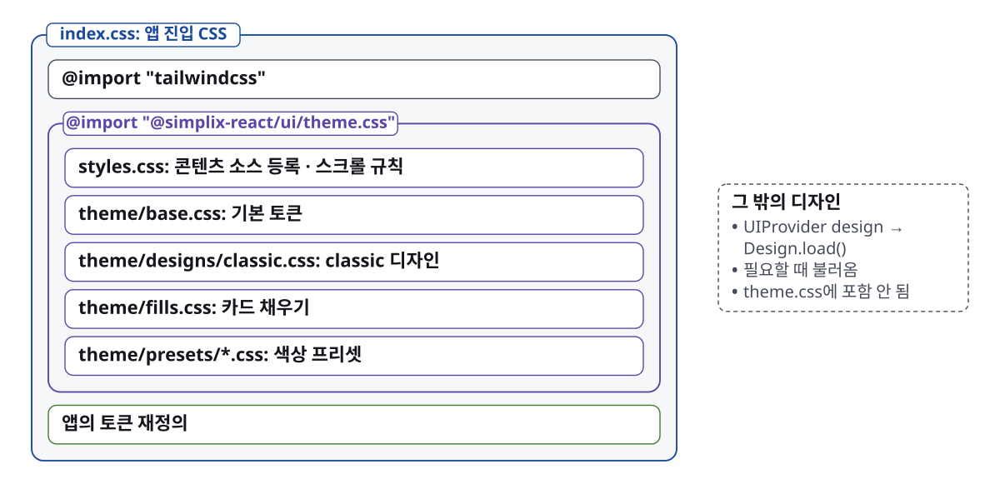

# `@simplix-react/ui` 사용 앱의 스타일 · 토큰 설정 가이드

[English](/en/guides/consumer-styling-setup.md) | **한국어**

이 문서는 다른 프로젝트에서 `@simplix-react/ui`를 의존성으로 추가해 컴포넌트를 쓸 때 **패키지를 사용하는 앱(consumer)에서 설정해야 하는 것**을 정리한 참조 문서입니다.

> **사전 조건:** `@simplix-react/ui`를 의존성으로 추가한 simplix-react 프로젝트(또는 React 앱)가 있고, 빌드가 `@tailwindcss/vite`로 Tailwind CSS v4를 지원해야 합니다.

## 한 문장 요약

패키지는 디자인 토큰을 포함한 스타일 계층 전체를 스타일시트 하나(`@simplix-react/ui/theme.css`)로 제공합니다. 사용하는 앱은 Tailwind 다음에 이 파일을 가져오고, 앱에서 달라지는 토큰만 재정의(override)합니다.

---

## 1. 패키지가 제공하는 스타일 파일

| 파일 | 내용 | 사용 시점 |
|---|---|---|
| `@simplix-react/ui/theme.css` | 한 번에 가져오는 스타일 계층: `styles.css`, 기본 토큰(`theme/base.css`), classic 디자인(`theme/designs/classic.css`), 카드 채우기(`theme/fills.css`), 모든 색상 프리셋(`theme/presets/*.css`) | 항상 |
| `@simplix-react/ui/styles.css` | 패키지를 Tailwind 콘텐츠 소스로 등록하는 `@source "./**/*.js"`, `@source "../src/**/*.{ts,tsx}"`와 `[data-slot="table-container"]`, `[data-crud-slot="body"]`의 스크롤바 · 열 너비 규칙 | `theme.css`가 포함합니다. `theme.css`를 가져오지 않을 때만 따로 가져오세요 |



classic이 아닌 디자인은 `theme.css`에 들어 있지 않습니다. 디자인을 선택하면 `UIProvider`가 그 스타일시트를 불러옵니다([designs.md](/ko/guides/designs.md) 참고).

빌드 설정 근거: `packages/ui/tsup.config.ts`의 `onSuccess`가 `src/styles.css`, `src/theme.css`, `src/theme/`을 `dist/`로 복사합니다.

---

## 2. 디자인 토큰(CSS 변수)

컴포넌트 클래스 이름은 `bg-background`, `text-muted-foreground`, `border-input`, `bg-primary/10` 같은 Tailwind 유틸리티를 씁니다. 이 유틸리티가 읽는 토큰은 모두 `theme/base.css`의 `:root`와 `.dark`에 정의되어 있고, `@theme inline`에서 Tailwind 색상으로 매핑됩니다. 토큰을 바꿀 때만 직접 정의하고, 재정의는 `theme.css`를 가져온 다음에 작성하세요.

### 2-1. 색상 토큰(짝으로 사용)

| 토큰 | 짝 | 사용 위치 |
|---|---|---|
| `--background` | `--foreground` | 전역 body, 모든 배경 영역 |
| `--card` | `--card-foreground` | `Card`, `CrudDetail` 섹션 |
| `--popover` | `--popover-foreground` | `Popover`, `DropdownMenu`, `Select`, `Tooltip` 내용 |
| `--primary` | `--primary-foreground` | `Button`(기본), 활성 상태, 링 강조 |
| `--secondary` | `--secondary-foreground` | `Button`(secondary), 보조 강조 |
| `--muted` | `--muted-foreground` | 비활성 텍스트, 호버 배경, 자리 표시자 |
| `--accent` | `--accent-foreground` | 호버 · 포커스 배경, 메뉴 항목 |
| `--destructive` | `--destructive-foreground` | 삭제 버튼, 오류, `aria-invalid` |
| `--success` | 없음 | 성공 상태 |
| `--warning` | 없음 | 알림 · 경고 |
| `--info` | 없음 | 안내 알림 |
| `--border` | 없음 | 모든 구분선, 입력 · 카드 테두리 |
| `--input` | 없음 | `Input`, `Textarea` 테두리 |
| `--ring` | 없음 | focus-visible 링 |

### 2-2. 차트 토큰(`base/charts/`에서 사용)

`--chart-1`부터 `--chart-5`까지

### 2-3. 사이드바 토큰(레이아웃 · 메뉴 컴포넌트에서 사용)

`--sidebar`, `--sidebar-foreground`, `--sidebar-primary`, `--sidebar-primary-foreground`, `--sidebar-accent`, `--sidebar-accent-foreground`, `--sidebar-border`, `--sidebar-ring`

### 2-4. 모서리 반경

`theme/base.css`가 기준값 `--radius`에서 `calc()`로 `--radius-sm | --radius-md | --radius-lg | --radius-xl`을 계산합니다.

### 2-5. 글꼴 패밀리

- `--font-sans`: 본문(Tailwind `font-sans`)
- `--font-display`: 제목 강조(Tailwind `font-display`)
- `--font-mono`: 코드(Tailwind `font-mono`)

---

## 3. Tailwind 설정 요건

이 패키지는 **Tailwind CSS v4**(카탈로그 버전 `^4.2.1`)를 전제로 합니다. 사용하는 앱의 빌드에는 다음이 필요합니다.

1. `vite.config.ts`에 `@tailwindcss/vite` 플러그인을 추가하세요
2. 앱의 진입 CSS에 다음을 작성하세요.
   - `@import "tailwindcss";`
   - `@import "@simplix-react/ui/theme.css";`: 포함된 `styles.css`가 패키지의 컴파일 결과를 콘텐츠 소스로 등록하므로 패키지용 `@source` 줄은 필요하지 않습니다
   - 앱에 필요하면 그 다음에 토큰을 재정의합니다

CLI가 생성하는 시작 파일도 같은 구성입니다: `packages/cli/src/templates/project/app/index-css.hbs`

---

## 4. 다크 모드 · 색상 테마

- **다크 모드**: `<html>`에 `.dark` 클래스를 추가하거나 제거하세요. `theme/base.css`와 각 프리셋의 `.dark` 블록이 토큰을 재정의합니다
- **색상 테마 전환**: `<html>`에 `data-color-theme="<name>"`을 지정하세요. 프리셋마다 `:root[data-color-theme='<name>']` 범위로 작성되어 있습니다
- **제공 프리셋**: `packages/ui/src/theme/presets/{blue,clear,cobalt,forest,fresh,grape,graphite,green,krds,orange,rose,violet}.css`. 각 프리셋의 레이블, 모서리 반경, 글꼴, 채우기는 `THEMES`(타입 `ColorTheme`)에 정리되어 있습니다

---

## 5. i18n 부수 효과(의도한 부수 효과 import)

`@simplix-react/ui`를 가져오기만 해도 `src/locales/index.ts`가 실행되어 `@simplix-react/i18n` 모듈 레지스트리에 `simplix` 네임스페이스(en/ko/ja)를 등록합니다.

- `package.json`의 `sideEffects` 필드가 이 파일을 유지하도록 설정되어 있습니다
- **가져오는 순서가 중요합니다**: `createI18nConfig()`를 호출하기 **전에** `@simplix-react/ui`를 가져오세요(`apps/storybook/.storybook/preview.tsx:9`의 주석 참고)

---

## 6. 앱 최소 설정(점검 목록)

```bash
pnpm add @simplix-react/ui @simplix-react/i18n @simplix-react/form @simplix-react/react \
         @tanstack/react-query react react-dom
pnpm add -D tailwindcss@^4.2 @tailwindcss/vite
```

`vite.config.ts`:

```ts
import tailwindcss from "@tailwindcss/vite";
export default defineConfig({
  plugins: [react(), tailwindcss()],
});
```

`src/index.css`:

```css
@import "tailwindcss";
@import "@simplix-react/ui/theme.css";

/* Optional: override tokens after the import */
:root {
  --radius: 0.5rem;
}

@layer base {
  body { @apply m-0 font-sans antialiased text-foreground bg-background; }
}
```

`src/main.tsx`:

```ts
import "./index.css";
import "@simplix-react/ui";              // i18n side-effect first
// then createI18nConfig(), createRoot, etc.
```

앱 루트:

```tsx
<UIProvider>
  <CrudProvider router={createReactRouterAdapter({ useNavigate, useSearchParams, useLocation })}>
    <App />
  </CrudProvider>
</UIProvider>
```

---

## 7. 파일 위치 색인(문제 해결용)

| 파일 | 역할 |
|---|---|
| `packages/ui/src/theme.css` | 한 번에 가져오는 스타일 파일 |
| `packages/ui/src/styles.css` | Tailwind 콘텐츠 소스 등록과 스크롤 컨테이너 규칙 |
| `packages/ui/src/theme/base.css` | 기본 토큰: `:root`, `.dark`, `@theme inline` |
| `packages/ui/src/theme/presets/*.css` | `data-color-theme="..."` 프리셋 |
| `packages/ui/src/theme/fills.css` | 카드 채우기(`data-fill`) |
| `packages/ui/tsup.config.ts` | CSS를 가공하지 않고 `dist/`로 복사 |
| `packages/ui/src/index.ts` | 공개 API(모든 컴포넌트 · 훅 · 타입 내보내기) |
| `packages/ui/src/locales/{en,ko,ja}.json` | 패키지에 포함된 번역 |
| `packages/ui/src/locales/index.ts` | i18n 모듈 자동 등록(부수 효과) |
| `apps/storybook/src/index.css` | Tailwind import, `theme.css`, `@layer base` 참고 예 |
| `apps/storybook/.storybook/preview.tsx` | 가져오는 순서와 테마 전환 예 |
| `packages/cli/src/templates/project/app/index-css.hbs` | CLI가 생성하는 시작 파일 |
| `packages/cli/src/templates/project/app/vite-config.hbs` | Vite와 Tailwind v4 플러그인 설정 |
| `packages/cli/src/templates/project/app/main-tsx.hbs` | 진입 파일의 import 순서 |

---

> **다음 단계:** 토큰과 Tailwind 설정을 마쳤으면 [`consumer-design-customization.md`](/ko/guides/consumer-design-customization.md)에서 색상, 글꼴, 모서리 반경, 컴포넌트별 스타일, 컴포넌트 구조를 바꾸는 방법을 확인하세요. 컴포넌트 자체는 [`ui-components.md`](/ko/guides/ui-components.md)를 참고하세요.

---

<p class="page-source"><a href="https://github.com/simplix-framework/simplix-react/blob/main/docs/ko/guides/consumer-styling-setup.md" target="_blank" rel="noopener noreferrer">원본 보기</a></p>
