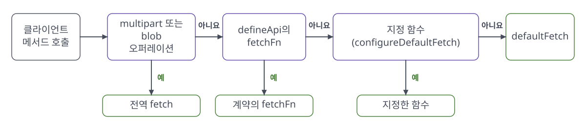

# 사용자 정의 fetch 함수

[English](/en/guides/custom-fetch.md) | **한국어**

> HTTP 계층의 헤더, 인터셉터, 오류 처리를 바꾸는 방법입니다.
>
> **인증(authentication)이 필요하다면** Bearer, API Key, OAuth2 같은 토큰 기반 인증과 토큰 갱신, 401 재시도는 [`@simplix-react/auth`](/ko/guides/authentication.md)를 사용하세요. 이 가이드는 인증 패키지가 다루지 않는 낮은 수준의 fetch 변경을 설명합니다.

## 시작하기 전에

- `@simplix-react/contract`의 `defineApi`로 계약(contract)을 정의해 두세요.
- `FetchFn`의 타입 시그니처 `<T>(path: string, options?: RequestInit) => Promise<T>`를 알아 두세요.
- 기본 제공 `defaultFetch`는 응답 변환을 지정한 `createFetch`입니다. 본문이 `FormData`가 아닌 `POST`, `PUT`, `PATCH` 요청에 `Content-Type: application/json`을 보내고, 브라우저의 시간대를 `X-Timezone` 헤더로 보냅니다. `{ data: T }` 응답 봉투(envelope)를 풀고, `204` 응답에는 `undefined`를, 콘텐츠 형식이 JSON이 아닌 응답에는 `Blob`을 반환합니다. 2xx가 아닌 응답에는 `ApiError`를 발생시킵니다.

## 계약이 사용하는 fetch 함수



클라이언트는 요청할 때마다 다음 순서로 판단합니다.

1. `contentType: "multipart"`에 입력이 있거나 `responseType: "blob"`을 지정한 오퍼레이션(operation)은 `transformRequest`가 없으면 전역 `fetch`를 직접 호출하고 아래 단계를 거치지 않습니다
2. `defineApi`의 두 번째 인자로 전달한 `fetchFn`
3. `configureDefaultFetch`로 지정한 함수
4. `defaultFetch`

⚠ 첫 번째 단계의 요청에는 fetch 함수에서 추가한 헤더가 포함되지 않습니다.

## 해결 방법

### 기본: `createFetch`로 fetch 함수 만들기

`createFetch`는 옵션으로 `FetchFn`을 만듭니다. 상대 경로 앞에는 `baseUrl`을 추가합니다. `getToken`이 반환한 토큰은 요청에 `Authorization` 헤더가 없을 때 `Authorization: Bearer <token>`으로 보냅니다. `transformResponse`는 파싱한 JSON과 `{ path, method }`를 받습니다. `onError`는 `{ status, body, path, method }`를 받으며, `body`는 가능하면 JSON으로 파싱한 값입니다. `onError`에서 직접 만든 오류를 발생시키세요. 발생시키지 않으면 `ApiError`를 발생시킵니다.

```ts
import { createFetch, defineApi } from "@simplix-react/contract";
import { projectConfig } from "./contract";

const apiFetch = createFetch({
  baseUrl: "https://api.example.com",
  getToken: () => localStorage.getItem("access_token"),
  transformResponse: (json) => (json as { body?: unknown }).body ?? json,
  onError: ({ status, body }) => {
    const envelope = body as { errorCode?: string; message?: string };
    if (envelope.errorCode) {
      throw new Error(`${status} ${envelope.errorCode}: ${envelope.message}`);
    }
  },
});

const projectApi = defineApi(projectConfig, { fetchFn: apiFetch });
```

### 모든 계약의 기본값 지정

`configureDefaultFetch`는 자체 `fetchFn`이 없는 모든 계약에서 `defaultFetch`를 대체합니다. 호출하기 전에 만든 계약에도 적용됩니다.

```ts
import { configureDefaultFetch, createFetch } from "@simplix-react/contract";

// Every contract created without its own fetchFn uses this function
configureDefaultFetch(
  createFetch({
    getToken: () => localStorage.getItem("access_token"),
    transformResponse: (json) => (json as { data?: unknown }).data ?? json,
  }),
);
```

### `defaultFetch`에 인증 헤더 추가

```ts
import { defineApi, defaultFetch } from "@simplix-react/contract";
import { projectConfig } from "./contract";

const projectApi = defineApi(projectConfig, {
  fetchFn: async (path, options) => {
    const token = localStorage.getItem("access_token");

    return defaultFetch(path, {
      ...options,
      headers: {
        ...options?.headers,
        Authorization: `Bearer ${token}`,
      },
    });
  },
});
```

### `ApiError` 응답 처리

`defaultFetch`는 2xx가 아닌 모든 상태에 `ApiError`를 발생시킵니다. `status`는 HTTP 상태 코드이고 `body`는 응답 본문 원문입니다. 오류를 잡아 HTTP 상태별로 처리하세요.

```ts
import { ApiError } from "@simplix-react/contract";

try {
  const task = await projectApi.client.task.get("nonexistent-id");
} catch (error) {
  if (error instanceof ApiError) {
    console.error(error.status); // 404
    console.error(error.body);   // "Not Found"

    if (error.status === 401) {
      // Redirect to login
      window.location.href = "/login";
    }
  }
}
```

### 요청·응답 인터셉터

`defaultFetch`를 감싸서 요청을 보내기 전과 응답을 받은 후에 원하는 처리를 넣으세요.

```ts
import { defineApi, defaultFetch, type FetchFn } from "@simplix-react/contract";
import { projectConfig } from "./contract";

function createFetchWithInterceptors(getToken: () => string | null): FetchFn {
  return async <T>(path: string, options?: RequestInit): Promise<T> => {
    // ── Request interceptor ──
    const token = getToken();
    const headers: Record<string, string> = {
      ...((options?.headers as Record<string, string>) ?? {}),
    };
    if (token) {
      headers["Authorization"] = `Bearer ${token}`;
    }
    headers["X-Request-Id"] = crypto.randomUUID();

    console.log(`[fetch] ${options?.method ?? "GET"} ${path}`);

    // ── Execute ──
    const result = await defaultFetch<T>(path, { ...options, headers });

    // ── Response interceptor ──
    console.log(`[fetch] ${path} -> OK`);

    return result;
  };
}

const projectApi = defineApi(projectConfig, {
  fetchFn: createFetchWithInterceptors(() => localStorage.getItem("access_token")),
});
```

### 재시도 처리

5xx 응답이나 네트워크 오류 같은 일시적인 실패에 재시도를 추가합니다.

```ts
import { defineApi, defaultFetch, ApiError, type FetchFn } from "@simplix-react/contract";
import { projectConfig } from "./contract";

function createFetchWithRetry(maxRetries = 3, delayMs = 1000): FetchFn {
  return async <T>(path: string, options?: RequestInit): Promise<T> => {
    let lastError: unknown;

    for (let attempt = 0; attempt <= maxRetries; attempt++) {
      try {
        return await defaultFetch<T>(path, options);
      } catch (error) {
        lastError = error;

        const isRetryable =
          error instanceof ApiError
            ? error.status >= 500
            : error instanceof TypeError; // network error

        if (!isRetryable || attempt === maxRetries) {
          throw error;
        }

        // Exponential backoff
        await new Promise((resolve) =>
          setTimeout(resolve, delayMs * Math.pow(2, attempt)),
        );
      }
    }

    throw lastError;
  };
}

const projectApi = defineApi(projectConfig, {
  fetchFn: createFetchWithRetry(3, 500),
});
```

### 완전한 사용자 정의 fetch(`defaultFetch` 미사용)

API가 `{ data: T }` 응답 봉투 규칙을 따르지 않으면 fetch 구현 전체를 바꾸세요.

```ts
import { defineApi, ApiError, type FetchFn } from "@simplix-react/contract";
import { projectConfig } from "./contract";

const customFetch: FetchFn = async <T>(
  path: string,
  options?: RequestInit,
): Promise<T> => {
  const res = await fetch(path, {
    ...options,
    headers: {
      "Content-Type": "application/json",
      Accept: "application/json",
      ...options?.headers,
    },
    credentials: "include",
  });

  if (!res.ok) {
    throw new ApiError(res.status, await res.text());
  }

  if (res.status === 204) {
    return undefined as T;
  }

  // No { data } envelope -- return JSON directly
  return res.json() as Promise<T>;
};

const projectApi = defineApi(projectConfig, { fetchFn: customFetch });
```

## 변형

### 401 응답 시 토큰 갱신

```ts
import { defineApi, defaultFetch, ApiError, type FetchFn } from "@simplix-react/contract";
import { projectConfig } from "./contract";

let isRefreshing = false;
let refreshPromise: Promise<string> | null = null;

async function refreshToken(): Promise<string> {
  const res = await fetch("/api/auth/refresh", {
    method: "POST",
    credentials: "include",
  });
  if (!res.ok) throw new Error("Token refresh failed");
  const { accessToken } = await res.json();
  localStorage.setItem("access_token", accessToken);
  return accessToken;
}

const fetchWithRefresh: FetchFn = async <T>(
  path: string,
  options?: RequestInit,
): Promise<T> => {
  const token = localStorage.getItem("access_token");
  const headers = {
    ...((options?.headers as Record<string, string>) ?? {}),
    Authorization: `Bearer ${token}`,
  };

  try {
    return await defaultFetch<T>(path, { ...options, headers });
  } catch (error) {
    if (!(error instanceof ApiError) || error.status !== 401) {
      throw error;
    }

    // Deduplicate concurrent refresh calls
    if (!isRefreshing) {
      isRefreshing = true;
      refreshPromise = refreshToken().finally(() => {
        isRefreshing = false;
        refreshPromise = null;
      });
    }

    const newToken = await refreshPromise!;

    return defaultFetch<T>(path, {
      ...options,
      headers: {
        ...((options?.headers as Record<string, string>) ?? {}),
        Authorization: `Bearer ${newToken}`,
      },
    });
  }
};

const projectApi = defineApi(projectConfig, { fetchFn: fetchWithRefresh });
```

### 기본 URL 접두사 추가

```ts
import { createFetch, defineApi } from "@simplix-react/contract";
import { projectConfig } from "./contract";

const prefixedFetch = createFetch({
  baseUrl: "https://api.example.com",
  transformResponse: (json) => (json as { data?: unknown }).data ?? json,
});

const projectApi = defineApi(projectConfig, { fetchFn: prefixedFetch });
```

## 관련 문서

- [인증 가이드](/ko/guides/authentication.md): `@simplix-react/auth`로 토큰 기반 인증 설정
- [국제화 가이드](/ko/guides/internationalization.md): `setRequestLocale`로 `Accept-Language` 헤더 동기화
- [목 핸들러](/ko/guides/mock-handlers.md): 백엔드 없이 개발할 때 MSW 핸들러 설정
- `@simplix-react/contract`의 내보내기: `FetchFn`, `ApiError`, `defaultFetch`, `createFetch`, `CreateFetchOptions`, `configureDefaultFetch`

---

<p class="page-source"><a href="https://github.com/simplix-framework/simplix-react/blob/main/docs/ko/guides/custom-fetch.md" target="_blank" rel="noopener noreferrer">원본 보기</a></p>
