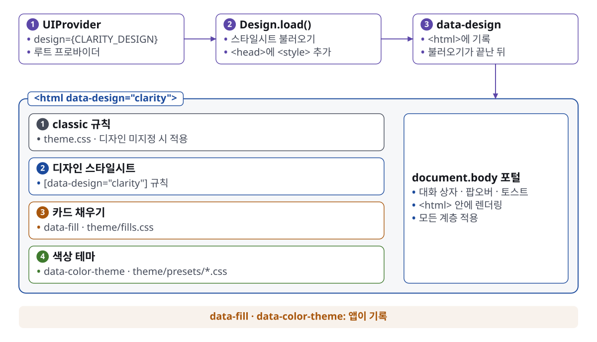

# 디자인 선택과 추가

[English](/en/guides/designs.md) | **한국어**

디자인(design)은 모든 컴포넌트의 모양을 정합니다. 동작, 키보드 처리, 움직임은 어느 디자인에서나 같습니다. `@simplix-react/ui`에는 기본값인 `classic`과 `clarity` 디자인이 들어 있고, 어느 디자인 위에든 색상 테마(`data-color-theme`)와 카드 채우기(`data-fill`)를 적용합니다.

## 디자인 선택

최상위 `UIProvider`에 디자인을 전달하세요. 공급자는 문서 요소에 `data-design`을 기록하므로 `document.body`에 렌더링되는 대화 상자, 팝오버, 토스트에도 같은 디자인이 적용됩니다.

```tsx
import { UIProvider } from "@simplix-react/ui";
import { CLARITY_DESIGN } from "@simplix-react/ui/design";

<UIProvider design={CLARITY_DESIGN}>{app}</UIProvider>;
```

classic 규칙은 `theme.css`에 포함되어 있습니다. 그 밖의 디자인은 컴파일된 스타일시트를 `Design.load`로 필요할 때 불러옵니다. 공급자는 스타일시트를 페이지에 추가한 뒤에야 `data-design`을 바꾸므로, 규칙이 없는 상태의 디자인이 화면에 표시되지 않습니다.



디자인에는 고유한 `UIDefaults`가 있습니다(clarity는 `density: "comfortable"`을 지정합니다). 공급자의 `defaults`가 이 값보다 우선합니다. `design`을 지정하지 않으면 classic 디자인을 적용합니다.

## 컴포넌트가 그리는 요소 표시

모양을 지정하는 요소에는 모두 표시를 추가하고, 모양 자체는 컴포넌트 옆의 `.style.ts` 선언에 작성합니다.

```ts
// toolbar.style.ts
import { defineSlotStyle } from "@simplix-react/ui/design";

export const toolbarStyle = defineSlotStyle({
  slot: "toolbar",
  base: "gap-2 rounded-md border bg-card p-2",
  variants: { tone: { plain: "", warn: "border-warning" } },
  defaultVariants: { tone: "plain" },
});
```

```tsx
// toolbar.tsx
<div className="flex items-center" {...slotAttributes(toolbarStyle, { tone })} />
```

- 구조 클래스(display, flex와 grid 흐름, position, overflow, 크기)는 요소에 남기고, 모양 클래스(색상, 테두리, 모서리 반경, 그림자, 간격, 글꼴)는 선언으로 이동하세요.
- 다른 컴포넌트가 렌더링하는 요소(`Badge`, `Stack`, `PopoverContent`)에는 `partAttributes`와 `as: "part"`인 선언으로 표시합니다. 컴포넌트 자체의 `data-slot`은 그대로 남고, part 규칙이 그 위에 그려집니다. 이런 요소를 가리키는 선택자는 `[data-slot=<name>]`이 아니라 `[data-part=<name>]`으로 작성하세요. `design:check`가 실행하는 `scripts/check-slot-spread.mjs`는 자체 `data-slot`을 기록하는 컴포넌트에 slot을 펼친 경우와 잘못된 속성으로 선택자를 작성한 경우를 모두 거부합니다.
- 키보드 포커스는 모든 디자인에서 같은 모양입니다: `focus-visible:shadow-[var(--focus-halo)]`이고, 유효하지 않은 컨트롤에는 `--invalid-halo`를 씁니다. 컨트롤의 그림자를 초기화하는 규칙(변형의 기본 그림자를 없애는 `shadow-none`)은 포커스 테두리까지 지우므로, 같은 규칙에서 `:focus-visible`일 때 포커스 테두리를 다시 지정하세요. `:not(:focus-visible)`로 포커스를 제외하는 방법은 Storybook에서 동작하지 않습니다. Storybook의 pseudo-states 애드온이 이 선택자를 포커스된 요소에도 일치하는 선택자 목록으로 바꾸기 때문입니다.
- 나타나고 사라지는 움직임(`animate-in`, `fade-*`, `zoom-*`, `slide-*`)은 요소에 남기세요. 모든 디자인에서 같으며, 생성기는 선언 안의 움직임 클래스를 거부합니다.

선언을 바꾼 뒤에는 스타일시트를 다시 생성하세요.

```bash
pnpm --filter @simplix-react/ui design:css
pnpm --filter @simplix-react/ui design:check
```

생성된 스타일시트가 선언과 맞지 않거나 어떤 디자인이 classic 규칙을 그리지 않으면 `design:check`가 실패합니다.

## 디자인 추가

classic이 아닌 디자인은 명세(spec)입니다. 모든 선언에 클래스 치환을 적용하고, 그 결과에 slot별 재정의를 tailwind-merge로 병합합니다.

```ts
// src/design/<id>.spec.ts
import type { DesignSpec } from "./design-spec";

const spec: DesignSpec = {
  id: "<id>",
  replace: { "rounded-md": "rounded-[var(--radius-control)]", "shadow-sm": "shadow-none" },
  slots: {
    "table-header": "bg-[var(--table-head)]",
    "button variant=outline": "bg-card",
  },
};

export default spec;
```

1. 명세와 `[data-design='<id>']` 범위의 `theme/designs/<id>-tokens.css`를 작성하세요.
2. `node scripts/build-design-css.mjs --design-spec src/design/<id>.spec.ts --out src/theme/designs/<id>.css --compiled src/design/<id>-stylesheet.ts --tokens src/theme/designs/<id>-tokens.css --tailwind-from <Tailwind에 의존하는 앱>`으로 생성하고, 이 명령을 `design:css`에 추가하고 `--check`를 지정해 `design:check`에도 추가하세요. `--compiled`는 규칙과 토큰을 일반 CSS로 담은 TypeScript 모듈을 기록하며, `theme.css`는 이 모듈을 가져오지 않습니다.
3. `load`가 그 모듈을 가져오는 `Design`(`load: () => import("./<id>-stylesheet").then((m) => [m.default])`)을 `src/design/design.ts`에 추가하고 `DESIGNS`에도 추가하세요.
4. `node scripts/check-design-css.mjs --tailwind-from <Tailwind에 의존하는 앱>`을 실행해 모든 규칙을 컴파일하세요.

UI 키트는 같은 방법으로 자체 slot을 추가합니다. `--root <키트 패키지>`를 지정하고, 프레임워크의 `CLARITY_REPLACE`에서 시작하는 명세를 작성하세요.

## 카드 채우기

색상 테마는 채우기(`ColorTheme.fill`)를 지정합니다: `plain`, `outline`, `raised`, `tint`, `lead`. 앱이 이 값을 문서 요소의 `data-fill`로 기록하면 `theme/fills.css`가 모든 디자인에서 그립니다. `outline`과 `raised`는 `card`와 `stat-card`에, `tint`는 `stat-card`에 적용합니다. `plain`은 속성이 없는 상태입니다. `theme/fills.css`에는 `lead` 규칙이 없습니다.

---

<p class="page-source"><a href="https://github.com/simplix-framework/simplix-react/blob/main/docs/ko/guides/designs.md" target="_blank" rel="noopener noreferrer">원본 보기</a></p>
