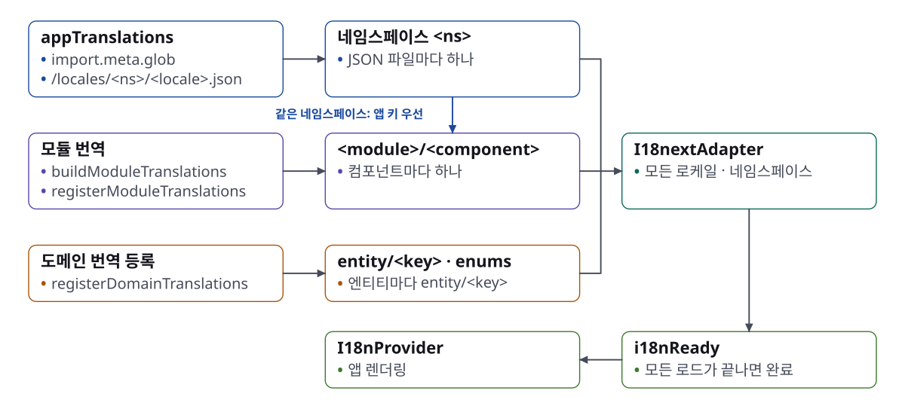

# 앱에 국제화 추가하기

[English](/en/guides/internationalization.md) | **한국어**

> `@simplix-react/i18n`으로 simplix-react 애플리케이션에 다국어 지원을 설정합니다.

## 시작하기 전에

- `simplix init`으로 초기화한 simplix-react 프로젝트(i18n 사용)가 있습니다.
- 번역 JSON 파일을 `src/locales/<namespace>/<locale>.json` 구조로 정리했습니다.
- i18n 패키지가 없으면 설치하세요.

```bash
pnpm add @simplix-react/i18n
```

## 해결 방법

### 1단계: 번역 파일 만들기

번역은 네임스페이스와 로케일(locale)별로 정리합니다. 네임스페이스마다 디렉터리를 하나 두고, 그 안에 로케일마다 JSON 파일을 하나씩 둡니다. `createI18nConfig`는 `/locales/<namespace>/<locale>.json` 경로에서 네임스페이스와 로케일을 읽으므로, `locales/dashboard/header/ko.json`처럼 디렉터리를 중첩하면 네임스페이스는 `dashboard/header`가 됩니다.

```text
src/
  locales/
    common/
      en.json
      ko.json
      ja.json
    dashboard/
      en.json
      ko.json
```

```json
// src/locales/common/en.json
{
  "greeting": "Hello, {{name}}!",
  "logout": "Log out",
  "items_count_one": "{{count}} item",
  "items_count_other": "{{count}} items"
}
```

```json
// src/locales/common/ko.json
{
  "greeting": "{{name}}님, 안녕하세요!",
  "logout": "로그아웃",
  "items_count_one": "{{count}}개 항목",
  "items_count_other": "{{count}}개 항목"
}
```

### 2단계: i18n 설정

`createI18nConfig`로 어댑터(adapter)를 초기화하세요. Vite의 `import.meta.glob`이 빌드할 때 번역 파일을 모두 즉시 불러옵니다.

```ts
// src/app/i18n/index.ts
import { createI18nConfig } from "@simplix-react/i18n";

const appTranslations = import.meta.glob("../../locales/**/*.json", {
  eager: true,
});

export const { adapter, i18nReady } = createI18nConfig({
  defaultLocale: "ko",
  fallbackLocale: "en",
  appTranslations,
  debug: false,
});
```

`createI18nConfig`의 반환값은 다음과 같습니다.

| 반환값 | 타입 | 설명 |
| --- | --- | --- |
| `adapter` | `I18nextAdapter` | 설정을 마친 어댑터 인스턴스 |
| `i18nReady` | `Promise<void>` | 모듈 번역과 도메인 번역을 포함한 모든 번역을 불러오면 이행 |



나머지 옵션은 다음과 같습니다.

| 옵션 | 기본값 | 용도 |
| --- | --- | --- |
| `defaultLocale` | `"en"` | 감지한 로케일이 없을 때 활성화할 로케일 |
| `fallbackLocale` | `"en"` | 키가 없을 때 대신 사용할 로케일 |
| `supportedLocales` | `DEFAULT_LOCALES` | 로케일 코드 또는 `LocaleConfig` 객체. 코드는 `DEFAULT_LOCALES`에서 찾음 |
| `detection` | 없음 | `{ order: ("localStorage" \| "navigator")[], storageKey? }`. `order`에 `"localStorage"`가 있으면 로케일을 바꿀 때마다 `storageKey`(`"i18n:locale"`)에 저장 |
| `moduleTranslations` | `[]` | `buildModuleTranslations`로 만든 모듈 번역 |
| `debug` | `false` | i18next 디버그 로그 |

### 3단계: I18nProvider로 앱 감싸기

`I18nProvider` 컴포넌트는 React 컨텍스트로 모든 하위 컴포넌트에 어댑터를 제공하고, `<html lang>`을 활성 로케일과 같게 유지합니다. 렌더링하기 전에 `i18nReady`를 기다리세요.

```tsx
// src/main.tsx
import { StrictMode } from "react";
import { createRoot } from "react-dom/client";
import { I18nProvider } from "@simplix-react/i18n/react";
import { adapter, i18nReady } from "./app/i18n/index.js";
import { App } from "./app/index.js";

async function bootstrap() {
  await i18nReady;

  createRoot(document.getElementById("root")!).render(
    <StrictMode>
      <I18nProvider adapter={adapter}>
        <App />
      </I18nProvider>
    </StrictMode>,
  );
}

bootstrap();
```

### 4단계: 컴포넌트에서 번역 훅 사용

#### useTranslation: 네임스페이스 범위의 번역

텍스트를 번역하는 기본 훅입니다. 모든 조회를 네임스페이스 하나로 한정하며, 로케일이 바뀌거나 번역을 나중에 불러오면 자동으로 다시 렌더링합니다. `I18nProvider` 밖에서는 `t`가 키를 그대로 반환합니다.

```tsx
import { useTranslation } from "@simplix-react/i18n/react";

function Greeting() {
  const { t, locale } = useTranslation("common");

  return (
    <div>
      <p>{t("greeting", { name: "Alice" })}</p>
      <small>Current locale: {locale}</small>
    </div>
  );
}
```

반환하는 객체의 속성은 다음과 같습니다.

| 속성 | 타입 | 설명 |
| --- | --- | --- |
| `t` | `(key, values?) => string` | 네임스페이스 안의 키를 번역 |
| `locale` | `string` | 현재 활성 로케일 코드 |
| `exists` | `(key) => boolean` | 키가 있는지 확인 |

#### useLocale: 활성 로케일 코드

활성 로케일 코드만 반환합니다. 로케일이 바뀌면 다시 렌더링합니다.

```tsx
import { useLocale } from "@simplix-react/i18n/react";

function LocaleBadge() {
  const locale = useLocale();
  return <span>{locale.toUpperCase()}</span>;
}
```

#### useI18n: 어댑터 직접 사용

서식 지정, 로케일 정보 조회, 코드에서 로케일 전환처럼 고급 작업에 쓰는 `II18nAdapter` 인스턴스를 반환합니다. `I18nProvider` 밖에서는 `null`을 반환합니다.

```tsx
import { useI18n } from "@simplix-react/i18n/react";

function PriceDisplay({ amount }: { amount: number }) {
  const i18n = useI18n();
  if (!i18n) return null;

  return <span>{i18n.formatCurrency(amount)}</span>;
}
```

### 5단계: 실행 중에 로케일 전환

로케일마다 그 언어로 쓴 이름을 표시한 목록이 필요하면 `useLocalePicker`를 사용하세요.

```tsx
import { useLocalePicker } from "@simplix-react/i18n/react";

function LocaleMenu() {
  const { locale, locales, setLocale } = useLocalePicker();

  return (
    <select value={locale} onChange={(e) => setLocale(e.target.value)}>
      {locales.map((option) => (
        <option key={option.value} value={option.value}>
          {option.displayName}
        </option>
      ))}
    </select>
  );
}
```

컨트롤을 직접 만들려면 어댑터의 `setLocale` 메서드를 사용하세요. `useSyncExternalStore`로 구독한 훅은 모두 자동으로 다시 렌더링합니다.

```tsx
import { useI18n } from "@simplix-react/i18n/react";

function LocaleSwitcher() {
  const i18n = useI18n();
  if (!i18n) return null;

  return (
    <select
      value={i18n.locale}
      onChange={(e) => i18n.setLocale(e.target.value)}
    >
      {i18n.availableLocales.map((code) => {
        const info = i18n.getLocaleInfo(code);
        return (
          <option key={code} value={code}>
            {info?.name ?? code}
          </option>
        );
      })}
    </select>
  );
}
```

### 6단계: API 요청에 로케일 반영(Accept-Language 헤더)

서버가 `Accept-Language` 헤더에 따라 응답을 지역화한다면, i18n 어댑터를 `@simplix-react/api`에 연결해 모든 API 요청에 앱의 활성 로케일을 담으세요.

```ts
// src/app/i18n/index.ts
import { setRequestLocale } from "@simplix-react/api";
import { createI18nConfig } from "@simplix-react/i18n";
import { DEFAULT_LOCALE, SUPPORTED_LOCALES } from "../../shared/config/app";

const appTranslations = import.meta.glob("/src/locales/**/*.json", { eager: true });

export const { adapter: i18nAdapter, i18nReady } = createI18nConfig({
  defaultLocale: DEFAULT_LOCALE,
  fallbackLocale: DEFAULT_LOCALE,
  supportedLocales: [...SUPPORTED_LOCALES],
  detection: { order: ["localStorage", "navigator"] },
  appTranslations,
});

// Sync i18n locale to API request headers (Accept-Language)
i18nAdapter.onLocaleChange(setRequestLocale);
i18nReady.then(() => setRequestLocale(i18nAdapter.locale));
```

다음 코드가 이 작업을 합니다.

| 코드 | 용도 |
| --- | --- |
| `i18nAdapter.onLocaleChange(setRequestLocale)` | 언어를 바꿀 때마다 로케일 반영 |
| `i18nReady.then(() => setRequestLocale(...))` | 감지를 마친 뒤 초기 로케일 설정 |

이렇게 설정하면 `getMutator()`를 거치는 모든 요청에 앱 언어와 같은 `Accept-Language` 헤더를 자동으로 추가합니다. 예를 들어 사용자가 영어를 선택하면 다음과 같습니다.

```http
POST /api/v1/pets HTTP/1.1
Accept-Language: en
```

> **왜 필요한가요?** 헤더를 직접 지정하지 않으면 브라우저가 운영 체제 설정에 따른 `Accept-Language`(예: `ko,en-US;q=0.9,...`)를 보냅니다. 이 값은 사용자가 애플리케이션에서 고른 언어와 다를 수 있습니다. `setRequestLocale`은 이 값을 앱의 활성 로케일로 바꿉니다.

> **참고:** `simplix init`으로 스캐폴딩한 프로젝트(i18n 사용)에는 이 연결 코드가 포함되어 있습니다. 기존 프로젝트에는 위 코드를 직접 추가하세요.

## 변형

### 모듈 번역 지연 로딩

규모가 큰 앱은 `buildModuleTranslations`로 번역을 모듈별로 나누세요. JSON 파일은 각각 별도 청크로 남고, `i18nReady`가 모듈에 나열한 모든 로케일의 청크를 불러옵니다.

```ts
// modules/dashboard/src/locales/index.ts
import { buildModuleTranslations } from "@simplix-react/i18n";

export const dashboardTranslations = buildModuleTranslations({
  namespace: "dashboard",
  locales: ["en", "ko", "ja"],
  components: {
    header: {
      en: () => import("./header/en.json"),
      ko: () => import("./header/ko.json"),
      ja: () => import("./header/ja.json"),
    },
    sidebar: {
      en: () => import("./sidebar/en.json"),
      ko: () => import("./sidebar/ko.json"),
      ja: () => import("./sidebar/ja.json"),
    },
  },
});
```

모듈 번역을 `createI18nConfig`에 전달하세요.

```ts
import { createI18nConfig } from "@simplix-react/i18n";
import { dashboardTranslations } from "@myapp/dashboard/locales";

const appTranslations = import.meta.glob("../../locales/**/*.json", {
  eager: true,
});

export const { adapter, i18nReady } = createI18nConfig({
  defaultLocale: "ko",
  appTranslations,
  moduleTranslations: [dashboardTranslations],
});
```

모듈 패키지가 진입점에서 `registerModuleTranslations(dashboardTranslations)`를 호출하는 방법도 있습니다. `createI18nConfig`는 등록된 모듈 번역을 모두 불러오며, `i18nReady`가 이행된 뒤에 등록된 것도 불러옵니다.

모듈 번역의 네임스페이스는 `dashboard/header`, `dashboard/sidebar` 형태입니다. 애플리케이션의 `locales/dashboard/header/<locale>.json` 파일은 모듈의 값을 키 단위로 재정의합니다. 컴포넌트에서는 다음과 같이 사용합니다.

```tsx
const { t } = useTranslation("dashboard/header");
t("title"); // looks up "dashboard/header:title"
```

### 로케일 설정 직접 지정

기본 제공 `DEFAULT_LOCALES` 목록 대신 직접 작성한 `LocaleConfig` 항목을 사용하세요(`timeFormat`도 지정할 수 있습니다).

```ts
import { createI18nConfig } from "@simplix-react/i18n";
import type { LocaleConfig } from "@simplix-react/i18n";

const customLocales: LocaleConfig[] = [
  {
    code: "en",
    name: "English",
    englishName: "English",
    direction: "ltr",
    dateFormat: "MM/dd/yyyy",
    currency: "USD",
  },
  {
    code: "ar",
    name: "العربية",
    englishName: "Arabic",
    direction: "rtl",
    dateFormat: "dd/MM/yyyy",
    currency: "SAR",
  },
];

export const { adapter, i18nReady } = createI18nConfig({
  defaultLocale: "en",
  supportedLocales: customLocales,
  appTranslations: import.meta.glob("../../locales/**/*.json", { eager: true }),
});
```

### 날짜, 숫자, 통화 서식

어댑터는 활성 로케일을 따르는 `Intl` 기반 서식 함수를 제공합니다.

```tsx
import { useI18n } from "@simplix-react/i18n/react";

function OrderSummary({ total, date }: { total: number; date: Date }) {
  const i18n = useI18n();
  if (!i18n) return null;

  return (
    <dl>
      <dt>Date</dt>
      <dd>{i18n.formatDate(date, { dateStyle: "long" })}</dd>

      <dt>Total</dt>
      <dd>{i18n.formatCurrency(total, "KRW")}</dd>

      <dt>Quantity</dt>
      <dd>{i18n.formatNumber(1234.5, { maximumFractionDigits: 0 })}</dd>

      <dt>Placed</dt>
      <dd>{i18n.formatRelativeTime(date)}</dd>
    </dl>
  );
}
```

### 도메인 번역과 엔티티 레이블

도메인 패키지는 `registerDomainTranslations`로 필드와 열거형 레이블을 등록합니다. JSON의 최상위 키는 각각 `entity/<key>` 네임스페이스가 되고, `enums` 키는 `enums` 네임스페이스가 됩니다.

```ts
import { registerDomainTranslations } from "@simplix-react/i18n";

registerDomainTranslations({
  domain: "pet",
  locales: {
    en: () => import("./locales/en.json"),
    ko: () => import("./locales/ko.json"),
  },
});
```

`useEntityTranslation`이 이 레이블을 읽습니다.

```tsx
import { useEntityTranslation } from "@simplix-react/i18n/react";

function PetStatus({ status }: { status: string }) {
  const { fieldLabel, enumLabel } = useEntityTranslation("pet");

  return (
    <span>
      {fieldLabel("status")}: {enumLabel("PetStatus", status)}
    </span>
  );
}
```

`fieldLabel("status")`는 `entity/pet`에서 `fields.status`를 찾고, `enumLabel("PetStatus", status)`는 `enums`에서 `PetStatus.<status>`를 찾습니다.

### i18n-codegen으로 타입 안전한 번역 키

JSON 파일에서 TypeScript 타입을 생성해 없는 키를 컴파일할 때 찾아내세요.

```bash
simplix i18n-codegen
```

프로젝트 루트에서 실행하세요. `modules/` 아래 모든 모듈에서 `src/locales/` 디렉터리를 찾고, JSON 파일이 있는 디렉터리마다 디렉터리 이름을 딴 타입(`header`는 `HeaderKeys`)을 담은 `keys.d.ts`를 씁니다. 키는 `en.json`에서, 없으면 첫 번째 JSON 파일에서 가져옵니다. `--watch`를 지정하면 파일이 바뀔 때마다 다시 생성합니다. 생성한 타입은 `useTranslation`에 지정하세요.

```tsx
import type { HeaderKeys } from "../locales/header/keys";

const { t } = useTranslation<HeaderKeys>("dashboard/header");
t("greeting"); // ✔ type-checked
t("typo");     // ✖ compile error
```

## 관련 문서

- [CLI 사용법](/ko/guides/cli-usage.md): i18n을 사용하는 `simplix init`, `simplix i18n-codegen`
- [목으로 테스트하기](/ko/guides/testing-with-mocks.md): i18n을 사용하는 컴포넌트 테스트
- [@simplix-react/i18n API 레퍼런스](https://github.com/simplix-framework/simplix-react/blob/main/docs/api/@simplix-react/i18n/README.md): 전체 API 문서

---

<p class="page-source"><a href="https://github.com/simplix-framework/simplix-react/blob/main/docs/ko/guides/internationalization.md" target="_blank" rel="noopener noreferrer">GitHub에서 편집</a></p>
