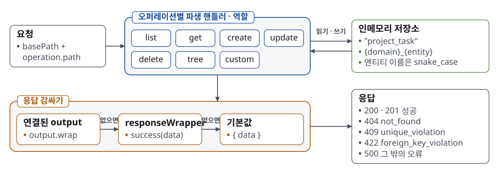

# MSW 목 핸들러

[English](/en/guides/mock-handlers.md) | **한국어**

> API 계약(contract)에서 파생한 MSW 목(mock) 핸들러를 설정하고 바꾸는 방법입니다.

## 시작하기 전에

- `@simplix-react/contract`의 `defineApi`로 API 계약을 정의해 두어야 합니다.
- 피어 의존성 `msw`(2.x)를 설치하세요.

예제는 도메인이 `project`이고 기본 경로가 `/api/v1`이며 엔티티(entity) `project`와 `task`가 있는 계약을 사용합니다.

## 해결 방법

### 계약에서 핸들러 파생

`deriveMockHandlers(config, mockConfig?, options?)`는 계약에 있는 모든 엔티티의 모든 오퍼레이션(operation)마다 MSW 핸들러를 하나씩 생성합니다.

```ts
import { deriveMockHandlers } from "@simplix-react/mock";
import { projectApi } from "./contract";

const handlers = deriveMockHandlers(projectApi.config);
```

핸들러의 HTTP 메서드와 경로는 오퍼레이션 정의를 따릅니다(`{basePath}{operation.path}`). 핸들러의 동작은 오퍼레이션의 역할로 정해지며, 역할은 `role`에서 읽고 `role`이 없으면 오퍼레이션 이름에서 정합니다.

| 역할 | 동작 | 상태 코드 |
| --- | --- | --- |
| `list` | 쿼리 매개변수로 거르고 정렬한 뒤 페이지를 나눕니다 | `200` |
| `get` | `:id`(없으면 마지막 경로 매개변수)로 레코드를 찾고 `relations`도 함께 조회합니다 | `200`, `404` |
| `create` | 본문을 저장합니다. 본문에 `id`가 없으면 `getNextId`로 숫자 `id`를 지정하고, `createdAt`과 `updatedAt`이 없으면 채웁니다 | `201` |
| `update` | 본문을 레코드에 병합하고(오퍼레이션이 선언한 PATCH 또는 PUT) `updatedAt`을 갱신합니다 | `200`, `400`, `404` |
| `delete` | 레코드를 삭제합니다 | `200`, `404` |
| `tree` | `parentId`로 묶은 `{ data, children }` 중첩 노드를 반환합니다. `?rootId=`를 주면 그 하위 트리만 반환합니다 | `200` |
| 사용자 정의 | 경로 매개변수가 없는 GET은 `list`처럼, 있는 GET은 `get`처럼 동작합니다. POST · PUT · PATCH는 `create` 또는 `update`처럼, 경로 매개변수가 있는 DELETE는 `delete`처럼 동작하고, 나머지는 `{ data: null }`을 반환합니다 | `200` |

`parent`가 있는 엔티티는 `list`와 `create` 핸들러를 `{basePath}{parent.path}/:{parent.param}{operation.path}`에 등록합니다. URL의 상위 엔티티 아이디는 `list`에서 필터로 쓰고 `create`에서 새 레코드에 기록합니다.



모든 핸들러는 `getEntityStore`가 관리하는 `Map` 기반 인메모리 저장소(in-memory store)를 읽고 씁니다. 저장소 이름은 `{domain}_{snake_case로 바꾼 엔티티 이름}`입니다. `project` 도메인의 `task` 엔티티는 `"project_task"`를 사용하고, `taskComment` 엔티티라면 `"project_task_comment"`를 사용합니다.

### 목록 핸들러의 쿼리 매개변수

| 매개변수 | 의미 |
| --- | --- |
| `sort` | `field:asc` 또는 `field:desc`. 기본값은 `defaultSort` |
| `page` | 0부터 시작하는 페이지 번호. 지정하면 페이지를 나눕니다 |
| `limit` 또는 `size` | 페이지당 행 수. `maxLimit`을 넘지 않습니다 |
| `cursor` | `page`처럼 페이지 나누기를 켭니다 |
| 그 밖의 이름 | 같은 이름의 필드가 값과 같은 행만 남깁니다 |

`page`나 `cursor`가 없으면 조건에 맞는 행을 모두 반환합니다. 둘 중 하나가 있으면 응답 데이터에 `data`와 함께 `meta: { total, page, limit, hasNextPage }`가 포함됩니다.

### 응답 형태

기본 성공 본문은 `{ data: <payload> }`이고 오류 본문은 `{ code, message }`입니다. 목록의 응답 데이터는 그 자체가 `{ data, meta? }`입니다. 오류 코드는 상태 코드로 바뀝니다. `not_found` → `404`, `unique_violation` → `409`, `foreign_key_violation` → `422`, 나머지 → `500`입니다.

백엔드의 응답 봉투(envelope)에 맞추려면 세 번째 인수(`MockHandlerOptions`)에 `responseWrapper`를 전달하세요.

```ts
import { deriveMockHandlers } from "@simplix-react/mock";
import type { MockResponseWrapper } from "@simplix-react/mock";
import { projectApi } from "./contract";

const responseWrapper: MockResponseWrapper = {
  success: (data) => ({ type: "SUCCESS", body: data, timestamp: new Date().toISOString() }),
  error: (error) => ({ type: "ERROR", message: error?.message, timestamp: new Date().toISOString() }),
};

const handlers = deriveMockHandlers(projectApi.config, undefined, { responseWrapper });
```

`output` 스키마가 응답 봉투와 연결된 오퍼레이션은 본문을 직접 감싸며, 이 방식이 `responseWrapper`보다 우선합니다.

### 엔티티별 동작 설정

엔티티 이름마다 `MockEntityConfig`를 전달해 페이지 나누기, 정렬, 관계, 사용자 정의 리졸버를 바꾸세요.

```ts
import { deriveMockHandlers } from "@simplix-react/mock";
import type { MockEntityConfig } from "@simplix-react/mock";
import { projectApi } from "./contract";

const handlers = deriveMockHandlers(projectApi.config, {
  task: {
    defaultLimit: 20,          // rows per page (default: 50)
    maxLimit: 100,             // max rows per page (default: 100)
    defaultSort: "createdAt:desc",
    relations: {
      project: {
        entity: "project",
        localKey: "projectId",
        type: "belongsTo",
      },
    },
  },
});
```

| 필드 | 타입 | 기본값 | 설명 |
| --- | --- | --- | --- |
| `defaultLimit` | `number` | `50` | 페이지당 행 수 |
| `maxLimit` | `number` | `100` | 허용하는 `limit`의 최댓값 |
| `defaultSort` | `string` | `"createdAt:desc"` | 요청에 `sort`가 없을 때 적용하는 정렬 |
| `relations` | `Record<string, { entity, localKey, foreignKey?, type: "belongsTo" }>` | 없음 | `get` 응답에 합쳐 넣을 레코드 |
| `resolvers` | `Record<string, (info: { request, params }) => Response \| Promise<Response>>` | 없음 | 이름이 같은 오퍼레이션의 핸들러를 대체 |

`relations`를 설정하면 `task`의 `get` 핸들러는 `foreignKey`(기본값 `id`)가 작업의 `projectId`와 같은 `project` 레코드를 찾아 `project` 키에 넣어 반환합니다. 관계는 `get` 핸들러에서만 조회합니다.

리졸버는 지정한 오퍼레이션의 파생 핸들러를 대체합니다.

```ts
import { HttpResponse } from "msw";
import { deriveMockHandlers, getEntityStore } from "@simplix-react/mock";
import { projectApi } from "./contract";

const handlers = deriveMockHandlers(projectApi.config, {
  task: {
    resolvers: {
      complete: ({ params }) => {
        const store = getEntityStore("project_task");
        const task = store.get(Number(params.id));
        if (!task) return HttpResponse.json({ code: "not_found" }, { status: 404 });
        const updated = { ...task, status: "done" };
        store.set(Number(params.id), updated);
        return HttpResponse.json({ data: updated });
      },
    },
  },
});
```

### `setupMockWorker`로 시작

`setupMockWorker`는 저장소 초기화, 시드 데이터 적재, MSW 워커 시작을 한 번에 처리합니다. 설정은 `MockDomainConfig`로 도메인별로 나눕니다.

```ts
import { setupMockWorker, deriveMockHandlers } from "@simplix-react/mock";
import { projectApi } from "./contract";

await setupMockWorker({
  domains: [
    {
      name: "project",
      handlers: deriveMockHandlers(projectApi.config),
      seed: {
        project_task: [
          { id: 1, title: "Design API", status: "done", createdAt: "2025-01-01" },
          { id: 2, title: "Implement UI", status: "in_progress", createdAt: "2025-01-02" },
        ],
        project_project: [
          { id: 1, name: "Simplix", createdAt: "2025-01-01" },
        ],
      },
    },
  ],
});
```

`MockServerConfig`의 형태는 다음과 같습니다.

| 필드 | 타입 | 설명 |
| --- | --- | --- |
| `domains` | `MockDomainConfig[]` | 활성화할 도메인 설정 |

`MockDomainConfig`의 필드는 다음과 같습니다.

| 필드 | 타입 | 설명 |
| --- | --- | --- |
| `name` | `string` | 도메인 식별자(로그와 디버깅에 사용) |
| `enabled` | `boolean` | 도메인을 켜거나 끕니다(기본값 `true`) |
| `handlers` | `RequestHandler[]` | MSW 핸들러(`deriveMockHandlers`의 결과) |
| `seed` | `Record<string, Record<string, unknown>[]>` | 저장소 이름을 키로 하는 시드 데이터(선택) |

시드의 키는 저장소 이름(`{domain}_{snake_case로 바꾼 엔티티 이름}`)입니다. 값은 초기 레코드를 담은 일반 객체의 배열입니다. 시드를 적재한 뒤 `getNextId`는 시드에 있는 가장 큰 숫자 `id` 다음 값부터 반환합니다.

활성화된 도메인이 하나도 없으면 `setupMockWorker`는 워커를 시작하지 않고 반환합니다. 도메인이 있으면 `onUnhandledRequest: "bypass"`로 워커를 시작하고, 출처가 다른 요청은 모두 네트워크로 그대로 보냅니다.

브라우저는 사이트 루트에서 `mockServiceWorker.js`를 받아야 합니다. `@simplix-react/mock/vite`의 `mswPlugin`은 개발 서버에서 이 파일을 제공하고, 프로덕션이 아닌 빌드에는 이 파일을 함께 출력합니다.

```ts
// vite.config.ts
import { defineConfig } from "vite";
import { mswPlugin } from "@simplix-react/mock/vite";

export default defineConfig({
  plugins: [mswPlugin()],
});
```

### 앱 진입점에 연결

앱을 렌더링하기 전에 환경을 확인하고 `setupMockWorker`를 호출하세요. 모킹을 끈 상태라면 `stopMocking`이 이전 세션이 남긴 목 워커의 등록을 해제하고, 그 워커가 페이지를 제어하던 중이면 페이지를 새로 고칩니다. 새로 고칠 때 `true`를 반환합니다.

```tsx
// src/main.tsx
import { stopMocking } from "@simplix-react/mock";

async function enableMocking(): Promise<{ reloading: boolean }> {
  if (import.meta.env.PROD || import.meta.env.VITE_ENABLE_MOCK !== "true") {
    return { reloading: await stopMocking() };
  }

  const { setupMockWorker, deriveMockHandlers } = await import("@simplix-react/mock");
  const { projectApi } = await import("./contract");
  const { seedData } = await import("./mock/seed");

  await setupMockWorker({
    domains: [
      {
        name: "project",
        handlers: deriveMockHandlers(projectApi.config),
        seed: seedData,
      },
    ],
  });
  return { reloading: false };
}

enableMocking().then(async ({ reloading }) => {
  if (reloading) return;
  const { createRoot } = await import("react-dom/client");
  const { App } = await import("./App");

  createRoot(document.getElementById("root")!).render(<App />);
});
```

`stopMocking({ storePrefix })`는 `storePrefix`로 시작하는 `localStorage` 키도 삭제합니다. 그래서 목 계층이 발급한 토큰이 실제 서버로 전송되지 않습니다.

`seedData`는 일반 레코드입니다.

```ts
// mock/seed.ts
export const seedData: Record<string, Record<string, unknown>[]> = {
  project_task: [
    { id: 1, title: "Design API", status: "done", createdAt: "2025-01-01" },
    { id: 2, title: "Implement UI", status: "in_progress", createdAt: "2025-01-02" },
  ],
  project_project: [
    { id: 1, name: "Simplix", createdAt: "2025-01-01" },
  ],
};
```

CLI로 만든 도메인 패키지는 `/mock` 진입점에서 `create<Domain>Mock(options?)`이라는 `MockDomainConfig` 팩토리를 내보냅니다. 이 팩토리도 같은 `MockHandlerOptions`를 받습니다.

## 변형

### 파생 핸들러와 직접 작성한 핸들러 함께 사용

계약에서 파생한 핸들러와 사용자 정의 엔드포인트용으로 직접 작성한 핸들러를 합치세요.

```ts
import { http, HttpResponse } from "msw";
import { setupMockWorker, deriveMockHandlers } from "@simplix-react/mock";
import { projectApi } from "./contract";
import { seedData } from "./mock/seed";

const derivedHandlers = deriveMockHandlers(projectApi.config);

const customHandlers = [
  http.post("/api/v1/tasks/:taskId/assign", async ({ request, params }) => {
    const { userId } = (await request.json()) as { userId: string };
    return HttpResponse.json({
      data: { taskId: params.taskId, assigneeId: userId },
    });
  }),

  http.get("/api/v1/health", () => {
    return HttpResponse.json({ status: "ok" });
  }),
];

await setupMockWorker({
  domains: [
    {
      name: "project",
      handlers: [...customHandlers, ...derivedHandlers],
      seed: seedData,
    },
  ],
});
```

**순서가 중요합니다.** MSW는 배열 순서대로 핸들러를 대조합니다. 특정 경로의 기본 동작을 바꾸려면 직접 작성한 핸들러를 파생 핸들러보다 앞에 두세요.

### 파생 핸들러 재정의

특정 CRUD 엔드포인트를 재정의하려면(예: 목록에 정보를 추가해 반환) 직접 작성한 핸들러를 앞에 두세요. `getEntityStore`로 인메모리 `Map`에 직접 접근할 수 있습니다.

```ts
import { http, HttpResponse } from "msw";
import { deriveMockHandlers, getEntityStore } from "@simplix-react/mock";
import { projectApi } from "./contract";

const derivedHandlers = deriveMockHandlers(projectApi.config);

const overrides = [
  http.get("/api/v1/tasks", () => {
    const taskStore = getEntityStore("project_task");
    const projectStore = getEntityStore("project_project");

    const tasks = Array.from(taskStore.values()).map((task) => {
      const project = projectStore.get(task.projectId as string | number);
      return {
        ...task,
        projectName: project ? (project.name as string) : null,
      };
    });

    // Sort by createdAt descending
    tasks.sort((a, b) =>
      String(b.createdAt).localeCompare(String(a.createdAt)),
    );

    // Same shape as the derived list handler: { data: { data: rows } }
    return HttpResponse.json({ data: { data: tasks } });
  }),
];

const handlers = [...overrides, ...derivedHandlers];
```

저장소 함수 `getEntityStore(storeName)`, `getNextId(storeName)`, `seedEntityStore(storeName, records)`, `resetStore()`는 파생 핸들러가 사용하는 저장소를 그대로 다룹니다. `mockSuccess(data)`와 `mockFailure({ code, message })`는 핸들러가 응답으로 바꾸는 `MockResult` 값을 만듭니다.

### 계약 여러 개

앱에 API 도메인이 여러 개 있으면 계약마다 도메인을 따로 정의하세요.

```ts
import { setupMockWorker, deriveMockHandlers } from "@simplix-react/mock";
import { projectApi } from "./contracts/project";
import { authApi } from "./contracts/auth";

await setupMockWorker({
  domains: [
    {
      name: "project",
      handlers: deriveMockHandlers(projectApi.config),
      seed: {
        project_task: [
          { id: 1, title: "Task 1", createdAt: "2025-01-01" },
        ],
      },
    },
    {
      name: "auth",
      handlers: deriveMockHandlers(authApi.config, {
        user: { defaultSort: "email:asc" },
      }),
      seed: {
        auth_user: [
          { id: 1, email: "admin@example.com", role: "admin" },
        ],
      },
    },
  ],
});
```

도메인마다 `enabled: false`로 따로 끌 수 있습니다. MSW 워커가 시작되기 전에 활성화된 모든 도메인의 시드 데이터를 적재합니다.

### Orval 모델용 타입 지정 저장소

`createMockEntityStore(seeds, idField?)`는 계약 대신 일반 타입을 모델로 쓰는 Orval 생성 코드에 타입이 지정된 인메모리 저장소를 제공합니다. 반환하는 `MockEntityStore<T>`에는 `list`, `listPaged(page, size, sort?)`, `filter`, `getById`, `create`, `update`, `upsert`, `remove`, `reset`이 있습니다. `listPaged`는 0부터 시작하는 페이지 번호와 `"createdAt.desc"` 형식의 정렬을 받아 `PagedResult<T>`(`content`, `totalElements`, `totalPages`, `number`, `size`, `first`, `last`, `empty`)를 반환합니다. `idField`의 기본값은 `"id"`입니다.

## 관련 문서

- [사용자 정의 fetch](/ko/guides/custom-fetch.md): API 계약이 사용하는 HTTP 클라이언트 변경
- [목을 사용한 테스트](/ko/guides/testing-with-mocks.md): 테스트에서 목 계층 사용
- `@simplix-react/mock`의 내보내기: `deriveMockHandlers`, `setupMockWorker`, `stopMocking`, `getEntityStore`, `getNextId`, `seedEntityStore`, `resetStore`, `createMockEntityStore`, `mockSuccess`, `mockFailure`, `buildEmbeddedTree`, `buildTreeFromFlatRows`, 타입 `MockEntityConfig`, `MockHandlerOptions`, `MockResponseWrapper`, `MockServerConfig`, `MockDomainConfig`, `MockResult`, `MockEntityStore`, `PagedResult`, `StopMockingOptions`
- `@simplix-react/mock/vite`의 내보내기: `mswPlugin`

---

<p class="page-source"><a href="https://github.com/simplix-framework/simplix-react/blob/main/docs/ko/guides/mock-handlers.md" target="_blank" rel="noopener noreferrer">GitHub에서 편집</a></p>
