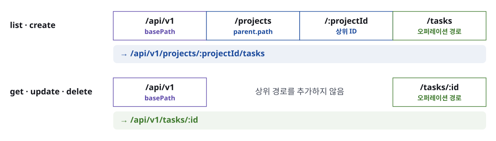

# 상위-하위 엔티티 관계 설정하기

[English](/en/guides/parent-child.md) | **한국어**

> 하위 엔티티(entity)의 리소스가 상위 엔티티의 URL 경로 아래에 놓이도록 중첩 관계를 설정합니다(예: `/projects/:projectId/tasks`).

## 시작하기 전에

- [기본 엔티티를 정의하는 방법](/ko/guides/defining-entities.md)을 알아 두세요.
- 계약(contract)에 상위 엔티티(예: `project`)를 먼저 정의해 두세요.

## 해결 방법

### 1단계: 상위 엔티티 정의

상위 엔티티는 별도 설정이 없는 일반 엔티티 정의입니다.

```ts
import { z } from "zod";

const projectSchema = z.object({
  id: z.string().uuid(),
  name: z.string(),
  status: z.enum(["active", "archived"]),
  createdAt: z.string().datetime(),
});

const createProjectSchema = z.object({
  name: z.string().min(1),
});

const updateProjectSchema = z.object({
  name: z.string().min(1).optional(),
  status: z.enum(["active", "archived"]).optional(),
});
```

### 2단계: `parent`를 지정한 하위 엔티티 정의

하위 엔티티에 `parent` 필드를 추가하세요. 프레임워크는 이 값으로 중첩 URL을 구성합니다.

```ts
const taskSchema = z.object({
  id: z.string().uuid(),
  title: z.string(),
  status: z.enum(["todo", "in_progress", "done"]),
  projectId: z.string().uuid(),
  createdAt: z.string().datetime(),
});

const createTaskSchema = z.object({
  title: z.string().min(1),
  status: z.enum(["todo", "in_progress", "done"]).default("todo"),
});

const updateTaskSchema = z.object({
  title: z.string().min(1).optional(),
  status: z.enum(["todo", "in_progress", "done"]).optional(),
});

const taskEntity = {
  schema: taskSchema,
  parent: {
    param: "projectId",    // Route parameter name
    path: "/projects",     // Parent's URL segment
  },
  operations: {
    list:   { method: "GET",    path: "/tasks" },
    get:    { method: "GET",    path: "/tasks/:id" },
    create: { method: "POST",   path: "/tasks", input: createTaskSchema },
    update: { method: "PATCH",  path: "/tasks/:id", input: updateTaskSchema },
    delete: { method: "DELETE", path: "/tasks/:id" },
  },
} satisfies EntityDefinition;
```

`parent` 설정은 `list`와 `create` 오퍼레이션(operation)의 경로 앞에 상위 엔티티의 경로와 상위 ID를 추가합니다.



### 3단계: 두 엔티티 등록

```ts
import { defineApi, simpleQueryBuilder } from "@simplix-react/contract";

const projectApi = defineApi({
  domain: "project",
  basePath: "/api/v1",
  entities: {
    project: {
      schema: projectSchema,
      operations: {
        list:   { method: "GET",    path: "/projects" },
        get:    { method: "GET",    path: "/projects/:id" },
        create: { method: "POST",   path: "/projects", input: createProjectSchema },
        update: { method: "PATCH",  path: "/projects/:id", input: updateProjectSchema },
        delete: { method: "DELETE", path: "/projects/:id" },
      },
    },
    task: taskEntity,
  },
  queryBuilder: simpleQueryBuilder,
});
```

### 4단계: 상위 ID로 클라이언트 사용

하위 엔티티의 `list`와 `create`에는 첫 번째 인자로 상위 ID를 전달하세요. 상위 ID 없이 호출하면 오퍼레이션 경로만으로 요청합니다(`/api/v1/tasks`).

```ts
const projectId = "proj-1";

// List tasks under a project
// GET /api/v1/projects/proj-1/tasks
const tasks = await projectApi.client.task.list(projectId);

// Create a task under a project
// POST /api/v1/projects/proj-1/tasks
const newTask = await projectApi.client.task.create(projectId, {
  title: "Implement feature",
});

// Get, update, and delete use the task's own ID (no parent needed)
// GET /api/v1/tasks/task-1
const task = await projectApi.client.task.get("task-1");

// PATCH /api/v1/tasks/task-1
const updated = await projectApi.client.task.update("task-1", {
  status: "done",
});

// DELETE /api/v1/tasks/task-1
await projectApi.client.task.delete("task-1");
```

### 5단계: 쿼리 키 전파

`useList`나 `useInfiniteList`에 상위 ID를 전달하면 목록 쿼리 키에 `parent.param` 이름으로 포함됩니다. 그래서 상위 엔티티마다 목록을 따로 캐시합니다.

```ts
// Query key for all tasks under a specific project:
projectApi.queryKeys.task.list({ projectId: "proj-1" });
// → ["project", "task", "list", { projectId: "proj-1" }]

// Invalidating all task queries regardless of parent:
projectApi.queryKeys.task.all;
// → ["project", "task"]
```

### 6단계: 상위 ID로 파생된 훅 사용

`@simplix-react/react`를 사용할 때는 목록 훅과 `useCreate`에 상위 ID를 전달하세요.

```tsx
import { deriveEntityHooks } from "@simplix-react/react";

const hooks = deriveEntityHooks(projectApi);

function TaskList({ projectId }: { projectId: string }) {
  // useList automatically includes projectId in the query key
  // and scopes the request to /api/v1/projects/:projectId/tasks
  const { data: tasks, isLoading } = hooks.task.useList(projectId);

  // useCreate takes parentId to POST under the correct parent
  const createTask = hooks.task.useCreate(projectId);

  if (isLoading) return <p>Loading...</p>;

  return (
    <div>
      <ul>
        {tasks?.map((task) => (
          <li key={task.id}>{task.title} - {task.status}</li>
        ))}
      </ul>
      <button
        onClick={() =>
          createTask.mutate({ title: "New task", status: "todo" })
        }
      >
        Add Task
      </button>
    </div>
  );
}
```

`projectId`가 `undefined`나 빈 문자열이면 `useList` 훅이 비활성화되므로 올바른 상위 ID 없이 요청을 보내지 않습니다. `useCreate`는 성공한 뒤 엔티티의 모든 쿼리(`queryKeys.task.all`)를 무효화합니다.

## 변형

### 상위 ID와 함께 필터링·정렬

상위 ID와 목록 매개변수를 함께 전달해 조건을 지정한 목록을 조회하세요.

```ts
// List tasks under a project, filtered and sorted
const { data: tasks } = hooks.task.useList(projectId, {
  filters: { status: "todo" },
  sort: { field: "createdAt", direction: "desc" },
});
```

### 조회·수정·삭제의 중첩 경로

`get`, `update`, `delete`는 각 오퍼레이션의 경로를 그대로 사용하고 상위 경로를 추가하지 않습니다. 서버가 이 요청도 중첩 경로로 받는다면 전체 경로를 적고, 모든 경로 매개변수를 채우는 객체를 전달하세요.

```ts
const commentEntity = {
  schema: commentSchema,
  parent: { param: "taskId", path: "/tasks" },
  operations: {
    list: { method: "GET",    path: "/comments" },
    get:  { method: "GET",    path: "/tasks/:taskId/comments/:id" },
    delete: { method: "DELETE", path: "/tasks/:taskId/comments/:id" },
  },
} satisfies EntityDefinition;

// GET /api/v1/tasks/task-1/comments/c-9
await projectApi.client.comment.get({ taskId: "task-1", id: "c-9" });
```

### 이름 있는 쿼리 범위

`queries`는 엔티티 정의에 상위 엔티티 기준의 쿼리 범위를 이름으로 선언합니다. 선언만 할 뿐이며, 요청 · 쿼리 키 · 훅을 만들 때 이 값을 읽는 패키지는 없습니다.

```ts
const taskEntity = {
  schema: taskSchema,
  parent: {
    param: "projectId",
    path: "/projects",
  },
  queries: {
    byProject: {
      parent: "project",
      param: "projectId",
    },
  },
  operations: {
    list: { method: "GET", path: "/tasks" },
  },
} satisfies EntityDefinition;
```

### 상위 ID로 무한 스크롤

`useInfiniteList` 훅도 상위 엔티티 기준의 쿼리를 지원합니다. 각 페이지는 `{ data, meta }` 형태이고, `meta.hasNextPage`가 `true`인 동안 다음 페이지를 요청합니다.

```tsx
function TaskInfiniteList({ projectId }: { projectId: string }) {
  const {
    data,
    fetchNextPage,
    hasNextPage,
  } = hooks.task.useInfiniteList(projectId, { limit: 20 });

  return (
    <div>
      {data?.pages.map((page) =>
        page.data.map((task) => (
          <div key={task.id}>{task.title}</div>
        )),
      )}
      {hasNextPage && (
        <button onClick={() => fetchNextPage()}>Load More</button>
      )}
    </div>
  );
}
```

## 관련 문서

- [계약에 엔티티 정의하기](/ko/guides/defining-entities.md): 기본 엔티티 설정
- [CRUD 밖의 사용자 정의 오퍼레이션](/ko/guides/custom-operations.md): 상위-하위 엔티티와 함께 사용하는 오퍼레이션

---

<p class="page-source"><a href="https://github.com/simplix-framework/simplix-react/blob/main/docs/ko/guides/parent-child.md" target="_blank" rel="noopener noreferrer">GitHub에서 편집</a></p>
