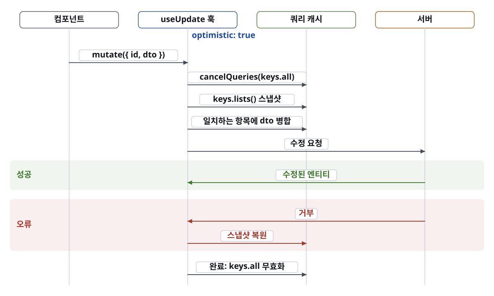

# @simplix-react/react로 React Query 훅 사용하기

[English](/en/guides/react-hooks-reference.md) | **한국어**

> API 계약(contract)에서 타입이 지정된 React Query 훅을 파생하고, 목록 · 상세 · 생성 · 수정 · 삭제 · 무한 스크롤 · 트리 · 사용자 정의 오퍼레이션(operation)에 사용합니다. 캐시 무효화(cache invalidation)는 자동으로 처리합니다.

## 시작하기 전에

- `@simplix-react/contract`로 계약을 정의한 simplix-react 프로젝트
- 의존성 설치:

```bash
pnpm add @simplix-react/react @tanstack/react-query
```

- 피어 의존성:

| 패키지 | 버전 |
| --- | --- |
| `@simplix-react/contract` | workspace |
| `@tanstack/react-query` | >= 5.0.0 |
| `@tanstack/react-query-persist-client` | >= 5.0.0 |
| `@tanstack/query-sync-storage-persister` | >= 5.0.0 |
| `react` | >= 18.0.0 |
| `zod` | >= 4.0.0 |

- 이미 정의한 계약:

```ts
// contract.ts
import { defineApi, simpleQueryBuilder } from "@simplix-react/contract";
import { z } from "zod";

const taskSchema = z.object({
  id: z.string(),
  title: z.string(),
  status: z.enum(["open", "in_progress", "done"]),
  priority: z.number(),
  createdAt: z.string(),
});

const createTaskSchema = z.object({
  title: z.string(),
  status: z.enum(["open", "in_progress", "done"]),
  priority: z.number(),
});

const updateTaskSchema = createTaskSchema.partial();

export const projectContract = defineApi({
  domain: "project",
  basePath: "/api",
  entities: {
    task: {
      schema: taskSchema,
      operations: {
        list: { method: "GET", path: "/tasks" },
        get: { method: "GET", path: "/tasks/:id" },
        create: { method: "POST", path: "/tasks", input: createTaskSchema },
        update: { method: "PATCH", path: "/tasks/:id", input: updateTaskSchema },
        delete: { method: "DELETE", path: "/tasks/:id" },
      },
    },
  },
  queryBuilder: simpleQueryBuilder,
});
```

## 해결 방법

### 1단계: 계약에서 훅 파생하기

계약을 전달해 `deriveEntityHooks`를 호출하세요. 호출 한 번으로 모든 엔티티(entity)와 오퍼레이션의 React Query 훅(hook)을 파생합니다.

```ts
import { deriveEntityHooks } from "@simplix-react/react";
import { projectContract } from "./contract.js";

export const hooks = deriveEntityHooks(projectContract);

// hooks.task.useList         : list query
// hooks.task.useGet          : detail query
// hooks.task.useCreate       : create mutation
// hooks.task.useUpdate       : update mutation
// hooks.task.useDelete       : delete mutation
// hooks.task.useInfiniteList : infinite scroll query (comes with the list role)
```

훅 이름은 `use`에 첫 글자를 대문자로 바꾼 오퍼레이션 이름을 이어 쓴 것입니다(`list` → `useList`, `archive` → `useArchive`). 오퍼레이션의 역할은 `role` 필드에서 정하고, 필드가 없으면 이름이 `list`, `get`, `create`, `update`, `delete`, `tree` 중 하나일 때 그 이름에서 정합니다. 역할에 따라 훅의 종류가 정해집니다. `list` 역할의 오퍼레이션은 `useInfiniteList`도 함께 만듭니다. 엔티티에는 그 엔티티가 정의한 오퍼레이션의 훅만 있습니다.

반환 타입은 `DerivedEntityHooksResult`입니다. 엔티티 이름마다 `EntityHooks` 객체를, 최상위 오퍼레이션마다 `OperationHooks` 객체를 담습니다.

### 2단계: useList로 목록 조회하기

`useList`는 엔티티 목록을 조회합니다. 상위 엔티티가 있는지에 따라 호출 방식이 다릅니다.

**최상위 엔티티(상위 엔티티 없음):**

```tsx
function TaskList() {
  const { data: tasks, isLoading, error } = hooks.task.useList();

  if (isLoading) return <p>Loading...</p>;
  if (error) return <p>Error: {error.message}</p>;

  return (
    <ul>
      {tasks?.map((task) => (
        <li key={task.id}>{task.title}: {task.status}</li>
      ))}
    </ul>
  );
}
```

**필터와 정렬 지정:**

```tsx
const { data: tasks } = hooks.task.useList({
  filters: { status: "open" },
  sort: { field: "createdAt", direction: "desc" },
});
```

**상위 엔티티 ID를 받는 하위 엔티티:**

```tsx
// Fetch tasks belonging to a specific project
const { data: tasks } = hooks.task.useList(projectId);

// With filters
const { data: tasks } = hooks.task.useList(projectId, {
  filters: { status: "open" },
  sort: { field: "priority", direction: "asc" },
});

// With filters and query options
const { data: tasks } = hooks.task.useList(
  projectId,
  { filters: { status: "open" } },
  { enabled: isReady },
);
```

하위 엔티티는 `parentId`가 falsy이면 쿼리를 자동으로 비활성화합니다. 두 번째 인수에 `filters`, `sort`, `pagination` 키가 있으면 `ListParams`로, 없으면 쿼리 옵션으로 읽습니다.

`ListParams` 타입(`@simplix-react/contract`에서 제공):

```ts
interface ListParams<TFilters = Record<string, unknown>> {
  filters?: TFilters;
  sort?: SortParam | SortParam[];
  pagination?: PaginationParam;
}

interface SortParam {
  field: string;
  direction: "asc" | "desc";
}

type PaginationParam =
  | { type: "offset"; page: number; limit: number }
  | { type: "cursor"; cursor: string; limit: number };
```

**시그니처:**

```ts
type DerivedListHook<TData> = (
  parentIdOrParams?: string | ListParams,
  paramsOrOptions?: ListParams | Omit<UseQueryOptions<TData[], Error>, "queryKey" | "queryFn">,
  options?: Omit<UseQueryOptions<TData[], Error>, "queryKey" | "queryFn">,
) => UseQueryResult<TData[]>;
```

### 3단계: useGet으로 단일 엔티티 조회하기

`useGet`은 ID로 엔티티 하나를 조회합니다. `id`가 빈 문자열이거나 키가 없는 복합 키 객체이면 쿼리를 자동으로 비활성화합니다.

```tsx
function TaskDetail({ taskId }: { taskId: string }) {
  const { data: task, isLoading } = hooks.task.useGet(taskId);

  if (isLoading) return <p>Loading...</p>;
  if (!task) return <p>Task not found</p>;

  return (
    <div>
      <h2>{task.title}</h2>
      <p>Status: {task.status}</p>
      <p>Priority: {task.priority}</p>
    </div>
  );
}
```

TanStack Query 옵션은 두 번째 인수로 전달하세요.

```tsx
const { data: task } = hooks.task.useGet(taskId, {
  staleTime: 5000,
  refetchOnWindowFocus: false,
});
```

`id` 매개변수에는 문자열이나 복합 키 객체(`EntityId`)를 전달합니다.

```ts
type EntityId = string | Record<string, string>;
```

**시그니처:**

```ts
type DerivedGetHook<TData> = (
  id: EntityId,
  options?: Omit<UseQueryOptions<TData, Error>, "queryKey" | "queryFn">,
) => UseQueryResult<TData>;
```

### 4단계: useCreate로 엔티티 생성하기

`useCreate`는 TanStack Query 뮤테이션(mutation)을 반환합니다. 하위 엔티티는 상위 엔티티 ID를 첫 번째 인수로 전달하세요.

```tsx
function CreateTaskForm() {
  const createTask = hooks.task.useCreate();

  async function handleSubmit(values: { title: string; status: string; priority: number }) {
    await createTask.mutateAsync(values);
  }

  return (
    <form onSubmit={(e) => { e.preventDefault(); handleSubmit(formValues); }}>
      {/* form fields */}
      <button type="submit" disabled={createTask.isPending}>
        {createTask.isPending ? "Creating..." : "Create Task"}
      </button>
    </form>
  );
}
```

하위 엔티티의 경우:

```tsx
const createTask = hooks.task.useCreate(projectId);
createTask.mutate({ title: "New task", status: "open", priority: 1 });
```

뮤테이션 옵션은 두 번째 인수로 전달하세요.

```tsx
const createTask = hooks.task.useCreate(undefined, {
  onSuccess: (data) => {
    console.log("Created:", data);
    navigate(`/tasks/${data.id}`);
  },
  onError: (error) => {
    console.error("Create failed:", error);
  },
});
```

`useCreate`는 성공하면 엔티티의 쿼리 키(query key) 범위에 있는 모든 쿼리를 자동으로 무효화합니다.

**시그니처:**

```ts
type DerivedCreateHook<TInput, TOutput> = (
  parentId?: string,
  options?: Omit<UseMutationOptions<TOutput, Error, TInput>, "mutationFn">,
) => UseMutationResult<TOutput, Error, TInput>;
```

### 5단계: useUpdate로 엔티티 수정하기

`useUpdate`는 `{ id, dto }`를 뮤테이션 변수로 받습니다. `optimistic` 옵션(기본값 `false`)으로 낙관적 업데이트(optimistic update)를 켤 수 있습니다.

```tsx
function TaskStatusToggle({ task }: { task: Task }) {
  const updateTask = hooks.task.useUpdate();

  function toggleStatus() {
    const newStatus = task.status === "done" ? "open" : "done";
    updateTask.mutate({ id: task.id, dto: { status: newStatus } });
  }

  return (
    <button onClick={toggleStatus} disabled={updateTask.isPending}>
      {task.status === "done" ? "Reopen" : "Complete"}
    </button>
  );
}
```

**낙관적 업데이트**: 화면을 즉시 갱신하고, 오류가 나면 되돌립니다. `optimistic: true`를 전달하면 훅이 낙관적 업데이트를 적용하지만, 이 옵션이 훅의 타입에 없으므로 타입 검사를 거치는 호출에서는 전달할 수 없습니다.

낙관적 업데이트의 처리 순서:



1. `queryClient.cancelQueries`로 엔티티의 모든 쿼리를 취소하고, 모든 목록 쿼리의 데이터를 스냅샷으로 보관합니다.
2. 캐시된 각 목록에서 `id`가 일치하는 항목(복합 키는 모든 키가 일치하는 항목)에 `dto`를 병합합니다.
3. 오류가 나면 스냅샷에서 이전 목록 데이터를 복원합니다.
4. 완료되면(성공이든 오류든) 엔티티의 모든 쿼리를 무효화합니다.

옵션으로 전달한 `onSuccess`는 그대로 실행합니다. 옵션의 `onMutate`, `onError`, `onSettled`는 훅 자체의 핸들러로 대체합니다.

**시그니처:**

```ts
type DerivedUpdateHook<TInput, TOutput> = (
  options?: Omit<
    UseMutationOptions<TOutput, Error, { id: EntityId; dto: TInput }>,
    "mutationFn"
  >,
) => UseMutationResult<TOutput, Error, { id: EntityId; dto: TInput }>;
```

### 6단계: useDelete로 엔티티 삭제하기

`useDelete`는 엔티티 ID를 뮤테이션 변수로 받습니다.

```tsx
function DeleteTaskButton({ taskId }: { taskId: string }) {
  const deleteTask = hooks.task.useDelete({
    onSuccess: () => navigate("/tasks"),
  });

  return (
    <button
      onClick={() => deleteTask.mutate(taskId)}
      disabled={deleteTask.isPending}
    >
      {deleteTask.isPending ? "Deleting..." : "Delete"}
    </button>
  );
}
```

`useDelete`는 성공하면 엔티티의 쿼리 키 범위에 있는 모든 쿼리를 자동으로 무효화합니다.

**시그니처:**

```ts
type DerivedDeleteHook = (
  options?: Omit<UseMutationOptions<void, Error, EntityId>, "mutationFn">,
) => UseMutationResult<void, Error, EntityId>;
```

### 7단계: useInfiniteList로 무한 스크롤 구현하기

`useInfiniteList`는 커서 기반 페이지 매기기와 오프셋 기반 페이지 매기기를 모두 지원합니다. 첫 페이지는 오프셋 1페이지, `limit`개(기본값 `20`)로 요청합니다. 다음 페이지 매개변수는 응답의 `meta` 필드에서 자동으로 정합니다. `hasNextPage`가 false이면 다음 페이지가 없고, 서버가 `nextCursor`를 보내면 그 값을, 아니면 다음 페이지 번호를 사용합니다. `@simplix-react/mock`의 목 핸들러는 오프셋 페이지를 0부터 세므로, 목 핸들러를 상대로 하면 첫 요청(1페이지)이 처음 `limit`개 행을 건너뜁니다.

```tsx
function InfiniteTaskList() {
  const {
    data,
    fetchNextPage,
    hasNextPage,
    isFetchingNextPage,
  } = hooks.task.useInfiniteList(undefined, {
    limit: 10,
    filters: { status: "open" },
    sort: { field: "createdAt", direction: "desc" },
  });

  const allTasks = data?.pages.flatMap((page) => page.data) ?? [];

  return (
    <div>
      <ul>
        {allTasks.map((task) => (
          <li key={task.id}>{task.title}</li>
        ))}
      </ul>

      {hasNextPage && (
        <button
          onClick={() => fetchNextPage()}
          disabled={isFetchingNextPage}
        >
          {isFetchingNextPage ? "Loading more..." : "Load More"}
        </button>
      )}
    </div>
  );
}
```

하위 엔티티는 상위 엔티티 ID를 전달하세요.

```tsx
const result = hooks.task.useInfiniteList(projectId, {
  limit: 20,
  filters: { status: "in_progress" },
});
```

서버가 반환해야 하는 응답 형식(`@simplix-react/contract`의 `PageInfo`):

```ts
interface PageResponse<T> {
  data: T[];
  meta: {
    total?: number;
    hasNextPage: boolean;
    nextCursor?: string; // for cursor-based pagination
  };
}
```

**시그니처:**

```ts
type DerivedInfiniteListHook<TData> = (
  parentId?: string,
  params?: Omit<ListParams, "pagination"> & { limit?: number },
  options?: Record<string, unknown>,
) => UseInfiniteQueryResult<
  InfiniteData<{ data: TData[]; meta: PageInfo }>,
  Error
>;
```

### 8단계: useTree로 트리 조회하기

`tree` 역할의 오퍼레이션(이름이 `tree`이거나 `role: "tree"`를 지정한 오퍼레이션)은 쿼리 훅을 만듭니다. 매개변수는 클라이언트 함수에 전달하고 쿼리 키에도 포함합니다.

```ts
const categoryContract = defineApi({
  domain: "catalog",
  basePath: "/api",
  entities: {
    category: {
      schema: categorySchema,
      operations: {
        tree: { method: "GET", path: "/categories/tree" },
      },
    },
  },
});

const catalogHooks = deriveEntityHooks(categoryContract);
const { data: tree } = catalogHooks.category.useTree({ rootId: "electronics" });
```

**시그니처:**

```ts
type DerivedTreeHook<TData> = (
  params?: Record<string, unknown>,
  options?: Omit<UseQueryOptions<TData, Error>, "queryKey" | "queryFn">,
) => UseQueryResult<TData>;
```

## 변형

### 쿼리 키 구조

엔티티마다 다음 구조의 `QueryKeyFactory`를 파생합니다.

| 키 | 형태 | 용도 |
| --- | --- | --- |
| `keys.all` | `[domain, entity]` | 엔티티의 모든 쿼리 무효화 |
| `keys.lists()` | `[domain, entity, "list"]` | 모든 목록 쿼리 무효화 |
| `keys.list(params)` | `[domain, entity, "list", params]` | 조건을 지정한 특정 목록 |
| `keys.details()` | `[domain, entity, "detail"]` | 모든 상세 쿼리 무효화 |
| `keys.detail(id)` | `[domain, entity, "detail", id]` | ID로 지정한 특정 엔티티 |
| `keys.trees()` | `[domain, entity, "tree"]` | 모든 트리 쿼리 무효화 |
| `keys.tree(params?)` | `[domain, entity, "tree", params]`, 매개변수가 없으면 `[domain, entity, "tree"]` | 트리 쿼리 |

`useList`는 `ListParams`(하위 엔티티는 상위 엔티티 매개변수도)를 `keys.list(...)`에 넣습니다. `useInfiniteList`는 `infinite: true`를, 사용자 정의 GET 훅은 `operation: <name>`을 추가하므로 일반 목록의 키와 겹치지 않습니다.

위 계약 예시의 쿼리 키는 다음과 같습니다.

```ts
// All task queries
["project", "task"]

// All task list queries
["project", "task", "list"]

// Filtered task list
["project", "task", "list", { filters: { status: "open" } }]

// Specific task
["project", "task", "detail", "task-1"]
```

### 자동 무효화 동작

뮤테이션 훅은 관련 쿼리를 자동으로 무효화합니다.

| 훅 | 무효화 범위 | 시점 |
| --- | --- | --- |
| `useCreate` | `keys.all`(엔티티의 모든 쿼리) | 성공 시 |
| `useUpdate` | `keys.all`(엔티티의 모든 쿼리) | 완료 시(성공 또는 오류) |
| `useDelete` | `keys.all`(엔티티의 모든 쿼리) | 성공 시 |
| 엔티티의 사용자 정의 뮤테이션 | `invalidates`가 반환한 키, 없으면 `keys.all` | 성공 시 |
| 최상위 `useMutation` | `invalidates`가 반환한 키, 없으면 무효화하지 않음 | 성공 시 |

표준 CRUD 오퍼레이션에서는 `queryClient.invalidateQueries()`를 직접 호출할 필요가 없습니다.

### TanStack Query 옵션 전달

모든 훅은 마지막 인수로 TanStack Query 옵션을 받습니다. 쿼리 훅은 `queryKey`와 `queryFn`을 제외한 모든 `UseQueryOptions`를, 뮤테이션 훅은 `mutationFn`을 제외한 모든 `UseMutationOptions`를 받습니다. 옵션의 `onSuccess`는 훅이 캐시를 무효화한 다음에 실행합니다. `useInfiniteList`는 옵션을 일반 객체로 받아 `useInfiniteQuery`에 그대로 펼쳐 넣습니다.

```ts
// Disable a query
const { data } = hooks.task.useList({ enabled: false });

// Custom stale time
const { data } = hooks.task.useGet(taskId, { staleTime: 30_000 });

// Mutation callbacks
const createTask = hooks.task.useCreate(undefined, {
  onSuccess: (data) => console.log("Created:", data),
  onError: (error) => console.error("Failed:", error),
  onSettled: () => console.log("Done"),
});
```

### 사용자 정의 오퍼레이션 훅

이름이 CRUD 이름이 아니고 `role`도 없는 엔티티 오퍼레이션은 사용자 정의 오퍼레이션입니다. 사용자 정의 오퍼레이션은 범용 훅을 만듭니다.

- **GET 오퍼레이션**은 쿼리 훅을 만듭니다. 매개변수 객체를 클라이언트 함수에 전달하고, 쿼리 키는 `keys.list({ operation: <name>, ...params })`입니다.
- **POST/PUT/PATCH/DELETE 오퍼레이션**은 뮤테이션 훅을 만듭니다. 뮤테이션 변수를 클라이언트 함수에 전달하고, 성공하면 오퍼레이션의 `invalidates`가 반환한 키를 무효화합니다. `invalidates`가 없으면 `keys.all`을 무효화합니다.

뮤테이션 변수가 클라이언트 함수의 첫 번째 인수가 되므로 오퍼레이션의 첫 번째 경로 매개변수를 채우며, 훅은 그와 함께 입력을 보낼 수 없습니다. 경로 매개변수와 입력이 모두 필요한 오퍼레이션은 직접 만든 `useMutation` 안에서 클라이언트를 호출하세요. 엔티티의 사용자 정의 오퍼레이션이면 훅은 오퍼레이션 이름을 키로 하고 그 엔티티의 쿼리 키 팩토리를 값으로 하는 항목 하나만 든 맵과 빈 매개변수 객체로 `invalidates`를 호출합니다. 예를 들어 `archive` 오퍼레이션 안에서 `queryKeys.archive.all`은 그 엔티티의 `all` 키이며, 다른 엔티티의 키는 이 맵에 없습니다.

```ts
const contract = defineApi({
  domain: "inventory",
  basePath: "/api",
  entities: {
    product: {
      schema: productSchema,
      operations: {
        list: { method: "GET", path: "/products" },
        get: { method: "GET", path: "/products/:id" },
        create: { method: "POST", path: "/products", input: createSchema },
        archive: { method: "POST", path: "/products/:id/archive" },
        search: { method: "GET", path: "/products/search" },
      },
    },
  },
});

const hooks = deriveEntityHooks(contract);

// Custom mutation hook (POST)
const archive = hooks.product.useArchive();
archive.mutate(productId);

// Custom query hook (GET)
const { data } = hooks.product.useSearch({ q: "keyword" });
```

### 최상위 오퍼레이션 훅

엔티티가 아니라 계약 최상위(`operations`)에 정의한 오퍼레이션은 `useMutation` 메서드가 있는 `OperationHooks`를 만듭니다. 뮤테이션 변수는 클라이언트 함수의 유일한 인수이므로, 경로에 매개변수가 있으면 첫 번째 경로 매개변수를 채우고 없으면 입력이 됩니다.

```ts
const archiveProject = hooks.archiveProject.useMutation({
  onSuccess: () => console.log("Project archived"),
});

archiveProject.mutate("abc");
```

오퍼레이션의 `invalidates` 함수는 모든 엔티티의 쿼리 키 팩토리를 받아, 성공 시 무효화할 키를 반환합니다. `invalidates`가 없는 오퍼레이션은 아무것도 무효화하지 않습니다.

### 페이지 응답의 목록 추출

`useList`는 페이지 응답에서 목록을 자동으로 꺼냅니다. 서버가 `{ data: T[] }`를 반환하면 훅은 배열만 반환합니다.

```ts
// Server returns: { data: [{ id: "1", ... }], meta: { total: 100 } }
// useList returns: [{ id: "1", ... }]
const { data: tasks } = hooks.task.useList();
```

### 연결 이벤트를 놓쳐도 쿼리가 멈추지 않게 하기

React Query는 브라우저가 오프라인이라고 판단하는 동안 조회를 일시 중지하고, 그 판단은 window의 `online` · `offline` 이벤트로만 기록하는 플래그에서 읽습니다. 연결 관리자는 구독자가 없을 때마다 이 이벤트 리스너를 해제하므로, `online` 이벤트를 한 번만 놓쳐도 플래그가 오프라인으로 남고 페이지를 닫을 때까지 모든 쿼리가 일시 중지됩니다.

앱이 `QueryClient`를 만드는 곳에서 `startOnlineStatusSync()`를 한 번 호출하세요. 이 함수는 시작할 때와 문서가 다시 보일 때마다(사용자가 멈춘 탭으로 돌아오는 시점) `navigator.onLine`으로 플래그를 바로잡습니다. 동기화를 멈추는 함수를 반환하고, 다시 호출하면 이전 등록을 대체합니다.

```ts
import { QueryClient, QueryClientProvider } from "@tanstack/react-query";
import { startOnlineStatusSync } from "@simplix-react/react";

const queryClient = new QueryClient();

startOnlineStatusSync();
```

플래그를 바로잡는 것으로 충분합니다. `QueryClient`가 연결 관리자를 직접 구독하고 있어서, 플래그가 온라인으로 바뀌면 일시 중지한 조회를 다시 시작합니다. `simplix init`으로 생성한 앱에는 이 호출이 이미 들어 있습니다.

직접 만든 연결 확인이 성공한 뒤처럼 플래그를 한 번만 바로잡으려면 `resyncOnlineStatus()`를 호출하세요. 동기화 후 React Query가 브라우저를 온라인으로 보는지를 반환합니다. `navigator.onLine`이 없는 환경(서버 렌더링, React Native)에서는 두 함수 모두 플래그를 바꾸지 않습니다.

```ts
import { resyncOnlineStatus } from "@simplix-react/react";

const online = resyncOnlineStatus();
```

대신 `networkMode: "always"`를 쓰지 마세요. 모든 쿼리가 연결 상태를 무시하게 되어, 실제로 오프라인일 때 일시 중지 대신 이해하기 어려운 오류가 표시됩니다.

### useBatchDetails로 행마다 상세 조회하기

`useBatchDetails`는 목록의 항목마다 상세 쿼리를 하나씩(`useQueries`로) 실행하고 결과를 합칩니다. `extractId`가 `undefined`를 반환한 항목은 건너뜁니다. `data`에는 조회에 성공한 상세 데이터가 들어 있고, `isPending`은 진행 중인 조회가 하나라도 있으면 `true`입니다.

```tsx
import { useBatchDetails } from "@simplix-react/react";

const { data: tasks } = hooks.task.useList();
const { data: details, isPending } = useBatchDetails(
  tasks,
  (task) => task.id,
  (id) => ({
    queryKey: projectContract.queryKeys.task.detail(id),
    queryFn: () => projectContract.client.task.get(id),
  }),
);
```

`extractId`는 바뀌지 않는 함수(컴포넌트 밖에서 정의하거나 `useCallback`으로 감싼 함수)로 전달하세요. 함수가 바뀌면 ID 목록을 다시 계산합니다.

### createLocalQueryStore로 선택한 쿼리 보존하기

`createLocalQueryStore`는 캐시를 `localStorage`에 기록하고 무효화할 때까지 유지할 쿼리 키를 등록합니다. 등록한 키(접두어로 일치 판정)이면서 조회에 성공한 데이터만 저장하므로, 일반 목록 · 상세 쿼리는 저장하지 않습니다.

```tsx
import { QueryClient } from "@tanstack/react-query";
import { PersistQueryClientProvider } from "@tanstack/react-query-persist-client";
import { createLocalQueryStore } from "@simplix-react/react";

const queryClient = new QueryClient();
const store = createLocalQueryStore({ version: "1", storageKey: "app:cache" });

// A query owned by a framework provider: register its key only
store.localQueryKey(["menu", "tree"]);

// A query owned by the app: define it and register its key
const policyQuery = store.localQuery({ key: ["policy"], queryFn: fetchPolicy });

function App() {
  return (
    <PersistQueryClientProvider client={queryClient} persistOptions={store.persistOptions}>
      <Routes />
    </PersistQueryClientProvider>
  );
}
```

`localQuery`는 `useQuery(policyQuery)`에 전달할 `queryOptions` 객체를 반환합니다.

| 옵션 | 타입 | 기본값 | 설명 |
| --- | --- | --- | --- |
| `version` | `string` | 필수 | 캐시 무효화 토큰. 복원할 때 값이 다르면 저장한 캐시 전체를 버립니다 |
| `storageKey` | `string` | 필수 | 캐시를 기록할 `localStorage` 키 |
| `maxAge` | `number` | 24시간 | 복원할 때 이보다 오래된 항목은 버립니다 |
| `storage` | `Storage` | `window.localStorage` | 저장소 백엔드 |

`LocalQueryDef`에는 `key`, `queryFn`, `staleTime`(기본값 `Infinity`, 무효화할 때만 다시 조회), `gcTime`(기본값은 저장소의 `maxAge`)이 있습니다.

## 관련 문서

- [계약에 엔티티 정의하기](/ko/guides/defining-entities.md): 엔티티 스키마 설정
- [폼 훅 가이드](/ko/guides/form-hooks.md): 생성 · 수정 폼용 TanStack Form 훅 파생
- [사용자 정의 오퍼레이션](/ko/guides/custom-operations.md): 계약에 CRUD가 아닌 오퍼레이션 정의
- [@simplix-react/react API 레퍼런스](https://github.com/simplix-framework/simplix-react/blob/main/docs/api/@simplix-react/react/README.md): 전체 API 문서

---

<p class="page-source"><a href="https://github.com/simplix-framework/simplix-react/blob/main/docs/ko/guides/react-hooks-reference.md" target="_blank" rel="noopener noreferrer">GitHub에서 편집</a></p>
