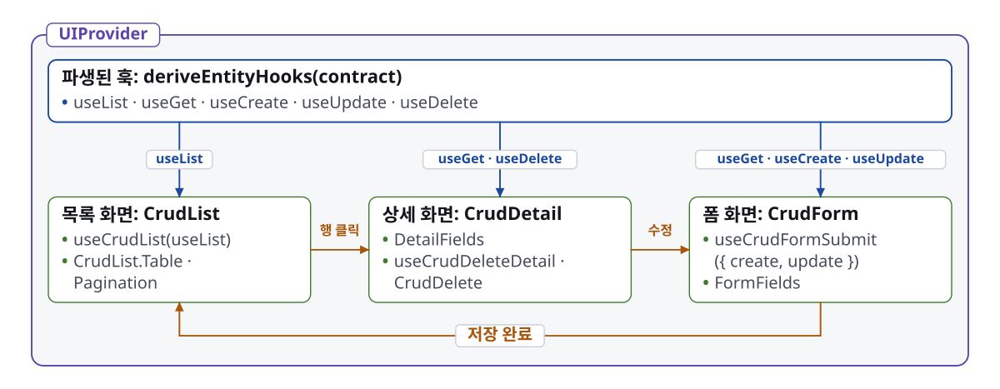

# @simplix-react/ui로 CRUD 화면 만들기

[English](/en/guides/ui-components.md) | **한국어**

> `@simplix-react/ui` 컴포넌트로 목록, 폼, 상세 화면을 만듭니다. 복합 컴포넌트 패턴, 명시적인 필드 props, 바꿀 수 있는 레이아웃을 사용합니다.

## 시작하기 전에

- 도메인 패키지와 파생된 훅이 있는 simplix-react 프로젝트
- UI 패키지 설치:

```bash
pnpm add @simplix-react/ui
```

- 피어 의존성:

| 패키지 | 버전 |
| --- | --- |
| `@simplix-react/api` | workspace |
| `@simplix-react/form` | workspace |
| `@simplix-react/i18n` | workspace |
| `@simplix-react/react` | workspace |
| `@tanstack/react-query` | >= 5.0.0 |
| `react` | >= 18.0.0 |
| `react-router-dom` | >= 6.0.0(선택, `createReactRouterAdapter`에 필요) |

- 계약(contract), 훅, 폼 훅이 준비되어 있어야 합니다.

```ts
// contract.ts
import { defineApi } from "@simplix-react/contract";
import { z } from "zod";

export const projectContract = defineApi({
  domain: "project",
  basePath: "/api",
  entities: {
    user: {
      schema: z.object({
        id: z.string(),
        name: z.string(),
        email: z.string(),
        status: z.enum(["active", "inactive"]),
        createdAt: z.string(),
      }),
      operations: {
        list: { method: "GET", path: "/users" },
        get: { method: "GET", path: "/users/:id" },
        create: { method: "POST", path: "/users" },
        update: { method: "PATCH", path: "/users/:id" },
        delete: { method: "DELETE", path: "/users/:id" },
      },
    },
  },
});

// hooks.ts
import { deriveEntityHooks } from "@simplix-react/react";
import { projectContract } from "./contract.js";

export const projectHooks = deriveEntityHooks(projectContract);
```

## 방법



### 1단계: UIProvider 설정

컴포넌트 재정의(override)와 기본 설정을 쓰려면 앱을 `UIProvider`로 감싸세요.

```tsx
import { UIProvider } from "@simplix-react/ui";

function App() {
  return (
    <UIProvider>
      {/* Your CRUD pages */}
    </UIProvider>
  );
}
```

기본 컴포넌트를 앱 전체에서 재정의하려면(예: `Input`이나 `Select`를 직접 만든 구현으로 교체) `createOverrides`로 재정의 맵을 만드세요. 팩토리는 기본 구현을 인수로 받습니다.

```tsx
import { createOverrides, UIProvider } from "@simplix-react/ui";
import { MyCustomInput } from "./my-input";

const overrides = createOverrides(() => ({
  Input: MyCustomInput,
  Select: {
    Root: MySelect.Root,
    Trigger: MySelect.Trigger,
    Value: MySelect.Value,
    Content: MySelect.Content,
    Item: MySelect.Item,
  },
}));

<UIProvider overrides={overrides}>
  {/* All fields now use custom input/select */}
</UIProvider>
```

재정의할 수 있는 컴포넌트는 `UIComponents`의 키입니다: `Input`, `Textarea`, `Label`, `Switch`, `Checkbox`, `Badge`, `Calendar`, `Button`, `Skeleton`, `Stack`, `Flex`, `Grid`, `Heading`, `Text`, `Card`, `SectionShell`, `QueryFallback`, `CrudDelete`, `FieldWrapper`, `DetailFieldWrapper`, 그리고 복합 컴포넌트 `Select`, `RadioGroup`, `Dialog`, `Sheet`, `Popover`, `Tooltip`, `DropdownMenu`, `Tabs`, `Command`, `Table`. 복합 컴포넌트의 일부만 재정의하면 나머지 하위 컴포넌트는 그대로 유지됩니다. `UIProvider`는 `defaults`, `statusTones`, `design`도 받습니다([designs.md](/ko/guides/designs.md) 참고).

### 2단계: CRUD 목록 화면 만들기

목록 상태는 `useCrudList`로 관리하고, 레이아웃은 복합 컴포넌트 `CrudList`로 구성하세요.

```tsx
import { CrudList, useCrudList, FormFields } from "@simplix-react/ui";
import { projectHooks } from "./hooks.js";

function UserListPage() {
  const { data, filters, sort, pagination, selection, emptyReason } =
    useCrudList(projectHooks.user.useList, {
      stateMode: "server",
      defaultSort: { field: "name", direction: "asc" },
      defaultPageSize: 20,
    });

  return (
    <CrudList>
      <CrudList.Toolbar>
        <CrudList.Search value={filters.search} onChange={filters.setSearch} />
      </CrudList.Toolbar>

      <CrudList.BulkActions
        selectedCount={selection.selected.size}
        onClear={selection.clear}
      >
        <CrudList.BulkAction
          label="Delete Selected"
          onClick={() => handleBulkDelete(selection.selected)}
          variant="destructive"
        />
      </CrudList.BulkActions>

      {emptyReason ? (
        <CrudList.Empty reason={emptyReason} />
      ) : (
        <CrudList.Table
          data={data}
          sort={{ field: sort.field!, direction: sort.direction }}
          onSortChange={(s) => sort.setSort(s.field, s.direction)}
          selectable
          selectedIndices={selection.selected}
          onSelectionChange={selection.toggle}
          onSelectAll={() => selection.toggleAll(data)}
          onRowClick={(row) => navigate(`/users/${row.id}`)}
        >
          <CrudList.Column field="name" header="Name" sortable />
          <CrudList.Column field="email" header="Email" sortable />
          <CrudList.Column
            field="status"
            header="Status"
            display="badge"
            variants={{ active: "success", inactive: "secondary" }}
          />
          <CrudList.Column field="createdAt" header="Created" format="date" sortable />
        </CrudList.Table>
      )}

      <CrudList.Pagination
        page={pagination.page}
        pageSize={pagination.pageSize}
        total={pagination.total}
        totalPages={pagination.totalPages}
        onPageChange={pagination.setPage}
        onPageSizeChange={pagination.setPageSize}
      />
    </CrudList>
  );
}
```

`useCrudList(useList, options?)`의 옵션: `stateMode`(`"server"` | `"client"`), `filterMode`(`"immediate"` | `"deferred"`), `maxRows`, `defaultSort`, `defaultPageSize`, `defaultFilters`, `addressedFilters`, `scopeKey`

`useCrudList`의 반환값:

| 속성 | 설명 |
| --- | --- |
| `data` | 현재 페이지의 데이터 |
| `isLoading` | 불러오는 중인지 여부 |
| `error` | 쿼리가 실패했을 때의 오류 객체 |
| `isPaused` | 요청이 진행 중이지만 멈춘 상태(React Query `fetchStatus === "paused"`) |
| `failureCount` | 연속으로 실패한 요청 횟수. `error === null`이면서 `> 0`이면 재시도를 기다리는 중입니다 |
| `filters` | `{ search, setSearch, values, setValue, setValues, setAll, clear, apply, isPending, committedValues, commitValue, commitValues }` |
| `sort` | `{ field, direction, setSort, toggleSort }` |
| `pagination` | `{ page, pageSize, total, totalPages, setPage, setPageSize }` |
| `selection` | `{ selected, toggle, toggleAll, clear, isSelected }` |
| `emptyReason` | `"no-data"`, `"no-filter"`, `"no-search"`, `"error"`, `"unavailable"` 또는 `null` |

성공으로도 오류로도 끝나지 않은 쿼리(멈춘 쿼리, 실패한 뒤 재시도를 기다리는 쿼리)는 `emptyReason: "unavailable"`을 보고합니다. React Query는 문서가 숨겨져 있거나 브라우저가 오프라인일 때 요청을 멈추고, 이때 쿼리는 `isLoading: false`, `error: null`입니다. 이 상태를 "데이터 없음"으로 표시하면 서버가 응답하지 않았는데도 운영자에게 목록이 비었다고 알리게 됩니다. 그래서 `CrudList`는 이 경우에 "목록을 불러오지 못했다"는 내용을 표시합니다.

`CrudList.Table`은 화면이 직접 설명할 수 있는 빈 상태에는 화면의 문구를 표시합니다. `emptyState`(`{ icon, title, description, action }`)는 아직 행이 없는 `"no-data"`일 때 표 대신 표시됩니다. 같은 형태의 `filteredEmptyState`는 필터와 일치하는 항목이 없는 `"no-filter"`일 때 프레임워크의 "No matching items" 카드 대신 표시되므로, 화면이 자체 필터나 칩의 뜻을 설명할 수 있습니다. 둘 다 없으면 프레임워크의 문구를 표시합니다. `"no-search"`, `"error"`, `"unavailable"`에는 항상 프레임워크의 카드를 표시합니다. `slots.empty`는 이유와 관계없이 이 모두를 대체합니다.

### 3단계: 생성 · 수정 폼 만들기

`CrudForm`과 값 · onChange를 명시적으로 받는 `FormFields` 필드 컴포넌트를 사용하세요.

```tsx
import { useRef, useState } from "react";
import { Button, CrudForm, FormFields, SaveButton, useCrudFormSubmit, useIsDirty } from "@simplix-react/ui";
import { projectHooks } from "./hooks.js";

function UserFormPage({ userId }: { userId?: string }) {
  const { data: user, isLoading } = projectHooks.user.useGet(userId ?? "");

  const [values, setValues] = useState({
    name: user?.name ?? "",
    email: user?.email ?? "",
    status: user?.status ?? "active",
  });
  const initialValues = useRef(values).current;
  const isDirty = useIsDirty(values, initialValues);

  const { isEdit, handleSubmit, isPending, fieldErrors } = useCrudFormSubmit({
    entityId: userId,
    create: projectHooks.user.useCreate(),
    update: projectHooks.user.useUpdate(),
    onSuccess: () => navigate("/users"),
  });

  if (userId && isLoading) return <p>Loading...</p>;

  return (
    <CrudForm
      onSubmit={() => handleSubmit(values)}
      isSubmitting={isPending}
      warnOnUnsavedChanges
    >
      <CrudForm.Section title="Basic Info" layout="two-column">
        <FormFields.TextField
          label="Name"
          value={values.name}
          onChange={(v) => setValues((p) => ({ ...p, name: v }))}
          error={fieldErrors["name"]}
        />
        <FormFields.TextField
          label="Email"
          value={values.email}
          onChange={(v) => setValues((p) => ({ ...p, email: v }))}
          type="email"
          error={fieldErrors["email"]}
        />
      </CrudForm.Section>

      <CrudForm.Section title="Settings" layout="single-column">
        <FormFields.SelectField
          label="Status"
          value={values.status}
          onChange={(v) => setValues((p) => ({ ...p, status: v }))}
          options={[
            { label: "Active", value: "active" },
            { label: "Inactive", value: "inactive" },
          ]}
        />
      </CrudForm.Section>

      <CrudForm.Actions>
        <Button type="button" variant="outline" onClick={() => navigate("/users")} disabled={isPending}>
          Cancel
        </Button>
        <SaveButton type="submit" isDirty={isEdit ? isDirty : undefined} isSaving={isPending} fieldErrors={fieldErrors}>
          {isEdit ? "Save Changes" : "Create User"}
        </SaveButton>
      </CrudForm.Actions>
    </CrudForm>
  );
}
```

`CrudForm.Section`의 layout 옵션: `"single-column"`, `"two-column"`, `"three-column"`

### 저장 버튼

저장, 생성, 수정 동작에는 모두 `SaveButton`을 사용하세요. isDirty, 저장 중, 검증 상태를 처리합니다.

```tsx
import { SaveButton, useIsDirty } from "@simplix-react/ui";

// Edit mode: disabled until changes, shows server error count badge
const isDirty = useIsDirty(values, initialValues);
<SaveButton type="submit" isDirty={isDirty} isSaving={isPending} fieldErrors={fieldErrors}>
  Save Changes
</SaveButton>

// Create mode: isDirty omitted (always enabled)
<SaveButton type="submit" isSaving={isPending} fieldErrors={fieldErrors}>
  Create
</SaveButton>

// Editor with client-side validation (validationCount disables button)
<SaveButton isDirty={isDirty} isSaving={isSaving} validationCount={errors.length} onClick={handleSave}>
  Save
</SaveButton>
```

| Prop | 타입 | 기본값 | 설명 |
| --- | --- | --- | --- |
| `isDirty` | `boolean` | `true` | `false`이면 비활성화됩니다. 생성 모드에서는 생략하세요. |
| `isSaving` | `boolean` | `false` | 스피너를 표시하고 버튼을 비활성화합니다. |
| `fieldErrors` | `Record<string, string>` | 없음 | 서버 검증 오류. 개수 배지를 표시합니다(안내용). |
| `validationCount` | `number` | 없음 | 클라이언트 검증 오류 수. fieldErrors보다 우선하며 버튼을 비활성화합니다. |
| `savingText` | `string` | 번역된 `common.saving` | 저장하는 동안 표시할 문구 |
| `disabled` | `boolean` | `false` | 버튼을 비활성화합니다. |

### 버튼의 loading prop

비동기 작업에는 모든 버튼에서 `loading` prop을 쓸 수 있습니다.

```tsx
import { Button } from "@simplix-react/ui";

<Button loading={mutation.isPending} loadingText="Executing...">
  Execute
</Button>
```

`loading=true`이면 스피너를 표시하고, 문구를 `loadingText`로 바꾸고(없으면 원래 문구 유지), 버튼을 자동으로 비활성화하고, `aria-busy`를 지정합니다.

사용할 수 있는 폼 필드 컴포넌트:

| 컴포넌트 | 값 타입 | 주요 props |
| --- | --- | --- |
| `FormFields.TextField` | `string` | `type`, `placeholder`, `maxLength` |
| `FormFields.TextareaField` | `string` | `rows`, `maxLength`, `resize` |
| `FormFields.NumberField` | `number \| null` | `min`, `max`, `step` |
| `FormFields.SelectField` | `T`(문자열 타입) | `options`, `placeholder` |
| `FormFields.SwitchField` | `boolean` | `switchProps` |
| `FormFields.CheckboxField` | `boolean` | `checkboxProps` |
| `FormFields.RadioGroupField` | `T`(문자열 타입) | `options`, `direction` |
| `FormFields.DateField` | 입력 `Date \| string \| number \| null`, 출력 `Date \| null` | `minDate`, `maxDate`, `locale`, `placeholder` |
| `FormFields.ComboboxField` | `T \| null` | `options`, `onSearch`, `loading` |
| `FormFields.PasswordField` | `string` | `placeholder`, `maxLength` |
| `FormFields.ColorField` | `string`(hex) | `presetColors`, `showCustomPicker`, `clearable` |
| `FormFields.SliderField` | `number` | `min`, `max`, `step`, `showValue` |
| `FormFields.MultiSelectField` | `T[]` | `options`, `maxCount` |
| `FormFields.Field` | `ReactNode` | 직접 만든 내용을 감싸는 범용 래퍼 |

모든 필드가 공통으로 받는 props: `label`, `error`, `description`, `required`, `disabled`, `className`

`FormFields`에는 `CountryField`, `CurrencyField`, `DateRangeField`, `DateTimeField`, `FileField`, `GroupedToggleField`, `IconField`, `ImageField`, `LocationPickerField`, `PhoneField`, `PlateEditorField`, `StaticField`, `TimeField`, `TimezoneField`, `TreeMultiSelectField`도 있습니다.

### 4단계: 상세 화면 만들기

읽기 전용 표시는 `CrudDetail`과 `DetailFields`로 구성하세요.

```tsx
import {
  CrudDetail,
  DetailFields,
  CrudDelete,
  useCrudDeleteDetail,
  QueryFallback,
} from "@simplix-react/ui";
import { projectHooks } from "./hooks.js";

function UserDetailPage({ userId }: { userId: string }) {
  const { data: user, isLoading } = projectHooks.user.useGet(userId);
  const deleteMutation = projectHooks.user.useDelete();
  const del = useCrudDeleteDetail();

  if (isLoading || !user) {
    return <QueryFallback isLoading={isLoading} notFoundMessage="User not found." />;
  }

  return (
    <>
      <CrudDetail fieldVariant={{ layout: "left" }}>
        <CrudDetail.Section title="User Info">
          <DetailFields.DetailTextField label="Name" value={user.name} copyable />
          <DetailFields.DetailTextField label="Email" value={user.email} copyable />
          <DetailFields.DetailBadgeField
            label="Status"
            value={user.status}
            variants={{ active: "success", inactive: "secondary" }}
          />
          <DetailFields.DetailDateField
            label="Created"
            value={user.createdAt}
            format="relative"
          />
        </CrudDetail.Section>

        <CrudDetail.DefaultActions
          onEdit={() => navigate(`/users/${userId}/edit`)}
          onDelete={del.requestDelete}
          isPending={deleteMutation.isPending}
        />
      </CrudDetail>

      <CrudDelete
        open={del.open}
        onOpenChange={del.onOpenChange}
        onConfirm={() => deleteMutation.mutate(userId)}
        entityName={user.name}
        loading={deleteMutation.isPending}
      />
    </>
  );
}
```

사용할 수 있는 상세 필드 컴포넌트:

| 컴포넌트 | 값 타입 | 주요 props |
| --- | --- | --- |
| `DetailFields.DetailTextField` | `string \| null` | `fallback`, `copyable` |
| `DetailFields.DetailNumberField` | `number \| null` | `format`(decimal/currency/percent), `locale`, `currency` |
| `DetailFields.DetailDateField` | `Date \| string \| number \| null` | `format`(date/datetime/time/relative), `fallback` |
| `DetailFields.DetailBadgeField` | `string` | `variants`(값과 배지 변형의 매핑) |
| `DetailFields.DetailLinkField` | `string` | `href`, `external` |
| `DetailFields.DetailBooleanField` | `boolean \| null` | `mode`(text/icon), `labels` |
| `DetailFields.DetailImageField` | `string \| null`(URL) | `alt`, `width`, `height` |
| `DetailFields.DetailListField` | `string[] \| null` | `mode`(badges/comma/bullet) |
| `DetailFields.DetailField` | `ReactNode` | 직접 만든 내용을 감싸는 범용 래퍼 |

`DetailFields`에는 `DetailBlockField`, `DetailCountryField`, `DetailCurrencyField`, `DetailLocationField`, `DetailNoteField`, `DetailPhoneField`, `DetailStatusField`, `DetailTextareaField`, `DetailTimezoneField`도 있습니다.

### 5단계: 레이아웃 프리미티브 사용

레이아웃 프리미티브는 CVA 기반의 의미 있는 레이아웃 컴포넌트입니다.

```tsx
import { Stack, Grid, Section, Card, Container, Heading, Text } from "@simplix-react/ui";

function UserProfilePage() {
  return (
    <Container size="lg">
      <Stack gap="lg">
        <Heading level={1}>User Profile</Heading>

        <Section title="Basic Info" description="Contact and account details">
          <Grid columns={2} gap="md">
            <FormFields.TextField label="First Name" value={first} onChange={setFirst} />
            <FormFields.TextField label="Last Name" value={last} onChange={setLast} />
          </Grid>
        </Section>

        <Card padding="md">
          <Text size="sm" tone="muted">
            Last updated 3 hours ago
          </Text>
        </Card>
      </Stack>
    </Container>
  );
}
```

| 컴포넌트 | 주요 props | 설명 |
| --- | --- | --- |
| `Stack` | `direction`, `gap`(none/xs/sm/md/lg/xl), `align`, `justify`, `wrap` | 세로 · 가로 flex 레이아웃 |
| `Flex` | Stack과 같음 | 가로 flex(`Stack direction="row"`의 별칭) |
| `Grid` | `columns`(1~6), `gap`, `responsive`(기본값 `true`) | CSS Grid 레이아웃 |
| `Container` | `size`(sm/md/lg/xl/2xl/full, 기본값 lg) | 가운데 정렬되는 최대 너비 래퍼 |
| `Section` | `title`, `description` | 제목과 설명이 있는 내용 구역 |
| `Card` | `padding`(none/sm/md/lg), `interactive`, `fill`, `as` | 테두리와 그림자가 있는 카드 컨테이너 |
| `Heading` | `level`(1~6), `tone`, `font` | 의미에 맞는 제목(h1~h6) |
| `Text` | `size`(lg/base/sm/caption), `tone`, `font`, `weight`, `align`, `as` | 글자 크기 단계가 적용된 본문 |

## 변형

### 필드 변형 컨텍스트

구역이나 화면 전체에서 필드 레이블 위치와 크기를 지정하세요.

```tsx
import { FieldVariantContext } from "@simplix-react/ui";

<FieldVariantContext.Provider value={{ layout: "left", size: "sm" }}>
  <FormFields.TextField label="Name" value={name} onChange={setName} />
  <FormFields.TextField label="Email" value={email} onChange={setEmail} />
</FieldVariantContext.Provider>
```

옵션: `layout`(`"top"` | `"left"` | `"inline"` | `"trailing"` | `"hidden"`), `size`(`"sm"` | `"md"` | `"lg"`). `CrudForm`과 `CrudDetail`도 같은 객체를 `fieldVariant`로 받습니다.

### 카드형 목록 레이아웃

모바일에 맞는 카드 레이아웃에는 `CardList`를 사용하세요(`columns`는 1, 2, 3 중 하나).

```tsx
import { CardList } from "@simplix-react/ui";

<CardList
  data={users}
  columns={2}
  renderCard={(user, index) => (
    <div key={index} className="rounded-lg border p-4">
      <h3>{user.name}</h3>
      <p>{user.email}</p>
    </div>
  )}
/>
```

### 여러 단계로 나뉜 폼 마법사

```tsx
import { Wizard, FormFields } from "@simplix-react/ui";

<Wizard onComplete={handleSubmit}>
  <Wizard.Step title="Basic Info" validate={validateStep1}>
    <FormFields.TextField label="Name" value={name} onChange={setName} />
    <FormFields.TextField label="Email" value={email} onChange={setEmail} />
  </Wizard.Step>
  <Wizard.Step title="Details">
    <FormFields.TextareaField label="Bio" value={bio} onChange={setBio} />
  </Wizard.Step>
  <Wizard.Step title="Review">
    <p>Confirm your details before submitting.</p>
  </Wizard.Step>
</Wizard>
```

### 목록 화면의 삭제 확인

목록 화면의 삭제 상태는 `useCrudDeleteList`로 관리하세요.

```tsx
import { CrudDelete, useCrudDeleteList } from "@simplix-react/ui";

function UserList() {
  const del = useCrudDeleteList();
  const deleteMutation = projectHooks.user.useDelete();

  // In row actions: del.requestDelete({ id: row.id, name: row.name })

  return (
    <>
      {/* List content... */}
      <CrudDelete
        open={del.open}
        onOpenChange={(o) => { if (!o) del.cancel(); }}
        onConfirm={() => deleteMutation.mutate(del.target!.id)}
        entityName={del.target?.name}
        loading={deleteMutation.isPending}
      />
    </>
  );
}
```

### ListDetail 패턴

목록과 상세를 나란히 놓는 2단 레이아웃입니다. `variant`는 `"panel"`, `"dialog"`, `"drawer"` 중 하나이며, 패널은 `detailWidth`나 `listWidth` 중 하나만 px 단위로 받습니다.

```tsx
import { ListDetail } from "@simplix-react/ui";

// Panel variant (side-by-side with draggable divider)
<ListDetail variant="panel" listWidth={480}>
  <ListDetail.List>
    {/* List content */}
  </ListDetail.List>
  <ListDetail.Detail>
    {/* Detail content */}
  </ListDetail.Detail>
</ListDetail>

// Dialog variant (full-width list, detail in modal)
<ListDetail variant="dialog" onClose={() => setSelected(null)}>
  <ListDetail.List>
    {/* List takes full width */}
  </ListDetail.List>
  <ListDetail.Detail>
    {/* Opens in a modal dialog */}
  </ListDetail.Detail>
</ListDetail>
```

### Calendar 선택 모드

`Calendar`의 선택 모드는 `mode` prop으로 지정합니다.

| 모드 | 출력 | 용도 |
| --- | --- | --- |
| `"single"` | `onSelect(date)` | 날짜 하루 선택 |
| `"range"` | `onSelectRange({ from, to })` | 자유로운 기간 선택 |
| `"week"` | `onSelectRange({ from, to })` | 날짜 하나를 누르면 그 주 전체(월~일) 선택 |
| `"month"` | `onSelectRange({ from, to })` | 2열 연간 격자에서 월 선택 |

**single 모드**: 기본값이며 날짜 하나를 선택합니다.

```tsx
import { Calendar } from "@simplix-react/ui";

<Calendar
  mode="single"
  selected={date}
  onSelect={setDate}
  maxDate={new Date()}
  className="rounded-md border"
/>
```

**week 모드**: 날짜를 누르면 그 주 전체를 선택합니다. 마우스를 올리면 행 전체가 강조됩니다.

```tsx
import { Calendar } from "@simplix-react/ui";
import type { DateRange } from "@simplix-react/ui";

const [range, setRange] = useState<DateRange>({ from: undefined, to: undefined });

<Calendar
  mode="week"
  selectedRange={range}
  onSelectRange={setRange}
  className="rounded-md border"
/>
```

**month 모드**: 월이 2열 격자로 놓인 연간 보기를 표시합니다. 이동 단위가 연 단위로 바뀝니다.

```tsx
<Calendar
  mode="month"
  selectedRange={range}
  onSelectRange={setRange}
  className="rounded-md border"
/>
```

**표시 월 제어**: `month` · `onMonthChange`로 표시할 월을 제어하세요(week 모드와 month 모드를 오갈 때 유용합니다).

```tsx
const [viewMonth, setViewMonth] = useState(new Date());

<Calendar
  mode="week"
  selectedRange={range}
  onSelectRange={setRange}
  month={viewMonth}
  onMonthChange={setViewMonth}
/>
```

**날짜 계산 유틸리티**: 주 · 월 범위를 계산하는 도우미 함수를 `@simplix-react/ui`에서 내보냅니다.

```tsx
import {
  startOfWeek, endOfWeek,
  startOfMonth, endOfMonth,
  startOfDay, endOfDay,
  addDays, subDays,
  isSameDay, isSameWeek, isSameMonth,
} from "@simplix-react/ui";
```

### 직접 만든 필드 컴포넌트

필드 변형 체계와 함께 동작하는 필드를 직접 만들려면 `FieldWrapper`를 사용하세요.

```tsx
import { FieldWrapper } from "@simplix-react/ui";

function CustomRatingField({
  label,
  value,
  onChange,
  error,
}: {
  label: string;
  value: number;
  onChange: (v: number) => void;
  error?: string;
}) {
  return (
    <FieldWrapper label={label} error={error}>
      <div className="flex gap-1">
        {[1, 2, 3, 4, 5].map((star) => (
          <button
            key={star}
            type="button"
            onClick={() => onChange(star)}
            className={star <= value ? "text-yellow-500" : "text-gray-300"}
          >
            ★
          </button>
        ))}
      </div>
    </FieldWrapper>
  );
}
```

### 링크에서 필터를 지정해 목록 열기

요약 수치("실패한 작업 4건")를 누르면 그 수치가 센 목록이 열려야 하고, 새로 고치거나 링크를 공유해도 읽는 사람이 지정한 필터가 유지되어야 합니다. 필터를 화면의 주소에 보관하세요.

```tsx
// Route: read the address and pass `replace` on, so filtering does not fill the history.
export const Route = createFileRoute("/jobs")({ validateSearch: validateCrudSearch });

function JobsRoute() {
  const search = Route.useSearch();
  const navigate = useNavigate();
  return (
    <JobsPage
      search={search}
      onNavigate={(next, options) => navigate({ to: "/jobs", search: next, replace: options?.replace })}
    />
  );
}

// Page: the address's filters go into the list, the reader's changes come back out.
function JobsPage({ search, onNavigate }: { search: CrudSearch; onNavigate: (s: CrudSearch, o?: CrudNavigateOptions) => void }) {
  const nav = useCrudNavigation(search, onNavigate);
  const list = useCrudList(useListJobs, {
    filterMode: "immediate",
    addressedFilters: { value: nav.filters, onChange: nav.setFilters, controls: filterDefs },
  });
  // ...
}

// Tile: the count and the link are built from one filters object.
const failed = { "status.in": ["FAILED"] };
const count = useListCount(useListJobs, filtersToRequestParams(failed)); // useListCount: the app's own count read
<Link to="/jobs" search={{ filters: failed }}>{count} failed</Link>
```

라우터를 `...flatSearch`로 생성하면 주소 표시줄에서 필터가 `?filters[status.in]=FAILED` 형태로 표시됩니다. `search.filters`는 전달하기 전에 목록이 선언한 키로 좁히고, 탭이 고정하는 필드의 필터는 빼세요. 타일이 탭 자체의 집합을 뜻하면(상태별 탭이 있는 목록의 "Suspended") 필터 대신 `?tab=`으로 연결하세요. 전체 규약은 `packages/ui/README.md`의 "CRUD search params"를 참고하세요.

### 라우터 어댑터

패키지는 특정 라우터에 의존하지 않습니다. `CrudProvider`로 라우터를 주입하세요.

```tsx
import { CrudProvider, createReactRouterAdapter } from "@simplix-react/ui";
import { useNavigate, useSearchParams, useLocation } from "react-router-dom";

function AppShell() {
  const adapter = createReactRouterAdapter({ useNavigate, useSearchParams, useLocation });

  return (
    <CrudProvider router={adapter}>
      {/* CRUD pages can now use useRouter(), useUrlSync(), etc. */}
    </CrudProvider>
  );
}
```

### 오류 경계

렌더링 오류를 잡으려면 CRUD 화면을 `CrudErrorBoundary`로 감싸세요.

```tsx
import { CrudErrorBoundary } from "@simplix-react/ui";

<CrudErrorBoundary
  fallback={(error, reset) => (
    <div>
      <p>Error: {error.message}</p>
      <button onClick={reset}>Retry</button>
    </div>
  )}
  onError={(error) => logError(error)}
>
  <UserListPage />
</CrudErrorBoundary>
```

## 관련 문서

- [폼 훅 가이드](/ko/guides/form-hooks.md): 계약에서 TanStack Form 훅을 파생합니다
- [엔티티 정의](/ko/guides/defining-entities.md): 계약에 엔티티 스키마를 설정합니다
- [@simplix-react/ui API 참조](https://github.com/simplix-framework/simplix-react/blob/main/docs/api/@simplix-react/ui/README.md): 전체 API 문서

---

<p class="page-source"><a href="https://github.com/simplix-framework/simplix-react/blob/main/docs/ko/guides/ui-components.md" target="_blank" rel="noopener noreferrer">GitHub에서 편집</a></p>
