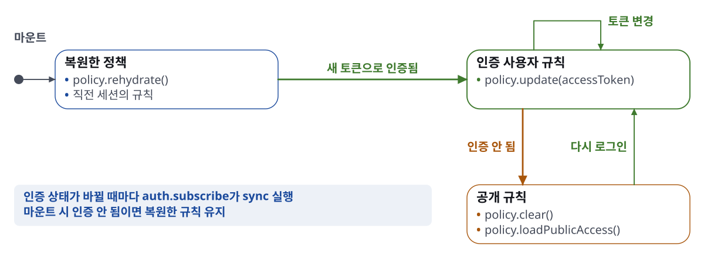

# @simplix-react/access

[English](/en/packages/access/README.md) | **한국어**

[CASL](https://casl.js.org/) 기반의 인가(authorization)와 접근 제어를 필요한 곳에만 적용하는 패키지입니다.

누가 무엇을 할 수 있는지만 정의하면, 나머지는 그 정의에서 파생합니다.

## 기능

- **어댑터 기반**: JWT, REST API, 고정 규칙 중에서 고릅니다. 인증 출처는 직접 연결할 수 있습니다.
- **프레임워크에 의존하지 않는 핵심 기능**: React 없이 동작합니다. 바인딩이 필요하면 `/react`를 추가하세요.
- **선택 적용**: `AccessProvider`가 없으면 권한 검사는 `true`를 반환합니다.
- **최고 관리자 우회**: 플래그나 사용자 정의 판정 함수로 `manage:all`을 부여합니다.
- **상태 유지**: 페이지를 새로 고쳐도 접근 상태를 저장했다가 복원합니다.
- **인증 자동 동기화**: `@simplix-react/auth`의 상태 변화를 자동으로 구독합니다.
- **타입 안전**: 제네릭 매개변수 `TActions`와 `TSubjects`로 권한 타입을 좁힙니다.

## 설치

```bash
pnpm add @simplix-react/access @casl/ability
```

React 바인딩에는 `react >= 18`이 필요합니다.

```bash
pnpm add react
```

`@simplix-react/auth`와 자동 동기화하려면 다음 패키지를 설치하세요.

```bash
pnpm add @simplix-react/auth
```

## 빠른 예제

```ts
import { createAccessPolicy, createApiAdapter } from "@simplix-react/access";

const policy = createAccessPolicy({
  adapter: createApiAdapter({
    endpoint: "/api/v1/user/me/permissions",
  }),
});

// After login
await policy.update(null);

policy.can("view", "Pet");    // true
policy.cannot("delete", "Pet"); // true
policy.hasRole("ADMIN");       // true
```

React에서 사용하는 예:

```tsx
import { AccessProvider, useCan, Can } from "@simplix-react/access/react";

function App() {
  return (
    <AccessProvider policy={policy} auth={auth}>
      <PetList />
    </AccessProvider>
  );
}

function PetList() {
  const canCreate = useCan("create", "Pet");

  return (
    <div>
      {canCreate && <CreateButton />}
      <Can I="delete" a="Pet">
        <DeleteButton />
      </Can>
    </div>
  );
}
```

## 진입점

이 패키지에는 진입점이 두 개 있습니다.

| 진입점 | 가져오기 경로 | React 필요 여부 |
| --- | --- | --- |
| 핵심 | `@simplix-react/access` | 아니요 |
| React | `@simplix-react/access/react` | 예 |

## API 개요

### 핵심 (`@simplix-react/access`)

| 내보내는 항목 | 종류 | 설명 |
| --- | --- | --- |
| `createAccessPolicy` | 함수 | CASL 기반 `AccessPolicy`를 생성 |
| `createJwtAdapter` | 함수 | JWT 클레임에서 규칙을 추출 |
| `createApiAdapter` | 함수 | REST 엔드포인트에서 규칙을 가져옴 |
| `createStaticAdapter` | 함수 | 고정 규칙을 반환(테스트·개발용) |
| `normalizePermissionMap` | 함수 | `{ Resource: [actions] }`를 CASL 규칙으로 변환 |
| `normalizeFlatPermissions` | 함수 | `["RESOURCE:action"]`을 CASL 규칙으로 변환 |
| `normalizeScopePermissions` | 함수 | OAuth2 스코프 문자열을 CASL 규칙으로 변환 |
| `normalizeRole` | 함수 | `ROLE_` 접두사를 보장 |
| `hasRole` | 함수 | 접두사를 정규화해 역할을 확인 |
| `hasAnyRole` | 함수 | 일치하는 역할이 하나라도 있는지 확인 |
| `AccessDeniedError` | 클래스 | `requireAccess`가 검사에 실패하면 발생시키는 오류 |

### React (`@simplix-react/access/react`)

| 내보내는 항목 | 종류 | 설명 |
| --- | --- | --- |
| `AccessProvider` | 컴포넌트 | 트리에 정책을 제공하고 인증 상태와 동기화 |
| `useCan` | 훅 | 권한 검사 결과를 `boolean`으로 반환 |
| `useCanWith` | 훅 | 순수 함수 `decide`로 여러 `can` 결과를 값 하나로 합침 |
| `useAccess` | 훅 | `AccessPolicy` 객체 전체를 반환 |
| `useAccessContext` | 훅 | 가장 가까운 `AccessProvider`의 정책을 반환, 제공자 밖에서는 오류 발생 |
| `Can` | 컴포넌트 | 선언형 권한 가드 |
| `requireAccess` | 함수 | TanStack Router `beforeLoad`용 라우트 가드 |
| `useMenuFilter` | 훅 | 권한에 따라 메뉴 트리를 재귀적으로 거름 |

### 타입

| 타입 | 설명 |
| --- | --- |
| `AccessPolicy` | 정책 인터페이스(`can`, `cannot`, `user`, `roles` 등) |
| `AccessPolicyConfig` | `createAccessPolicy` 설정 |
| `AccessAdapter` | `extract(authData)` 메서드를 구현하는 어댑터 인터페이스 |
| `AccessExtractResult` | `extract`의 반환 타입 |
| `AccessRule` | CASL 원시 규칙(action + subject) |
| `AccessUser` | 사용자 정보(userId, username, roles, isSuperAdmin) |
| `AccessSnapshot` | 직렬화할 수 있는 상태 스냅샷 |
| `PermissionMap` | `{ [resource]: string[] }` 맵 |
| `DefaultActions` | `"list" \| "view" \| "create" \| "edit" \| "delete" \| "export" \| "import" \| "approve" \| "manage"` |
| `AccessProviderProps` | `AccessProvider`의 props(`policy`, `auth?`, `children`) |
| `AccessPersistConfig` | 상태 유지 옵션(`storage`, `key`) |
| `DefaultSubjects` | 기본 대상 타입(`string`) |
| `AccessAbility` | 동작과 대상에 대한 CASL `MongoAbility` |
| `JwtAdapterOptions`, `ApiAdapterOptions`, `FetchFn` | 기본 제공 어댑터의 옵션 |
| `AuthLike` | 자동 동기화에 필요한 최소 인증 인터페이스 |
| `CanProps` | `Can` 컴포넌트의 props |
| `RouteGuardOptions` | `requireAccess` 옵션 |
| `FilterableMenuItem`, `MenuPermission` | `useMenuFilter`가 받는 메뉴 항목 형태 |

## 핵심 개념

### AccessPolicy

CASL ability, 사용자 정보, 역할을 관리하는 중심 객체입니다.

```ts
const policy = createAccessPolicy({
  adapter,            // Required: how to extract rules
  publicAccess,       // Optional: rules for unauthenticated users
  isSuperAdmin,       // Optional: custom super-admin checker
  persist,            // Optional: localStorage persistence
});
```

**메서드:**

| 메서드 | 설명 |
| --- | --- |
| `can(action, subject)` | 동작이 허용되면 `true`를 반환 |
| `cannot(action, subject)` | `can`의 반대 |
| `hasRole(role)` | `ROLE_` 접두사를 정규화해 역할을 확인 |
| `hasAnyRole(roles)` | 주어진 역할 중 하나라도 사용자에게 있는지 확인 |
| `update(authData)` | 어댑터로 규칙을 추출해 적용 |
| `setRules(rules, user?, roles?)` | 어댑터 없이 규칙을 직접 설정 |
| `clear()` | 모든 상태를 초기화하고 저장된 상태를 지움 |
| `loadPublicAccess()` | 인증하지 않은 사용자의 접근 규칙을 불러옴 |
| `rehydrate()` | 저장소에서 상태를 복원 |
| `subscribe(listener)` | 상태 변화를 구독(구독 해제 함수를 반환) |
| `getSnapshot()` | `useSyncExternalStore`용 직렬화 가능한 상태를 반환 |

**속성:**

| 속성 | 타입 | 설명 |
| --- | --- | --- |
| `ability` | `AccessAbility` | 내부의 CASL MongoAbility |
| `user` | `AccessUser \| null` | 현재 사용자 정보 |
| `roles` | `string[]` | 현재 역할 이름 |

### 어댑터

어댑터는 인증 출처와 CASL 기반 정책을 연결합니다. 모든 어댑터는 `AccessAdapter` 인터페이스를 구현합니다.

```ts
interface AccessAdapter {
  extract(authData: unknown): Promise<AccessExtractResult>;
}
```

**기본 제공 어댑터:**

#### `createJwtAdapter`

JWT 클레임에서 권한을 바로 추출합니다. 서버를 다시 호출하지 않습니다.

```ts
const adapter = createJwtAdapter({
  permissionFormat: "map",       // "map" | "flat" | "scopes"
  permissionsKey: "permissions", // JWT claim key
  rolesKey: "roles",
  userIdKey: "sub",
  usernameKey: "username",
  superAdminKey: "isSuperAdmin",
});
```

모든 옵션은 선택이며, 위 값이 기본값입니다. `flatSeparator`(기본값 `":"`)는 `flat`과 `scopes` 형식의 구분자를 정하고, `decode`는 base64url 페이로드 해석을 대체하며, `transform`은 추출 로직 전체를 대체합니다.

권한 형식:

| 형식 | JWT 클레임 형태 | 예 |
| --- | --- | --- |
| `"map"` | `{ "Pet": ["list", "view"] }` | Spring Security `PermissionMap` |
| `"flat"` | `["PET:list", "PET:view"]` | Spring Security authorities |
| `"scopes"` | `"pet:read pet:write"` | OAuth2 스코프 |

#### `createApiAdapter`

REST 엔드포인트에서 권한을 가져옵니다.

```ts
const adapter = createApiAdapter({
  endpoint: "/api/v1/user/me/permissions",
  fetchFn: auth.fetchFn,  // Injects auth headers automatically
  transformResponse: (res) => ({
    permissions: (res as any).data.body.permissions,
    roles: (res as any).data.body.roles,
  }),
});
```

`endpoint`의 기본값은 `"/api/me/permissions"`입니다. 기본 응답 형식은 `{ permissions: PermissionMap }`입니다. 서버 응답 형식이 다르면 `transformResponse`로 변환하세요.

#### `createStaticAdapter`

고정 규칙을 반환합니다. 테스트와 공개 접근 규칙 정의에 유용합니다.

```ts
const adapter = createStaticAdapter(
  [{ action: "view", subject: "Pet" }],
  { userId: "anon", username: "anonymous", roles: [] },
);
```

### 권한 정규화

다음 도우미는 흔히 쓰는 권한 형식을 CASL 규칙으로 변환합니다.

```ts
// { Resource: [actions] } → CASL rules
normalizePermissionMap({ Pet: ["list", "view"] });
// → [{ action: "list", subject: "Pet" }, { action: "view", subject: "Pet" }]

// ["RESOURCE:action"] → CASL rules
normalizeFlatPermissions(["PET:list", "PET:view"]);
// → [{ action: "list", subject: "PET" }, { action: "view", subject: "PET" }]

// OAuth2 scopes → CASL rules
normalizeScopePermissions("pet:read pet:write");
// → [{ action: "read", subject: "pet" }, { action: "write", subject: "pet" }]
```

### 최고 관리자 우회

사용자가 최고 관리자로 판정되면 정책은 `manage:all`(모든 대상에 대한 모든 동작)을 부여합니다.

판정 방법:

```ts
// 1. AccessUser.isSuperAdmin flag (default)
const user: AccessUser = { userId: "1", username: "admin", roles: [], isSuperAdmin: true };

// 2. Custom checker function
const policy = createAccessPolicy({
  adapter,
  isSuperAdmin: (user) => user.roles.includes("ROLE_SYSTEM_ADMIN"),
});
```

### 상태 유지

접근 상태를 `localStorage`(또는 `Storage`와 호환되는 저장소)에 저장하면 페이지를 새로 고친 직후에도 바로 사용할 수 있습니다.

```ts
const policy = createAccessPolicy({
  adapter,
  persist: {
    storage: localStorage,  // Default
    key: "simplix-access",  // Default
  },
});

// Restore on app startup
const restored = policy.rehydrate(); // true if state was found
```

## React 바인딩

### AccessProvider

컴포넌트 트리에 정책을 제공하고, 지정하면 인증 상태와 자동으로 동기화합니다.

```tsx
import { createAccessPolicy, createApiAdapter } from "@simplix-react/access";
import { AccessProvider } from "@simplix-react/access/react";

const policy = createAccessPolicy({
  adapter: createApiAdapter({ endpoint: "/api/v1/user/me/permissions" }),
  persist: { storage: localStorage },
});

function App() {
  return (
    <AccessProvider policy={policy} auth={auth}>
      <Router />
    </AccessProvider>
  );
}
```

**인증 자동 동기화 동작:**

| 인증 이벤트 | 정책 동작 |
| --- | --- |
| 로그인(인증됨) | `policy.update(accessToken)` |
| 로그아웃(인증 안 됨) | `policy.clear()` 다음 `policy.loadPublicAccess()` |
| 마운트 | `policy.rehydrate()` 다음 첫 동기화 |

`auth` prop이 없으면 제공자는 정책만 제공하며, 상태를 복원하거나 동기화하지 않습니다.



`auth` prop에는 `AuthLike` 인터페이스를 구현한 객체라면 무엇이든 전달할 수 있습니다.

```ts
interface AuthLike {
  isAuthenticated(): boolean;
  getAccessToken(): string | null;
  subscribe(listener: () => void): () => void;
}
```

그래서 `@simplix-react/auth`에 강하게 의존하지 않습니다. 이 인터페이스를 만족하는 인증 구현은 모두 사용할 수 있습니다.

### useCan

권한 검사 한 건의 결과를 `boolean`으로 반환합니다. 정책이 바뀌면 결과도 갱신됩니다.

```tsx
function EditButton() {
  const canEdit = useCan("edit", "Pet");
  if (!canEdit) return null;
  return <button>Edit</button>;
}
```

**선택 적용 동작:** 트리에 `AccessProvider`가 없으면 `useCan`은 `true`를 반환합니다. 그래서 접근 제어를 점진적으로 도입할 수 있습니다. 접근 제어는 연결한 곳에만 적용됩니다.

### useAccess

`AccessPolicy` 객체 전체를 반환합니다. `AccessProvider` 밖에서 사용하면 오류가 발생합니다.

```tsx
function UserBadge() {
  const access = useAccess();
  return (
    <span>
      {access.user?.displayName} ({access.roles.join(", ")})
    </span>
  );
}
```

### Can

선언형 권한 가드 컴포넌트입니다.

```tsx
<Can I="edit" a="Pet">
  <EditButton />
</Can>

<Can I="delete" a="Pet" fallback={<span>No permission</span>}>
  <DeleteButton />
</Can>

{/* Invert: render when permission is ABSENT */}
<Can I="manage" a="all" not>
  <span>Limited access</span>
</Can>
```

| Prop | 타입 | 설명 |
| --- | --- | --- |
| `I` | `string` | 검사할 동작 |
| `a` | `string` | 검사할 대상 |
| `not` | `boolean` | 검사 결과를 반전 |
| `fallback` | `ReactNode` | 검사에 실패하면 렌더링 |
| `children` | `ReactNode` | 검사를 통과하면 렌더링 |

### useMenuFilter

권한에 따라 메뉴 트리를 재귀적으로 거릅니다. `permission` 필드가 없는 항목은 항상 표시합니다. 하위 항목이 모두 걸러지면 상위 항목도 제거합니다.

```tsx
const menu = [
  { label: "Dashboard" },
  {
    label: "Management",
    children: [
      { label: "Pets", permission: { action: "list", subject: "Pet" } },
      { label: "Orders", permission: { action: "list", subject: "Order" } },
    ],
  },
];

function Sidebar() {
  const filtered = useMenuFilter(menu);
  return filtered.map((item) => <MenuItem key={item.label} {...item} />);
}
```

`FilterableMenuItem` 인터페이스:

```ts
interface FilterableMenuItem {
  permission?: { action: string; subject: string };
  children?: FilterableMenuItem[];
  [key: string]: unknown;
}
```

### requireAccess (라우트 가드)

권한을 동기적으로 검사하고, 실패하면 `AccessDeniedError`를 발생시킵니다. TanStack Router의 `beforeLoad`에서 쓰도록 설계했습니다.

```ts
import { requireAccess } from "@simplix-react/access/react";

export const Route = createFileRoute("/admin")({
  beforeLoad: () => {
    requireAccess(policy, {
      action: "view",
      subject: "BACKOFFICE_ACCESS",
    });
  },
});
```

**상태 복원 경쟁 조건 처리:**

TanStack Router의 `beforeLoad`는 React가 마운트되기 전에 실행되므로, 이 시점에는 `AccessProvider`가 아직 `rehydrate()`를 호출하지 않았습니다. `storageFallback`으로 저장된 상태를 직접 검사하세요.

```ts
requireAccess(policy, {
  action: "view",
  subject: "BACKOFFICE_ACCESS",
  storageFallback: {
    key: "simplix-access",
    check: (stored) => {
      const data = stored as { rules?: Array<{ action: string; subject: string }> };
      return data.rules?.some(
        (r) => r.action === "view" && r.subject === "BACKOFFICE_ACCESS",
      ) ?? false;
    },
  },
});
```

## 고급 예제

### Spring Security JWT 연동

JWT 클레임으로 권한을 반환하는 Spring Security 백엔드의 예입니다.

```ts
import { createAccessPolicy, createJwtAdapter } from "@simplix-react/access";

const policy = createAccessPolicy({
  adapter: createJwtAdapter({
    permissionFormat: "map",
    permissionsKey: "permissions",  // { "PET": ["list", "view"], "ORDER": ["list"] }
    rolesKey: "roles",              // ["ROLE_ADMIN", "ROLE_USER"]
    superAdminKey: "isSuperAdmin",
  }),
  isSuperAdmin: (user) => user.roles.includes("ROLE_SYSTEM_ADMIN"),
  persist: { storage: localStorage },
});
```

### Spring Security REST API 연동

전용 엔드포인트에서 권한을 가져오는 예입니다.

```ts
import { createAccessPolicy, createApiAdapter } from "@simplix-react/access";

const policy = createAccessPolicy({
  adapter: createApiAdapter({
    endpoint: "/api/v1/user/me/permissions",
    fetchFn: auth.fetchFn,
    transformResponse: (res) => {
      const data = res as {
        permissions: Record<string, string[]>;
        roles: string[];
        isSuperAdmin: boolean;
      };
      return {
        permissions: data.permissions,
        roles: data.roles,
        isSuperAdmin: data.isSuperAdmin,
      };
    },
  }),
  persist: { storage: localStorage },
});
```

### 공개 접근 규칙

인증하지 않은 사용자에게 특정 리소스 접근을 허용합니다.

```ts
// Static public rules
const policy = createAccessPolicy({
  adapter,
  publicAccess: [
    { action: "list", subject: "Pet" },
    { action: "view", subject: "Pet" },
  ],
});

// Or fetch from server
const policy = createAccessPolicy({
  adapter,
  publicAccess: createApiAdapter({
    endpoint: "/api/v1/public/user/permissions",
  }),
});

// Load on app init (before login)
await policy.loadPublicAccess();
```

### 인증 동기화를 포함한 제공자 설정 전체

```tsx
import { createAuth, bearerScheme, localStorageStore } from "@simplix-react/auth";
import { AuthProvider } from "@simplix-react/auth/react";
import { createAccessPolicy, createApiAdapter } from "@simplix-react/access";
import { AccessProvider } from "@simplix-react/access/react";

const store = localStorageStore("myapp:");
const auth = createAuth({
  schemes: [bearerScheme({ store, token: () => store.get("access_token") })],
  store,
});

const policy = createAccessPolicy({
  adapter: createApiAdapter({
    endpoint: "/api/v1/user/me/permissions",
    fetchFn: auth.fetchFn,
  }),
  publicAccess: createApiAdapter({
    endpoint: "/api/v1/public/user/permissions",
  }),
  isSuperAdmin: (user) => user.roles.includes("ROLE_SYSTEM_ADMIN"),
  persist: { storage: localStorage },
});

function App() {
  return (
    <AuthProvider auth={auth}>
      <AccessProvider policy={policy} auth={auth}>
        <Router />
      </AccessProvider>
    </AuthProvider>
  );
}
```

### 사용자 정의 어댑터

인증 출처에 맞춰 `AccessAdapter`를 구현하세요.

```ts
import type { AccessAdapter, AccessExtractResult } from "@simplix-react/access";

const customAdapter: AccessAdapter = {
  async extract(authData: unknown): Promise<AccessExtractResult> {
    const session = authData as { token: string };
    const res = await fetch("/api/permissions", {
      headers: { Authorization: `Bearer ${session.token}` },
    });
    const data = await res.json();

    return {
      rules: data.permissions.map((p: any) => ({
        action: p.action,
        subject: p.resource,
      })),
      user: {
        userId: data.user.id,
        username: data.user.name,
        roles: data.user.roles,
      },
      roles: data.user.roles,
    };
  },
};
```

### 역할 확인

역할 도우미는 `ROLE_` 접두사를 자동으로 정규화합니다.

```ts
policy.hasRole("ADMIN");        // checks against "ROLE_ADMIN"
policy.hasRole("ROLE_ADMIN");   // same check

policy.hasAnyRole(["ADMIN", "MANAGER"]); // true if user has either
```

### 타입 안전한 권한

제네릭으로 동작과 대상의 타입을 좁힙니다.

```ts
type MyActions = "list" | "view" | "create" | "edit" | "delete";
type MySubjects = "Pet" | "Order" | "User";

const policy = createAccessPolicy<MyActions, MySubjects>({
  adapter: createJwtAdapter(),
});

policy.can("view", "Pet");       // OK
policy.can("view", "all");       // OK (wildcard always allowed)
// policy.can("fly", "Pet");     // Type error: "fly" is not in MyActions
// policy.can("view", "Rocket"); // Type error: "Rocket" is not in MySubjects
```

## 오류 처리

### AccessDeniedError

권한 검사에 실패하면 `requireAccess`가 발생시킵니다.

```ts
import { AccessDeniedError } from "@simplix-react/access";

try {
  requireAccess(policy, { action: "delete", subject: "Pet" });
} catch (error) {
  if (error instanceof AccessDeniedError) {
    console.log(error.action);  // "delete"
    console.log(error.subject); // "Pet"
    console.log(error.message); // 'Access denied: cannot "delete" on "Pet"'
  }
}
```

TanStack Router에서는 라우트의 `onError`나 전역 오류 경계에서 이 오류를 잡아 권한이 없는 사용자를 다른 화면으로 보내세요.

## 테스트

`@simplix-react/testing`의 도구를 사용하세요.

```tsx
import { createMockPolicy } from "@simplix-react/testing";
import { createAccessTestWrapper } from "@simplix-react/testing";

// Default: allows everything (manage:all)
const policy = createMockPolicy();

// Restrict to specific rules
const policy = createMockPolicy({
  allowAll: false,
  rules: [{ action: "view", subject: "Pet" }],
  user: { userId: "1", username: "test", roles: ["ROLE_USER"] },
});

// Wrap components for testing
const wrapper = createAccessTestWrapper({ policy });
render(<MyComponent />, { wrapper });
```

## 관련 패키지

| 패키지 | 관계 |
| --- | --- |
| `@simplix-react/auth` | 선택 피어 의존성. `AuthInstance`가 자동 동기화에 필요한 `AuthLike`를 만족합니다. |
| `@simplix-react/testing` | `createMockPolicy`와 `createAccessTestWrapper`를 제공합니다. |
| `@casl/ability` | 필수 피어 의존성(`>= 6.0.0`). 권한 평가 엔진입니다. |

---

<p class="page-source"><a href="https://github.com/simplix-framework/simplix-react/blob/main/packages/access/README.ko.md" target="_blank" rel="noopener noreferrer">원본 보기</a></p>
