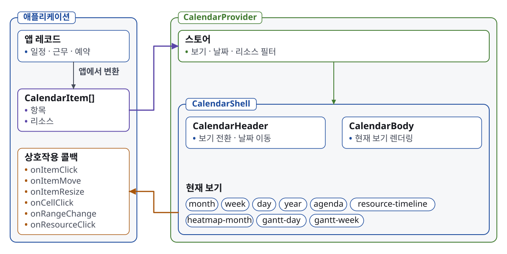

# @simplix-react/calendar

[English](/en/packages/calendar/README.md) | **한국어**

도메인에 묶이지 않는 달력 컴포넌트입니다. 월간, 주간, 일간, 연간, 일정 목록, 리소스 타임라인, 히트맵, 간트 보기를 제공하며, 렌더링과 상호작용 콜백을 끼워 넣을 수 있습니다.

## 개요

`@simplix-react/calendar`는 앱이 `CalendarItem` 객체로 전달한 항목을 그립니다. 데이터를 가져오지 않고 도메인도 알지 못합니다. 앱이 레코드를 항목으로 변환하면, 달력은 항목 · 셀 · 리소스 클릭, 항목 이동, 크기 조절, 범위 변경을 콜백으로 알립니다. 보기, 선택한 날짜, 리소스 필터, 표시 설정은 프로바이더마다 따로 만드는 스토어에 저장하므로 한 페이지에 둔 여러 달력이 서로 영향을 주지 않습니다.



## 설치

```bash
pnpm add @simplix-react/calendar @simplix-react/ui @simplix-react/i18n
```

`react`(18 이상), `@simplix-react/ui`, `@simplix-react/i18n`은 피어 의존성입니다.

## 사용법

달력을 `CalendarProvider`로 감싸고 `CalendarShell`을 렌더링하세요. `CalendarShell`은 헤더(이동, 오늘 버튼, 리소스 선택, 보기 전환)를 그리고 그 아래에 현재 보기를 표시합니다.

```tsx
import { CalendarProvider, CalendarShell, type CalendarItem } from "@simplix-react/calendar";

interface Meeting {
  id: string;
  subject: string;
  startsAt: string;
  endsAt: string;
}

function toItem(meeting: Meeting): CalendarItem<Meeting> {
  return {
    id: meeting.id,
    title: meeting.subject,
    start: new Date(meeting.startsAt),
    end: new Date(meeting.endsAt),
    color: "blue",
    payload: meeting,
  };
}

export function MeetingCalendar({ meetings }: { meetings: Meeting[] }) {
  return (
    <CalendarProvider
      items={meetings.map(toItem)}
      defaultView="week"
      onItemClick={(item) => console.log(item.payload)}
      onRangeChange={({ start, end, view }) => console.log(view, start, end)}
    >
      <CalendarShell views={["day", "week", "month", "agenda"]} />
    </CalendarProvider>
  );
}
```

`CalendarItem.start`와 `end`는 로컬 필드가 화면에 표시할 시각인 `Date` 값입니다. `payload`는 원래 레코드를 모든 콜백에 그대로 전달합니다.

### 레이아웃 직접 구성

`CalendarShell`은 `CalendarHeader`와 `CalendarBody`에 선택 항목인 `sidePanel` 열을 더한 것입니다(`sidePanelClassName`의 기본값은 `w-72`). 다른 레이아웃이 필요하면 구성 요소를 직접 사용하세요.

```tsx
import { CalendarBody, CalendarHeader, CalendarProvider } from "@simplix-react/calendar";

<CalendarProvider items={items} resources={resources} defaultView="resource-timeline" dndEnabled onItemMove={moveItem}>
  <CalendarHeader views={["resource-timeline", "gantt-day"]} trailing={<AddButton />} />
  <CalendarBody />
</CalendarProvider>
```

### 바깥에서 달력 제어

`CalendarApiBridge`는 프로바이더 안에 마운트된 동안 `CalendarApi`(`setView`, `setDate`, `goTo`)를 ref에 전달하고, 언마운트하면 ref를 `null`로 되돌립니다.

```tsx
import { useRef } from "react";
import { CalendarApiBridge, type CalendarApi } from "@simplix-react/calendar";

const apiRef = useRef<CalendarApi | null>(null);

<CalendarProvider items={items}>
  <CalendarApiBridge apiRef={apiRef} />
  <CalendarShell />
</CalendarProvider>

// Elsewhere, outside the provider:
apiRef.current?.goTo(new Date(2026, 6, 15), "day");
```

## API 레퍼런스

### 프로바이더와 훅

| 내보내는 이름 | 설명 |
| --- | --- |
| `CalendarProvider` | 스토어를 만들고 항목, 리소스, 콜백, 플러그인을 보관합니다 |
| `useCalendarData` | 가장 가까운 프로바이더의 항목, 리소스, 콜백, 플러그인 |
| `useCalendarView` | `{ currentView, setCurrentView }` |
| `useCalendarDate` | `{ selectedDate, setSelectedDate }` |
| `useCalendarPreferences` | `badgeVariant`, `workingHours`, `visibleHours`와 각 설정 함수 |
| `useCalendarResourceFilter` | `{ selectedResourceId, setSelectedResourceId, resources }` |
| `useCalendarSelector` | `CalendarStoreState`의 일부를 읽습니다 |
| `useCalendarStoreApi` | 프로바이더의 `CalendarStore` |
| `CalendarApiBridge` | `apiRef`로 `CalendarApi`를 제공합니다 |

### `CalendarProvider` props

| Prop | 타입 | 설명 |
| --- | --- | --- |
| `items` | `CalendarItem[]` | 그릴 항목(필수) |
| `resources` | `CalendarResource[]` | `item.resourceId`를 찾는 리소스 목록 |
| `dndEnabled` | `boolean` | 칸과 시간대 사이에서 항목을 끌어 놓을 수 있게 합니다(기본값 `false`) |
| `defaultView` | `CalendarView` | 처음 보기(기본값 `"month"`) |
| `defaultDate` | `Date` | 처음 선택한 날짜(기본값 오늘) |
| `defaultResourceId` | `string \| "all"` | 처음 리소스 필터 |
| `agendaScope` | `"month" \| "year"` | 일정 목록 보기의 범위(기본값 `"month"`) |
| `badgeVariant` | `"dot" \| "colored" \| "mixed"` | 항목을 배지로 그리는 방식 |
| `workingHours` | `WorkingHours` | 요일별 근무 시간(기본값 `DEFAULT_WORKING_HOURS`) |
| `visibleHours` | `VisibleHours` | 시간 격자에 표시할 시간(기본값 `DEFAULT_VISIBLE_HOURS`, 7시부터 18시) |
| `hourHeight` | `number \| "fit"` | 시간 격자의 시간당 픽셀(기본값 96). `"fit"`은 본문 높이를 채웁니다 |

콜백(`CalendarCallbacks`)은 모두 선택 항목입니다.

| 콜백 | 호출 시점 |
| --- | --- |
| `onItemClick(item)` | 클릭이나 키보드로 항목을 활성화할 때 |
| `onCellClick(date)` | 빈 칸이나 시간대를 활성화할 때 |
| `onItemMove(item, start, end)` | 항목을 새 위치에 놓을 때(`dndEnabled` 필요) |
| `onItemResize(item, start, end)` | 주간 · 일간 격자에서 `resizable` 항목의 가장자리를 끌 때 |
| `onRangeChange({ start, end, view })` | 보기나 날짜 이동으로 표시 범위가 바뀔 때 |
| `onResourceClick(resource, date?)` | 타임라인이나 간트 보기에서 리소스 레이블을 활성화할 때 |

플러그인(`CalendarPlugins`)은 모두 선택 항목입니다.

| 플러그인 | 설명 |
| --- | --- |
| `timeBands` | 리소스 타임라인에 배경 띠로 그리는 `TimeBand[]` |
| `heatmap`, `heatmapMax` | 히트맵 월간 보기의 `HeatmapCell[]` 집계와 척도 최댓값 |
| `dayHighlights` | 월간 · 일간 · 주간 · 타임라인에 적용하는 날짜별 강조(공휴일) `DayHighlight[]` |
| `renderDayBadge` | 히트맵 날짜 칸의 요약 배지 |
| `renderDayContent` | 월간 보기 날짜 칸의 항목 배지를 대신 그립니다 |
| `renderYearDayContent` | 연간 보기 날짜 칸의 표시 점을 대신 그립니다 |
| `renderWeekDayHeader` | 주간 보기 날짜 헤더 아래의 요약 영역 |
| `renderItemOverlay` | 시간 격자 항목 위의 작업 오버레이 |
| `renderGanttRowExtra` | 간트 행의 리소스 이름 뒤에 표시하는 메타데이터 |
| `timelineEmptyState` | 간트 보기와 리소스 타임라인 보기의 빈 상태를 대신 그립니다 |
| `showItemCountBadge` | 헤더 제목 옆에 항목 수를 표시합니다(기본값 `true`) |

### 컴포넌트

| 컴포넌트 | 설명 |
| --- | --- |
| `CalendarShell` | 헤더와 현재 보기, 선택 항목인 사이드 패널(`views`, `trailing`, `sidePanel`, `sidePanelClassName`) |
| `CalendarHeader` | 이동과 보기 전환. `views`는 전환 버튼을 제한하고 순서를 정하며(항목이 하나면 숨김), `trailing`은 작업 버튼을 추가합니다 |
| `CalendarBody` | 표시 범위와 선택한 리소스에 맞춰 현재 보기를 그립니다 |
| `CalendarMonthView`, `CalendarWeekView`, `CalendarDayView`, `CalendarYearView`, `CalendarAgendaView` | 직접 구성하는 셸에 쓰는 개별 보기 |
| `ResourceTimelineView`, `HeatmapMonthView` | 데이터 기반 보기 |
| `CalendarColorLegend` | `CalendarLegendItem`(`{ color, label }`)의 범례 |
| `ResourceAvatar` | 대체 이미지와 이니셜을 지원하는 아바타 |
| `DayHighlightBadge` | 날짜 강조의 배지(`color`, `label`) |

`CalendarView` 값은 `"day"`, `"week"`, `"month"`, `"year"`, `"agenda"`, `"resource-timeline"`, `"heatmap-month"`, `"gantt-day"`, `"gantt-week"`입니다. `views`를 주지 않으면 헤더는 기본 보기만 제공하고, 데이터 기반 보기는 목록에 넣었을 때만 나타납니다.

### 스토어

`createCalendarStore(options)`는 `CreateCalendarStoreOptions`로 프로바이더가 쓰는 zustand 스토어를 만듭니다. 기본값은 `DEFAULT_WORKING_HOURS`와 `DEFAULT_VISIBLE_HOURS`입니다. 타입: `CalendarStore`, `CalendarStoreState`, `AgendaScope`.

### 모델 타입

`CalendarItem`, `CalendarResource`, `CalendarView`, `CalendarColor`(`blue`, `green`, `red`, `yellow`, `purple`, `orange`, `gray`, `teal`), `EventPattern`(`solid`, `hatched`, `translucent`), `BadgeVariant`, `WorkingHours`, `VisibleHours`, `TimeBand`, `HeatmapCell`, `DayHighlight`, `CalendarCell`.

### 도우미 함수

| 함수 | 설명 |
| --- | --- |
| `getViewDateRange(view, date, locale?)` | 날짜를 포함하는 보기의 `{ start, end }` |
| `navigateDate(date, view, direction)` | 보기에서 `"previous"` 또는 `"next"`로 한 단계 이동한 날짜 |
| `toDateString(date)` | `Date`를 `"yyyy-MM-dd"`로 |
| `datePart(value)` | 날짜 · 시간 문자열의 `"yyyy-MM-dd"` 부분 |
| `patternClass(pattern?)` | `EventPattern`의 클래스 이름 |
| `dotBgClass(color)`, `timelineBarClass(color)` | `CalendarColor`의 클래스 이름 |

## 스타일

컴포넌트는 Tailwind CSS 유틸리티와 `@simplix-react/ui` 디자인 토큰으로 스타일을 입힙니다. UI 스타일시트와 테마 다음에 이 패키지의 스타일시트를 가져오세요. 이 스타일시트가 패키지의 빌드 결과(링크한 체크아웃이면 `src`도)를 Tailwind 콘텐츠 소스로 등록하므로 `node_modules` 경로를 적지 않아도 됩니다.

```css
@import "tailwindcss";
@import "@simplix-react/ui/styles.css";
@import "@simplix-react/ui/theme.css";
@import "@simplix-react/calendar/styles.css";
```

## 다국어 지원

패키지를 가져오면 `en`, `ko`, `ja` 로케일의 번역을 `@simplix-react/i18n`에 등록합니다. 컴포넌트는 `simplix-calendar/calendar` 네임스페이스를 읽으며, 이 이름은 `PACKAGE_NAMESPACE`로 내보냅니다. 날짜 형식은 현재 로케일을 따릅니다.

## 라이선스

SimpleCORE License 1.0 (SCL-1.0). 전문은 [LICENSE](https://github.com/simplix-framework/simplix-react/blob/main/LICENSE), 한국어 번역은 [LICENSE_KO](https://github.com/simplix-framework/simplix-react/blob/main/LICENSE_KO)에 있습니다.

---

<p class="page-source"><a href="https://github.com/simplix-framework/simplix-react/blob/main/packages/calendar/README.ko.md" target="_blank" rel="noopener noreferrer">GitHub에서 편집</a></p>
