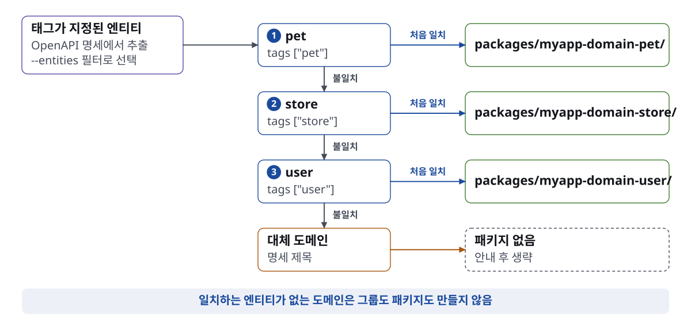

<p align="center">
  
</p>

# @simplix-react/cli

[English](/en/packages/cli/README.md) | **한국어**

simplix-react 프로젝트의 골격을 생성하고 구조를 검증하는 CLI입니다.

## 설치

메타 패키지로 설치하세요(권장).

```bash
pnpm add simplix-react
```

pnpm을 쓰면 `@simplix-react/*` 패키지를 찾을 수 있도록 `.npmrc`에 다음 줄을 추가하세요.

```ini
public-hoist-pattern[]=@simplix-react/*
```

CLI만 설치할 수도 있습니다.

```bash
pnpm add -D @simplix-react/cli
```

**Node.js 18 이상**이 필요합니다.

> **참고:** `simplix init`으로 만든 프로젝트에는 `.npmrc` 설정이 이미 들어 있습니다.

## 빠른 시작

```bash
# Create a new project
simplix init my-app

# Add a domain package
simplix add-domain inventory

# Add an FSD module
simplix add-module editor

# Validate project structure
simplix validate
```

## 명령

### simplix init

pnpm과 Turborepo 기반 모노레포 구조로 새 simplix-react 프로젝트를 생성합니다.

```bash
simplix init <project-name> [options]
```

**인수:**

| 인수 | 설명 |
| --- | --- |
| `project-name` | 생성할 프로젝트 이름 |

**옵션:**

| 옵션 | 설명 | 기본값 |
| --- | --- | --- |
| `-s, --scope <scope>` | 패키지의 npm 스코프 | `@<project-name>` |
| `--no-demo` | 데모 앱을 생성하지 않음 | - |
| `--no-i18n` | i18n 설정을 생략 | - |
| `--no-auth` | 인증 설정을 생략 | - |
| `--no-access` | 인가 설정을 생략 | - |
| `-y, --yes` | 모든 기본값을 받아들임(비대화형) | - |

스코프가 `@`로 시작하지 않으면 CLI가 앞에 `@`를 추가합니다.

**예시:**

```bash
# Interactive mode
simplix init my-app

# Non-interactive with custom scope
simplix init my-app --scope @mycompany -y

# Without demo app or i18n
simplix init my-app --no-demo --no-i18n -y
```

**생성 구조:**

```text
my-app/
  apps/my-app-demo/       # Demo app (unless --no-demo)
  modules/                # FSD modules directory
  config/typescript/      # Shared TypeScript configs (base.json, react.json)
  package.json
  pnpm-workspace.yaml
  turbo.json
  tsconfig.json
  simplix.config.ts
  .npmrc
  .gitignore
  .oxlintrc.json
```

데모 앱에는 `--no-auth`가 없으면 `src/app/auth/`가, `--no-access`가 없으면 `src/app/access/`가 생성됩니다. i18n을 켜면 선택한 로케일(기본값 `en`, `ko`, `ja`)의 로케일 파일도 생성합니다.

### simplix add-domain

`packages/` 아래에 `<prefix>-domain-<name>` 이름으로 도메인 패키지를 추가합니다. `simplix.config.ts`의 `openapi` 항목이 이 도메인을 포함하면 골격만 만들고, 코드는 `simplix openapi`(항목에 `meta` 블록이 있으면 `simplix meta`)가 생성합니다. 그렇지 않으면 템플릿으로 스키마, 계약, 훅, 목 핸들러를 생성합니다.

```bash
simplix add-domain <name> [options]
```

**인수:**

| 인수 | 설명 |
| --- | --- |
| `name` | 도메인 이름(예: `inventory`, `topology`) |

**옵션:**

| 옵션 | 설명 | 기본값 |
| --- | --- | --- |
| `--no-i18n` | i18n 번역 설정을 생략 | - |
| `-y, --yes` | 모든 기본값을 받아들임(비대화형) | - |

**예시:**

```bash
# Interactive mode
simplix add-domain inventory

# Without i18n
simplix add-domain inventory --no-i18n -y
```

**생성 구조(`openapi` 항목이 없을 때):**

```text
packages/<prefix>-domain-<name>/
  src/
    schemas.ts            # Zod schemas
    contract.ts           # API contract
    hooks.ts              # Hooks derived from the contract
    mock/
      handlers.ts         # MSW mock handlers
      seed.ts             # Mock seed data
      index.ts
    translations.ts       # Only if i18n enabled
    locales/<locale>.json # Only if i18n enabled
    index.ts
  package.json
  tsup.config.ts
  vitest.config.ts
  tsconfig.json
```

### simplix add-module

`modules/` 아래에 FSD(Feature-Sliced Design) 모듈을 추가합니다. 모듈은 `features/`, `widgets/`, `shared/` 계층으로 UI 기능을 구성합니다. 이름을 `<group>/<name>` 형태로 주면 `modules.groups`에 등록된 그룹 디렉터리 안에 모듈을 생성하고, `modules.dependencies`의 패키지를 새 모듈의 의존성으로 선언합니다.

```bash
simplix add-module <name> [options]
```

**인수:**

| 인수 | 설명 |
| --- | --- |
| `name` | 모듈 이름(예: `editor`, `maps`, `monitoring`) |

**옵션:**

| 옵션 | 설명 | 기본값 |
| --- | --- | --- |
| `--no-i18n` | i18n 로케일 설정을 생략 | - |
| `-y, --yes` | 모든 기본값을 받아들임(비대화형) | - |

**예시:**

```bash
# Interactive mode
simplix add-module editor

# Without i18n
simplix add-module editor --no-i18n -y
```

**생성 구조:**

```text
modules/<prefix>-<name>/
  src/
    features/
      index.ts
    widgets/
      index.ts
    shared/
      lib/
      ui/
      config/
    locales/              # Only if i18n enabled
      index.ts
      features/<locale>.json
      widgets/<locale>.json
    index.ts
  package.json
  tsup.config.ts
  tsconfig.json
```

### simplix validate

프로젝트 구조, FSD 계층 규칙, import 경계, 패키지 설정, i18n 일관성, 계약 완결성을 검증합니다.

```bash
simplix validate [options]
```

**옵션:**

| 옵션 | 설명 | 기본값 |
| --- | --- | --- |
| `--fix [checks]` | 쉼표로 구분한 검사 항목(`exports`, `dependencies`, `tsup`, `i18n`, `fsd`, `root`, `tsconfig`, `expo`, `all`)을 자동으로 고칩니다. 값 없이 `--fix`만 주면 패키지 exports만 고칩니다 | 꺼짐 |

**예시:**

```bash
# Validate only
simplix validate

# Repair package exports (each entry's `source` and `types`)
simplix validate --fix

# Also repair i18n keys and the workspace root (turbo.json, scripts, TypeScript catalog)
simplix validate --fix exports,i18n,root
```

**검증 규칙:**

패키지와 모듈에는 서로 다른 규칙 집합을 적용합니다.

| 규칙 집합 | 대상 | 검사 내용 |
| --- | --- | --- |
| **Package** | packages/, modules/ | `exports` 필드, `tsup.config`, React `peerDependencies`, `"type": "module"` |
| **Contract** | packages/ | 모든 엔티티에 `schema`와 `operations`가 있는지, 모든 커스텀 오퍼레이션에 `input`과 `output`이 있는지, 목 핸들러 설정 |
| **FSD** | modules/ | `features/`가 `widgets/`를 import하지 않는지, `shared/`가 `features/`나 `widgets/`를 import하지 않는지 |
| **Import** | modules/ | 모듈 사이의 직접 import 금지(패키지 exports를 거쳐야 함) |
| **i18n** | modules/ | 로케일 간 누락 키, 남는 키, 빈 값, 보간 변수(`{{var}}`) 일치 |

`--fix`에 지정하는 검사별 자동 수정 대상:

- `exports`: `source`가 없는 항목, 소스를 가리키지 않는 `types`
- `dependencies`: 누락된 `"type": "module"`, peer로 선언되지 않은 React
- `tsup`: `tsup.config.ts`의 `dts`
- `i18n`: 누락 키(기준 로케일에서 복사)와 남는 키(삭제). 복수형 키는 로케일마다 CLDR 범주를 따르므로 한국어 카탈로그에는 `_other`만 있습니다
- `fsd`: 누락된 계층 폴더
- `root`, `tsconfig`, `expo`: turbo.json, 루트 스크립트, TypeScript 카탈로그 고정 버전, `baseUrl`, Expo 앱의 TypeScript 버전

**출력 형식:**

```text
simplix validate

  packages/myapp-core
    ✔ Has "exports" field
    ✔ tsup.config exists
    ✔ "type": "module"

  modules/myapp-editor
    ✔ FSD: features/ has no widgets/ imports
    ✖ i18n: Missing key "title" in ko.json (src/locales)

  Summary: 1 error, 0 warnings, 5 checks passed
```

### simplix i18n-codegen

i18n JSON 파일에서 TypeScript 타입 정의를 생성합니다. `modules/` 아래의 모든 모듈을 찾아 번역 키 전체의 유니언 타입을 담은 `keys.d.ts` 파일을 생성합니다.

```bash
simplix i18n-codegen [options]
```

**옵션:**

| 옵션 | 설명 | 기본값 |
| --- | --- | --- |
| `--watch` | 파일 변경을 감시하고 다시 생성 | `false` |

**예시:**

```bash
# One-time generation
simplix i18n-codegen

# Watch mode
simplix i18n-codegen --watch
```

`en.json`을 기준으로 삼고, 없으면 처음 찾은 JSON 파일을 사용합니다. 평탄화한 키 전체로 유니언 타입을 생성합니다.

```ts
// Auto-generated by simplix i18n-codegen
// Do not edit manually

export type LocalesKeys =
  | "title"
  | "description"
  | "actions.save"
  | "actions.cancel";
```

### simplix openapi

Orval로 OpenAPI 명세에서 도메인 패키지를 생성합니다. 입력으로 파일 경로와 URL을 모두 받습니다. 입력과 `spec`이 일치하는 `simplix.config.ts`의 `openapi` 항목에서 프로필, 도메인, CRUD 패턴을 읽습니다. 두 번째 실행부터는 명세를 스냅샷과 비교하여 바뀌지 않은 도메인을 건너뛰며(`--force`를 주면 다시 생성), 사용자가 고친 파일은 보존하고 생성 디렉터리만 다시 생성합니다.

```bash
simplix openapi <spec> [options]
```

**인수:**

| 인수 | 설명 |
| --- | --- |
| `spec` | OpenAPI 명세 파일 경로 또는 URL |

**옵션:**

| 옵션 | 설명 | 기본값 |
| --- | --- | --- |
| `-d, --domain <name>` | 생성할 도메인 | 설정된 모든 도메인 |
| `-e, --entities <names>` | 생성할 엔티티 이름(쉼표로 구분) | 모든 엔티티 |
| `-o, --output <dir>` | 출력 디렉터리 | `packages/` |
| `-f, --force` | 변경이 없어도 다시 생성 | `false` |
| `--no-http` | `.http` 파일을 생성하지 않음 | - |
| `--offline` | 서버 대신 `meta.snapshot`에서 SimpliX Meta를 읽음 | `false` |
| `-y, --yes` | 확인 없이 진행 | - |

**예시:**

```bash
# Generate from a local file
simplix openapi ./specs/inventory-api.yaml

# Generate from a URL with custom domain name
simplix openapi https://api.example.com/openapi.json --domain inventory

# Generate specific entities only
simplix openapi ./spec.yaml --entities product,category

# Force regeneration without prompts
simplix openapi ./spec.yaml --force -y
```

**생성 구조:**

```text
packages/<prefix>-domain-<name>/
  src/
    generated/              # Orval output (regenerated)
      endpoints/            # Request functions and React Query hooks
      model/                # TypeScript types
    generated-meta/         # SimpliX Meta output, when the entry has a meta block (regenerated)
    hooks/                  # Hooks over the generated endpoints (regenerated)
    mock/                   # Mock layer
    schemas.ts              # Zod schemas
    mutator.ts              # Request mutator chosen by the spec profile
    index.ts                # Package entry
  crud.config.ts            # CRUD role mapping (see defineCrudMap)
  http/                     # HTTP client files (unless --no-http)
    http-client.env.json
    <entity>.http
  .openapi-snapshot.json    # Snapshot for incremental updates
  package.json
  tsup.config.ts
  tsconfig.json
```

다시 생성할 때 `src/generated/`, `src/hooks/`, `src/generated-meta/`를 지우고 새로 씁니다. `src/index.ts`는 덮어쓰지 않고 병합하며, 이미 있는 `crud.config.ts`는 그대로 둡니다.

#### 다중 도메인 모드(태그 기반 분할)

OpenAPI 명세가 여러 도메인에 걸치면 오퍼레이션 태그를 기준으로 엔티티를 여러 패키지로 나눌 수 있습니다. `simplix.config.ts`의 `openapi`에서 해당 명세 항목의 `domains`에 도메인 이름과 태그 패턴을 지정하세요.

```ts
// simplix.config.ts
import { defineConfig } from "@simplix-react/cli";

export default defineConfig({
  openapi: [
    {
      spec: "https://petstore.swagger.io/v2/swagger.json",
      domains: {
        pet: ["pet"],
        store: ["store"],
        user: ["user"],
      },
    },
  ],
});
```

각 값은 태그 패턴 배열입니다. 패턴은 정확한 문자열이거나 `/`로 감싼 정규식입니다.

```ts
domains: {
  iam: ["IAM", "Authentication", "/^Auth.*/"],  // exact + regex
  billing: ["Billing", "/^Payment.*/"],
}
```

항목에 도메인이 있으면 `simplix openapi`는 도메인마다 패키지를 하나씩 생성합니다.

```bash
simplix openapi https://petstore.swagger.io/v2/swagger.json -y

# Generates:
#   packages/myapp-domain-pet/
#   packages/myapp-domain-store/
#   packages/myapp-domain-user/
```

**매칭 규칙:**

| 규칙 | 동작 |
| --- | --- |
| 첫 일치 우선 | 각 엔티티는 설정 순서상 처음 일치하는 도메인에 배정됩니다 |
| 대체 도메인 | 일치하는 태그가 없는 엔티티는 명세 제목으로 이름을 정한 대체 도메인에 배정됩니다. `--domain`은 생성할 그룹을 고르기만 하며, 패키지가 없는 그룹은 안내를 출력하고 건너뜁니다 |
| 빈 도메인 생략 | 배정된 엔티티가 없는 도메인은 생성하지 않습니다 |
| 엔티티 필터 먼저 | 도메인 분류 전에 `--entities` 필터를 적용합니다 |
| 스냅샷 분리 | 도메인 패키지마다 자체 `.openapi-snapshot.json`을 유지합니다 |

실행하면 엔티티 분류 결과를 출력합니다(예: `Multi-domain mode: pet(3), store(2), user(1)`).



### simplix meta-diff

도메인 패키지의 생성 결과(orval이 만든 `src/generated/`와 SimpliX Meta가 만든 `src/generated-meta/`)를 비교하여 공개 이름, 필드, 쿼리 키가 어긋나는 곳을 보고합니다. 이 명령이 아무것도 보고하지 않을 때에만 도메인을 Meta 출력으로 전환합니다.

```bash
simplix meta-diff <domain> [options]
```

**인수:**

| 인수 | 설명 |
| --- | --- |
| `<domain>` | `openapi` 설정에 적힌 그대로의 도메인 이름 |

**옵션:**

| 플래그 | 설명 |
| --- | --- |
| `--root <dir>` | 프로젝트 루트(기본값: 작업 디렉터리에서 찾음) |
| `--package <dir>` | 도메인 패키지가 `packages/` 아래에 없을 때 그 디렉터리 |
| `--expect <file>` | 이름 변경, 필수 여부 근거, 한쪽에만 있는 이름을 적은 JSON 파일 |
| `--json` | 결과를 JSON으로 출력 |

두 트리는 같은 서버를 대상으로 한 **같은** `simplix openapi` 실행에서 나와야 합니다. 두 실행에 걸쳐 비교하면 그 사이에 백엔드가 바꾼 내용이 모두 보고됩니다.

결과는 오류와 참고로 나뉘며, 오류가 하나라도 있으면 0이 아닌 코드로 종료합니다.

| 결과 | 수준 |
| --- | --- |
| 타입, 훅, 요청 함수, URL 빌더, `get<Name>QueryKey`, `as const` 맵, params 타입, `create<Name>Handlers` 팩토리가 한쪽 출력에만 있음 | 오류 |
| `get<Name>QueryKey`가 반환하는 배열의 길이나 요소 순서가 바뀜 | 오류 |
| 필드가 한쪽 출력에만 있거나 타입이 바뀜 | 오류 |
| orval 출력에서 필수인 필드가 Meta 출력에서 선택임 | 오류 |
| Meta 출력에서 필수인 필드에 원시 타입도, 선언된 근거도 없음 | 오류 |
| 열거형 필드가 값 유니언에서 `{ value, label }` 형태로 바뀜 | 참고 |
| Meta 출력에서 필수인 필드의 타입이 `boolean` 또는 `number`임 | 참고 |
| zod 상수가 한쪽 출력에만 있음 | 참고 |
| `--expect`에 선언한 이름 차이, 필수 여부 차이, 한쪽에만 있는 이름 | 참고 |

Orval이 오퍼레이션마다 만드는 부속 코드(HTTP 상태별 타입, query-options와 mutation-options 빌더, 결과와 오류 별칭)는 Meta 출력에 대응하는 것이 없으므로 보고하지 않고 제외합니다. 제외한 선언 수는 트리마다 출력합니다.

**기대 파일:**

어느 출력에도 필드가 필수인 이유나 태그 이름이 정해진 이유가 기록되지 않으므로, 프로젝트가 아는 내용은 추측하지 않고 선언합니다.

```json
{
  "renames": [
    {
      "orval": "useGetAvatar",
      "meta": ["useGetPublicUserAvatar", "useGetPublicUserAvatarThumbnail"],
      "reason": "SimpliX Meta follows the @Tag annotation and springdoc does not"
    }
  ],
  "requiredFields": ["UserAccountCreateDTO.email"],
  "ignore": ["BodyObject", "ErrorDetail"]
}
```

`renames` 항목은 `orval` 쪽 이름이 모두 orval 출력에만 있고 `meta` 쪽 이름이 모두 Meta 출력에만 있을 때에만 참고 하나로 합쳐집니다. 일부만 맞는 기대 항목으로는 어떤 결과도 숨겨지지 않습니다.

**예시:**

```bash
simplix meta-diff org --expect openapi/meta-diff.json
```

### simplix init-ui

shadcn/ui와 연동하여 `@simplix-react/ui`를 초기화합니다. 필요한 shadcn 컴포넌트를 설치하고 `UIProvider` 설정 파일을 생성합니다.

```bash
simplix init-ui [-y]
```

**옵션:**

| 플래그 | 설명 |
| --- | --- |
| `-y, --yes` | 비대화형 모드 |

**사전 조건:** shadcn을 먼저 초기화해야 합니다(`npx shadcn@latest init`). 이 명령은 shadcn 컴포넌트 `input`, `textarea`, `select`, `switch`, `checkbox`, `badge`, `calendar`, `label`을 설치합니다.

### simplix scaffold

FSD 모듈의 `widgets/` 계층에 CRUD 위젯을 생성합니다. 엔티티 스키마 정의를 읽어 목록, 폼, 상세, 트리 페이지 컴포넌트를 생성합니다.

```bash
simplix scaffold <entity> [options]
```

**인수:**

| 인수 | 설명 |
| --- | --- |
| `<entity>` | 엔티티 이름(예: `product`, `user`) |

**옵션:**

| 플래그 | 설명 |
| --- | --- |
| `--module <dir>` | 대상 FSD 모듈 디렉터리(`modules/` 기준) |
| `--output <dir>` | 출력 디렉터리 직접 지정(`--module`보다 우선, 현재 디렉터리 기준) |
| `--native` | 모바일 엔티티 화면 묶음(목록, 푸시 상세, 전체 화면 폼, expo-router 라우트)을 생성 |
| `--app <dir>` | 라우트 파일을 쓸 `apps/` 아래 Expo 앱(`--native`와 함께 사용) |
| `--blocks` | 페이지 옆에 작성자가 채울 `page.blocks.tsx` 파일을 한 번만 함께 생성 |
| `--menu-group <key>` | 화면의 메뉴 항목이 들어갈 메뉴 그룹(메뉴 파일의 키). 기본값: 메뉴 마커 앞 |
| `--menu-icon <name>` | 메뉴 항목이 그리는 아이콘. 메뉴 파일에 import가 없으면 추가 |
| `--list-presentation <kind>` | 목록이 행을 그리는 방식: `table`(기본값) 또는 `cards` |
| `--view-toggle` | 표 목록에 카드 보기 전환 스위치를 추가(카드 목록은 항상 스위치가 있으므로 이 플래그를 거부) |
| `--card-title <column>` | 카드 제목으로 쓸 열의 키. 기본값: 첫 번째 열 |
| `--status-badge <field>` | 상세 머리글이 레코드 배지로 그리는 열거형 또는 불리언 필드. 기본값: `status`, `state`, `standing` 이름의 필드 |
| `--text-filter <fields>` | 사용자가 일부를 입력해 거르는 필터를 줄 텍스트 필드(쉼표로 구분). 지정하지 않으면 텍스트 필드는 키워드 검색에 맡김 |

**예시:**

```bash
# Generate CRUD widgets for the "product" entity
simplix scaffold product --module store
```

`scaffold`는 파일을 쓴 뒤 `simplix.config.ts`의 `generated.after`에 나열된 명령을 실행합니다.

### 생성된 폼 확장

생성되는 폼 템플릿은 의도적으로 최소한만 담습니다. 각 `FormFields.*` 컴포넌트는 아래 props를 이미 받으므로, 생성된 파일의 해당 필드에 props를 추가하세요. `useCrudFormSubmit` 훅은 클라이언트 검사를 위한 `validator`를 선택적으로 받습니다.

#### 클라이언트 검증

`useCrudFormSubmit({ validator })` 옵션에 동기 검증 함수를 연결하세요. 검증에 실패하면 제출을 중단하고 서버 뮤테이션을 호출하지 않습니다. 클라이언트 오류와 서버 오류는 한 시도에서 함께 나오지 않으므로 `fieldErrors`는 시도마다 정확히 한 출처만 반영합니다.

```tsx
// Zod-driven (recommended when schemas-ts.hbs is present):
import { zodToFieldErrors } from "@simplix-react/form";
import { createProductSchema, updateProductSchema } from "@my-app/domain-product";

const { handleSubmit, fieldErrors } = useCrudFormSubmit<ProductFormValues>({
  entityId,
  create: adaptOrvalCreate(_create, { onSettled: invalidate }),
  update: adaptOrvalUpdate(_update, "productId", { onSettled: invalidate }),
  validator: (v) => zodToFieldErrors(isEdit ? updateProductSchema : createProductSchema, v),
  onSuccess,
});

// Imperative rules (no Zod):
validator: (v) => v.name?.trim() ? null : { name: "Name is required" }
```

#### maxLength

`FormFields.TextField` / `TextareaField` / `I18nTextField` / `I18nTextareaField`는 리터럴 `maxLength`를 받습니다.

```tsx
<FormFields.TextField
  label={fieldLabel("name")}
  value={values.name}
  onChange={(v) => updateField("name", v)}
  error={fieldErrors?.["name"]}
  maxLength={50}
/>
```

#### placeholder

모든 입력 컴포넌트는 `placeholder`를 받습니다. 사용자에게 보이는 문구에는 i18n 키를 쓰세요.

```tsx
<FormFields.TextField
  label={fieldLabel("name")}
  placeholder={t("product.placeholders.name")}
  /* ... */
/>
```

`I18nTextField` / `I18nTextareaField`는 로케일마다 다른 placeholder가 필요할 때 로케일별 객체(`{ en: "...", ko: "..." }`)도 받습니다.

#### min / max (NumberField)

```tsx
<FormFields.NumberField
  label={fieldLabel("priority")}
  value={values.priority}
  onChange={(v) => updateField("priority", v ?? 0)}
  error={fieldErrors?.["priority"]}
  min={0}
  max={100}
/>
```

#### 레이블 번역 동기화

엔티티 필드 레이블은 `useEntityTranslation(entity).fieldLabel("...")`로 가져오며, 도메인 패키지의 `locales/{lang}.json` 중 `{entity}.fields.*`에서 읽습니다. placeholder, 도움말, 섹션 제목도 같은 JSON 트리(`{entity}.placeholders.*`, `{entity}.form.sections.*` 등)에 두고 `useTranslation("{moduleNamespace}/widgets").t("...")`로 읽을 수 있습니다.

### simplix add-app

`apps/` 아래에 expo-router를 쓰는 Expo(React Native) 앱을 추가합니다. 이 명령은 네이티브 앱만 생성하며 `--native`가 없으면 실행을 거부합니다. 웹 앱 셸은 `simplix init`이 만듭니다.

```bash
simplix add-app <name> --native [-y]
```

| 옵션 | 설명 |
| --- | --- |
| `--native` | expo-router를 쓰는 Expo(React Native) 앱을 생성 |
| `-y, --yes` | 모든 기본값을 받아들임(비대화형) |

### simplix add-page

페이지를 소유한 앱의 템플릿으로 한 종류의 페이지를 생성합니다. 템플릿은 [템플릿 순서 표](#앱별-ui-키트)의 순서로 읽습니다.

```bash
simplix add-page <kind> <name> [options]
```

| 인수 | 설명 |
| --- | --- |
| `<kind>` | 페이지 종류: `record-page`, `dashboard-page`, `static-page`, `error-page`, `auth-page`, `app-shell` 중 하나(CLI에는 `record-page`, `dashboard-page`, `static-page`, `error-page` 템플릿이 들어 있고 `auth-page`와 `app-shell`은 UI 키트가 제공) |
| `<name>` | 페이지 이름(예: `my-profile`, `home`, `not-found`) |

| 옵션 | 설명 |
| --- | --- |
| `--module <name>` | 페이지를 소유한 모듈(`modules/<name>/src/pages/<page>`). 그룹 안의 모듈은 `<group>/<name>` |
| `--app <name>` | 페이지를 소유한 앱(`apps/<name>/src/pages/<page>`). 그 앱의 템플릿으로 생성하고 스토리는 그 앱의 `storiesDir`에 씀 |
| `--variant <name>` | 같은 종류의 다른 형태. `<kind>.<variant>.hbs`로 생성 |
| `--blocks` | 페이지 옆에 작성자가 채울 `page.blocks.tsx` 파일을 한 번만 함께 생성 |
| `--dry-run` | 생성할 모든 파일을 내용과 함께 출력하고 아무것도 쓰지 않음(`generated.after` 명령도 실행하지 않음) |

### simplix generated

생성된 모든 파일이 현재 템플릿 기준으로 그대로인지, 고쳐졌는지, 낡았는지 보고하고, 다시 생성하면 고친 파일마다 무엇이 병합되는지 보고합니다. 병합 기준본은 `.simplix/generated`에 보관합니다.

```bash
simplix generated [paths...] [options]
```

| 옵션 | 설명 |
| --- | --- |
| `[paths...]` | 이 경로의 파일이나 이 디렉터리 아래의 생성 파일만 보고. `--all`과 함께 쓰면 이 파일만 다시 생성 |
| `--all` | 먼저 생성된 모든 화면과 페이지를 다시 생성. 그대로인 파일은 새로 쓰고, 고친 파일은 3방향 병합하며, 지운 파일은 지운 상태로 둠 |
| `--write-conflicts` | `--all`과 함께 쓰면 병합이 충돌한 파일을 그대로 두지 않고 충돌 표시를 써 넣음 |
| `--check` | 낡은 파일, 충돌, 기준본이나 출처가 없는 파일, 깨끗한 병합으로도 바뀌는 고친 파일이 있어도 0이 아닌 코드로 종료 |
| `--json` | 보고를 JSON으로 출력 |
| `--share` | 화면마다 blocks 파일과 고친 파일의 줄을 생성된 줄과 비교해 보고하고, 두 화면이 반복하는 사용자 정의를 보고 |
| `--adopt <path...>` | 고친 파일의 현재 렌더링을 병합 기준본으로 기록. 기록 전에 두 내용의 차이를 출력 |
| `-y, --yes` | `--adopt`와 함께 쓰면 차이를 출력한 뒤 묻지 않고 기록 |
| `--origin <command>` | 지정한 경로의 생성 파일 출처로 `<command>`(`simplix` 뒤의 인수)를 기록 |
| `--rebase` | `--adopt`와 함께 쓰면 이미 기준본이 있는 파일도 받아들임 |

### simplix meta

Orval 없이 SimpliX Meta에서 도메인 패키지를 생성합니다. `meta` 블록이 있는 `openapi` 항목마다 SimpliX Meta를 어디서 읽을지 지정합니다.

```bash
simplix meta [options]
```

| 옵션 | 설명 |
| --- | --- |
| `-d, --domain <name>` | 생성할 도메인(기본값: 설정된 모든 도메인) |
| `--offline` | 서버 대신 `meta.snapshot`에서 SimpliX Meta를 읽음 |
| `-f, --force` | 이미 있는 `crud.config.ts`도 다시 씀 |
| `--strict` | SimpliX Meta의 태그 중 어느 도메인에도 속하지 않는 것이 있으면 아무것도 생성하지 않고 0이 아닌 코드로 종료(`meta.ignoreTags`의 태그는 제외) |

### simplix meta-info

커밋된 SimpliX Meta를 읽어 백엔드가 한 엔티티의 화면에 제공하는 것을 출력합니다. 목록과 접근 권한, 기본 정렬, 키워드 검색, 상태별 건수, 집계, 기간별 건수, 내보내기, 액션, 필터, 마스킹해서 표시하는 필드가 대상입니다.

```bash
simplix meta-info <entity> [--json]
```

엔티티 이름은 대소문자 표기와 관계없이 받습니다(`EmailLog`, `email-log`, `emailLog`). `--json`을 주면 결과를 JSON으로 출력합니다.

### simplix meta-removals

SimpliX Meta 스냅샷에서 사라진 타입, 필드, 오퍼레이션, 열거형 값을 루트 아래의 코드가 아직 참조하면 실패합니다. 인정 파일에 나열된 항목은 예외입니다. 루트의 기본값은 `checks.metaRemovals.roots`입니다.

```bash
simplix meta-removals [roots...] [--base <ref>]
```

| 옵션 | 설명 | 기본값 |
| --- | --- | --- |
| `--base <ref>` | 변경 전 스냅샷을 읽을 Git 리비전 | `HEAD` |

### simplix check-screen

생성된 화면 파일을 커밋된 SimpliX Meta와 대조합니다. 폼이 생성 요청 본문의 필수 항목을 담고 표시하는지, 긴 텍스트가 길이 제한을 따르는지, 수치가 형식에 선언된 종류로 그려지는지, 참조가 대상 엔티티의 이름 필드로 그려지는지, 프레임의 샘플 행이 화면을 감싸는지 검사합니다. 오류가 있으면 1로 종료합니다. 엔티티를 지정하지 않으면 Meta에서 읽은 모든 화면을 검사하고, `apps.<app>.design`을 선언한 앱의 라우트 화면마다 디자인 출처에 항목이나 행이 있는지도 검사합니다.

```bash
simplix check-screen [entity...]
```

### simplix cycles

루트 아래 소스 파일 사이의 import 순환을 번들러가 유지하는 간선과 함께 보고하고(순환이 있으면 Vite의 핫 업데이트가 페이지 전체를 다시 불러옴), 워크스페이스 패키지의 `package.json` 사이의 의존성 순환도 보고합니다. 루트의 기본값은 `checks.cycles.roots`입니다.

```bash
simplix cycles [roots...]
```

### simplix kit-fence

린트 설정이 UI 키트가 차단하는 프레임워크 import(키트 `package.json`의 `simplix.fence`)를 정확히 거부하는지 검사합니다.

```bash
simplix kit-fence [--lint <file>] [--write]
```

| 옵션 | 설명 | 기본값 |
| --- | --- | --- |
| `--lint <file>` | 차단 목록을 담은 린트 설정 | `.oxlintrc.json` |
| `--write` | 검사하지 않고 키트의 차단 목록을 린트 설정에 씀 | - |

### 전역 옵션

| 옵션 | 설명 |
| --- | --- |
| `--root <dir>` | 모든 명령의 프로젝트 루트(기본값: 작업 디렉터리나 그 위에서 `simplix.config.ts`가 있는 가장 가까운 디렉터리). `meta-diff`, `meta-info`, `meta-removals`, `check-screen`, `cycles`는 자체 옵션으로도 받음 |

## 설정

CLI는 프로젝트 루트의 `simplix.config.ts`를 선택적으로 읽습니다. 파일이 없으면 기본값을 사용합니다.

```ts
// simplix.config.ts
import { defineConfig } from "@simplix-react/cli";

export default defineConfig({
  plugins: ["@simplix-react-ext/simplix-boot-cli-plugin"],
  api: { baseUrl: "/api/v1" },
  packages: {
    prefix: "myapp",             // Package name prefix (default: derived from root package.json)
  },
  http: {
    environments: {
      development: { baseUrl: "http://localhost:3000" },
      staging: { baseUrl: "https://staging.example.com" },
    },
  },
  codegen: {
    header: true,                // Add auto-generated header to generated files
  },
  openapi: [
    {
      spec: "openapi.json",
      profile: "simplix-boot",
      domains: {                 // Tag-based domain splitting
        iam: ["IAM", "/^Auth.*/"],
        billing: ["Billing"],
      },
    },
  ],
});
```

| 필드 | 설명 | 기본값 |
| --- | --- | --- |
| `plugins` | 명령을 실행하기 전에 불러오는 CLI 확장 플러그인 모듈 | `[]` |
| `api.baseUrl` | 코드 생성에 쓰는 API 기본 경로 | `"/api"` |
| `packages.prefix` | 생성 패키지 이름의 짧은 접두어 | 루트 `package.json`의 이름에서 도출 |
| `http.environments` | `.http` 파일에 이름을 지정한 환경 | `{ development: { baseUrl: "http://localhost:3000" } }` |
| `codegen.header` | 생성 파일 앞에 자동 생성 머리 주석을 추가함 | `true` |
| `i18n.locales` | 지원 로케일 코드 | `["en", "ko", "ja"]` |
| `i18n.defaultLocale` | 기본 로케일 코드 | `"en"` |
| `i18n.localeOnlyKeys` | 기준 로케일에는 없고 해당 로케일에만 있어도 되는 키(로케일 코드별). `validate`가 보고하지도 지우지도 않음 | `undefined` |
| `openapi` | 명세마다 하나씩 두는 항목(`OpenAPISpecConfig`) | `undefined`(OpenAPI 생성 없음) |
| `openapi[].spec` | OpenAPI 문서 경로(프로젝트 루트 기준) 또는 URL. `simplix meta`에는 필요 없음 | `undefined` |
| `openapi[].profile` | 플러그인이 등록한 명세 프로필 이름 | `undefined` |
| `openapi[].naming` | 프로필의 명명 전략을 재정의 | 프로필의 값 |
| `openapi[].responseAdapter` | 프로필의 응답 어댑터를 재정의 | 프로필의 값 |
| `openapi[].domains` | 태그 기반 도메인 분할 맵: 도메인 이름 → 태그 패턴(정확한 문자열 또는 `/regex/`). 필수 | - |
| `openapi[].crud` | CRUD 역할 감지 패턴(역할마다 `CrudEndpointPattern`) | `undefined`(CRUD 역할 없음) |
| `openapi[].meta.source` | SimpliX Meta 엔드포인트 URL 또는 스냅샷 경로 | 명세의 origin과 프로필의 `metaEndpoint`를 합친 값 |
| `openapi[].meta.snapshot` | 가져온 SimpliX Meta를 커밋할 위치. `--offline`과 변경 검사에 씀 | `undefined`(Meta 단계를 매번 실행) |
| `openapi[].meta.export` | 배럴이 Orval 출력 대신 `src/generated-meta/`를 내보내는 도메인 | `[]` |
| `openapi[].meta.ignoreTags` | 의도적으로 어느 도메인에도 넣지 않는 태그(glob 패턴). 경고하지 않고 `--strict`도 거부하지 않음 | `[]` |
| `modules.groups` | `modules/` 아래에서 모듈이 아니라 모듈을 담는 디렉터리 | `[]` |
| `modules.dependencies` | `add-module`이 만드는 모든 모듈이 의존성으로 선언할 패키지(이름 → 버전 범위) | `{}` |
| `routes` | 모듈 그룹별로 목록 화면에 이르는 라우트 파일(`dir`, `template`, `paths`, `except`, `menu`) | `undefined`(라우트를 쓰지 않음) |
| `scaffold.defaultSortFields` | SimpliX Meta에 `defaultSort`가 없을 때 생성된 목록의 초기 정렬 후보 필드 | `[]` |
| `scaffold.maskedSuffix` | 필드의 마스킹 형태 이름 끝에 추가하는 접미어. 원래 형태와 마스킹 형태가 모두 있는 레코드는 마스킹 형태로 표시 | `undefined` |
| `scaffold.referencePickers` | 참조 대상 엔티티별로 폼 선택기나 목록 필터가 검색에 쓰는 훅(`facet` 또는 `facetFor` 포함) | `{}` |
| `scaffold.holders` | 생성 엔티티별로 상세 화면에서 빼는 보유 엔티티(`exclude`) | `{}` |
| `references.peeks` | 참조가 여는 미리보기 종류(참조 어간 또는 엔티티 이름별) | `{}` |
| `generated.format` | 렌더링 결과를 쓰거나 비교하기 전에 실행하는 프로젝트 포매터 | `undefined`(렌더링 결과를 그대로 사용) |
| `generated.after` | `scaffold`, `add-page`, `generated --all`이 파일을 쓴 뒤 실행하는 명령 | `[]` |
| `checks.cycles.roots` | `simplix cycles`의 기본 루트 | `undefined` |
| `checks.metaRemovals` | `simplix meta-removals`의 기본 `roots`, `snapshot`, `acknowledged` 파일 | `undefined` |
| `templates.from` | 페이지와 위젯 템플릿을 가져올 UI 키트 패키지 또는 템플릿 디렉터리 | UI 키트인 루트 의존성 하나(키트와 그 키트가 확장하는 기반 키트는 하나로 셈) |
| `templates.storiesDir` | 생성한 디자인 참조 스토리를 쓸 디렉터리 | `undefined`(스토리 없음) |
| `templates.story` | 스토리 id와 제목 패턴, 생성 키별 스토리 파일 | `Generated/{Entity}` 아래 Storybook의 제목 기반 id |
| `apps.<app>.moduleGroups` | 이 앱용으로 페이지를 생성할 모듈 그룹 | `[]` |
| `apps.<app>.templates` | 앱의 `from`, `storiesDir`(`null`이면 스토리를 쓰지 않음), `story`. 각각 최상위 키를 재정의 | 최상위 `templates` |
| `apps.<app>.design` | 앱의 모든 라우트 화면을 대조할 디자인 출처 | `undefined`(검사하지 않음) |

설정 파일은 [jiti](https://github.com/unjs/jiti)로 불러오므로 컴파일 없이 TypeScript 문법을 쓸 수 있습니다.

### 앱별 UI 키트

한 워크스페이스에 서로 다른 UI 키트로 그리고 서로 다른 디자인 참조로 설계하는 앱을 둘 수 있습니다. 앱별 설정은 `apps` 아래에 적으세요. `--app <name>`이 앱을 지정하거나 `--module <group>/<name>`이 앱의 `moduleGroups`에 있는 그룹을 지정하면 페이지는 그 앱의 설정을 읽습니다.

```ts
// simplix.config.ts
import { defineConfig } from "@simplix-react/cli";

export default defineConfig({
  modules: { groups: ["admin", "site", "shared"] },
  templates: { from: "@acme-kits/console-clarity", storiesDir: "../board/screens" },
  apps: {
    "acme-admin": {
      design: { source: "screen-design", manifest: "../board/screen-design.json" },
    },
    "acme-site": {
      moduleGroups: ["site"],
      templates: { from: "@acme-kits/site-clarity", storiesDir: null },
      design: { source: "story-manifest", manifest: "site-design-manifest.json" },
    },
  },
});
```

템플릿은 이름마다 다음 순서로 찾습니다.

| 순서 | 출처 |
| --- | --- |
| 1 | `.simplix/templates/<app>/<name>.hbs` |
| 2 | `.simplix/templates/<name>.hbs` |
| 3 | `apps.<app>.templates.from`이 지정한 키트, 없으면 `templates.from` |
| 4 | 그 키트가 확장하는 각 키트(`simplix.extends`), 가까운 것부터 |
| 5 | CLI 내장 템플릿 |

UI 키트는 자신의 `package.json`에 템플릿을 선언합니다. 같은 계열이 공유하는 템플릿을 쓰는 키트는 그 템플릿이 들어 있는 기반 키트를 확장하고 자기 고유의 템플릿만 둡니다.

```json
{
  "name": "@acme-kits/console-clarity",
  "simplix": {
    "templates": "templates",
    "extends": "@acme-kits/console-core",
    "id": "clarity"
  }
}
```

| 필드 | 의미 |
| --- | --- |
| `simplix.templates` | 키트의 템플릿 디렉터리(패키지 기준) |
| `simplix.extends` | 이 키트 아래에서 템플릿을 읽을 키트. 이 키트의 디렉터리에서 찾음 |
| `simplix.id` | `{{@kit.id}}`가 가리키는 키트의 짧은 이름 |

기반 키트의 템플릿은 프로젝트가 쓰는 키트를 아래 값으로 가리키며, CLI가 렌더링 전에 이 값을 템플릿에 써 넣습니다. 가리킬 대상이 없는 값은 빈 문자열로 렌더링하지 않고 거부합니다.

| 토큰 | `@acme-kits/console-clarity`일 때의 값 |
| --- | --- |
| `{{@kit.package}}` | `@acme-kits/console-clarity` |
| `{{@kit.label}}` | `console-clarity` |
| `{{@kit.id}}` | `clarity` |

`apps.<app>.design`은 앱의 라우트 화면을 검사합니다. `simplix generated`와 (엔티티 없이 실행한) `simplix check-screen`은 디자인이 없는 앱의 TanStack 파일 라우트가 있으면 1로 종료합니다.

| `source` | 매니페스트 | 라우트가 설계된 것으로 보는 조건 |
| --- | --- | --- |
| `screen-design` | `{ "screens": [{ "app": "<app>", "route": "/path", ... }] }` | 앱 이름과 라우트가 일치하는 항목이 있음 |
| `story-manifest` | `{ "rows": [{ "route": "/path", "stories": { "<width>": ["<story id>"] } }], "exempt": [{ "route": "/path", "reason": "..." }] }` | 스토리를 하나 이상 지정한 행이 있거나, 사유와 함께 예외로 등록됨 |

라우트는 파일의 `createFileRoute("...")` 호출이 지정한 id이므로 `login_.complete.tsx`는 `"/login_/complete"`입니다. 라우트는 `design.routes`가 다른 디렉터리를 지정하지 않으면 `apps/<app>/src/routes`에서 읽습니다.

`simplix add-page <kind> <name> --app <app> --dry-run`은 페이지가 쓸 모든 파일을 내용과 함께 출력하고 아무것도 쓰지 않습니다.

### defineConfig

`simplix.config.ts`에 타입 안전한 자동 완성을 제공하는 항등 함수입니다.

```ts
import { defineConfig } from "@simplix-react/cli";

export default defineConfig({
  api: { baseUrl: "/api/v1" },
  packages: { prefix: "my-app" },
  codegen: { header: true },
});
```

### defineCrudMap

엔티티별 CRUD 오퍼레이션 매핑에 타입 안전한 자동 완성을 제공하는 항등 함수입니다. `crud.config.ts` 파일에서 엔티티 이름을 오퍼레이션 ID에 매핑할 때 쓰세요.

```ts
import { defineCrudMap } from "@simplix-react/cli";

export default defineCrudMap({
  pet: {
    list: "findPetsByStatus",
    get: "getPetById",
    create: "addPet",
    update: "updatePet",
    delete: "deletePet",
  },
});
```

## 플러그인 시스템

CLI는 사용자 정의 명명 전략, 응답 어댑터, 스키마 어댑터로 OpenAPI 코드 생성을 확장하는 플러그인 레지스트리를 제공합니다.

### 등록 함수

| export | 종류 | 설명 |
| --- | --- | --- |
| `registerSpecProfile` | 함수 | 이름을 지정한 명세 프로필(명명 전략과 응답 어댑터 묶음)을 등록 |
| `registerResponseAdapterPreset` | 함수 | 이름을 지정한 응답 어댑터 프리셋을 등록 |
| `registerSchemaAdapter` | 함수 | 래퍼 타입을 벗기는 스키마 어댑터를 등록 |
| `registerPlugin` | 함수 | 플러그인 하나를 등록(명세 프로필과 응답 어댑터를 한꺼번에 등록) |

### 조회 함수

| export | 종류 | 설명 |
| --- | --- | --- |
| `getSpecProfile` | 함수 | 이름으로 등록된 명세 프로필을 조회 |
| `getResponseAdapterPreset` | 함수 | 이름으로 등록된 응답 어댑터 프리셋을 조회 |
| `getSchemaAdapters` | 함수 | 등록된 스키마 어댑터 전체를 조회 |

### registerSpecProfile

명명 전략과 응답 어댑터 설정을 묶은 `SpecProfile`을 이름으로 등록합니다. `simplix.config.ts`의 `profile` 필드에 프로필 이름을 지정하세요.

```ts
import { registerSpecProfile } from "@simplix-react/cli";
import type { SpecProfile } from "@simplix-react/cli";

const myProfile: SpecProfile = {
  naming: {
    resolveEntityName: (ctx) => ctx.tag ?? "unknown",
    resolveOperation: (ctx) => ({
      role: "list",
      hookName: `list${ctx.entityName}`,
    }),
  },
  responseAdapter: "raw",
};

registerSpecProfile("my-api", myProfile);
```

설정에서는 다음과 같이 지정합니다.

```ts
export default defineConfig({
  openapi: [
    { spec: "openapi.json", profile: "my-api", domains: { main: ["*"] } },
  ],
});
```

### registerResponseAdapterPreset

여러 명세에서 다시 쓸 응답 어댑터 프리셋을 이름으로 등록합니다.

```ts
import { registerResponseAdapterPreset } from "@simplix-react/cli";

registerResponseAdapterPreset("my-envelope", {
  unwrapExpression: "data?.result",
  errorAdapterImport: 'import { adaptError } from "./error-adapter"',
  errorAdapterName: "adaptError",
});
```

### registerSchemaAdapter

OpenAPI 스키마의 래퍼 타입을 벗기는 스키마 어댑터를 등록합니다(예: 제네릭 봉투 타입 제거).

```ts
import { registerSchemaAdapter } from "@simplix-react/cli";

registerSchemaAdapter({
  id: "my-wrapper",
  canUnwrap: (schema) => !!schema["x-wrapper"],
  unwrap: (schema) => schema.properties?.data as Record<string, unknown>,
  stripPrefix: (typeName) => typeName.replace(/^Wrapper/, ""),
});
```

### registerPlugin

플러그인 객체 하나로 명세 프로필과 응답 어댑터 프리셋을 한꺼번에 등록하는 편의 함수입니다.

```ts
import { registerPlugin } from "@simplix-react/cli";

registerPlugin({
  id: "my-backend",
  specs: {
    "my-backend": mySpecProfile,
  },
  responseAdapters: {
    "my-envelope": myResponseAdapterPreset,
  },
});
```

### 타입 export

| export | 설명 |
| --- | --- |
| `SimplixConfig` | `simplix.config.ts`의 프로젝트 설정 |
| `OpenAPISpecConfig` | `SimplixConfig.openapi`의 명세별 OpenAPI 설정 |
| `CrudEndpointPattern` | CRUD 역할과 HTTP 메서드·경로 패턴의 매핑 |
| `CrudEntityConfig` | 엔티티별 CRUD 역할과 operationId의 매핑 |
| `CrudMap` | 엔티티 이름과 `CrudEntityConfig`의 매핑(`defineCrudMap`에서 사용) |
| `SpecProfile` | 명명 전략과 응답 어댑터를 묶은 재사용 프리셋 |
| `ResponseAdapterPreset` | 응답 어댑터의 프리셋 정의 |
| `ResponseAdapterConfig` | 응답 어댑터 설정(프리셋 이름 문자열 또는 객체) |
| `OpenApiNamingStrategy` | 엔티티와 오퍼레이션 이름을 도출하는 전략 인터페이스 |
| `EntityNameContext` | `resolveEntityName()`에 전달되는 컨텍스트 |
| `OperationContext` | `resolveOperation()`에 전달되는 컨텍스트 |
| `ResolvedOperation` | 오퍼레이션 해석 결과(role과 hookName) |
| `CliPlugin` | `registerPlugin`에 전달하는 플러그인 객체 |
| `SchemaAdapter` | `registerSchemaAdapter`용 스키마 어댑터 인터페이스 |
| `I18nEntityInfo` | i18n 키 매핑용 엔티티 정보 |
| `I18nDownloader` | 서버에서 i18n 데이터를 내려받는 콜백 |
| `OpenAPIMetaConfig` | `OpenAPISpecConfig`의 `meta` 블록 |
| `SimplixHttpEnvironment` | `http.environments`의 환경 하나 |
| `SimplixChecksConfig` | `checks` 블록 |
| `SimplixTemplatesConfig` | `templates` 블록 |
| `SimplixAppConfig` | `apps` 아래 앱 하나의 설정 |
| `SimplixDesignSource` | 앱의 `design` 설정 |
| `ContainerMapping` | 백엔드 컨테이너 타입과 그에 대응하는 TypeScript 타입 및 zod 팩토리 |
| `MetaExtensionOutput` | 명세 프로필의 `metaExtensions`가 만드는 파일 |

### UI 키트 템플릿 export

UI 키트는 자체 테스트에서 이 export로 생성기와 같은 방식으로 템플릿을 읽고 렌더링합니다.

| export | 종류 | 설명 |
| --- | --- | --- |
| `loadProjectTemplates` | 함수 | 프로젝트에 적용되는 템플릿을 불러옴 |
| `resolveKitChain` | 함수 | 프로젝트가 쓰는 키트와 그 키트가 확장하는 모든 키트(기반 키트부터) |
| `renderTemplate` | 함수 | 컨텍스트로 Handlebars 템플릿을 렌더링 |
| `readKitFence` | 함수 | 키트와 그 키트가 확장하는 키트가 차단하는 import(`simplix.fence`). `{{@kit.*}}` 위치에 키트의 값을 넣음 |
| `kitFenceOf` | 함수 | `readKitFence`의 결과. 차단 목록을 선언한 키트가 없으면 `undefined` |
| `ProjectTemplates` | 타입 | 템플릿 이름 → 템플릿 소스 |
| `KitChain` | 타입 | `resolveKitChain`의 결과 |
| `KitLayer` | 타입 | 키트 체인의 키트 하나 |
| `FencedImport` | 타입 | `no-restricted-imports` 형태의 제한 import 하나 |

## 관련 패키지

메타 패키지로 모든 패키지를 한 번에 설치하세요.

```bash
pnpm add simplix-react
```

| 패키지 | 설명 |
| --- | --- |
| [`simplix-react`](https://www.npmjs.com/package/simplix-react) | 메타 패키지(아래 패키지를 모두 설치) |
| `@simplix-react/contract` | Zod 기반의 타입 안전한 API 계약 정의 |
| `@simplix-react/react` | 계약에서 파생한 React Query 훅 |
| `@simplix-react/form` | 계약에서 파생한 TanStack Form 훅 |
| `@simplix-react/auth` | 인증 미들웨어(Bearer, API Key, OAuth2) |
| `@simplix-react/mock` | MSW 핸들러와 인메모리 목 저장소 |
| `@simplix-react/i18n` | i18next 기반 국제화 프레임워크 |
| `@simplix-react/testing` | 테스트 유틸리티(목 클라이언트, 쿼리 래퍼) |

---

<p class="page-source"><a href="https://github.com/simplix-framework/simplix-react/blob/main/packages/cli/README.ko.md" target="_blank" rel="noopener noreferrer">원본 보기</a></p>
