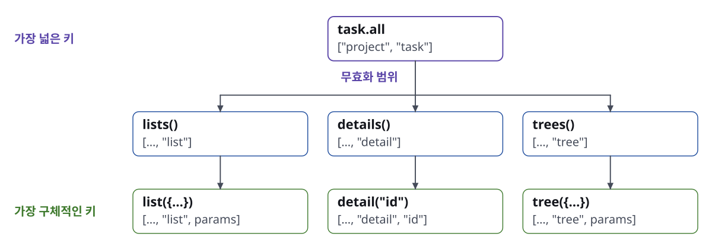

<p align="center">
  
</p>

# @simplix-react/contract

[English](/en/packages/contract/README.md) | **한국어**

Zod 스키마로 타입이 안전한 API 계약(contract)을 정의합니다. 계약 하나에서 HTTP 클라이언트, React Query 훅, MSW 목(mock) 핸들러를 모두 얻습니다.

## 설치

```bash
pnpm add @simplix-react/contract
```

**피어 의존성:** `zod >= 4.0.0`

```bash
pnpm add zod
```

## 빠른 예제

```ts
import { z } from "zod";
import { defineApi, simpleQueryBuilder } from "@simplix-react/contract";

const taskSchema = z.object({
  id: z.string(),
  title: z.string(),
  status: z.enum(["open", "closed"]),
});

// 1. Define your contract
const projectApi = defineApi({
  domain: "project",
  basePath: "/api/v1",
  entities: {
    task: {
      schema: taskSchema,
      operations: {
        list: { method: "GET", path: "/tasks" },
        get: { method: "GET", path: "/tasks/:id" },
        create: {
          method: "POST",
          path: "/tasks",
          input: z.object({ title: z.string() }),
        },
        update: {
          method: "PATCH",
          path: "/tasks/:id",
          input: z.object({
            title: z.string().optional(),
            status: z.enum(["open", "closed"]).optional(),
          }),
        },
        delete: { method: "DELETE", path: "/tasks/:id" },
      },
    },
  },
  queryBuilder: simpleQueryBuilder,
});

// 2. Use the type-safe client
const tasks = await projectApi.client.task.list();
const task = await projectApi.client.task.get("task-1");
const created = await projectApi.client.task.create({ title: "New task" });
const updated = await projectApi.client.task.update("task-1", { status: "closed" });
await projectApi.client.task.delete("task-1");

// 3. Use query keys for cache management
projectApi.queryKeys.task.all;                      // ["project", "task"]
projectApi.queryKeys.task.lists();                   // ["project", "task", "list"]
projectApi.queryKeys.task.list({ status: "open" });  // ["project", "task", "list", { status: "open" }]
projectApi.queryKeys.task.detail("task-1");          // ["project", "task", "detail", "task-1"]
```

## API 개요

| 내보내는 이름 | 종류 | 설명 |
| --- | --- | --- |
| `defineApi` | 함수 | 설정에서 계약(`config`, `client`, `queryKeys`)을 만듭니다. `options.fetchFn`으로 fetch 함수를 바꿉니다 |
| `customizeApi` | 함수 | 기존 계약의 엔티티 오퍼레이션을 추가 · 교체 · 삭제한 새 계약을 파생합니다 |
| `deriveClient` | 함수 | 계약 설정에서 타입이 안전한 HTTP 클라이언트를 파생합니다 |
| `deriveQueryKeys` | 함수 | 계약 설정에서 TanStack Query 쿼리 키 팩토리를 파생합니다 |
| `buildPath` | 함수 | URL 템플릿의 `:param` 자리 표시자를 값으로 치환합니다 |
| `extractPathParams` | 함수 | 경로에 있는 `:param` 이름을 순서대로 반환합니다 |
| `interpolatePath` | 함수 | `:param` 자리 표시자를 값으로 치환하고, 값이 없으면 오류를 발생시킵니다 |
| `resolveRole` | 함수 | 오퍼레이션의 `role`이나 이름에서 CRUD 역할을 구합니다 |
| `defaultFetch` | 함수 | JSON Content-Type을 추가하고 `{ data }` 응답 봉투를 벗기는 기본 fetch 함수입니다 |
| `configureDefaultFetch` | 함수 | 자체 `fetchFn`이 없는 모든 클라이언트가 쓰는 fetch 함수를 바꿉니다 |
| `createFetch` | 함수 | 기본 URL, 토큰 조회 함수, 응답 변환, 오류 콜백을 지정한 fetch 함수를 만듭니다 |
| `ApiError` | 클래스 | 2xx가 아닌 HTTP 응답의 오류 타입입니다 |
| `simpleQueryBuilder` | 객체 | 흔한 REST 쿼리 문자열 형식을 따르는 `QueryBuilder` 구현입니다 |
| `camelToSnake` | 함수 | camelCase를 snake_case로 바꿉니다 |
| `wired` | 함수 | 전송 형식의 출력 스키마와 업무 데이터 스키마를 한 쌍으로 묶습니다 |
| `isWiredSchema` | 함수 | `wired`로 만든 값인지 판별하는 타입 가드입니다 |
| `CRUD_OPERATIONS` | 객체 | `list`, `get`, `create`, `update`, `delete` 오퍼레이션의 기본 HTTP 메서드입니다 |

### 타입

| 내보내는 이름 | 설명 |
| --- | --- |
| `EntityDefinition` | 엔티티(entity)를 기술합니다. 스키마, 오퍼레이션, 선택 항목인 `parent`, `queries`, `filterSchema`, `identity`로 구성합니다 |
| `EntityOperationDef` | 엔티티의 오퍼레이션(operation) 하나를 기술합니다 |
| `CrudRole` | 오퍼레이션이 `role`로 선언할 수 있는 역할의 유니언입니다 |
| `EntityParent` | 중첩 URL을 만들 때 쓰는 상위 리소스입니다 |
| `EntityQuery` | 상위 엔티티 관계로 목록을 거르는 명명된 쿼리 범위입니다 |
| `TreeNode` | `tree` 응답의 노드입니다: `{ data, children }` |
| `OperationDefinition` | 엔티티에 속하지 않는 최상위 오퍼레이션을 기술합니다 |
| `HttpMethod` | 지원하는 HTTP 메서드의 유니언입니다 |
| `TransformedRequest` | `transformRequest`가 반환하는 헤더, 본문, URL입니다 |
| `WiredSchema` | `wired`로 만든 출력 스키마입니다 |
| `ApiContractConfig` | `defineApi`에 전달하는 전체 설정입니다 |
| `ApiContract` | `defineApi`의 반환 타입입니다 |
| `ApiPatch`, `EntityPatch` | `customizeApi`가 받는 패치 형태입니다 |
| `EntityClient`, `EntityClientFn` | 엔티티 하나의 클라이언트 인터페이스와 그 오퍼레이션 하나의 함수 타입입니다 |
| `EntityId` | 문자열 아이디 또는 복합 키 객체입니다 |
| `QueryKeyFactory` | TanStack Query용 쿼리 키 생성 함수 묶음입니다 |
| `FetchFn` | 사용자 정의 fetch 함수의 시그니처입니다 |
| `CreateFetchOptions`, `FetchContext`, `FetchErrorContext` | `createFetch`의 옵션과 콜백 컨텍스트입니다 |
| `ListParams` | 목록 조회의 필터, 정렬, 페이지 매개변수입니다 |
| `SortParam` | 정렬 필드와 방향입니다 |
| `PaginationParam` | 오프셋 방식 또는 커서 방식 페이지네이션입니다 |
| `PageInfo` | 서버가 반환하는 페이지 정보입니다 |
| `QueryBuilder` | 목록 매개변수를 URL 검색 매개변수로 직렬화하는 인터페이스입니다 |

타입 추론 보조 타입(`InferEntityData`, `InferOpInput`, `InferOpOutputData`, `InferOutputData`, `ResolveRole`, `AnyEntityDef`, `AnyOperationDef`)은 [API 레퍼런스](https://github.com/simplix-framework/simplix-react/blob/main/docs/api/README.md)에 있습니다.

## 핵심 개념

### Zod 스키마 → 타입 추론

계약의 모든 타입은 컴파일 시점에 Zod 스키마에서 추론합니다. 스키마를 한 번 정의하면 나머지는 TypeScript가 추론합니다.

```ts
import { z } from "zod";

const taskSchema = z.object({
  id: z.string(),
  title: z.string(),
  status: z.enum(["open", "closed"]),
});

// z.infer<typeof taskSchema> → { id: string; title: string; status: "open" | "closed" }
```

프레임워크는 추론한 타입을 클라이언트, 훅, 목 핸들러 전체에서 사용합니다. 그래서 API 타입과 검증 로직이 항상 일치합니다.

### EntityDefinition

`EntityDefinition`은 리소스 하나를 정의하는 기본 단위이며 다음 항목으로 구성합니다.

- **`schema`**: API가 반환하는 엔티티 전체 형태
- **`operations`**: 오퍼레이션 이름과 `{ method, path, input?, output?, role? }`의 맵. 요청 본문은 오퍼레이션의 `input` 스키마로 정의합니다
- **`parent`**, **`queries`**, **`filterSchema`**, **`identity`** (선택)

```ts
import { CRUD_OPERATIONS } from "@simplix-react/contract";

const taskEntity = {
  schema: taskSchema,
  operations: {
    list: { ...CRUD_OPERATIONS.list, path: "/tasks" },
    get: { ...CRUD_OPERATIONS.get, path: "/tasks/:id" },
    create: { ...CRUD_OPERATIONS.create, path: "/tasks", input: z.object({ title: z.string() }) },
    update: { ...CRUD_OPERATIONS.update, path: "/tasks/:id", input: z.object({ title: z.string().optional() }) },
    delete: { ...CRUD_OPERATIONS.delete, path: "/tasks/:id" },
    close: { method: "POST", path: "/tasks/:id/close" },
  },
};
```

오퍼레이션의 역할은 `role` 필드에서 정해지고, 이 필드가 없으면 이름이 `list`, `get`, `create`, `update`, `delete`, `tree` 중 하나일 때 그 이름에서 정해집니다. 역할에 따라 클라이언트 메서드의 시그니처가 달라집니다.

| 역할 | 클라이언트 호출 |
| --- | --- |
| `list` | `list(params?)` 또는 `list(parentId, params?)` |
| `get` | `get(id)` |
| `create` | `create(dto)` 또는 `create(parentId, dto)` |
| `update` | `update(id, dto)` |
| `delete` | `delete(id)` |
| `tree` | `tree(params?)` |
| 그 밖의 오퍼레이션 | 경로 매개변수를 순서대로 전달하고 마지막에 입력값을 전달합니다 |

`id`는 문자열이며, 경로 매개변수가 여럿이면 `{ projectId: "p1", id: "t1" }` 같은 객체를 전달합니다. 위 예제의 `close` 같은 사용자 정의 오퍼레이션은 `client.task.close("task-1")`로 호출합니다.

### OperationDefinition

어느 엔티티에도 속하지 않는 엔드포인트(파일 업로드, RPC 형식 호출, 일괄 처리)는 최상위 `OperationDefinition`으로 정의하세요.

```ts
import { z } from "zod";
import { defineApi } from "@simplix-react/contract";

const api = defineApi({
  domain: "project",
  basePath: "/api/v1",
  entities: { task: taskEntity },
  operations: {
    assignTask: {
      method: "POST",
      path: "/tasks/:taskId/assign",
      input: z.object({ userId: z.string() }),
      output: z.object({ id: z.string(), assigneeId: z.string() }),
    },
    exportReport: {
      method: "GET",
      path: "/projects/:projectId/export",
      input: z.object({}),
      output: z.any(),
      responseType: "blob",
    },
  },
});

// Path params are positional arguments, input is the last argument
await api.client.assignTask("task-1", { userId: "user-42" });
```

엔티티 오퍼레이션과 최상위 오퍼레이션 모두 `invalidates`, `contentType`, `responseType`, `transformRequest`, `transformResponse`를 받습니다.

### 중첩 엔티티(상위 엔티티 관계)

엔티티에 `parent`를 선언하면 중첩 URL을 만듭니다.

```ts
const taskEntity = {
  schema: taskSchema,
  parent: { param: "projectId", path: "/projects" },
  operations: {
    list: { method: "GET", path: "/tasks" },
    create: { method: "POST", path: "/tasks", input: createTaskSchema },
  },
};

// Client adjusts URLs based on parent
await api.client.task.list("project-1");
// GET /api/v1/projects/project-1/tasks

await api.client.task.create("project-1", { title: "New task" });
// POST /api/v1/projects/project-1/tasks
```

상위 경로는 `list`와 `create` 역할에만 적용됩니다. 다른 오퍼레이션은 상위 경로 구간을 자기 `path`에 포함하세요(`/projects/:projectId/tasks/:id`).

### 쿼리 키

계약은 TanStack Query와 호환되는 계층형 쿼리 키 팩토리를 자동으로 파생합니다.



| 팩토리 | 키 |
| --- | --- |
| `task.all` | `["project", "task"]` |
| `task.lists()` | `["project", "task", "list"]` |
| `task.list({ ... })` | `["project", "task", "list", { ... }]` |
| `task.details()` | `["project", "task", "detail"]` |
| `task.detail("id")` | `["project", "task", "detail", "id"]` |
| `task.trees()` | `["project", "task", "tree"]` |
| `task.tree({ ... })` | `["project", "task", "tree", { ... }]` |

넓은 키를 무효화하면 그 아래에 있는 구체적인 키가 모두 함께 무효화됩니다.

## 가이드

### 사용자 정의 fetch 함수

인증, 로깅, 재시도가 필요하면 기본 HTTP 클라이언트를 직접 만든 함수로 바꾸세요.

```ts
import { defineApi, defaultFetch } from "@simplix-react/contract";

const api = defineApi(config, {
  fetchFn: async (path, options) => {
    const token = await getAuthToken();
    return defaultFetch(path, {
      ...options,
      headers: {
        ...options?.headers,
        Authorization: `Bearer ${token}`,
      },
    });
  },
});
```

자체 `fetchFn`이 없는 모든 계약의 fetch 함수를 바꾸려면 `createFetch`로 함수를 만들고 `configureDefaultFetch`로 등록하세요.

```ts
import { configureDefaultFetch, createFetch } from "@simplix-react/contract";

configureDefaultFetch(
  createFetch({
    baseUrl: "https://api.example.com",
    getToken: () => localStorage.getItem("token"),
    onError: ({ status, path }) => console.warn(status, path),
  }),
);
```

`createFetch`로 만든 함수는 `FormData`가 아닌 본문에 `Content-Type: application/json`을 추가하고, `getToken`이 토큰을 반환하면 `Authorization: Bearer <token>`을 추가하며, `X-Timezone` 헤더를 추가합니다. 204 응답에는 `undefined`를, JSON이 아닌 Content-Type을 선언한 응답에는 `Blob`을 반환합니다. `defaultFetch`는 `{ data }`를 벗기는 `transformResponse`를 지정한 `createFetch`입니다.

### 사용자 정의 쿼리 빌더

API의 쿼리 문자열 규칙에 맞추려면 `QueryBuilder` 인터페이스를 구현하세요.

```ts
import { defineApi } from "@simplix-react/contract";
import type { QueryBuilder } from "@simplix-react/contract";

const springQueryBuilder: QueryBuilder = {
  buildSearchParams(params) {
    const sp = new URLSearchParams();
    if (params.pagination?.type === "offset") {
      // Spring uses 0-based page indexing
      sp.set("page", String(params.pagination.page - 1));
      sp.set("size", String(params.pagination.limit));
    }
    if (params.sort) {
      const sorts = Array.isArray(params.sort) ? params.sort : [params.sort];
      for (const s of sorts) {
        sp.append("sort", `${s.field},${s.direction}`);
      }
    }
    return sp;
  },
};

const api = defineApi({
  domain: "project",
  basePath: "/api/v1",
  entities: { task: taskEntity },
  queryBuilder: springQueryBuilder,
});
```

`simpleQueryBuilder`는 필터를 각각 별도 매개변수로, 정렬을 `sort=field:direction`(쉼표로 구분)으로, 페이지네이션을 `page`와 `limit` 또는 `cursor`와 `limit`으로 씁니다. `QueryBuilder`에 `parsePageInfo(response)`를 구현하면 응답에서 `PageInfo`를 읽습니다.

### 계약 재정의

`customizeApi`는 기존 계약과 패치를 받아, 클라이언트와 쿼리 키를 다시 파생한 새 계약을 반환합니다. `null`로 지정한 오퍼레이션은 삭제됩니다.

```ts
import { customizeApi } from "@simplix-react/contract";

const customApi = customizeApi(projectApi, {
  entities: {
    task: {
      operations: {
        delete: null,
        archive: { method: "POST", path: "/tasks/:id/archive" },
      },
    },
  },
});
```

### 멀티파트 파일 업로드

파일 업로드 엔드포인트는 오퍼레이션 정의에 `contentType: "multipart"`를 지정하세요.

```ts
const api = defineApi({
  domain: "project",
  basePath: "/api/v1",
  entities: {},
  operations: {
    uploadAvatar: {
      method: "POST",
      path: "/users/:userId/avatar",
      input: z.object({ file: z.instanceof(File) }),
      output: z.object({ url: z.string() }),
      contentType: "multipart",
    },
  },
});

await api.client.uploadAvatar("user-1", { file: selectedFile });
```

멀티파트 요청과 `responseType: "blob"` 요청은 `fetchFn`을 거치지 않고 전역 `fetch`를 직접 호출합니다.

### 오류 처리

모든 클라이언트 메서드는 2xx가 아닌 응답에서 `ApiError`를 발생시킵니다.

```ts
import { ApiError } from "@simplix-react/contract";

try {
  await api.client.task.get("nonexistent");
} catch (error) {
  if (error instanceof ApiError) {
    console.log(error.status); // 404
    console.log(error.body);   // Raw response body
  }
}
```

`error.body`는 응답 본문 문자열입니다.

## 관련 패키지

| 패키지 | 설명 |
| --- | --- |
| `@simplix-react/react` | 계약에서 React Query 훅을 파생합니다 |
| `@simplix-react/form` | 계약과 그 훅에서 TanStack Form 훅을 파생합니다 |
| `@simplix-react/mock` | 계약에서 인메모리 저장소를 쓰는 MSW 목 핸들러를 파생합니다 |
| `@simplix-react/testing` | 계약 패키지와 목 패키지를 기반으로 한 테스트 도구입니다 |

---

**다음 단계** → [`@simplix-react/react`](/ko/packages/react/README.md): 계약을 React Query 훅으로 바꿉니다.

---

<p class="page-source"><a href="https://github.com/simplix-framework/simplix-react/blob/main/packages/contract/README.ko.md" target="_blank" rel="noopener noreferrer">GitHub에서 편집</a></p>
