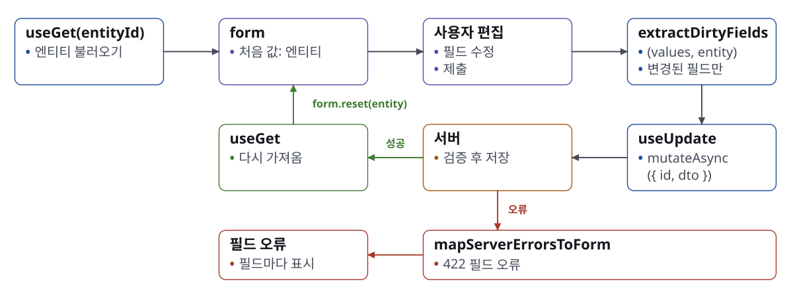

<p align="center">
  
</p>

# @simplix-react/form

[English](/en/packages/form/README.md) | **한국어**

`@simplix-react/contract` 계약(contract)과 `@simplix-react/react` 훅에서 TanStack Form 훅을 자동으로 파생합니다.

> **사전 준비:** `@simplix-react/contract`로 정의한 계약과 `@simplix-react/react`로 파생한 훅이 필요합니다. 먼저 [`@simplix-react/react`](/ko/packages/react/README.md)를 읽으세요.

## 설치

```bash
pnpm add @simplix-react/form @tanstack/react-form
```

**피어 의존성:**

| 패키지 | 버전 |
| --- | --- |
| `@simplix-react/api` | workspace |
| `@simplix-react/contract` | workspace |
| `@simplix-react/react` | workspace |
| `@tanstack/react-form` | >= 1.0.0 |
| `@tanstack/react-query` | >= 5.0.0 |
| `react` | >= 18.0.0 |
| `zod` | >= 4.0.0 |

## 빠른 예제

```tsx
import { defineApi, simpleQueryBuilder } from "@simplix-react/contract";
import { deriveEntityHooks } from "@simplix-react/react";
import { deriveEntityFormHooks } from "@simplix-react/form";
import { z } from "zod";

// 1. Define the contract
const projectContract = defineApi({
  domain: "project",
  basePath: "/api",
  entities: {
    task: {
      schema: z.object({ id: z.string(), title: z.string(), status: z.string() }),
      parent: { param: "projectId", path: "/projects" },
      operations: {
        get: { method: "GET", path: "/tasks/:id" },
        create: {
          method: "POST",
          path: "/tasks",
          input: z.object({ title: z.string(), status: z.string() }),
        },
        update: {
          method: "PATCH",
          path: "/tasks/:id",
          input: z.object({ title: z.string().optional(), status: z.string().optional() }),
        },
      },
    },
  },
  queryBuilder: simpleQueryBuilder,
});

// 2. Derive React Query hooks
const hooks = deriveEntityHooks(projectContract);

// 3. Derive form hooks: one call covers every entity
const formHooks = deriveEntityFormHooks(projectContract, hooks);

// 4. Use in components
function CreateTaskForm({ projectId }: { projectId: string }) {
  const { form, isSubmitting, submitError, reset } = formHooks.task.useCreateForm!(projectId);

  return (
    <form onSubmit={(e) => { e.preventDefault(); form.handleSubmit(); }}>
      <form.Field name="title">
        {(field) => <input value={field.state.value} onChange={(e) => field.handleChange(e.target.value)} />}
      </form.Field>
      <button type="submit" disabled={isSubmitting}>Create</button>
      {submitError && <p>{submitError.message}</p>}
    </form>
  );
}
```

## API 개요

| 내보내는 이름 | 종류 | 설명 |
| --- | --- | --- |
| `deriveEntityFormHooks` | 함수 | 계약과 훅에서 엔티티 폼 훅을 파생합니다 |
| `extractDirtyFields` | 함수 | 바뀐 필드만 추립니다(PATCH 요청용) |
| `mapServerErrorsToForm` | 함수 | 서버의 검증 오류를 폼 필드 오류로 옮깁니다 |
| `zodToFieldErrors` | 함수 | Zod 스키마로 값을 검증하고 필드 경로마다 메시지 하나를 반환합니다 |
| `DerivedEntityFormHooksResult` | 타입 | `deriveEntityFormHooks`의 반환 타입입니다 |
| `CreateFormOptions` | 타입 | `useCreateForm`의 옵션 인터페이스입니다 |
| `UpdateFormOptions` | 타입 | `useUpdateForm`의 옵션 인터페이스입니다 |
| `CreateFormReturn` | 타입 | `useCreateForm`의 반환 인터페이스입니다 |
| `UpdateFormReturn` | 타입 | `useUpdateForm`의 반환 인터페이스입니다 |
| `DerivedCreateFormHook` | 타입 | 생성 폼 훅의 시그니처입니다 |
| `DerivedUpdateFormHook` | 타입 | 수정 폼 훅의 시그니처입니다 |
| `EntityFormHooks` | 타입 | 엔티티 하나의 폼 훅 인터페이스입니다 |

## 핵심 개념

### 훅 파생

`deriveEntityFormHooks(contract, hooks)`는 계약의 엔티티(entity) 정의를 읽고 엔티티의 훅에서 폼 훅을 파생합니다. `create` 역할의 오퍼레이션(operation)이 있는 엔티티에는 `useCreateForm`이, `update` 역할과 `get` 역할의 오퍼레이션이 있는 엔티티에는 `useUpdateForm`이 생깁니다. `EntityFormHooks`에서 두 훅은 선택 속성이므로 `!`를 추가해 호출하거나 먼저 존재 여부를 확인하세요.

```ts
const formHooks = deriveEntityFormHooks(projectContract, projectHooks);
// formHooks.task.useCreateForm  → create mutation + TanStack Form
// formHooks.task.useUpdateForm  → get query + update mutation + TanStack Form + dirty tracking
```

### 변경 필드 자동 추출

`useUpdateForm`은 기본적으로 바뀐 필드만 서버로 보냅니다(`dirtyOnly: true`). 불러온 엔티티와 현재 폼 값을 비교해 차이만 추리므로 PATCH에 맞는 요청이 자동으로 만들어집니다. 이 모드에서는 엔티티를 불러오기 전에 제출하면 아무 일도 일어나지 않습니다.



### 서버 오류 매핑

제출이 실패하면 훅이 `mapServerErrorsToForm`을 호출해 서버의 검증 메시지를 해당 필드에 기록합니다. `@simplix-react/api`의 `getValidationErrors`가 해석하는 형식을 읽으며, 상태 코드는 따지지 않습니다.

## 훅 레퍼런스

### `useCreateForm`

새 엔티티를 생성하는 폼 훅입니다. TanStack Form 인스턴스를 생성 뮤테이션과 연결합니다.

```ts
const { form, isSubmitting, submitError, reset } = formHooks.task.useCreateForm!(parentId, options);
```

**매개변수:**

| 매개변수 | 타입 | 설명 |
| --- | --- | --- |
| `parentId` | `string?` | 상위 엔티티 아이디(하위 엔티티용) |
| `options.defaultValues` | `Partial<CreateSchema>?` | 폼 초깃값 |
| `options.resetOnSuccess` | `boolean?` | 성공하면 폼 초기화(기본값: `true`) |
| `options.onSuccess` | `(data) => void` | 성공 콜백 |
| `options.onError` | `(error) => void` | 오류 콜백 |

**반환값:**

| 속성 | 타입 | 설명 |
| --- | --- | --- |
| `form` | `AnyFormApi` | TanStack Form 인스턴스 |
| `isSubmitting` | `boolean` | 제출 진행 여부 |
| `submitError` | `Error \| null` | 마지막 제출 오류 |
| `reset` | `() => void` | 폼과 오류 상태 초기화 |

### `useUpdateForm`

기존 엔티티를 수정하는 폼 훅입니다. `get` 훅으로 엔티티를 불러오고, 엔티티를 다시 가져올 때마다 폼을 초기화합니다.

```ts
const { form, isLoading, isSubmitting, submitError, entity } = formHooks.task.useUpdateForm!(entityId, options);
```

**매개변수:**

| 매개변수 | 타입 | 설명 |
| --- | --- | --- |
| `entityId` | `string` | 수정할 엔티티의 아이디(필수) |
| `options.dirtyOnly` | `boolean?` | 바뀐 필드만 전송(기본값: `true`) |
| `options.onSuccess` | `(data) => void` | 성공 콜백 |
| `options.onError` | `(error) => void` | 오류 콜백 |

**반환값:**

| 속성 | 타입 | 설명 |
| --- | --- | --- |
| `form` | `AnyFormApi` | TanStack Form 인스턴스 |
| `isLoading` | `boolean` | 엔티티 데이터를 불러오는 중인지 여부 |
| `isSubmitting` | `boolean` | 제출 진행 여부 |
| `submitError` | `Error \| null` | 마지막 제출 오류 |
| `entity` | `Entity \| undefined` | 불러온 엔티티 데이터 |

## 유틸리티

### `extractDirtyFields(current, original)`

두 객체를 깊은 비교로 대조해 바뀐 필드만 추립니다. Date, 배열, 중첩 객체를 지원합니다.

```ts
import { extractDirtyFields } from "@simplix-react/form";

const dirty = extractDirtyFields(
  { name: "Updated", status: "active", priority: 1 },
  { name: "Original", status: "active", priority: 1 },
);
// → { name: "Updated" }
```

### `mapServerErrorsToForm(error, form)`

`@simplix-react/api`의 `getValidationErrors`로 오류에서 필드 오류를 읽고, TanStack Form 필드의 `onSubmit` 오류로 설정합니다. 한 필드의 메시지가 여럿이면 `, `로 이어서 연결합니다. 오류를 하나라도 설정하면 `true`를 반환합니다.

지원하는 오류 형식은 다음과 같으며, 오류 객체 자체, `error.data`, JSON으로 파싱한 `error.body`에서 읽습니다.

- **Spring Boot:** `{ errorDetail: [{ field, message }] }`
- **필드 배열:** `{ errors: [{ field, message }] }`
- **Rails:** `{ errors: { [field]: string[] } }`

```ts
import { mapServerErrorsToForm } from "@simplix-react/form";

// Manual usage (automatically called inside hooks)
try {
  await mutation.mutateAsync(data);
} catch (error) {
  mapServerErrorsToForm(error, form);
}
```

### `zodToFieldErrors(schema, values)`

Zod 스키마로 `values`를 검증합니다. 유효하면 `null`을, 그렇지 않으면 점으로 이은 필드 경로마다 첫 번째 메시지를 담은 객체를 반환합니다.

```ts
import { zodToFieldErrors } from "@simplix-react/form";

const errors = zodToFieldErrors(createTaskSchema, { title: "" });
// → { title: "<first Zod message for title>" } when invalid, null when valid
```

## 관련 패키지

| 패키지 | 설명 |
| --- | --- |
| `@simplix-react/contract` | Zod 기반의 타입이 안전한 API 계약 정의 |
| `@simplix-react/react` | 계약에서 파생한 React Query 훅 |
| `@simplix-react/api` | `mapServerErrorsToForm`이 검증 오류를 읽는 데 쓰는 오류 유틸리티 |
| `@simplix-react/mock` | 계약에서 파생한, 인메모리 저장소를 쓰는 MSW 목(mock) 핸들러 |

---

**다음 단계** → [`@simplix-react/mock`](/ko/packages/mock/README.md): 계약에서 목 핸들러를 파생합니다.

---

<p class="page-source"><a href="https://github.com/simplix-framework/simplix-react/blob/main/packages/form/README.ko.md" target="_blank" rel="noopener noreferrer">원본 보기</a></p>
