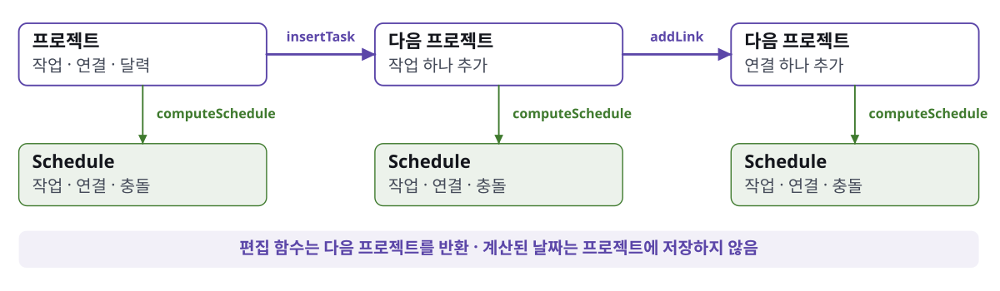

# @simplix-react/gantt-core

[English](/en/packages/gantt-core/README.md) | **한국어**

런타임 의존성과 UI가 없는 프로젝트 일정 엔진입니다. 근무 달력, 연결과 제약 조건에 따른 일정 계산, 중요 경로, 초기 계획, 자원과 자원 평준화, 되돌릴 수 있는 편집 함수, Microsoft Project XML 교환을 제공합니다.

`@simplix-react/gantt`가 이 엔진 위에 차트를 그립니다. 서버, 워커, 테스트에서 일정을 계산할 때는 이 패키지만 사용하세요.

## 설치

```bash
pnpm add @simplix-react/gantt-core
```

## 빠른 시작

```ts
import { addLink, computeSchedule, createTask, formatLocalDateTime, insertTask, parseLocalDateTime, standardCalendar } from "@simplix-react/gantt-core";
import type { Project } from "@simplix-react/gantt-core";

let project: Project = {
  name: "Launch",
  scheduleFrom: "start",
  start: parseLocalDateTime("2026-03-02T08:00"),
  calendarId: "standard",
  minutesPerDay: 480,
  minutesPerWeek: 2400,
  daysPerMonth: 20,
  defaultStartTime: 480,
  defaultFinishTime: 1020,
  criticalSlackLimit: 0,
  honorConstraints: true,
  calendars: [standardCalendar()],
  tasks: [],
  links: [],
  resources: [],
  assignments: [],
  baselines: {},
};

project = insertTask(project, createTask(project, { id: "design", name: "Design", duration: 5 * 480 }));
project = insertTask(project, createTask(project, { id: "build", name: "Build", duration: 10 * 480 }));
project = addLink(project, { predecessorId: "design", successorId: "build" });

const schedule = computeSchedule(project);
const build = schedule.tasks.get("build");
console.log(build && formatLocalDateTime(build.start)); // 2026-03-09T08:00:00
console.log(build?.critical); // true
```

## 모델

`Project`는 변경할 수 없는 일반 데이터입니다. 모든 함수는 프로젝트를 받아 새 프로젝트를 돌려주며, 계산한 날짜는 저장하지 않고 `computeSchedule(project)`로 구합니다. 프로젝트와 작업에 저장하는 날짜는 시작일, 수동 일정, 제약 날짜, 실제 날짜입니다.



| 레코드 | 담는 내용 |
| --- | --- |
| `Task` | 행 하나입니다. 행은 표시 순서대로 보관하며, `outlineLevel`이 그 행을 한 수준 위인 가장 가까운 앞 행 아래에 둡니다. 아래에 행이 있는 행은 요약 작업입니다. |
| `Link` | 연결입니다. 종류는 `FS`, `SS`, `FF`, `SF`이고 지연 시간은 근무 분, 경과 분, 선행 작업 기간의 백분율로 지정합니다. 음수 지연은 앞당김입니다. |
| `WorkCalendar` | 요일별 근무 시간, 기간을 정한 근무 주와 예외일을 담고, 기본 달력을 상속할 수 있습니다. |
| `Resource`, `Assignment` | 누가 어떤 작업을 시간의 몇 퍼센트로, 얼마만큼의 작업량으로 맡는지 담습니다. |
| `Baseline` | 초기 계획을 저장한 시점의 모든 작업 날짜입니다. 0~10번으로 구분합니다. |
| `CustomField` | 계획이 작업에 추가하는 텍스트, 숫자, 날짜, 플래그 필드입니다. |

시각은 프로젝트 자체의 벽시계 기준 분 단위 정수(`Minutes`)입니다. 시간대는 어디에도 적용하지 않습니다. `parseLocalDateTime`은 `YYYY-MM-DD` 또는 `YYYY-MM-DDTHH:MM[:SS]`를 읽고 초는 버리며, `formatLocalDateTime`은 `YYYY-MM-DDTHH:MM:00` 형식으로 씁니다. `formatLocalDate`, `formatClockTime`, `parseClockTime`, `toCivil`, `fromCivil`, `daysFromCivil`, `dayIndexOf`, `weekdayOfDay`, `MINUTES_PER_DAY`도 같은 시계 기준으로 동작합니다.

## 일정 계산

`computeSchedule`은 작업마다 `start`, `finish`, `earlyStart`, `earlyFinish`, `lateStart`, `lateFinish`, `totalSlack`, `freeSlack`, `critical`, 개요 번호(`wbs`), 합산한 진행률을 돌려줍니다. 연결마다 상태(`violated`, `driving`)를 함께 돌려주고, 충돌 목록도 돌려줍니다.

| 입력 | 효과 |
| --- | --- |
| `scheduleFrom: "start"` | 연결과 제약 조건이 허용하는 가장 이른 날짜에 작업을 배치하고, 늦은 날짜는 그 결과의 완료일에서 거꾸로 계산합니다. `"finish"`는 `Project.finish`에서 반대 방향으로 계산합니다. |
| 제약 조건 종류 | `asap`, `alap`, `must-start-on`, `must-finish-on`, `start-no-earlier-than`, `start-no-later-than`, `finish-no-earlier-than`, `finish-no-later-than` |
| `honorConstraints` | true이면 must-start-on, must-finish-on, start-no-later-than, finish-no-later-than 날짜가 연결보다 우선하고, 그 연결을 위반으로 보고합니다. |
| `deadline` | 늦은 완료일의 상한입니다. 기한을 넘기면 음수 여유 시간과 `deadline-missed` 충돌로 나타납니다. |
| `mode: "manual"` | 작업은 `manualStart`와 `manualFinish`에 머뭅니다. 그 작업으로 들어오는 연결은 검사만 하고 적용하지 않습니다. |
| `actualStart`, `actualFinish` | 시작한 작업은 실제 날짜에 고정합니다. |
| 작업 달력과 자원 달력 | 작업은 자체 달력으로 진행하고, `ignoreResourceCalendar`를 지정하지 않으면 배정된 자원의 달력으로 진행합니다. |
| `elapsed` | 기간이나 지연 시간을 밤과 주말을 포함한 경과 시간으로 셉니다. |
| 요약 작업 | 아래 작업에서 날짜를 가져옵니다. 요약 작업에 건 연결은 그 아래 모든 작업에 적용합니다. |
| `splits` | 작업이 정해진 작업량을 마친 뒤 정해진 근무 시간 동안 중단합니다. 완료일은 중단한 만큼 늦어지지만 기간은 그대로이고, `TaskSchedule.segments`가 실제로 진행하는 구간을 알려 줍니다. |

일정을 아예 계산할 수 없는 프로젝트(연결 순환, 근무 시간이 없는 달력, 없는 레코드 참조)는 `code`가 있는 `ScheduleError`를 발생시킵니다. 연결, 제약 조건, 기한을 지키지 못하는 것은 오류가 아닙니다. 일정은 계산하고, 지키지 못한 내용은 `Schedule.conflicts`에 나열합니다.

### Microsoft Project와의 일치

테스트는 Microsoft Project 2002~2019가 계산해 저장한 계획을 읽어 다시 계산하고 결과를 비교합니다. 이 계획들의 자동 일정 작업 1,248개 모두에서 시작일, 완료일, 이른 날짜와 늦은 날짜, 전체 여유 시간과 자유 여유 시간, 중요 여부가 같습니다.

저장된 계획이 다루는 범위는 좁고, 이 비교가 증명하는 것도 그 범위까지입니다.

| 저장된 계획이 다루는 것 | 다루지 않는 것 |
| --- | --- |
| 일이나 주 단위 지연이 있는 `FS`, `SS`, `FF`, `SF` 연결, 연결된 작업 64개 | 앞당김, 경과 지연과 백분율 지연, 요약 작업에 건 연결 |
| 가능한 한 빨리 작업과 지정 날짜 이후 시작 작업(프로젝트 시작일보다 앞선 날짜 포함) | 나머지 제약 조건 종류, 기한 |
| 표준 달력 | 달력 예외, 근무 주, 작업 달력과 자원 달력 |
| 시작일부터 계산하는 프로젝트 | 완료일부터 계산하는 프로젝트 |

오른쪽 열은 Microsoft Project가 아니라 손으로 계산한 값과 무작위 계획에 대한 불변식(모든 연결이 지켜진다, 어떤 작업도 기간이 늘거나 줄지 않는다, 기한을 넘기지 않으면 여유 시간이 음수가 되지 않는다)으로 검사합니다.

수동 일정 작업은 파일에서 날짜를 가져오므로, 그 날짜는 일정 계산 엔진에 대해 아무것도 증명하지 않습니다. Microsoft Project는 수동 작업의 늦은 날짜와 중요 여부를 자동 작업처럼 연결에서 계산하지 않으므로, 이 값은 서로 다릅니다.

비교에 쓰는 표본 파일은 MPXJ 프로젝트(LGPL-2.1)에서 가져오며 이 패키지에 포함하지 않습니다. 테스트 전에 `node scripts/fetch-oracle.mjs`가 Git에서 제외된 디렉터리로 내려받습니다.

## 편집

| 영역 | 함수 |
| --- | --- |
| 행 | `createTask`, `insertTask`, `removeTasks`, `updateTask`, `changeTask`, `taskIndex`, `nextId`, `indentTasks`, `outdentTasks`, `moveTask`, `copyTasks`, `pasteTasks` |
| 날짜와 진행률 | `setTaskStart`, `setTaskFinish`, `setTaskStartKeepingFinish`, `setTaskDuration`, `setPercentComplete` |
| 연결 | `addLink`, `updateLink`, `removeLinks` |
| 자원 | `addResource`, `updateResource`, `removeResources`, `assignResource`, `updateAssignment`, `removeAssignments` |
| 프로젝트 | `updateProject` |
| 달력 | `putCalendar`, `removeCalendar`, `standardCalendar`, `continuousCalendar`, `parseWorkingRanges`, `formatWorkingRanges`, `compileCalendars`, `intersectWorkingTime`, `ELAPSED_TIME` |
| 개요 | `buildOutline`, `isAncestor`, `subtreeEnd` |
| 초기 계획 | `setBaseline`, `clearBaseline`, `baselineVariance` |
| 분할 | `splitTask`, `clearSplits` |
| 반복 작업 | `addRecurringTask`, `updateRecurringTask`, `recurrenceDays` |
| 사용자 지정 필드 | `addCustomField`, `renameCustomField`, `removeCustomField`, `setCustomValue` |
| 비용 | `computeCosts` |
| 진행 | `rescheduleUncompletedWork`, `computeEarnedValue` |
| 변경 | `diffProjects`, `mergeProjects`, `takeTheirs` |
| 저장한 계획 | `serializeProject`, `parseProject`, `toSavedPlan`, `PLAN_FORMAT`, `PLAN_FORMAT_VERSION` |
| 하위 프로젝트 | `insertSubproject` |
| 자원 부하 | `findOverallocations`, `resourceUsage`, `levelResources`, `clearLeveling` |
| 텍스트 입력 | `parseDuration`, `formatDuration`, `parsePredecessors`, `formatPredecessors`, `minutesPerUnit` |
| 되돌리기 | `createHistory`, `commit`, `undo`, `redo`, `undoLabel`, `redoLabel` |

배정은 작업 종류를 따릅니다. 단위 고정 작업은 작업량이 바뀌면 기간이 바뀌고, 기간 고정 작업은 단위가 바뀝니다. 노력 기반 작업은 배정된 자원끼리 작업량을 나눕니다.

`computeCosts`는 작업마다 작업량과 비용을 합산합니다. 작업 자원은 배정 시간에 시간당 `standardRate`를 곱하고, 재료 자원은 단위에 단가를 곱합니다. 작업마다 한 번씩 `costPerUse`를 더하고 작업 자체의 `fixedCost`를 더한 뒤 요약 작업으로 합산합니다.

`addRecurringTask`는 매일, 매주, 매월 반복마다 작업 하나씩을 둔 요약 작업을 추가합니다. 각 작업은 지정 날짜 이후 시작 제약 조건으로 그날에 고정합니다.

`levelResources`는 작업 자원이 최대 단위를 넘겨 배정되지 않을 때까지 작업을 늦춥니다. 연결 순서대로, 우선순위가 높은 작업부터 하나씩 배치하며, 시작하지 않았고 우선순위가 1000 미만인 자동 일정의 가능한 한 빨리 작업만 이동합니다. `withinSlack`은 모든 지연을 그 작업의 전체 여유 시간 안에 두므로 프로젝트 완료일이 바뀌지 않습니다. `split`은 작업 전체를 이동하는 대신 충돌이 시작하는 지점에서 작업을 중단합니다. 해결하지 못한 내용을 돌려줍니다. 작업 400개와 배정 200개인 계획을 평준화하는 데 약 15ms가 걸립니다.

`rescheduleUncompletedWork`는 끝내지 못한 작업을 상태 기준일 뒤로 이동합니다. 시작하지 않은 작업에는 그 날짜로 지정 날짜 이후 시작 제약 조건을 지정하고, 진행 중인 작업은 완료한 작업량이 끝나는 지점에서 중단합니다.

`computeEarnedValue`는 상태 기준일 시점에서 계획을 초기 계획과 비교합니다. 계획 가치, 획득 가치, 실제 비용, 일정 차이와 비용 차이, 일정 성과 지수와 비용 성과 지수를 작업, 요약 작업, 프로젝트 단위로 계산합니다. 초기 계획을 저장할 때 작업마다 비용을 예산으로 저장합니다.

`diffProjects`는 계획의 두 버전 사이에서 달라진 내용을 레코드 단위로 나열합니다. 추가, 수정, 삭제한 작업, 연결, 자원, 배정, 달력, 사용자 지정 필드와 행 순서, 계획 설정, 초기 계획이 대상입니다. 서버는 이 목록으로 계획 전체를 다시 쓰지 않고 편집 내용만 저장할 수 있습니다.

`mergeProjects(base, mine, theirs)`는 다른 곳에서 만든 변경을 이쪽에서 편집한 계획에 합칩니다. 상대만 바꾼 레코드는 받아들이고, 양쪽이 모두 바꾼 레코드는 이쪽 버전을 유지하고 충돌로 돌려줍니다. `takeTheirs(project, theirs, conflicts)`는 나열한 충돌을 상대 쪽 버전으로 정리합니다.

`serializeProject`는 형식 이름과 버전(`PLAN_FORMAT_VERSION`)을 기록한 JSON으로 계획을 쓰고, `parseProject`는 그 JSON을 읽습니다. 더 새로운 버전이 저장한 계획은 `unsupported-plan-version`, 계획이 아닌 값은 `invalid-plan` 오류를 발생시킵니다. 버전 표기 없이 프로젝트만 저장한 계획은 그대로 읽습니다.

자원에는 초과 근무 단가와 날짜별로 적용하는 표준 단가를 지정할 수 있습니다. 배정에는 초과 근무 작업량과 작업 분포를 지정할 수 있습니다. 초과 근무 작업량은 초과 근무 단가로 비용을 계산하고 기간을 차지하지 않습니다. 작업 분포는 `resourceUsage`에서 날짜별 작업량을 앞쪽, 뒤쪽, 가운데로 몰아 줍니다.

## Microsoft Project XML

```ts
import { computeSchedule } from "@simplix-react/gantt-core";
import { readMspdi, writeMspdi } from "@simplix-react/gantt-core/mspdi";

const { project, warnings } = readMspdi(xmlText);
const xml = writeMspdi(project, computeSchedule(project));
```

교환 코드는 `@simplix-react/gantt-core/mspdi`에서만 내보냅니다. 이 코드를 필요할 때 불러오는 앱은 처음 불러오는 코드에서 교환 코드를 제외할 수 있습니다.

`readMspdi`는 계획과 함께, 변환하지 못한 데이터를 담은 경고 목록을 돌려줍니다. `writeMspdi`는 계산한 날짜, 여유 시간, 개요 번호를 포함해 Microsoft Project가 저장하는 파일과 같은 요소 순서로 계획을 씁니다. `mspdiExportLosses(project)`는 계획 가운데 이 문서 형식에 담을 수 없는 내용을 나열합니다. `parseMspdiDuration`과 `formatMspdiDuration`은 문서의 기간 텍스트를 변환하고, `parseXml`과 `XmlWriter`는 교환에 쓰는 XML 읽기와 쓰기 도구입니다.

| 교환하는 내용 | 저장 방식 |
| --- | --- |
| 작업의 고정 비용과 실제 비용, 자원의 사용당 비용, 초기 계획의 비용 | Microsoft Project가 금액을 저장하는 방식대로 금액의 100배 |
| 자원의 표준 단가와 초과 근무 단가 | 시간당 금액, 재료 자원은 단위당 금액 |
| 자원의 날짜별 표준 단가 | 자원의 첫 번째 단가표 |
| 배정의 초과 근무 작업량과 작업 분포 | 균등, 후반 집중, 전반 집중, 종형. 그 밖의 분포는 경고와 함께 균등으로 읽습니다 |
| 사용자 지정 텍스트, 숫자, 날짜, 플래그 필드 | Microsoft Project의 Text1~Text30, Number1~Number20, Date1~Date10, Flag1~Flag20에 필드 이름을 별칭으로 저장합니다. 파일에서 읽은 필드의 ID는 `text1`, `number3` 같은 형태입니다 |
| 평준화 지연 | 시작일 앞의 경과 시간입니다. 작업 달력 기준 근무 분과 서로 변환합니다 |
| 통화 코드 | 그대로 저장합니다 |

교환의 한계는 다음과 같습니다.

- 표본 파일 122개를 하나씩 읽고, 쓰고, 다시 읽으면 같은 계획이 나옵니다. 쓴 파일을 Microsoft Project가 여는지는 확인하지 않았습니다.
- 분할 작업의 중단 구간, 작업별 색상, 반복 작업의 반복 규칙, 시간별 데이터는 교환하지 않습니다. Microsoft Project가 종류별로 제공하는 개수를 넘는 사용자 지정 필드는 쓰지 않습니다.
- 금액 배율과 사용자 지정 필드 값은 알려진 값을 입력해 Microsoft Project가 저장한 파일로 검사했습니다. 단가, 단가표, 평준화 지연, 균등 외의 작업 분포를 담은 표본 파일은 없으므로, 이 항목은 공개된 스키마를 따르고 쓰고 다시 읽는 방식으로만 검사합니다.
- 평준화 지연은 파일에 있는 작업 시작일에서 변환하므로, 지연된 시작일이 근무 시간 경계에 있을 때만 정확히 같은 값으로 다시 읽힙니다.

## 라이선스

MIT

---

<p class="page-source"><a href="https://github.com/simplix-framework/simplix-react/blob/main/packages/gantt-core/README.ko.md" target="_blank" rel="noopener noreferrer">GitHub에서 편집</a></p>
