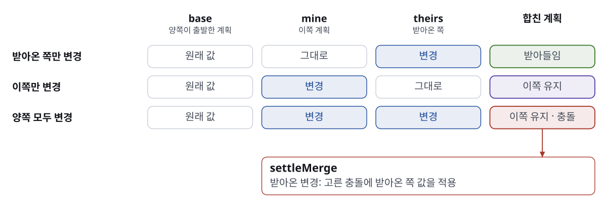

# Gantt 차트 사용 안내

[English](/en/packages/gantt/docs/guide.md) | **한국어**

`@simplix-react/gantt`로 프로젝트 일정 화면을 만들고, 계획을 저장하고, 화면 배치를 사용자별로 보관하는 방법을 설명합니다. 속성 목록과 단축키 표는 [README](/ko/packages/gantt/README.md)에 있습니다.

## 화면에 차트 넣기

스타일시트를 프레임워크 테마 뒤에 한 번 불러옵니다.

```css
@import "tailwindcss";
@import "@simplix-react/ui/theme.css";
@import "@simplix-react/gantt/styles.css";
```

높이가 정해진 상자 안에 `Gantt`를 넣습니다. 차트는 상자를 가득 채우고 그 안에서 스크롤합니다.

```tsx
import { Gantt } from "@simplix-react/gantt";
import type { Project } from "@simplix-react/gantt-core";

export function PlanPage({ plan }: { plan: Project }) {
  return (
    <div className="h-[720px]">
      <Gantt defaultProject={plan} />
    </div>
  );
}
```

번역은 패키지를 불러올 때 등록합니다. 앱이 i18n 설정을 만들기 전에 `@simplix-react/gantt`를 먼저 불러와 주세요.

## 계획 저장하기

사용자가 편집을 확정할 때마다 차트는 `onChange`를 호출합니다. 세 번째 인수 `changes`에는 직전 계획과 달라진 레코드만 들어 있으므로, 서버에는 이 목록만 보내면 됩니다.

```tsx
<Gantt
  defaultProject={plan}
  onChange={(project, schedule, changes) => {
    for (const change of changes) {
      if (change.entity === "task" && change.kind === "updated") saveTask(change.id, change.value);
      if (change.entity === "task" && change.kind === "removed") deleteTask(change.id);
    }
  }}
/>
```

날짜는 계획에 저장하지 않습니다. 시작일과 완료일은 `schedule`에 들어 있고, 계획을 다시 열면 엔진이 같은 값을 계산합니다.

계획 전체를 문자열로 보관할 때는 `serializeProject`로 쓰고 `parseProject`로 읽습니다. 저장한 문자열에 형식 이름과 버전을 함께 기록합니다.

```ts
import { parseProject, serializeProject } from "@simplix-react/gantt-core";

const text = serializeProject(project);
const plan = parseProject(text);
```

`parseProject`는 더 새로운 버전에서 저장한 계획을 받으면 `unsupported-plan-version` 오류를 내고, 계획이 아닌 값을 받으면 `invalid-plan` 오류를 냅니다. 버전 표기 없이 `Project` 객체만 저장해 둔 계획은 그대로 읽습니다.

## 다른 사용자의 변경 반영하기

서버에서 새 계획을 받으면 스토어의 `merge`로 합칩니다. `base`에는 양쪽이 함께 출발한 계획(마지막으로 저장한 계획)을 전달합니다.

```tsx
const store = useGanttStore();
const conflicts = store.getState().merge(lastSavedPlan, planFromServer);
```



상대만 바꾼 레코드는 그대로 받아들입니다. 양쪽이 모두 바꾼 레코드는 이쪽 값을 유지하고 `conflicts`로 돌려줍니다. 되돌리기 기록은 유지됩니다.

충돌이 있으면 차트는 대화 상자에 그 레코드를 나열합니다. 사용자가 레코드마다 「이쪽 유지」와 「받아온 변경」 가운데 하나를 고르고 「적용」을 누르면, 「받아온 변경」을 고른 레코드만 상대의 값으로 바뀝니다. 이 변경은 한 번의 되돌리기로 취소할 수 있습니다. 코드에서 직접 처리하려면 `settleMerge`에 상대 값으로 바꿀 충돌 목록을 전달합니다.

```tsx
store.getState().settleMerge(conflicts.filter((conflict) => conflict.entity === "task"));
```

## 화면 배치 보관하기

열 너비와 순서, 확대 단계, 접힌 행, 필터, 막대 설정을 통틀어 화면 배치라고 합니다. `onLayoutChange`로 받은 값을 사용자별로 저장하고, 다음에 열 때 `layout`으로 전달합니다.

```tsx
<Gantt
  defaultProject={plan}
  layout={JSON.parse(localStorage.getItem("plan-layout") ?? "{}")}
  onLayoutChange={(layout) => localStorage.setItem("plan-layout", JSON.stringify(layout))}
/>
```

## 작업 표 다루기

| 동작 | 방법 |
| --- | --- |
| 열 너비 조절 | 머리글 오른쪽 경계의 손잡이를 끕니다. 손잡이를 두 번 누르면 기본 너비로 되돌립니다 |
| 열 순서 변경 | 머리글을 좌우로 끕니다. 끄는 동안 포인터 옆에 열 이름을 표시하고, 놓으면 열이 놓일 경계에 세로선을 표시합니다. 머리글을 표 가장자리에 대고 있으면 가려진 열이 그쪽으로 스크롤됩니다 |
| 표시할 열 선택 | 표 왼쪽 위 모서리의 버튼이나 도구 모음의 열 버튼에서 고릅니다. 새로 추가한 열이 표 밖에 있으면 표가 그 열까지 스크롤합니다 |
| 표 너비 조절 | 표와 타임라인 사이 경계의 손잡이를 끕니다 |
| 표 안에서 좌우 이동 | 열 너비의 합이 표보다 넓으면 표 아래에 스크롤 막대를 표시합니다. 막대를 끌거나, 표 위에서 휠을 옆으로 돌리거나, 터치 화면에서 표를 옆으로 밉니다 |

행 번호 열의 너비는 가장 긴 행 번호와 그 옆의 표시 아이콘이 들어가는 만큼만 차지합니다. 표를 옆으로 스크롤해도 행 번호 열과 첫 번째 열은 스크롤하지 않고 왼쪽에 고정됩니다. 방향키로 활성 셀을 바꾸면 표가 그 셀이 보이는 위치까지 스크롤합니다.

손잡이는 키보드로도 조작할 수 있습니다. 탭 키로 손잡이를 선택한 뒤 좌우 방향키를 누르면 너비가 바뀌고, Shift를 함께 누르면 네 배씩 바뀝니다. 열 손잡이에서 Home을 누르면 기본 너비로 되돌립니다.

## 터치 화면에서 쓰기

손가락을 대자마자 움직이면 차트가 스크롤됩니다. 막대, 열 머리글, 행 번호, 달력의 작업 위에서 시작해도 같습니다. 막대나 머리글을 이동하려면 손가락을 0.3초 동안 대고 있다가 끕니다. 마우스와 펜은 기다리지 않고 바로 끌 수 있습니다.

## 좁은 화면에서 쓰기

차트는 놓인 상자의 너비에 맞춰 배치를 바꿉니다.

- 보기 전환 탭은 명령 버튼 윗줄에 따로 놓이고, 탭이 다 들어가지 않는 너비에서는 선택 목록으로 바뀝니다.
- 도구 모음 너비가 560px보다 좁으면 되돌리기, 작업 추가, 작업 삭제, 열 선택, 검색만 도구 모음에 남기고 나머지 명령은 더 보기 메뉴에 표시합니다.
- 더 보기 메뉴의 「표시 영역」에서 표만 또는 타임라인만 표시할 수 있습니다. 이 선택도 화면 배치에 함께 저장합니다.
- 자원 사용 현황, 작업 배정 현황, 자원 그래프는 이름 열에 너비의 40%까지만 내어 줍니다.
- 달력은 날짜 칸에 작업 수와 표시 막대만 그립니다. 날짜를 누르면 달력 아래에 그날의 작업 이름을 나열하고, 이름을 누르면 작업 정보 대화 상자를 엽니다.

## 고대비 테마와 화면 낭독기

Windows 고대비 테마처럼 브라우저가 색을 강제로 바꾸는 환경에서도 요약 막대, 마일스톤, 진행률, 초기 계획 막대, 근무 시간이 아닌 구간, 날짜 표시선을 테마 색으로 채워 표시합니다. 이 환경에서는 색상으로 구분할 수 없으므로 중요 작업은 이중 테두리로, 선택한 막대는 강조색 외곽선으로 표시합니다.

화면 낭독기에는 표의 행 번호를 화면에 표시한 순서대로 전달하고, 머리글 행을 첫 번째 행으로 셉니다. 막대는 작업 이름, 시작일과 완료일, 진행률로 읽고, 마일스톤과 중요 작업은 그 사실을 추가해 읽습니다.

## 보기 전용으로 열기

`readOnly`를 켜면 차트는 계획을 보여 주기만 합니다. 셀 편집, 막대 드래그, 삭제를 모두 거부하고 대화 상자의 입력란을 비활성화합니다.

```tsx
<Gantt defaultProject={plan} readOnly />
```

## 필터, 정렬, 그룹

도구 모음의 더 보기 메뉴에서 고릅니다. 검색란에 입력하면 이름에 그 글자가 들어 있는 작업만 남습니다.

| 기능 | 동작 |
| --- | --- |
| 필터 | 조건에 맞는 작업과 그 상위 요약 작업을 표시합니다 |
| 정렬 | 요약 작업 아래의 작업끼리 순서를 바꾸고 개요 구조는 유지합니다 |
| 그룹 | 개요 구조를 풀고 작업을 자원, 중요 여부, 진행 상태별 머리행 아래에 모읍니다 |

필터나 정렬, 그룹이 켜져 있는 동안에는 행을 끌어 순서를 바꿀 수 없습니다. 화면의 순서가 계획의 순서와 다르기 때문입니다.

## 진행 상황 관리하기

프로젝트 정보 대화 상자에서 상태 기준일을 정하면 다음 기능을 쓸 수 있습니다.

- 타임라인에 상태 기준일을 주황색 점선으로 표시합니다.
- 진행선을 켜면 기준일을 따라 내려오다가 각 작업의 진행 지점에서 꺾이는 선을 표시합니다. 왼쪽으로 꺾이면 늦은 작업입니다.
- 「미완료 작업 재일정」은 시작하지 않은 작업을 기준일 뒤로 이동하고, 진행 중인 작업은 완료한 부분에서 중단했다가 기준일에 다시 시작하게 합니다.
- 획득 가치 열은 초기 계획에 저장된 비용을 예산으로 삼아 계획 가치, 획득 가치, 실제 비용을 표시합니다. 초기 계획을 먼저 저장해 주세요.

## 다른 보기

보기 전환 탭에서 고릅니다.

| 보기 | 내용 |
| --- | --- |
| 네트워크 다이어그램 | 작업을 상자로, 선후 관계를 선으로 그립니다. 오른쪽 위 버튼으로 확대, 축소하거나 전체를 화면에 맞춥니다 |
| 달력 | 한 달을 날짜 칸으로 나누고 그날 진행하는 작업을 표시합니다. 작업을 다른 날짜 칸으로 끌면 그 날수만큼 시작일을 옮깁니다 |
| 자원 시트 | 자원의 단가, 최대 단위, 달력을 편집합니다 |
| 자원 사용 현황 | 자원별로 날짜마다 배정된 시간을 표시합니다 |
| 작업 배정 현황 | 작업별로 배정된 자원의 날짜별 시간을 표시합니다 |
| 자원 그래프 | 자원별 배정 시간과 가용 시간을 막대로 비교합니다 |

자원 사용 현황과 작업 배정 현황, 자원 그래프는 화면에 보이는 행과 열만 그리므로 긴 계획도 같은 속도로 엽니다.

## 파일로 주고받기

더 보기 메뉴에서 실행합니다.

| 명령 | 동작 |
| --- | --- |
| 계획 파일로 저장 | 계획 전체를 `.gantt.json` 파일로 내려받습니다. 차트의 모든 정보를 담습니다 |
| 계획 파일 열기 | 저장한 계획 파일을 읽어 현재 계획을 바꿉니다 |
| MS Project XML 내보내기 | 계획을 Microsoft Project XML 파일로 내려받습니다 |
| MS Project XML 가져오기 | Microsoft Project XML 파일을 읽어 현재 계획을 바꿉니다 |

Microsoft Project XML 형식에는 분할 작업의 중단 구간, 작업별 색상, 반복 작업의 반복 규칙을 저장할 수 없습니다. 계획에 이런 내용이 있으면 차트는 내보내기 전에 저장되지 않는 내용을 대화 상자로 알리고, 사용자가 「그대로 내보내기」를 눌러야 파일을 만듭니다. 가져온 파일에 기록된 대로 읽지 못한 내용이 있을 때도 같은 대화 상자로 알립니다. 정보를 빠짐없이 보관하려면 계획 파일로 저장하세요.

계획 파일 명령은 `planFiles={false}`로, XML 명령은 `xmlExchange={false}`로 숨길 수 있습니다.

## 테스트 실행하기

단위 테스트와 컴포넌트 테스트는 `pnpm --filter @simplix-react/gantt test`로 실행합니다. 실제 브라우저 테스트는 Storybook을 먼저 실행한 뒤 다음 명령으로 실행합니다. 설치된 Google Chrome을 사용합니다.

```bash
pnpm --filter @simplix-react/gantt build
pnpm storybook
GANTT_STORYBOOK_URL=http://localhost:6006 pnpm --filter @simplix-react/gantt test:e2e
```

브라우저 테스트는 시작할 때 Storybook이 내보내는 소스를 디스크의 파일과 대조합니다. 내용이 서로 다르면 테스트를 중단하고 내용이 다른 파일의 경로를 출력합니다. 이때는 Storybook을 다시 시작한 뒤 테스트를 다시 실행하세요. Storybook은 차트의 스타일시트를 빌드 결과물(`dist/styles.css`)에서 읽으므로, `src/styles.css`를 고친 뒤에는 패키지를 다시 빌드해야 합니다. 두 파일의 내용이 다르면 테스트를 중단하고 빌드 명령을 출력합니다. 같은 문제가 반복되는 컴퓨터에서는 `CHOKIDAR_USEPOLLING=1 pnpm storybook`으로 시작하면 파일 변경을 주기적으로 확인하므로 다시 생기지 않습니다.

`.github/workflows/gantt.yml` 워크플로는 `gantt` 패키지, `gantt-core` 패키지, Gantt 스토리 가운데 하나라도 바뀌면 타입 검사, 린트, 단위 테스트, 브라우저 테스트를 실행합니다.

---

<p class="page-source"><a href="https://github.com/simplix-framework/simplix-react/blob/main/packages/gantt/docs/guide.ko.md" target="_blank" rel="noopener noreferrer">원본 보기</a></p>
