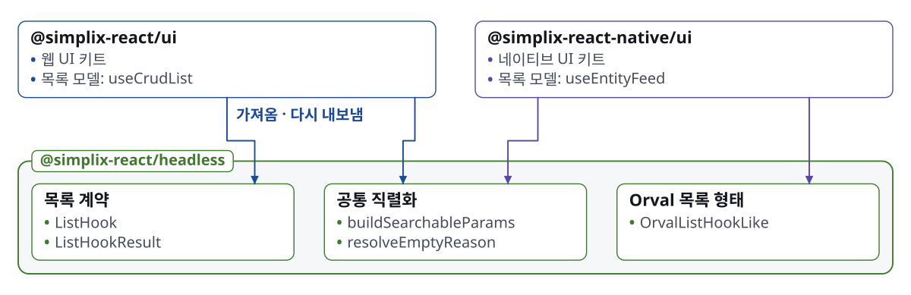

# @simplix-react/headless

[English](/en/packages/headless/README.md) | **한국어**

웹 UI 키트(`@simplix-react/ui`)와 네이티브 UI 키트(`@simplix-react-native/ui`)가 함께 쓰는, 플랫폼에 의존하지 않는 헤드리스 로직입니다. 이 패키지는 DOM이나 React Native를 사용하지 않습니다. 모든 플랫폼에서 실행되는 TypeScript 코드와 React 훅만 들어 있습니다.



## 제공 기능

| 영역 | 내보내는 항목 |
| --- | --- |
| Orval 어댑터 | `adaptOrvalList`, `adaptOrvalGet`, `adaptOrvalCreate`, `adaptOrvalUpdate`, `adaptOrvalDelete`, `adaptOrvalOrder`, `LIST_READ_META` |
| 검색 매개변수 직렬화 | `buildSearchableParams`, `SEARCHABLE_KEYWORD_PARAM` |
| 필터 어휘 | `SearchOperator`, `makeFilterKey`, `parseFilterKey`, `getFilterLayout`, `insertFilterSeparators`, 연산자 설정 표(`dateOperatorConfig`, `selectOperatorConfig`, `textOperatorOrder`, `numberOperatorOrder`) |
| 목록 계약 | `ListHook`, `ListHookResult`, `SortState`, `PaginationState`, `FilterState`, `EmptyReason`, `CrudMutation` |
| 빈 상태 분류 | `resolveEmptyReason`: 성공하지 못한 쿼리(`"error"`, `"unavailable"`)를 결과가 비어 있는 사유보다 앞에 둡니다 |
| 인메모리 필터링 | `matchesFilter` |
| 토스트 스토어 | `addToast`, `removeToast`, `runToastAction`, `useToastStore`(그리는 컴포넌트는 각 플랫폼 키트에 있습니다) |
| 서식 | `formatBytes`, `toBcp47`, `formatDateShort` / `formatDateMedium` / `formatDateTime` / `formatRelativeTime` / `formatDateRange`, `getMonthNames`, `generateYears` |
| 날짜 계산 | `startOfDay` … `endOfYear`, `addDays` / `subDays`, `isSameDay` / `isSameMonth` / `isSameWeek`, `parseDate`, `asPlainDate` |
| 의미 종류별 날짜·시간 인코딩 | `serializeInstant`, `decodeInstant`, `serializeCalendarDate`, `decodeCalendarDate`, `serializeWallClockTime`, `decodeWallClockTime`, `TimeValue` 도우미 |
| 애플리케이션 시간대와 시간대 기준 날짜 | `configureAppTimeZone`, `getAppTimeZone`, `useAppTimeZone`, `zoneDayRange`를 비롯한 `zone*` 도우미, `elapsedSpan`, `periodStanding`, `daysUntilDay` |
| 클립보드와 보안 컨텍스트 대체 구현 | `copyText`, `installClipboardFallback`, `installRandomUUIDFallback` |
| 목록·폼 상태 | `paginationHandlers`, `useDebouncedValue`, `useOnline`, `missingRequired` |
| 로컬 아이디 | `generateLocalId` |
| 테마 목록 | `THEMES`, `ColorTheme`: 웹 CSS 프리셋과 네이티브 토큰 시트가 함께 쓰는 색상 프리셋 목록 |

시그니처를 포함한 전체 목록은 [API 레퍼런스](https://github.com/simplix-framework/simplix-react/blob/main/docs/api/@simplix-react/headless/README.md)에 있습니다.

## 사용 방법

`@simplix-react/ui`는 목록 계약, Orval 어댑터, 필터 어휘, 토스트 스토어, 서식·날짜 도우미, 테마 목록을 다시 내보냅니다. 웹 애플리케이션은 이 항목을 `@simplix-react/ui`에서 가져오세요. 네이티브 애플리케이션과 `@simplix-react-native/ui`는 `@simplix-react/headless`에서 직접 가져옵니다. `buildSearchableParams`나 `matchesFilter`처럼 `@simplix-react/ui`가 다시 내보내지 않는 항목도 이 패키지에서 직접 가져오세요.

```ts
import { adaptOrvalList, buildSearchableParams, SearchOperator } from "@simplix-react/headless";
```

목록 상태 머신은 일부러 이 패키지에 두지 않았습니다. 웹 페이지 모델(`useCrudList`)은 `@simplix-react/ui`에, 네이티브 피드 모델(`useEntityFeed`)은 `@simplix-react-native/ui`에 있습니다. `useCrudList`는 이 패키지의 `ListHook` 계약을 사용하고, `useEntityFeed`는 `OrvalListHookLike`, `buildSearchableParams`, `resolveEmptyReason`을 사용합니다.

---

<p class="page-source"><a href="https://github.com/simplix-framework/simplix-react/blob/main/packages/headless/README.ko.md" target="_blank" rel="noopener noreferrer">GitHub에서 편집</a></p>
