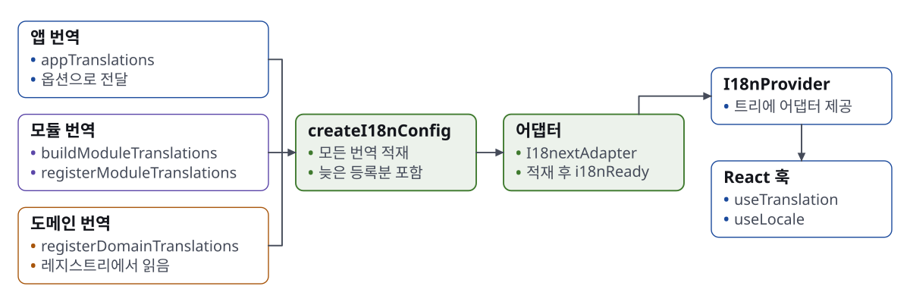

<p align="center">
  
</p>

# @simplix-react/i18n

[English](/en/packages/i18n/README.md) | **한국어**

어댑터(adapter) 패턴으로 구성한 국제화 프레임워크입니다. i18next 연동을 기본으로 제공합니다.

## 설치

```bash
pnpm add @simplix-react/i18n
```

### 피어 의존성

| 패키지 | 버전 | 필수 여부 |
| --- | --- | --- |
| `i18next` | >= 25.0.0 | 선택 |
| `react` | >= 18.0.0 | 선택 |
| `react-i18next` | >= 16.0.0 | 선택 |

사용 방식에 맞는 피어 의존성을 설치하세요.

```bash
# Core only (i18next adapter)
pnpm add i18next

# With React bindings
pnpm add i18next react react-i18next
```

## 빠른 예제

```ts
import { createI18nConfig } from "@simplix-react/i18n";

const appTranslations = import.meta.glob("./locales/**/*.json", { eager: true });

const { adapter, i18nReady } = createI18nConfig({
  defaultLocale: "ko",
  appTranslations,
});

await i18nReady;

adapter.t("common:greeting");          // "안녕하세요"
adapter.formatCurrency(10000);         // "₩10,000"
adapter.formatDate(new Date());        // "2025. 1. 15."
```

## API 개요



### 핵심 (`@simplix-react/i18n`)

| 내보내는 항목 | 종류 | 설명 |
| --- | --- | --- |
| `II18nAdapter` | 인터페이스 | 국제화 백엔드가 구현하는 어댑터 계약 |
| `I18nextAdapter` | 클래스 | i18next 기반 어댑터 구현 |
| `createI18nConfig` | 함수 | 어댑터를 만들고 초기화하는 팩토리 |
| `buildModuleTranslations` | 함수 | 지연 로딩하는 모듈 번역 기술자를 구성 |
| `registerModuleTranslations` | 함수 | `createI18nConfig`가 만드는 모든 어댑터에 모듈 번역 기술자를 등록 |
| `registerDomainTranslations` | 함수 | 도메인 패키지의 번역 리소스를 등록 |
| `DEFAULT_LOCALES` | 상수 | 84개 언어의 기본 로케일 설정 |
| `SUPPORTED_LOCALES` | 상수 | `DEFAULT_LOCALES`의 로케일 코드 |
| `DATE_TIME_STYLES` | 상수 | 날짜·시간 서식 스타일 값 |
| `NUMBER_FORMAT_STYLES` | 상수 | 숫자 서식 스타일 값 |
| `TEXT_DIRECTIONS` | 상수 | 텍스트 방향 값(ltr, rtl) |
| `TRANSLATION_LOAD_STATES` | 상수 | 번역 불러오기 상태 값 |
| `formatDate`, `formatTime`, `formatDateTime`, `formatRelative` | 함수 | 어댑터 없이 쓰는, 로케일과 시간대를 반영한 `Intl` 서식 함수 |
| `toBCP47Locale`, `clearFormatterCaches` | 함수 | 로케일 태그 변환과 서식 캐시 초기화 |
| `configureFallbackLocale`, `getFallbackLocale`, `useFallbackLocale`, `DEFAULT_FALLBACK_LOCALE` | 함수, 훅, 상수 | 다국어 값에 해당 언어 항목이 없을 때 대신 쓰는 언어(기본값 `"en"`) |
| `seedI18nDefaults`, `i18nBaseValue`, `i18nFallbackText`, `someLanguageFilled` | 함수 | 다국어 필드 값 도우미 |
| `koreanParticle`, `formatKoreanParticle`, `localeParticle`, `KOREAN_PARTICLES` | 함수, 상수 | 낱말이나 숫자 뒤의 한국어 조사 선택 |
| `byteSize`, `messageLength`, `unitAmount` | 함수 | 바이트 크기, 메시지 길이, 단위를 포함한 수량을 표시 문자열로 변환 |

### React 바인딩 (`@simplix-react/i18n/react`)

| 내보내는 항목 | 종류 | 설명 |
| --- | --- | --- |
| `I18nProvider` | 컴포넌트 | React 컨텍스트로 어댑터를 제공 |
| `useTranslation` | 훅 | 네임스페이스 단위 번역, 로케일이 바뀌면 다시 렌더링 |
| `useLocale` | 훅 | 현재 로케일 반환, 로케일이 바뀌면 다시 렌더링 |
| `useI18n` | 훅 | 컨텍스트의 어댑터를 그대로 반환 |
| `useI18nAdapter` | 훅 | 컨텍스트의 어댑터 또는 `null` 반환 |
| `useEntityTranslation` | 훅 | 엔티티(entity) 필드 이름(`entity/{entityName}` 네임스페이스)과 열거형 값(`enums` 네임스페이스)의 번역 |
| `useLocalePicker` | 훅 | 로케일 선택 UI용 현재 로케일, 표시 이름을 포함한 로케일 목록, 변경 함수 |
| `useOptionalTranslation` | 훅 | 카탈로그에 항목이 없을 수 있는, 서버 값으로 만든 키의 번역 |
| `DateTimeProvider`, `useDateTime` | 컴포넌트, 훅 | 현재 로케일과 주입한 시간대를 `Intl` 서식 함수에 연결 |
| `useFormattedDate`, `useFormattedTime`, `useFormattedDateTime`, `useFormattedRelative` | 훅 | `DateTimeProvider` 기준으로 서식을 적용한 값 |
| `useI18nEditLanguage`, `useContentEditLanguage` | 훅 | 화면의 다국어 필드가 편집하는 언어 |

각 진입점의 나머지 항목은 [API 레퍼런스](https://github.com/simplix-framework/simplix-react/blob/main/docs/api/@simplix-react/i18n/README.md)에 있습니다.

## 핵심 개념

### 어댑터 패턴

`II18nAdapter` 인터페이스를 사용하면 애플리케이션이 특정 국제화 라이브러리에 묶이지 않습니다. 기본 제공하는 `I18nextAdapter`는 i18next로 이 인터페이스를 구현합니다. 다른 백엔드가 필요하면 어댑터를 직접 구현하세요.

```ts
import { I18nextAdapter } from "@simplix-react/i18n";

const adapter = new I18nextAdapter({
  defaultLocale: "en",
  fallbackLocale: "en",
  resources: {
    en: { common: { greeting: "Hello, {{name}}!" } },
    ko: { common: { greeting: "안녕하세요, {{name}}!" } },
  },
});

await adapter.initialize();

adapter.t("common:greeting");                    // uses default namespace
adapter.tn("common", "greeting", { name: "A" }); // namespaced lookup
adapter.tp("items", 3);                          // plural form
```

### 모듈 번역

`buildModuleTranslations`로 컴포넌트 단위의 번역을 정의하면 필요할 때 불러옵니다. 번역은 해당 모듈을 사용할 때만 불러오므로 코드 분할이 가능합니다.

```ts
import { buildModuleTranslations } from "@simplix-react/i18n";

const dashboardTranslations = buildModuleTranslations({
  namespace: "dashboard",
  locales: ["en", "ko"],
  components: {
    header: {
      en: () => import("./header/locales/en.json"),
      ko: () => import("./header/locales/ko.json"),
    },
    sidebar: {
      en: () => import("./sidebar/locales/en.json"),
      ko: () => import("./sidebar/locales/ko.json"),
    },
  },
});
```

이 값을 `createI18nConfig`에 전달하면 자동으로 불러옵니다.

```ts
const { adapter, i18nReady } = createI18nConfig({
  defaultLocale: "ko",
  moduleTranslations: [dashboardTranslations],
});
```

### 도메인 번역

`registerDomainTranslations`로 도메인 패키지(예: `simplix openapi`로 생성한 패키지)의 번역을 등록합니다. 도메인마다 자신의 로케일 파일을 등록하며, `createI18nConfig`가 초기화할 때 이 파일을 자동으로 불러옵니다.

```ts
import { registerDomainTranslations } from "@simplix-react/i18n";

registerDomainTranslations({
  domain: "pet",
  locales: {
    en: () => import("./locales/en.json"),
    ko: () => import("./locales/ko.json"),
  },
});
```

도메인 패키지의 진입점에서 이 함수를 부수 효과로 호출하세요. 그러면 패키지를 가져오는 시점에 번역을 사용할 수 있습니다.

### 로케일 설정

`DEFAULT_LOCALES`에는 84개 언어의 기본 로케일 설정이 들어 있습니다. `supportedLocales`를 지정하지 않으면 `createI18nConfig`는 이 언어를 모두 지원합니다. `locales` 없이 만든 `I18nextAdapter`는 한국어, 영어, 일본어를 지원합니다. 지원 언어를 줄이거나 늘리려면 `supportedLocales`에 로케일 코드나 `LocaleConfig` 객체를 전달하세요.

```ts
import type { LocaleConfig } from "@simplix-react/i18n";

const customLocales: LocaleConfig[] = [
  { code: "en", name: "English", englishName: "English", currency: "USD" },
  { code: "ko", name: "한국어", englishName: "Korean", currency: "KRW" },
  { code: "zh", name: "中文", englishName: "Chinese", currency: "CNY" },
];

const { adapter, i18nReady } = createI18nConfig({
  defaultLocale: "en",
  supportedLocales: customLocales,
});
```

### 서식

어댑터는 `Intl` API로 로케일에 맞는 서식을 적용합니다.

```ts
// Date / Time
adapter.formatDate(new Date(), { dateStyle: "long" });
adapter.formatTime(new Date(), { timeStyle: "short", hour12: true });
adapter.formatDateTime(new Date());
adapter.formatRelativeTime(pastDate); // "3 hours ago"

// Numbers
adapter.formatNumber(1234567.89);                              // "1,234,567.89"
adapter.formatNumber(0.42, { style: "percent" });              // "42%"
adapter.formatCurrency(9900, "KRW");                           // "₩9,900"
```

## React 연동

앱을 `I18nProvider`로 감싸고 훅을 사용하세요.

```tsx
import { I18nProvider, useTranslation, useLocale } from "@simplix-react/i18n/react";
import { createI18nConfig } from "@simplix-react/i18n";

// Setup
const { adapter, i18nReady } = createI18nConfig({ defaultLocale: "ko" });
await i18nReady;

// Provider
function App() {
  return (
    <I18nProvider adapter={adapter}>
      <Dashboard />
    </I18nProvider>
  );
}

// Consumer
function Dashboard() {
  const { t, locale } = useTranslation("dashboard");
  return <h1>{t("title")} ({locale})</h1>;
}

// Locale-only
function LocaleBadge() {
  const locale = useLocale();
  return <span>{locale}</span>;
}
```

## 관련 패키지

- `@simplix-react/contract`: 타입 안전한 API 계약(contract) 정의
- `@simplix-react/react`: 계약에서 파생한 React Query 훅
- `@simplix-react/mock`: 인메모리 저장소를 갖춘 MSW 핸들러

---

<p class="page-source"><a href="https://github.com/simplix-framework/simplix-react/blob/main/packages/i18n/README.ko.md" target="_blank" rel="noopener noreferrer">원본 보기</a></p>
