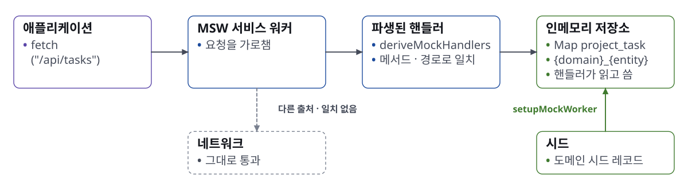

<p align="center">
  
</p>

# @simplix-react/mock

[English](/en/packages/mock/README.md) | **한국어**

`@simplix-react/contract` 계약(contract)에서 MSW 목(mock) 핸들러와 인메모리 저장소를 파생합니다.

> **사전 준비:** `@simplix-react/contract`로 정의한 계약이 필요합니다. 먼저 [`@simplix-react/contract`](/ko/packages/contract/README.md)를 읽으세요.

## 설치

```bash
pnpm add @simplix-react/mock
```

피어 의존성:

| 패키지 | 필수 여부 | 비고 |
| --- | --- | --- |
| `@simplix-react/contract` | 필수 | API 계약 정의를 제공합니다 |
| `zod` | 필수 | `>=4.0.0` |
| `msw` | 선택 | `>=2.0.0`, 목 핸들러와 워커에 필요합니다 |
| `vite` | 선택 | `>=5.0.0`, Vite 플러그인에 필요합니다 |

## 빠른 예제

```ts
import { defineApi, simpleQueryBuilder } from "@simplix-react/contract";
import { setupMockWorker, deriveMockHandlers } from "@simplix-react/mock";
import { z } from "zod";

// 1. Define your contract
const projectContract = defineApi({
  domain: "project",
  basePath: "/api",
  entities: {
    task: {
      schema: z.object({
        id: z.number(),
        title: z.string(),
        status: z.enum(["todo", "done"]),
        createdAt: z.string(),
      }),
      operations: {
        list: { method: "GET", path: "/tasks" },
        get: { method: "GET", path: "/tasks/:id" },
        create: { method: "POST", path: "/tasks", input: z.object({ title: z.string() }) },
        update: {
          method: "PATCH",
          path: "/tasks/:id",
          input: z.object({ status: z.enum(["todo", "done"]).optional() }),
        },
        delete: { method: "DELETE", path: "/tasks/:id" },
      },
    },
  },
  queryBuilder: simpleQueryBuilder,
});

// 2. Derive handlers and bootstrap
await setupMockWorker({
  domains: [
    {
      name: "project",
      handlers: deriveMockHandlers(projectContract.config),
      seed: {
        project_task: [
          { id: 1, title: "Sample Task", status: "todo", createdAt: "2025-01-01T00:00:00Z" },
        ],
      },
    },
  ],
});
```

`setupMockWorker`가 완료되면 애플리케이션의 모든 `fetch("/api/tasks")` 호출을 MSW가 가로채 인메모리 저장소의 데이터로 응답합니다.



## API 개요

### 핵심 API

| 내보내는 이름 | 설명 |
| --- | --- |
| `setupMockWorker(config)` | 인메모리 저장소와 MSW를 한 번에 준비합니다 |
| `deriveMockHandlers(config, mockConfig?, options?)` | 계약 설정의 엔티티 오퍼레이션마다 MSW 핸들러를 파생합니다 |
| `stopMocking(options?)` | 이전 세션에서 남은 목 서비스 워커의 등록을 해제합니다 |
| `MockServerConfig` | `setupMockWorker`의 도메인 단위 설정입니다 |
| `MockDomainConfig` | 도메인별 목 설정(핸들러, 시드, 사용 여부)입니다 |
| `MockEntityConfig` | 엔티티별 목 설정(한도, 정렬, 관계, 리졸버)입니다 |
| `MockHandlerOptions` | `deriveMockHandlers`의 옵션(`responseWrapper`)입니다 |
| `MockResponseWrapper` | 성공 응답 본문과 오류 응답 본문을 만듭니다 |
| `StopMockingOptions` | `stopMocking`의 옵션(`storePrefix`)입니다 |

### 인메모리 저장소

| 내보내는 이름 | 설명 |
| --- | --- |
| `getEntityStore(storeName)` | 해당 저장소의 `Map`을 반환합니다(처음 요청할 때 만듭니다) |
| `getNextId(storeName)` | 다음 자동 증가 숫자 아이디를 반환합니다 |
| `seedEntityStore(storeName, records)` | 저장소에 레코드를 넣고 아이디 카운터를 맞춥니다 |
| `resetStore()` | 모든 저장소와 카운터를 비웁니다 |
| `createMockEntityStore(seeds, idField?)` | 목록, 페이지 조회, CRUD, 초기화를 갖춘 독립형 타입 저장소를 만듭니다 |
| `MockEntityStore`, `PagedResult` | 그 저장소의 인터페이스와 Spring 형식의 페이지 결과입니다 |

### 결과 타입

| 내보내는 이름 | 설명 |
| --- | --- |
| `MockResult<T>` | 성공 · 실패 결과 타입입니다 |
| `mockSuccess(data)` | 성공 결과를 만듭니다 |
| `mockFailure(error)` | 실패 결과를 만듭니다 |

### 트리 빌더

| 내보내는 이름 | 설명 |
| --- | --- |
| `buildTreeFromFlatRows(rows, identityField?)` | `parentId`가 있는 평면 행을 `TreeNode` 객체(`{ data, children }`)로 바꿉니다 |
| `buildEmbeddedTree(rows, identityField?, parentField?)` | 평면 행을 `children` 배열이 포함된 행으로 바꿉니다 |

### Vite 플러그인

| 내보내는 이름 | 설명 |
| --- | --- |
| `@simplix-react/mock/vite`의 `mswPlugin()` | `mockServiceWorker.js`를 `public/`에 복사하지 않고 제공합니다 |

## 핵심 개념

### 인메모리 저장소

엔티티마다 `Map<string | number, Record<string, unknown>>`이 하나씩 있으며, `{domain}_{snake_case_entity}` 규칙을 따르는 저장소 이름으로 구분합니다(`project` 도메인의 `task` 엔티티는 `"project_task"`, `taskComment` 엔티티는 `"project_task_comment"`).

저장소는 모두 동기식으로 동작합니다.

- **읽기**: Map을 순회하거나 아이디로 조회합니다
- **쓰기**: 항목을 직접 설정하거나 삭제합니다
- **아이디 생성**: `getNextId`가 자동 증가 숫자 아이디를 제공합니다
- **시드**: `seedEntityStore`가 레코드를 넣고, 카운터를 기존 숫자 아이디의 최댓값으로 맞춥니다
- **초기화**: `resetStore`가 모든 저장소와 카운터를 비웁니다(`setupMockWorker`가 자동으로 호출합니다)

데이터는 메모리에만 있으므로 페이지를 새로 고치면 사라집니다. 그래서 개발과 테스트에 알맞습니다.

### MSW 핸들러 파생

`deriveMockHandlers`는 계약의 엔티티(entity) 정의를 읽어 오퍼레이션(operation)마다 핸들러를 하나씩 파생합니다. 핸들러는 `{basePath}{오퍼레이션 경로}`에서 오퍼레이션의 메서드로 등록되며, 오퍼레이션의 역할에 따라 동작이 정해집니다.

| 역할 | 핸들러 동작 | 성공 상태 코드 |
| --- | --- | --- |
| `list` | 필터, 정렬, 페이지네이션을 적용해 레코드 목록을 반환합니다 | 200 |
| `get` | `id` 매개변수(없으면 마지막 경로 매개변수)의 레코드를 관계와 함께 반환합니다 | 200 |
| `create` | 본문을 저장하고, 값이 없으면 `getNextId`로 `id`를, `createdAt`과 `updatedAt`을 설정합니다 | 201 |
| `update` | 본문을 레코드에 병합하고(정의한 대로 PATCH 또는 PUT) `updatedAt`을 설정합니다 | 200 |
| `delete` | 레코드를 삭제합니다 | 200 |
| `tree` | 레코드를 트리로 반환합니다 | 200 |

`parent`를 정의한 하위 엔티티는 목록 핸들러와 생성 핸들러를 `{basePath}{상위 경로}/:{상위 매개변수}{오퍼레이션 경로}`에 등록합니다. 목록은 상위 엔티티 아이디로 거르고, 생성한 레코드의 `parent.param` 필드에는 상위 엔티티 아이디를 넣습니다.

CRUD 역할이 없는 오퍼레이션은 메서드와 경로 매개변수 유무로 동작이 정해집니다.

| 메서드 | 경로 매개변수 | 동작 |
| --- | --- | --- |
| `GET` | 없음 | `list`와 같습니다 |
| `GET` | 있음 | 마지막 경로 매개변수로 찾는 `get`과 같습니다 |
| `POST`, `PUT`, `PATCH` | 없음 | `create`와 같으며, 본문이 배열이면 항목을 모두 저장합니다 |
| `POST`, `PUT`, `PATCH` | 있음 | 마지막 경로 매개변수로 찾는 `update`와 같습니다 |
| `DELETE` | 있음 | 마지막 경로 매개변수로 찾는 `delete`와 같습니다 |
| `DELETE` | 없음 | `{ data: null }`을 반환합니다 |

사용자 정의 리졸버로 어떤 엔티티 오퍼레이션이든 대체할 수 있습니다. 최상위 오퍼레이션(`config.operations`)에는 핸들러를 파생하지 않으므로 MSW 핸들러를 직접 작성하세요.

#### 응답 형태

성공 응답 본문은 `{ data: <결과> }`입니다. `output`이 `wired` 스키마인 오퍼레이션은 그 스키마의 `wrap` 함수로 감싸고, 그 밖의 오퍼레이션은 `options.responseWrapper`를 지정하면 기본 형태 대신 그 함수로 감쌉니다.

```ts
const handlers = deriveMockHandlers(contract.config, undefined, {
  responseWrapper: {
    success: (data) => ({ type: "SUCCESS", body: data }),
    error: (error) => ({ type: "ERROR", errorCode: error?.code, message: error?.message }),
  },
});
```

#### 쿼리 매개변수

목록 엔드포인트는 다음 쿼리 매개변수를 지원합니다.

| 매개변수 | 예 | 설명 |
| --- | --- | --- |
| `sort` | `sort=title:asc,createdAt:desc` | 쉼표로 구분한 `field:direction`(또는 `field.direction`) 쌍입니다. 기본값은 `defaultSort`(`createdAt:desc`)입니다 |
| `page` | `page=2` | 0부터 시작하는 오프셋 방식 페이지 번호입니다 |
| `cursor` | `cursor=abc` | 페이지네이션을 켭니다. 페이지 오프셋은 여전히 `page`로 정해집니다 |
| `limit` 또는 `size` | `limit=20` | 페이지당 행 수입니다. 기본값은 `defaultLimit`(50)이고 `maxLimit`(100)을 넘지 않습니다 |
| `{field}` | `status=done` | 임의 필드의 일치 필터입니다 |

`page`와 `cursor`가 모두 없으면 조건에 맞는 행을 전부 반환합니다.

```json
{ "data": { "data": [] } }
```

`page`나 `cursor`가 있으면 응답에 페이지 정보가 포함됩니다.

```json
{
  "data": {
    "data": [],
    "meta": { "total": 100, "page": 2, "limit": 20, "hasNextPage": true }
  }
}
```

#### 관계 불러오기

`MockEntityConfig`에 `belongsTo` 관계를 설정하면 아이디로 조회하는 GET 요청에서 관련 데이터를 자동으로 결합합니다.

```ts
const handlers = deriveMockHandlers(contract.config, {
  task: {
    relations: {
      project: {
        entity: "project",
        localKey: "projectId",
        foreignKey: "id", // defaults to "id"
        type: "belongsTo",
      },
    },
  },
});
```

작업을 조회하면 `{domain}_project` 저장소에서 관련 `project` 레코드를 찾아 응답에 포함합니다.

#### 트리 조회

`tree` 역할의 오퍼레이션은 저장소의 행을 트리로 반환합니다. 핸들러는 `buildTreeFromFlatRows`로 `parentId` 필드가 있는 평면 행을 `{ data, children }` 노드로 바꿉니다.

특정 노드부터 시작하는 하위 트리를 조회하려면 쿼리 매개변수로 `rootId`를 전달하세요.

```text
GET /api/categories/tree?rootId=cat-1
```

#### 사용자 정의 리졸버

표준 CRUD를 넘는 로직이 필요하면 오퍼레이션 이름을 키로 사용자 정의 리졸버를 지정해 엔티티 오퍼레이션을 재정의하세요.

```ts
import { HttpResponse } from "msw";

const handlers = deriveMockHandlers(contract.config, {
  task: {
    resolvers: {
      batchCreate: async ({ request }) => {
        const tasks = await request.json();
        // Custom batch logic...
        return HttpResponse.json({ data: created }, { status: 201 });
      },
    },
  },
});
```

### 도메인 단위 설정

`setupMockWorker`는 핸들러를 도메인 단위로 묶고 도메인마다 사용 여부를 정합니다.

```ts
await setupMockWorker({
  domains: [
    {
      name: "project",
      enabled: true, // default
      handlers: deriveMockHandlers(projectContract.config),
      seed: {
        project_task: [
          { id: 1, title: "Task 1", status: "todo", createdAt: "2025-01-01T00:00:00Z" },
        ],
      },
    },
    {
      name: "user",
      enabled: false, // disabled: handlers are not registered
      handlers: deriveMockHandlers(userContract.config),
    },
  ],
});
```

준비 순서는 다음과 같습니다.

1. `enabled !== false`인 도메인만 남기고, 남은 도메인이 없으면 워커를 시작하지 않고 끝냅니다
2. 모든 인메모리 저장소를 초기화합니다
3. 도메인의 `seed` 데이터로 엔티티 저장소마다 시드를 넣습니다
4. 모든 핸들러를 합쳐 MSW 서비스 워커를 시작합니다. 다른 출처로 가는 요청과 일치하는 핸들러가 없는 요청은 네트워크로 그대로 보냅니다

### 오류 처리

실패한 오퍼레이션은 `{ code, message }`(또는 `responseWrapper.error`가 만든 본문)를 오류 코드에 맞는 HTTP 상태 코드와 함께 반환합니다.

| 오류 코드 | HTTP 상태 코드 | 설명 |
| --- | --- | --- |
| `not_found` | 404 | 레코드가 없습니다 |
| `unique_violation` | 409 | 키가 중복됩니다 |
| `foreign_key_violation` | 422 | 참조하는 레코드가 없습니다 |
| `bad_request` | 400 | `update` 요청에 올바른 JSON 본문이 없습니다 |
| 그 밖의 코드 | 500 | 예상하지 못한 오류입니다 |

### Vite 플러그인

`mswPlugin`을 쓰면 `mockServiceWorker.js`를 `public/` 디렉터리에 직접 복사하지 않아도 됩니다.

```ts
// vite.config.ts
import { defineConfig } from "vite";
import { mswPlugin } from "@simplix-react/mock/vite";

export default defineConfig({
  plugins: [mswPlugin()],
});
```

- **개발 모드**: 미들웨어로 `/mockServiceWorker.js`에서 워커 스크립트를 제공합니다
- **빌드 모드**: 출력 디렉터리에 정적 자산으로 내보냅니다. `mode: "production"` 빌드에서는 내보내지 않습니다

앱이 `msw`를 설치했으면 앱의 `msw`에 있는 워커를, 그렇지 않으면 프레임워크에 포함된 워커를 제공합니다.

## 가이드

### 시드 데이터 넣기

시드 데이터는 도메인 설정에서 엔티티 저장소별로 지정합니다. 저장소 이름은 `{domain}_{snake_case_entity}` 규칙을 따릅니다.

```ts
import type { MockDomainConfig } from "@simplix-react/mock";

const projectDomain: MockDomainConfig = {
  name: "project",
  handlers: deriveMockHandlers(projectContract.config),
  seed: {
    project_task: [
      { id: 1, title: "Design mockups", status: "done", createdAt: "2025-01-01T00:00:00Z" },
      { id: 2, title: "Implement API", status: "todo", createdAt: "2025-01-02T00:00:00Z" },
    ],
    project_project: [
      { id: 1, name: "Acme Project", createdAt: "2025-01-01T00:00:00Z" },
    ],
  },
};
```

코드에서 직접 시드를 넣을 수도 있습니다.

```ts
import { seedEntityStore } from "@simplix-react/mock";

seedEntityStore("project_task", [
  { id: 1, title: "Task 1", status: "todo" },
  { id: 2, title: "Task 2", status: "done" },
]);
```

### 사용자 정의 핸들러

파생된 핸들러로 처리하지 않는 엔드포인트는 인메모리 저장소를 직접 사용하는 MSW 핸들러로 작성하세요.

```ts
import { http, HttpResponse } from "msw";
import { getEntityStore } from "@simplix-react/mock";

const overdueHandler = http.get("/api/tasks/overdue", () => {
  const store = getEntityStore("project_task");
  const weekAgo = new Date(Date.now() - 7 * 24 * 60 * 60 * 1000).toISOString();

  const overdue = Array.from(store.values()).filter(
    (task) => task.status !== "done" && (task.createdAt as string) < weekAgo,
  );

  return HttpResponse.json({ data: overdue });
});
```

사용자 정의 핸들러는 도메인 설정에서 파생된 핸들러와 함께 등록하세요. MSW는 처음 일치한 핸들러를 사용하므로, 고정 경로의 핸들러는 같은 위치에 경로 매개변수가 있는 파생 핸들러보다 앞에 두세요.

```ts
const projectDomain: MockDomainConfig = {
  name: "project",
  handlers: [overdueHandler, ...deriveMockHandlers(projectContract.config)],
};
```

### 독립형 타입 저장소

`createMockEntityStore`는 위의 저장소와 별개로 레코드 배열을 직접 관리합니다. Orval로 생성한 도메인 패키지(domain package)용 핸들러를 직접 작성할 때 적합합니다.

```ts
import { createMockEntityStore } from "@simplix-react/mock";

const pets = createMockEntityStore([
  { id: 1, name: "Rex" },
  { id: 2, name: "Tom" },
]);

pets.create({ name: "Kit" });            // → { id: 3, name: "Kit" }
pets.listPaged(0, 20, "name.asc");       // → { content, totalElements, totalPages, number, size, first, last, empty }
pets.reset();                            // back to the seeds
```

### 남은 워커 중지

앱이 `setupMockWorker`를 더 이상 호출하지 않아도 브라우저에는 등록된 서비스 워커가 남습니다. `stopMocking`은 스크립트가 `mockServiceWorker.js`인 워커의 등록을 모두 해제하고, `storePrefix`로 시작하는 `localStorage` 키를 삭제하며, 그 워커가 페이지를 제어하고 있었으면 페이지를 새로 고칩니다. 새로 고칠 때 `true`를 반환합니다.

```ts
import { stopMocking } from "@simplix-react/mock";

if (!import.meta.env.VITE_ENABLE_MOCK) {
  await stopMocking({ storePrefix: "app:" });
}
```

### 테스트

테스트 사이에 저장소를 초기화해 서로 영향을 주지 않게 하세요.

```ts
import { resetStore, seedEntityStore, getEntityStore } from "@simplix-react/mock";
import { afterEach, beforeEach, describe, it, expect } from "vitest";

describe("task store", () => {
  beforeEach(() => {
    resetStore();
    seedEntityStore("project_task", [
      { id: 1, title: "Test Task", status: "todo" },
    ]);
  });

  afterEach(() => {
    resetStore();
  });

  it("retrieves seeded data", () => {
    const store = getEntityStore("project_task");
    expect(store.get(1)).toEqual({ id: 1, title: "Test Task", status: "todo" });
  });
});
```

## 관련 패키지

| 패키지 | 설명 |
| --- | --- |
| [`@simplix-react/contract`](/ko/packages/contract/README.md) | 이 패키지가 사용하는, 타입이 안전한 API 계약을 정의합니다 |
| [`@simplix-react/react`](/ko/packages/react/README.md) | 같은 계약에서 파생한 React Query 훅입니다 |
| [`@simplix-react/testing`](/ko/packages/testing/README.md) | 계약 기반 모킹을 위한 테스트 도구입니다 |

---

<p class="page-source"><a href="https://github.com/simplix-framework/simplix-react/blob/main/packages/mock/README.ko.md" target="_blank" rel="noopener noreferrer">원본 보기</a></p>
