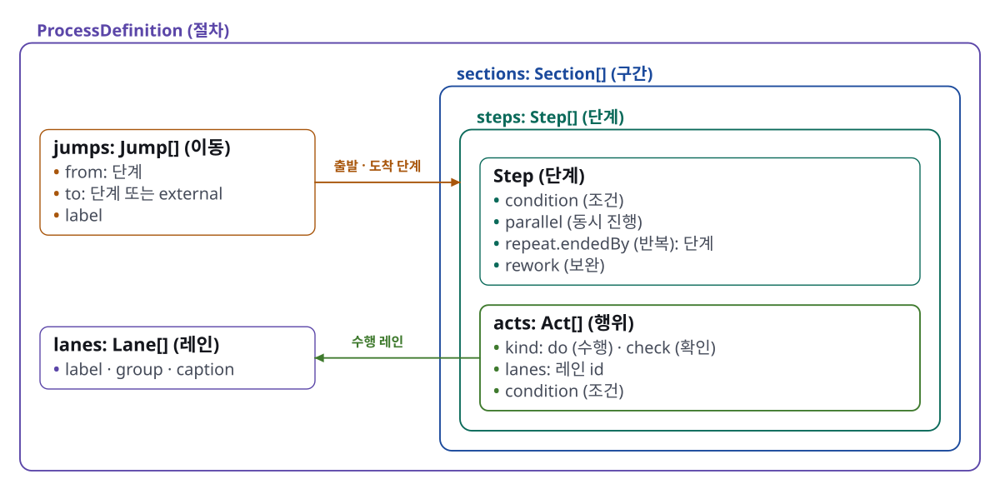

# @simplix-react/process-core

[English](/en/packages/process-core/README.md) | **한국어**

런타임 의존성과 UI가 없는 절차 모델입니다. 정의 형식, 정의 검증, 건의 사실에 대한 조건 판정, 읽는 순서, 레인 배치와 한 열 배치, 되돌릴 수 있는 편집 함수, 두 버전 비교를 제공합니다.

`@simplix-react/process`가 이 모델 위에 절차를 그립니다. 서버, CLI, 테스트에서 정의를 검증, 편집, 비교할 때는 이 패키지만 사용하세요.

## 설치

```bash
pnpm add @simplix-react/process-core
```

## 정의

절차(procedure)는 구간(section)의 목록이고, 구간은 단계(step)의 목록입니다. 단계의 순서는 작성한 순서 하나뿐입니다. 그 순서를 벗어나는 흐름은 단계 자체와 단계 옆에 적습니다.



| 부분 | 의미 |
| --- | --- |
| `lanes` | 행위를 수행하는 주체입니다. 역할, 부서, 시스템이 레인(lane)이 됩니다. |
| `sections[].steps[]` | 단계는 순서가 있는 행위의 묶음입니다. |
| `acts[]` | 레인 하나 또는 여러 레인이 함께 하는 일 하나입니다. `do`는 수행, `check`는 확인입니다. |
| `condition` | 조건이 건의 사실에 맞을 때만 단계나 행위를 적용합니다. |
| `parallel` | 같은 키를 지정한 이웃 단계는 동시에 진행합니다. |
| `repeat` | 지정한 단계(`endedBy`)를 수행할 때까지 단계를 다시 수행합니다. |
| `rework` | 마지막 행위가 단계를 첫 행위로 되돌릴 수 있습니다. `label`에 그 사유를 적습니다. |
| `jumps[]` | 앞 단계로 되돌아가거나, 뒤 단계로 건너뛰거나, 다른 절차로 나가는 이동(jump)입니다. |

이 패키지가 모르는 멤버는 모든 함수가 그대로 유지합니다. 그래서 제품은 자체 필드를 같은 정의에 저장할 수 있습니다.

정의는 `format`(`PROCESS_FORMAT`)과 `version`(`PROCESS_VERSION`)에 형식과 버전을 기록합니다. `parseDefinition`은 저장한 정의를 텍스트나 파싱한 값에서 읽고, 읽을 수 없으면 `reason`이 `not-json`, `not-a-definition`, `newer-version`, `shape` 가운데 하나인 `ProcessFormatError`를 발생시킵니다. `serializeDefinition`은 정의를 텍스트로 씁니다. `validateDefinition`은 정의의 문제를 `code`와 함께 돌려줍니다.

조건은 `{ fact }`, `{ not }`, `{ all }`, `{ any }` 가운데 하나입니다. `evaluateCondition(condition, facts)`는 `true`, `false`, `unknown`(주어지지 않은 사실) 가운데 하나로 답하고, `conditionFacts`는 조건이 읽는 사실을 나열하며, `isCondition`은 값이 조건인지 판정합니다.

## 빠른 시작

```ts
import { applyEdit, diffDefinitions, parseDefinition, validateDefinition } from "@simplix-react/process-core";

const published = parseDefinition(storedText);
validateDefinition(published); // [] when nothing is wrong

const result = applyEdit(published, { type: "remove-step", id: "review" });
if (result.ok) {
  result.consequences; // the jumps removed with the step, a repeat cleared, a parallel run left
  diffDefinitions(published, result.definition); // what a reader of the new version should look at
} else {
  result.refusal; // why the operation was not applied
}
```

## 편집

`applyEdit(definition, operation, options?)`는 새 정의를 돌려주고, 받은 정의는 바꾸지 않습니다.

- **편집은 `validateDefinition`이 이미 보고하지 않은 문제를 남기지 않을 때만 적용합니다.** 문제가 없는 정의는 계속 문제가 없고, 문제가 있는 초안도 편집할 수 있으며, 어떤 편집도 문제를 늘리지 않습니다.
- **단계를 참조하는 부분은 단계의 변경을 함께 반영합니다.** 단계를 삭제하면 그 단계에서 나가고 들어오는 이동을 삭제하고, 그 단계로 끝나는 반복을 해제합니다. 동시 진행 단계 사이에 넣은 단계는 동시 진행에 합류하고, 단계가 하나만 남은 동시 진행은 키를 제거합니다. 이 결과는 모두 `consequences`에 나열합니다.
- **거부에는 사유가 있습니다.** 편집이 남겼을 문제의 코드, 또는 `unknown-subject`, `lane-in-use`, `nothing-to-change`, `flow-changed`입니다.
- **패치에서 `undefined`로 준 멤버는 그 부분에서 제거합니다.** 호출하는 쪽의 자체 멤버도 다른 멤버와 같이 설정합니다.
- **`keepFlow` 옵션을 주면 절차가 하는 일을 바꾸는 편집을 `flow-changed`로 거부합니다.** `sameFlow`와 `flowOf`는 문구, 구간, 레인, 행위의 담당자를 뺀 절차의 흐름을 비교합니다.

`createHistory`, `commitEdit`, `undoEdit`, `redoEdit`는 편집하는 동안 거친 정의를 기록합니다. `freshId`는 정의 안에서 쓰지 않은 ID를 만듭니다.

## 버전 비교

`diffDefinitions(before, after)`는 부분을 ID로 맞춰 `added`, `removed`, `changed`(달라진 멤버 포함), `moved`(상위 부분이 바뀌었거나, 두 버전 모두에 있는 부분 사이에서 순서가 바뀜)로 나열합니다.

## 읽는 순서와 배치

| 함수 | 결과 |
| --- | --- |
| `resolveProcess` | 주어진 사실에서 적용되는 단계와 행위, 그리고 조건과 함께 제외된 단계와 행위입니다. `leftOut` 옵션은 제외된 부분을 배치에서 원래 위치에 그대로 둘지(`drawn`, 기본값) 접을지(`folded`) 정합니다. |
| `readingOrder` | 모든 보기가 따르는 순서 하나로 정렬한 구간, 단계, 행위, 이동입니다. |
| `laneGeometry` | 레인 격자 위의 절차입니다. 행, 열, 모든 선의 조각을 계산합니다. `drawn`에서는 사실과 관계없이 격자가 같고, 건이 제외한 부분의 행위, 선, 이동에는 `off`를 지정합니다. |
| `stackGeometry` | 단계 카드를 한 열로 쌓은 절차입니다. |
| `chooseLayout` | 주어진 너비의 상자가 두 배치 가운데 무엇을 쓸지 `DEFAULT_LAYOUT_METRICS`나 호출하는 쪽의 치수로 정합니다. `requiredWidth`는 레인 배치에 필요한 너비입니다. |
| `showsInclusion`, `showsJump` | `leftOut` 선택에 따라 판정한 부분이나 이동을 그리는지 알려 줍니다. |
| `assignTracks`, `laneColumn`, `trackColumn` | 이동 선이 지나는 트랙, 그리고 레인이나 트랙이 놓이는 격자 열입니다. |

---

<p class="page-source"><a href="https://github.com/simplix-framework/simplix-react/blob/main/packages/process-core/README.ko.md" target="_blank" rel="noopener noreferrer">원본 보기</a></p>
