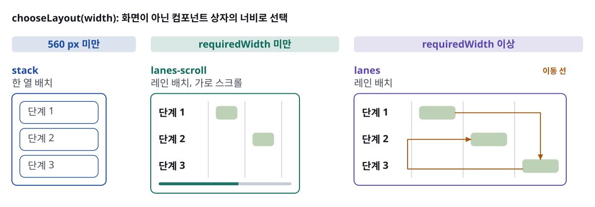

# @simplix-react/process

[English](/en/packages/process/README.md) | **한국어**

정의에서 그리는 절차입니다. 레인 격자 위에 단계와 행위를 이동, 동시 진행, 조건과 함께 그리고, 좁은 상자에서는 한 열로 배치합니다. 편집기와 두 버전 비교는 별도 진입점에 있으므로, 절차를 그리기만 하는 화면은 편집 코드를 불러오지 않습니다.

모델은 `@simplix-react/process-core`입니다.

## 설치

```bash
pnpm add @simplix-react/process @simplix-react/process-core
```

```css
@import "@simplix-react/process/styles.css";
```

## 절차 그리기

```tsx
import { ProcessLanes } from "@simplix-react/process";

<ProcessLanes definition={definition} facts={{ large: true }} run={runState} selected={selected} onSelect={setSelected} />;
```



- 배치는 화면이 아니라 컴포넌트 자체 상자의 너비를 따릅니다. 레인이 들어가면 나란히 놓고, 들어가지 않으면 같은 격자를 옆으로 스크롤하며, 좁은 상자에서는 단계 카드를 한 열로 쌓습니다.
- `facts`는 해당 건에서 어떤 조건이 성립하는지 지정합니다. 조건이 정해지지 않은(사실이 주어지지 않은) 단계는 조건부로 표시합니다. 건이 제외한 단계나 행위는 원래 위치를 유지한 채 흐리게 그리고 해당 없음으로 표시하므로, 사실과 관계없이 절차의 모양이 같습니다. `leftOut="folded"`는 제외된 단계를 한 줄로 그리고, 제외된 행위만 있는 레인은 그리지 않습니다.
- 뒤 단계로 건너뛰는 이동은 레인 오른쪽을 따라 내려갑니다. 앞 단계로 되돌아가는 이동과 보완 선은 왼쪽으로 나와, 행위 왼쪽에서 지나는 행이 비어 있는 가장 가까운 레인을 따라 올라가고, 그런 레인이 없으면 레인 왼쪽의 트랙을 따라 올라갑니다. 단계의 행위가 한 행에 있고 첫 행위가 마지막 행위보다 왼쪽에 있으면 보완 선은 첫 행위로 곧장 올라갑니다.
- `run`은 건이 어디까지 진행했는지 표시합니다. 진행 중인 행위에는 퍼지면서 사라지는 고리를 그립니다.
- `highlightLanes`는 사용자가 맡은 레인에 색을 입히고, `marks`는 단계, 행위, 이동에 낱말 하나를 `data-mark`로 지정합니다.
- 색, 글자 크기, 모서리 반경은 `@simplix-react/ui`의 테마 토큰을 따르며, 마크업은 어떤 디자인에서도 같습니다.

| 속성 | 타입 | 기본값 | 설명 |
| --- | --- | --- | --- |
| `definition` | `ProcessDefinition` | 필수 | `validateDefinition`이 문제를 찾지 않은 정의 |
| `facts` | `Facts` | | 해당 건의 사실. 생략하면 모든 조건이 미정 |
| `run` | `ProcessRunState` | | 진행 중인 건의 진행 상황 |
| `layout` | `"auto" \| "lanes" \| "stack"` | `"auto"` | `auto`는 상자 너비로 정하고, 나머지는 배치 하나를 유지 |
| `defaultLayout` | `LayoutMode` | `"lanes"` | 상자를 재기 전(서버나 첫 화면 그리기)에 쓰는 배치 |
| `metrics` | `Partial<LayoutMetrics>` | | 기본값과 다를 때 배치를 정하는 너비 |
| `visibleLanes` | `readonly Id[]` | 모든 레인 | 그릴 레인. 생략하면 컴포넌트가 직접 선택을 관리 |
| `onVisibleLanesChange` | `(lanes) => void` | | 사용자가 그릴 레인을 바꿀 때 호출 |
| `laneFilter` | `boolean` | `false` | 절차 위에 레인 선택 줄을 표시 |
| `highlightLanes` | `readonly Id[]` | | 사용자가 맡은 레인 |
| `leftOut` | `"drawn" \| "folded"` | `"drawn"` | 건이 제외한 단계와 행위의 표시 방식 |
| `marks` | `Record<Id, string>` | | 단계, 행위, 이동마다 `data-mark`로 지정할 낱말. `added`, `changed`, `moved`는 패키지가 스타일을 지정 |
| `selected` | `ProcessTarget \| null` | | 현재 선택한 대상 |
| `onSelect` | `(target) => void` | | 사용자가 단계, 행위, 이동을 고를 때 호출 |
| `renderDetail` | `(target) => ReactNode` | | 선택한 대상의 상세 내용. 격자 아래나 단계 카드 안에 그림 |
| `scrollToActive` | `boolean` | `true` | 처음 그릴 때 진행 중인 단계로 스크롤 |
| `className` | `string` | | |

## 절차 편집하기

```tsx
import { ProcessEditor, useProcessEditing } from "@simplix-react/process/edit";
import type { ProcessDefinition } from "@simplix-react/process-core";

function Settings({ stored }: { stored: ProcessDefinition }) {
  const editing = useProcessEditing(stored);
  return <ProcessEditor editing={editing} problems={ownRules(editing.definition)} />;
}
```

- 편집기는 절차를 그리고, 그 옆 패널에서 그림에서 고른 부분을 편집합니다. 좁은 상자에서는 패널을 그림 아래에 놓습니다.
- 모든 변경은 `process-core`의 편집 하나이므로 되돌릴 수 있습니다. 문제를 남길 편집은 거부하고, 그 사유를 그림 위에 표시합니다.
- `problems`는 형식의 문제와 함께 표시할, 호출하는 쪽의 자체 규칙이 찾은 문제입니다. `renderFields`는 고른 부분에 대해 호출하는 쪽의 자체 필드를 그립니다. `facts`를 주면 해당 건 기준으로 절차를 그립니다.
- `useProcessEditing(initial, options?)`은 정의, `apply`, `undo`, `redo`, `canUndo`, `canRedo`, 마지막 `refusal`과 `consequences`, `reset`을 돌려줍니다.
- `scope="wording"`과 `useProcessEditing(stored, { keepFlow: true })`는 흐름을 다른 곳에서 정하는 제품에 씁니다. 이름, 설명, 조건 문구, 행위의 담당자만 바꿀 수 있고, `lanesFor`가 행위에 지정할 수 있는 레인을 정합니다.
- `ProcessProblems`는 게시 전 검사에 쓰는 문제 목록만 표시합니다. `onShow`는 문제가 가리키는 부분과 함께 호출합니다. `useProcessProblems(definition, problems)`는 같은 목록을 데이터로 돌려줍니다.

## 두 버전 비교하기

```tsx
import { ProcessDiff } from "@simplix-react/process/edit";

<ProcessDiff before={published} after={draft} />;
```

나중 버전을 그리면서 추가, 변경, 이동한 부분을 표시하고, 모든 차이를 그 아래에 부분 이름으로 나열합니다. `facts`를 주면 해당 건 기준으로 그리고, `fieldLabel`은 목록에서 호출하는 쪽의 자체 멤버 이름을 정합니다.

## 번역

패키지를 불러오면 `simplix-process` 네임스페이스에 영어, 한국어, 일본어를 등록합니다. 편집 문구는 편집 컴포넌트를 처음 그릴 때 불러옵니다.

---

<p class="page-source"><a href="https://github.com/simplix-framework/simplix-react/blob/main/packages/process/README.ko.md" target="_blank" rel="noopener noreferrer">원본 보기</a></p>
