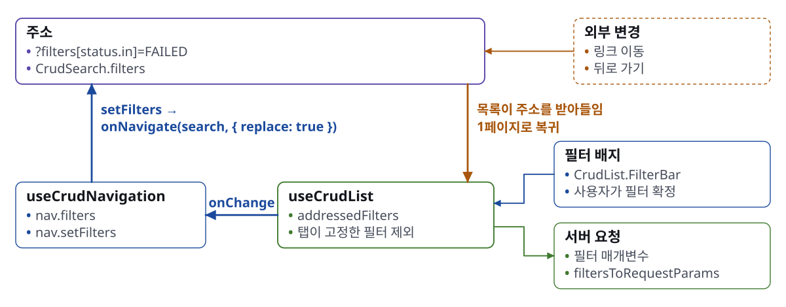

# @simplix-react/ui

[English](/en/packages/ui/README.md) | **한국어**

명시적인 필드 컴포넌트와 컴파운드 패턴으로 CRUD 화면을 만드는 UI 컴포넌트 패키지입니다.

## 개요

`@simplix-react/ui`는 CRUD 화면을 만드는 Tailwind CSS 기반 컴포넌트 라이브러리이며, 헤드리스 방식으로도 쓸 수 있습니다. 모든 컴포넌트는 **No Magic** 원칙을 따릅니다. `value`/`onChange` props를 명시적으로 받고, 숨은 상태가 없으며, 모든 수준에서 동작을 직접 제어할 수 있습니다.

## 빠른 시작

```tsx
import {
  UIProvider,
  CrudForm,
  FormFields,
  CrudDetail,
  DetailFields,
  CrudList,
  useCrudList,
} from "@simplix-react/ui";

function App() {
  return (
    <UIProvider>
      {/* Your CRUD pages */}
    </UIProvider>
  );
}
```

## 스타일과 테마

컴포넌트 CSS는 값을 `var(--*)` 참조로만 담습니다. 앱의 CSS 진입 파일에서 스타일시트와 공식 토큰 테마를 가져오세요.

```css
@import "tailwindcss";
@import "@simplix-react/ui/styles.css";   /* component styles */
@import "@simplix-react/ui/theme.css";    /* official design tokens (opt-in) */

@source "../node_modules/@simplix-react/ui/dist/**/*.js";
```

`theme.css`는 컴포넌트가 사용하는 디자인 토큰(라이트 · 다크, 색상 변형, 모서리 반경, 타이포그래피, 상태 표시 애니메이션)을 정의합니다. 앱은 가져온 뒤에 토큰을 다시 정의해 어떤 토큰이든 재정의할 수 있습니다. `simplix init`으로 스캐폴딩한 프로젝트는 이 설정이 자동으로 적용됩니다.

모든 컴포넌트는 슬롯 선언에서 모양을 가져오므로, 앱 하나가 실행 중에 디자인(`classic`, `clarity`)을 바꿔도 동작은 그대로입니다. [디자인 선택과 추가](/ko/guides/designs.md)를 참고하세요.

## 앱 구조(FSD)

simplix-react 앱은 **Feature-Sliced Design(FSD)** 을 따릅니다. UI 코드는 도메인 패키지가 아니라 **모듈**에 둡니다.

```text
my-app/
├── packages/                     Domain packages (generated) - NO UI code
│   ├── user/
│   │   ├── schemas.ts                Zod schemas
│   │   ├── contract.ts               API contracts
│   │   ├── hooks.ts                  React Query hooks
│   │   └── form-hooks.ts             TanStack Form hooks
│   └── product/
│       └── ...
│
├── modules/                      FSD modules - compose domain packages + @simplix-react/ui
│   └── myapp-admin/
│       └── src/
│           ├── manifest.ts           Module manifest (navigation, capabilities)
│           ├── index.ts              Root exports
│           ├── features/             Feature layer - CRUD screens
│           │   ├── user/                 uses @myapp/user hooks
│           │   │   ├── user-list.tsx
│           │   │   ├── user-form.tsx
│           │   │   ├── user-detail.tsx
│           │   │   └── index.ts
│           │   └── product/              uses @myapp/product hooks
│           │       └── ...
│           ├── widgets/              Widget layer - compose multiple features
│           │   └── dashboard/
│           ├── shared/               Shared layer
│           │   ├── ui/
│           │   ├── lib/
│           │   └── config/
│           └── locales/              i18n (optional)
│
└── app/                          Final app - composes modules only
    └── src/
        ├── features/
        ├── widgets/
        └── shared/
```

### FSD 계층 규칙

| 계층 | 가져올 수 있는 곳 | 가져올 수 없는 곳 |
| --- | --- | --- |
| `shared/` | 외부 패키지만 | `features/`, `widgets/` |
| `features/` | `shared/`, 도메인 패키지 | `widgets/` |
| `widgets/` | `shared/`, `features/`, 도메인 패키지 | - |

### 여러 도메인 패키지를 조합하는 모듈

모듈 하나에 **서로 다른** 도메인 패키지의 CRUD 기능을 함께 둘 수 있습니다.

```tsx
// modules/myapp-admin/src/features/user/user-list.tsx
import { useUserHooks } from "@myapp/user";   // domain package A

// modules/myapp-admin/src/features/product/product-list.tsx
import { useProductHooks } from "@myapp/product"; // domain package B
```

### CLI 스캐폴드

```bash
# Generate CRUD feature into a module's features/ layer
simplix scaffold user --module myapp-admin

# Output: modules/myapp-admin/src/features/user/
#   user-list.tsx, user-form.tsx, user-detail.tsx, index.ts
```

## 설계 원칙

### No Magic

모든 필드 컴포넌트는 `value`와 `onChange` props를 명시적으로 받아야 합니다. 숨은 폼 상태, 자동 바인딩, 암묵적인 컨텍스트 의존이 없습니다.

```tsx
// Explicit value/onChange - always
<FormFields.TextField
  label="Name"
  value={name}
  onChange={setName}
  required
/>
```

### 컴파운드 컴포넌트

CRUD 레이아웃(CrudList, CrudForm, CrudDetail)은 컴파운드 컴포넌트 패턴을 사용합니다. 필요한 부분만 조립하세요.

```tsx
<CrudList>
  <CrudList.Toolbar>
    <CrudList.Search value={search} onChange={setSearch} />
  </CrudList.Toolbar>
  <CrudList.Table data={items} sort={sort} onSortChange={setSort}>
    <CrudList.Column field="name" header="Name" sortable />
    <CrudList.Column field="status" header="Status" display="badge" />
  </CrudList.Table>
  <CrudList.Pagination page={1} pageSize={10} total={100} totalPages={10} onPageChange={setPage} />
</CrudList>
```

### 컴포넌트 재정의 전략

수고가 적은 방법부터 큰 방법 순으로 나열한 사용자 지정 수준입니다.

| 수준 | 방법 | 범위 |
| --- | --- | --- |
| 1 | `className` prop | 인스턴스 하나 |
| 2 | CVA 변형(`variant`, `size`) | 변형 단위 |
| 3 | `FieldVariantContext` | 섹션 · 페이지 전체의 필드 스타일 |
| 4 | `UIProvider` 재정의 | 앱 전체의 컴포넌트 교체 |
| 5 | 직접 만든 컴포넌트 | 전체 교체 |

```tsx
// Level 4: Replace Input globally via UIProvider
import { MyCustomInput } from "./my-input";

<UIProvider overrides={{ Input: MyCustomInput }}>
  {/* All TextField components now use MyCustomInput */}
</UIProvider>
```

## API 레퍼런스

### 레이아웃 프리미티브

CVA 변형으로 만든 의미 기반 레이아웃 컴포넌트입니다.

| 컴포넌트 | 설명 | 주요 props |
| --- | --- | --- |
| `Stack` | 세로 · 가로 flex 레이아웃 | `direction`, `gap`, `align`, `justify`, `wrap` |
| `Flex` | 가로 flex(`Stack direction="row"`의 별칭) | Stack과 같음 |
| `Grid` | CSS Grid 레이아웃 | `columns`(1-6), `gap`, `gapX`/`gapY`(축별 재정의), `divider`(열 사이 세로선), `template`(임의의 `grid-template-columns`) |
| `Container` | 가운데 정렬된 최대 너비 래퍼 | `size`(sm/md/lg/xl/full) |
| `Section` | 제목 · 설명이 있는 콘텐츠 섹션 | `title`, `description` |
| `Card` | 테두리와 그림자가 있는 카드 컨테이너 | `padding`(none/sm/md/lg), `interactive` |
| `Heading` | 의미 기반 제목(h1-h6) | `level`(1-6), `tone`, `font`(sans/display/mono) |
| `Text` | 타이포그래피 단계를 따르는 본문 텍스트 | `size`(lg/base/sm/caption), `tone`, `font`(sans/display/mono) |

```tsx
<Stack gap="lg">
  <Section title="User Info" description="Basic information">
    <Grid columns={2} gap="md">
      <FormFields.TextField label="First Name" value={first} onChange={setFirst} />
      <FormFields.TextField label="Last Name" value={last} onChange={setLast} />
    </Grid>
  </Section>
</Stack>
```

### 기본 컴포넌트

Tailwind CSS로 스타일을 입힌 Radix UI 프리미티브입니다. 필드 컴포넌트가 내부에서 사용하며 직접 사용할 수도 있습니다.

- `Button`(CVA 변형: `variant`, `size`)
- `Input`, `Textarea`, `Label`, `Badge`, `Switch`, `Checkbox`
- `CodeInput`(일회용 코드를 칸마다 한 자리씩 입력합니다. 입력하면 다음 칸으로 이동하고, Backspace는 앞 칸으로 돌아가며, 붙여 넣기나 자동 완성은 모든 칸을 채웁니다. `codeType`, `codeBackspace`, `codePaste`가 편집 규칙입니다)
- `Select`(Root, Trigger, Value, Content, Item, Group, Label, Separator)
- `RadioGroup`(Root, Item)
- `Calendar`(날짜 선택 격자)
- `TimePicker`(오전 · 오후 전환과 펼쳐지는 시 · 분 목록이 있는 시간 입력)
- `Popover`(Root, Trigger, Content, Anchor)
- `Dialog`(Root, Trigger, Content, Header, Footer, Title, Description, Close)
- `DropdownMenu`(Root, Trigger, Content, Item, CheckboxItem, RadioItem, RadioGroup, Label, Separator, Sub, SubTrigger, SubContent, Group)
- `Sheet`(Root, Trigger, Content, Header, Footer, Title, Description, Close)
- `Table`(Root, Header, Body, Footer, Head, Row, Cell, Caption)
- `Tabs`(Root, List, Trigger, Content)
- `Tooltip`(Provider, Root, Trigger, Content)
- `NavigationMenu`(Root, List, Item, Trigger, Content, Link, Viewport, Indicator)
- `Separator`
- `Skeleton`

### 상태 표시

같은 의미 색상 어휘를 공유하는 톤 기반 컴포넌트입니다. 각 `StatusTone`(`success`, `warning`, `danger`, `info`, `neutral`, `pending`, `processing`)은 배지 · 점 · 링 · 아이콘 · 배경에 쓰는 Tailwind 클래스를 `dark:` 변형과 함께 묶습니다. 그래서 이 컴포넌트를 쓰면 라이트와 다크에서 색상이 일관됩니다.

- `StatusBadge`: 작은 상태 배지(톤과 레이블, 선택 항목인 앞쪽 점 · 아이콘, `filled`/`outline` 모양)
- `StatusDot`: 작은 표시 점. 선택 항목으로 `ping`/`flash` 링 애니메이션을 추가합니다
- `AlertBanner`: 색을 입힌 상태 배너. 아이콘, 제목 · 부제목(또는 자유 형식 children), 뒤쪽 슬롯, `default`/`sm`/`hint` 밀도가 있습니다
- `DetailList` / `DetailListRow`: 테두리가 있는 키-값 행. `onClick`을 주면 행이 버튼으로 동작합니다
- `LabeledField`: 레이블과 설명 행에 임의의 뒤쪽 컨트롤을 배치합니다
- `SettingSwitch`: `LabeledField`와 `Switch`로 만든 레이블 달린 토글 행

톤 토큰은 직접 렌더링에 쓰도록 그대로 내보냅니다. `STATUS_TONES`, `STATUS_TONE_NAMES`, `statusToneClass(tone, slot)`, 그리고 `StatusTone` / `StatusToneToken` / `IconComponent` 타입입니다.

```tsx
<StatusBadge tone="success" label="Active" showDot />
<AlertBanner tone="danger" icon={AlertTriangleIcon} title="Connection lost" subtitle="Reconnecting…" />
```

### 폼 필드 컴포넌트

모든 폼 필드는 같은 패턴을 따릅니다. `value`, `onChange`, 공통 필드 props(label, error, description, required, disabled, className)를 받습니다.

모든 필드는 `prefixControl` / `suffixControl`도 받습니다. 입력과 같은 행에 그리는 컨트롤입니다(예: 추가 버튼, IconPicker, ColorPicker). 필드 옆에 버튼을 따로 배치하지 말고 이 props를 사용하세요. 컨트롤은 입력과 정렬되고, 설명과 오류는 아래에 전체 너비로 표시합니다.

```tsx
<FormFields.TextField
  label="Training key"
  value={draft}
  onChange={setDraft}
  description="Added on submit."
  suffixControl={<Button onClick={add}>Add</Button>}
/>
```

```tsx
import { FormFields } from "@simplix-react/ui";
```

| 컴포넌트 | 값 타입 | 주요 props |
| --- | --- | --- |
| `FormFields.TextField` | `string` | `type`(text/email/url/password/tel), `placeholder`, `maxLength` |
| `FormFields.TextareaField` | `string` | `rows`, `maxLength`, `resize`(none/vertical/both) |
| `FormFields.NumberField` | `number \| null` | `min`, `max`, `step`, `placeholder` |
| `FormFields.SelectField` | `string` | `options`(label/value 쌍), `placeholder` |
| `FormFields.SwitchField` | `boolean` | `switchProps` |
| `FormFields.CheckboxField` | `boolean` | `checkboxProps` |
| `FormFields.RadioGroupField` | `string` | `options`(label/value/description), `direction` |
| `FormFields.DateField` | `Date \| null` | `minDate`, `maxDate`, `format`, `placeholder` |
| `FormFields.DateTimeField` | `Date \| string \| number \| null` | `minDate`, `maxDate`, `hideTime`, `hour12`, `minuteStep` |
| `FormFields.TimeField` | `TimeValue \| null`(`{ hours, minutes }`) | `minTime`, `maxTime`, `hour12`, `minuteStep` |
| `FormFields.ComboboxField` | `string \| null` | `options`, `onSearch`, `loading`, `emptyMessage` |
| `FormFields.PasswordField` | `string` | `placeholder`, `maxLength`(표시 전환 포함) |
| `FormFields.ColorField` | `string`(hex) | 브라우저 색상 선택기와 hex 텍스트 입력 |
| `FormFields.SliderField` | `number` | `min`, `max`, `step`, `showValue` |
| `FormFields.MultiSelectField` | `string[]` | `options`, `placeholder`, `maxCount` |
| `FormFields.Field` | `ReactNode`(children) | 직접 만든 내용을 감싸는 범용 래퍼 |

```tsx
<FormFields.SelectField
  label="Status"
  value={status}
  onChange={setStatus}
  options={[
    { label: "Active", value: "active" },
    { label: "Inactive", value: "inactive" },
  ]}
  required
  error={errors.status}
/>
```

### 상세 필드 컴포넌트

서식을 적용해 값을 표시하는 읽기 전용 필드입니다.

```tsx
import { DetailFields } from "@simplix-react/ui";
```

| 컴포넌트 | 값 타입 | 주요 props |
| --- | --- | --- |
| `DetailFields.DetailTextField` | `string \| null` | `fallback`, `copyable` |
| `DetailFields.DetailNumberField` | `number \| null` | `format`(decimal/currency/percent), `locale`, `currency` |
| `DetailFields.DetailDateField` | `Date \| string \| null` | `format`(date/datetime/relative), `fallback` |
| `DetailFields.DetailBadgeField` | `string` | `variants`(값과 변형의 매핑) |
| `DetailFields.DetailLinkField` | `string` | `href`, `external` |
| `DetailFields.DetailBooleanField` | `boolean \| null` | `mode`(text/icon), `labels` |
| `DetailFields.DetailImageField` | `string \| null`(URL) | `alt`, `width`, `height`, `imageClassName` |
| `DetailFields.DetailListField` | `string[] \| null` | `mode`(badges/comma/bullet) |
| `DetailFields.DetailField` | `ReactNode`(children) | 직접 만든 내용을 감싸는 범용 래퍼 |

```tsx
<DetailFields.DetailDateField
  label="Created At"
  value={user.createdAt}
  format="relative"
/>

<DetailFields.DetailBadgeField
  label="Status"
  value={user.status}
  variants={{ active: "success", inactive: "secondary", banned: "destructive" }}
/>
```

### 필드 래퍼

`FormFields`와 `DetailFields`가 내부에서 사용하는 저수준 래퍼입니다. 직접 필드 컴포넌트를 만들 때 사용하세요.

| 컴포넌트 | 용도 | 주요 props |
| --- | --- | --- |
| `FieldWrapper` | 편집 가능한 입력을 레이블 · 오류 · 설명과 함께 감쌉니다 | `label`, `error`, `description`, `required`, `disabled`, `layout`, `size` |
| `DetailFieldWrapper` | 읽기 전용 표시 값을 레이블과 함께 감쌉니다 | `label`, `layout`, `size` |

```tsx
import { FieldWrapper } from "@simplix-react/ui";

// Pass a render function to receive { id, labelId }. Put `id` on a labelable
// control so the label names it; use `labelId` with `aria-labelledby` for a
// composite control (radio group, date picker) with no single labelable element.
// A plain-element child is instead named by the wrapping fieldset.
<FieldWrapper label="Custom Field" error={errors.custom} required>
  {({ id }) => <MyCustomInput id={id} value={value} onChange={onChange} />}
</FieldWrapper>
```

### 필드 변형 체계

컨텍스트로 섹션이나 페이지 전체의 필드 레이블 위치와 크기를 정합니다.

```tsx
import { FieldVariantContext } from "@simplix-react/ui";

// All fields inside will use left-aligned labels at small size
<FieldVariantContext.Provider value={{ layout: "left", size: "sm" }}>
  <FormFields.TextField label="Name" value={name} onChange={setName} />
  <FormFields.TextField label="Email" value={email} onChange={setEmail} />
</FieldVariantContext.Provider>
```

옵션:
- `layout`: `"top"`(기본값) | `"left"` | `"inline"` | `"trailing"`(컨트롤을 오른쪽에 정렬하고 레이블에서 점선을 잇습니다. `SwitchField`의 기본값) | `"hidden"`(접근성을 위해 sr-only로 표시)
- `size`: `"sm"` | `"md"`(기본값) | `"lg"`

### CRUD 레이아웃 컴포넌트

#### CrudList(컴파운드)

정렬, 필터링, 페이지 이동, 선택, 일괄 작업을 갖춘 데이터 표입니다.

```tsx
const { data, filters, sort, pagination, selection, emptyReason } = useCrudList(useUserList);

<CrudList>
  <CrudList.Toolbar>
    <CrudList.Search value={filters.search} onChange={filters.setSearch} />
  </CrudList.Toolbar>

  <CrudList.BulkActions selectedCount={selection.selected.size} onClear={selection.clear}>
    <CrudList.BulkAction label="Delete Selected" onClick={handleBulkDelete} variant="destructive" />
  </CrudList.BulkActions>

  {emptyReason ? (
    <CrudList.Empty reason={emptyReason} />
  ) : (
    <CrudList.Table
      data={data}
      sort={{ field: sort.field!, direction: sort.direction }}
      onSortChange={(s) => sort.setSort(s.field, s.direction)}
      selectable
      selectedIndices={selection.selected}
      onSelectionChange={selection.toggle}
      onSelectAll={() => selection.toggleAll(data)}
      onRowClick={handleRowClick}
    >
      <CrudList.Column field="name" header="Name" sortable />
      <CrudList.Column field="email" header="Email" sortable />
      <CrudList.Column field="status" header="Status" display="badge"
        variants={{ active: "success", inactive: "secondary" }} />
      <CrudList.Column field="createdAt" header="Created" format="date" sortable />
    </CrudList.Table>
  )}

  <CrudList.Pagination
    page={pagination.page}
    pageSize={pagination.pageSize}
    total={pagination.total}
    totalPages={pagination.totalPages}
    onPageChange={pagination.setPage}
    onPageSizeChange={pagination.setPageSize}
  />
</CrudList>
```

하위 컴포넌트: `CrudList.Toolbar`, `CrudList.Search`, `CrudList.Table`, `CrudList.TableCard`, `CrudList.Column`, `CrudList.Pagination`, `CrudList.BulkActions`, `CrudList.BulkAction`, `CrudList.Empty`, `CrudList.ViewToggle`, 그리고 필터 컴포넌트 `CrudList.FilterBar`, `CrudList.FilterActions`, `CrudList.TextFilter`, `CrudList.MultiTextFilter`, `CrudList.AdvancedTextFilter`, `CrudList.UnifiedTextFilter`, `CrudList.NumberFilter`, `CrudList.DateFilter`, `CrudList.DateRangeFilter`, `CrudList.FacetedFilter`, `CrudList.AdvancedSelectFilter`, `CrudList.ToggleFilter`, `CrudList.ChipFilter`.

행 작업은 하위 컴포넌트가 아니라 `CrudList.Table`의 `actions` prop(`RowActionDef[]`)으로 전달합니다.

`CrudList.Table`과 `CrudTree.Table`은 기본으로 고정 헤더를 그립니다. 바깥 컨테이너(페이지, 대화 상자, 상세 패널 본문)를 스크롤해 헤더 행이 가려지는 시점부터 헤더는 가장 가까운 스크롤 조상의 위쪽에 고정됩니다. 넓은 표는 자체 가로 스크롤 막대를 유지하고, 떠 있는 헤더는 열과 함께 스크롤됩니다. 끄려면 `stickyHeader={false}`를 전달하세요. `CrudList.TableCard` 안에서는 표가 스크롤 영역을 직접 가지므로 헤더가 항상 고정됩니다.

#### CardList

표 대신 쓰는 모바일 친화적 카드 레이아웃입니다.

```tsx
<CardList
  data={items}
  columns={2}
  renderCard={(item, index) => (
    <div key={index} className="rounded-lg border p-4">
      <h3>{item.name}</h3>
    </div>
  )}
/>
```

#### CrudForm(컴파운드)

섹션과 작업 영역으로 구성하는 폼 레이아웃입니다.

```tsx
<CrudForm
  onSubmit={handleSubmit}
  fieldVariant={{ layout: "top", size: "md" }}
  warnOnUnsavedChanges
>
  <CrudForm.Section title="Basic Info" layout="two-column">
    <FormFields.TextField label="Name" value={name} onChange={setName} required />
    <FormFields.TextField label="Email" value={email} onChange={setEmail} type="email" />
  </CrudForm.Section>

  <CrudForm.Section title="Details" layout="single-column">
    <FormFields.TextareaField label="Bio" value={bio} onChange={setBio} />
  </CrudForm.Section>

  <CrudForm.Actions>
    <button type="button" onClick={onCancel}>Cancel</button>
    <button type="submit">Save</button>
  </CrudForm.Actions>
</CrudForm>
```

하위 컴포넌트: `CrudForm.Section`(`layout`: single-column/two-column/three-column), `CrudForm.Actions`

#### CrudDetail(컴파운드)

읽기 전용 상세 보기 레이아웃입니다.

```tsx
<CrudDetail fieldVariant={{ layout: "left" }}>
  <CrudDetail.Section title="User Info">
    <DetailFields.DetailTextField label="Name" value={user.name} copyable />
    <DetailFields.DetailDateField label="Joined" value={user.createdAt} format="relative" />
    <DetailFields.DetailBadgeField
      label="Status"
      value={user.status}
      variants={{ active: "success", inactive: "secondary" }}
    />
  </CrudDetail.Section>
  <CrudDetail.Actions>
    <button onClick={onEdit}>Edit</button>
    <button onClick={onDelete}>Delete</button>
  </CrudDetail.Actions>
</CrudDetail>
```

하위 컴포넌트: `CrudDetail.Section`, `CrudDetail.Actions`, `CrudDetail.DefaultActions`, `CrudDetail.ActionFooter`, `CrudDetail.AuditFooter`, `CrudDetail.List`, `CrudDetail.Table`

#### CrudDelete

Radix AlertDialog로 만든 삭제 확인 대화 상자입니다.

```tsx
import { CrudDelete } from "@simplix-react/ui";

<CrudDelete
  open={showDelete}
  onOpenChange={setShowDelete}
  onConfirm={handleDelete}
  entityName="user"
  loading={isDeleting}
/>
```

Props: `open`, `onOpenChange`, `onConfirm`, `title`, `description`, `loading`, `entityName`, `cancelLabel`, `deleteLabel`, `deletingLabel`

#### CrudErrorBoundary

CRUD 컴포넌트의 렌더링 오류를 잡는 오류 경계입니다.

```tsx
import { CrudErrorBoundary } from "@simplix-react/ui";

<CrudErrorBoundary
  fallback={(error, reset) => (
    <div>
      <p>Error: {error.message}</p>
      <button onClick={reset}>Retry</button>
    </div>
  )}
  onError={(error) => logError(error)}
>
  <UserList />
</CrudErrorBoundary>
```

Props: `children`, `fallback`(ReactNode 또는 렌더 함수), `onError`

#### Wizard(컴파운드)

단계 표시와 검증을 갖춘 여러 단계 폼 마법사입니다.

```tsx
import { Wizard } from "@simplix-react/ui";

<Wizard onComplete={handleSubmit}>
  <Wizard.Step title="Basic Info" validate={validateStep1}>
    <FormFields.TextField label="Name" value={name} onChange={setName} />
  </Wizard.Step>
  <Wizard.Step title="Details">
    <FormFields.TextareaField label="Bio" value={bio} onChange={setBio} />
  </Wizard.Step>
  <Wizard.Step title="Review">
    <p>Confirm your details before submitting.</p>
  </Wizard.Step>
</Wizard>
```

하위 컴포넌트: `Wizard.Step`(`title`, `description`, 선택 항목인 비동기 `validate` 함수)


### QueryFallback

단일 엔티티 보기에서 불러오는 중 상태와 찾을 수 없음 상태를 대신 표시하는 가드입니다.

```tsx
import { QueryFallback } from "@simplix-react/ui";

const { data, isLoading } = useGet(id);
if (isLoading || !data) return <QueryFallback isLoading={isLoading} notFoundMessage="Pet not found." />;
```

Props: `isLoading`, `notFoundMessage`, `onNotFound`

### CRUD 훅

#### useCrudFormSubmit

CRUD 폼의 생성 · 수정 뮤테이션 호출을 처리합니다. `entityId`가 있으면 수정, 없으면 생성을 호출합니다.

```tsx
const { isEdit, handleSubmit, isPending } = useCrudFormSubmit<FormValues>({
  entityId,
  create: entityHooks.useCreate(),
  update: entityHooks.useUpdate(),
  onSuccess: () => navigate(-1),
});
```

반환값: `{ isEdit, handleSubmit, isPending, fieldErrors }`

##### 클라이언트 검증(선택)

`validator`를 전달하면 서버 뮤테이션 **전에** 폼의 원래 값을 동기 방식으로 검사합니다. 비어 있지 않은 `Record<field, message>`를 반환하면 제출을 멈추고 오류를 `fieldErrors`로 제공하며, 생성 · 수정 뮤테이션은 호출하지 **않습니다**. `null`(또는 `{}`)을 반환하면 서버로 그대로 진행합니다.

한 번의 제출에서 클라이언트 오류와 서버 오류는 동시에 생기지 않습니다. 그래서 `fieldErrors`는 시도마다 정확히 한 곳의 오류만 담습니다(클라이언트 → 서버 → 성공 순으로 교체).

```tsx
// Zod (use `zodToFieldErrors` from @simplix-react/form):
import { zodToFieldErrors } from "@simplix-react/form";
import { createUserSchema, updateUserSchema } from "@my-app/domain-user";

const { handleSubmit, fieldErrors } = useCrudFormSubmit<FormValues>({
  entityId,
  create: adaptOrvalCreate(_create),
  update: adaptOrvalUpdate(_update, "userId"),
  validator: (v) => zodToFieldErrors(isEdit ? updateUserSchema : createUserSchema, v),
  onSuccess,
});

// Custom imperative rules:
validator: (v) => v.email?.includes("@") ? null : { email: "Invalid email" }
```

인라인 validator 함수는 `useCallback` / `useMemo`로 감싸 렌더링마다 `handleSubmit`의 참조가 바뀌지 않게 하세요.

#### useCrudDeleteList

**목록** 보기의 삭제 확인 상태를 관리합니다.

```tsx
const del = useCrudDeleteList();

// Trigger: del.requestDelete({ id: row.id, name: row.name })
<CrudDelete
  open={del.open}
  onOpenChange={(o) => { if (!o) del.cancel(); }}
  onConfirm={() => deleteMutation.mutate(del.target!.id)}
  entityName={del.target?.name}
/>
```

반환값: `{ open, target, requestDelete, cancel }`

#### useCrudDeleteDetail

**상세** 보기(항목 하나)의 삭제 확인 상태를 관리합니다.

```tsx
const del = useCrudDeleteDetail();

<button onClick={del.requestDelete}>Delete</button>
<CrudDelete open={del.open} onOpenChange={del.onOpenChange} onConfirm={handleDelete} />
```

반환값: `{ open, requestDelete, cancel, onOpenChange }`

#### usePreviousData

다시 가져오는 동안 이전 쿼리 데이터를 유지해 레이아웃 깜박임을 막습니다.

```tsx
const { data, isLoading } = useGet(id);
const stableData = usePreviousData(data);
```

#### useFadeTransition

보기 전환(예: 목록에서 상세로)에 쓰는 CSS 페이드 전환 훅입니다.

```tsx
const { displayedId, fading, style } = useFadeTransition({
  active: true,
  targetId: selectedId,
  duration: 200,
});
```

반환값: `{ displayedId, fading, style }`

#### useListDetailState

ListDetail 패턴의 상태를 관리합니다. 선택한 항목과 열린 보기를 추적합니다.

```tsx
const { selectedId, view, showList, showDetail, showNew, showEdit } = useListDetailState({
  initialView: "list",
});
```

반환값: `{ selectedId, view, showList, showDetail, showNew, showEdit }`

#### useCrudList

필터링, 정렬, 페이지 이동, 선택을 다루는 목록 보기용 상태 관리 훅입니다.

```tsx
const result = useCrudList(useUserList, {
  stateMode: "server",      // "server" (API-driven) or "client" (local)
  defaultSort: { field: "name", direction: "asc" },
  defaultPageSize: 20,
});
```

반환값: `{ data, isLoading, error, isPaused, failureCount, filters, sort, pagination, selection, emptyReason }`

`emptyReason`은 `"no-data"`, `"no-filter"`, `"no-search"`, `"error"`, `"unavailable"`, `null` 중 하나입니다. `"unavailable"`은 성공으로도 오류로도 끝나지 않은 쿼리를 가리킵니다. 일시 중지된 쿼리(React Query `fetchStatus === "paused"`, 문서가 숨겨져 있거나 브라우저가 오프라인일 때 발생)나 실패 후 재시도를 기다리는 쿼리입니다. 이런 쿼리는 `isLoading: false`, `error: null`을 보고하므로, 빈 결과가 아니라 "목록을 불러올 수 없음"으로 표시합니다.

#### useUrlSync

목록 상태(필터, 정렬, 페이지)를 URL 쿼리 매개변수와 동기화합니다.

```tsx
useUrlSync({
  filters: { search, values: filterValues },
  sort: sortState,
  pagination: { page, pageSize, total },
  setFilters,
  setSort,
  setPage,
});
```

#### useVirtualList

`@tanstack/react-virtual`로 큰 목록을 가상 스크롤합니다.

```tsx
const { virtualizer, virtualRows, totalHeight } = useVirtualList({
  count: data.length,
  estimateSize: () => 48,
  parentRef: scrollRef,
  overscan: 5,
});
```

#### useKeyboardNav

목록 컴포넌트의 키보드 탐색입니다(ArrowUp/Down, Enter, Space, Ctrl+K, Escape).

```tsx
const { containerRef } = useKeyboardNav({
  onNavigate: (dir) => { /* move focus up/down */ },
  onSelect: () => { /* select current item */ },
  onToggle: () => { /* toggle checkbox */ },
  onSearch: () => { /* focus search input */ },
  onEscape: () => { /* dismiss */ },
});
```

#### useMediaQuery

`matchMedia` API로 반응형 중단점을 감지합니다.

```tsx
const isMobile = useMediaQuery("(max-width: 768px)");
```

#### useAutosave

폼 값의 변경을 지켜보다가 지연 후 자동 저장하는 훅입니다.

```tsx
const { status, lastSavedAt, isSaving } = useAutosave({
  values: formValues,
  onSave: async (values) => await api.saveDraft(values),
  debounceMs: 2000,
  hasErrors: form.hasErrors,
});
```

반환값: `{ status, lastSavedAt, isSaving }`

상태 값: `"idle"` | `"saving"` | `"saved"` | `"error"`


### CRUD 패턴

#### ListDetail

목록과 상세를 함께 보여 주는 레이아웃의 렌더링 방식입니다. `panel`, `dialog`, `drawer`가 있습니다.

**패널 방식**(기본값): 끌어서 조절하는 구분선이 있는 나란한 레이아웃입니다.

```tsx
<ListDetail variant="panel" listWidth={360}>
  <ListDetail.List>
    {/* List content */}
  </ListDetail.List>
  <ListDetail.Detail>
    {/* Detail content */}
  </ListDetail.Detail>
</ListDetail>
```

**대화 상자 방식**: 목록을 전체 너비로 표시하고 상세는 모달 대화 상자에 엽니다.

```tsx
<ListDetail variant="dialog" onClose={() => setSelected(null)}>
  <ListDetail.List>
    {/* List takes full width */}
  </ListDetail.List>
  <ListDetail.Detail>
    {/* Opens in a modal dialog */}
  </ListDetail.Detail>
</ListDetail>
```

Props:

- `variant`: `"panel"`(기본값) | `"dialog"` | `"drawer"`
- `detailWidth`: 상세 패널의 고정 너비(px). 목록이 나머지를 채웁니다(기본값 `DETAIL_PANEL_WIDTH`)
- `listWidth`: 목록 패널의 고정 너비(px). 상세가 나머지를 채웁니다(`detailWidth`와 `listWidth` 중 하나만 사용)
- `minDetailWidth`, `maxDetailWidth`, `minListWidth`: 끌어서 조절할 때의 한계(px)
- `onDetailWidthChange`, `onDetailWidthReset`: 사용자가 구분선을 끌거나 두 번 눌러 초기화할 때 호출합니다
- `dialogHeight`: 대화 상자 방식의 높이
- `activePanel`: `"list"` | `"detail"`(제어 모드)
- `onClose`: 대화 상자를 닫을 때 호출하는 콜백(대화 상자 방식 전용)

패널 방식의 기능:
- 반응형: 모바일에서는 패널 하나로 접힙니다
- 키보드(ArrowLeft/Right)로도 조절하는 끌기 구분선

하위 컴포넌트: `ListDetail.List`, `ListDetail.Detail`, `ListDetail.ViewSwitch`.

`ListDetailRoot`는 `ListDetail`과 같은 컴포넌트이며, 컴파운드 패턴을 조합할 때 쓰도록 별칭으로 내보냅니다.

#### CRUD 검색 매개변수

`CrudSearch`는 CRUD 페이지의 주소입니다. `validateCrudSearch`는 라우터의 원래 검색 객체에서 이 값을 읽고, 멤버가 아닌 값은 예외 없이 버립니다.

| 멤버 | 타입 | 의미 |
|---|---|---|
| `id` | `string` | 열린 레코드 |
| `mode` | `"new" \| "edit"` | 열린 보기가 폼인지 여부 |
| `tab` | `string` | 열린 탭 |
| `filters` | `Record<string, string \| string[]>` | 필터 키(`field.operator`, 예: `status.in`)별 목록 필터 |

`id`, `mode`, `tab`은 예약어라서 `filters` 안에 있으면 버립니다. 숫자, 불리언, 중첩 객체, 그런 값을 담은 배열, 빈 값도 버립니다. 원소가 하나인 배열은 배열로 남습니다. `buildCrudSearch(view, id, tab, filters)`는 모든 보기에서 `tab`과 `filters`를 유지합니다. 그래서 필터를 적용한 목록에서 레코드를 열었다가 닫으면 같은 필터 목록으로 돌아옵니다.

프레임워크는 엔티티의 필터 키를 알지 못합니다. 페이지는 `search.filters`를 적용하기 전에 자기 목록이 선언한 키로 좁힙니다. 그래서 오래된 링크가 서버가 거부하는 매개변수를 보내지 않고, 탭이 이미 고정한 필드의 필터는 빠집니다.



**적용과 기록.** `useCrudList`는 `addressedFilters`를 받아 확정한 필터를 주소에 유지합니다.

```tsx
const nav = useCrudNavigation(search, onNavigate);
const list = useCrudList(useListJobs, {
  filterMode: "immediate",
  addressedFilters: {
    value: nav.filters,          // what the address carries now
    onChange: nav.setFilters,    // writes the reader's change with `replace: true`
    controls: filterDefs,        // so a toggle's "true" reads back as a boolean
    forced: tabParams,           // filters over a field the tab pins are not applied
  },
});
```

필터가 있는 주소로 연 목록은 그 필터로 시작하고, `CrudList.FilterBar`에 배지로 표시하며, 첫 요청에 그 필터를 담아 보냅니다. 사용자가 확정한 변경은 `onChange`로 전달합니다. 목록 밖에서 바뀐 주소(링크 이동, 뒤로 가기)는 목록이 받아들이고 첫 페이지를 표시합니다. `defaultFilters`는 주소에 필터가 없을 때만 적용합니다. 탭이 고정한 필드의 필터는 목록에서 빠지지만, 사용자가 다음에 필터를 바꿔 주소에서 지울 때까지 주소에 남습니다. 사용자가 그 필드를 고정하지 않는 탭으로 이동하면 다시 적용합니다. `addressedFilters`가 없는 목록은 동작이 바뀌지 않습니다. 필터가 바뀌면 `onNavigate(search, { replace: true })`로 호출하므로, 라우트 핸들러는 `replace`를 그대로 전달하세요.

```tsx
onNavigate={(next, options) => navigate({ to: "/jobs", search: next, replace: options?.replace })}
```

**개수와 목록에 같은 요청.** `filtersToRequestParams(filters, { controls, forced, transformFilters, searchKey })`는 필터 집합에 대해 목록이 보내는 요청 매개변수를 페이지 범위 없이 반환합니다. 링크로 여는 목록의 개수를 표시하는 타일은 개수 요청과 목록 요청에 모두 이 함수를 사용합니다(`useListCount`는 앱이 직접 만든 개수 훅을 가리키며, 프레임워크는 이 훅을 내보내지 않습니다).

```tsx
const failed = { "status.in": ["FAILED"] };
const count = useListCount(useListJobs, filtersToRequestParams(failed));
const href = { to: "/jobs", search: { filters: failed } };
```

**전송 형식.** `flatSearch`(`createRouter`의 검색 직렬화기)를 쓰면 필터 하나가 대괄호 매개변수 하나가 되고, 배열은 원소마다 반복합니다: `/jobs?filters[status.in]=FAILED&filters[status.in]=PAUSED`. 한 번만 쓴 필터는 문자열로 읽힙니다. `decodeAddressedFilters`는 집합 연산자(`in`, `notIn`)를 어느 쪽이든 배열로 읽습니다. 라우터의 기본 직렬화기를 쓰면 객체가 JSON으로 전송됩니다. `useUrlSync`는 별개의 평면 쿼리 문자열 방식입니다. 같은 키로 `filters[key]`를 기록하지만 검색 전체를 교체하므로, `id`나 `tab`을 담는 페이지는 `addressedFilters`를 사용하세요.

### 라우터 어댑터

이 패키지는 특정 라우터에 묶이지 않습니다. `CrudProvider`로 라우터 어댑터를 주입하세요.

```tsx
import { CrudProvider, createReactRouterAdapter } from "@simplix-react/ui";
import { useNavigate, useSearchParams, useLocation } from "react-router-dom";

function AppShell() {
  const adapter = createReactRouterAdapter({ useNavigate, useSearchParams, useLocation });

  return (
    <CrudProvider router={adapter}>
      {/* CRUD pages can now use useRouter(), useUrlSync(), etc. */}
    </CrudProvider>
  );
}
```

### UIProvider

기본 컴포넌트를 앱 전체에서 재정의합니다. 중첩해 범위를 좁힌 재정의도 할 수 있습니다.

```tsx
import { UIProvider } from "@simplix-react/ui";
import { MyInput, MySelect } from "./custom-components";

<UIProvider overrides={{
  Input: MyInput,
  Select: {
    Root: MySelect.Root,
    Trigger: MySelect.Trigger,
    Value: MySelect.Value,
    Content: MySelect.Content,
    Item: MySelect.Item,
  },
}}>
  {/* All fields now use custom input/select */}
</UIProvider>
```

재정의할 수 있는 컴포넌트(`UIComponents`): `Input`, `Textarea`, `Label`, `Switch`, `Checkbox`, `Badge`, `Calendar`, `Button`, `Skeleton`, 컴파운드 `Select`, `RadioGroup`, `Dialog`, `Sheet`, `Popover`, `Tooltip`, `DropdownMenu`, `Tabs`, `Command`, `Table`, 프리미티브 `Stack`, `Flex`, `Grid`, `Heading`, `Text`, `Card`, 그리고 `SectionShell`, `QueryFallback`, `CrudDelete`, `FieldWrapper`, `DetailFieldWrapper`입니다. `Container`와 `Section`은 내보내지만 재정의할 수 없습니다.

### 유틸리티

| 함수 | 설명 |
| --- | --- |
| `cn(...inputs)` | `clsx`와 `tailwind-merge`로 클래스 이름을 병합합니다 |
| `toTestId(label)` | 레이블 문자열을 kebab-case `data-testid` 값으로 바꿉니다 |
| `sanitizeHtml(dirty)` | DOMPurify로 HTML을 정화합니다 |

## 접근성

- `FieldWrapper`는 필드의 id를 만들어 렌더 함수 자식에게 `{ id, labelId }`를 전달합니다. 그래서 모든 컨트롤이 접근 가능한 이름을 얻습니다. 레이블을 연결할 수 있는 컨트롤은 `id`와 레이블의 `htmlFor`로, 복합 컨트롤은 `aria-labelledby={labelId}`로 이름을 얻습니다. 일반 요소 자식은 감싸는 fieldset이 이름을 제공합니다.
- 아이콘만 있는 컨트롤(행 작업, 도구 모음 버튼)은 `aria-label`을 직접 지정합니다. 툴팁은 컨트롤을 설명할 뿐 이름을 지정하지 않습니다.
- 숨긴 레이블은 화면 낭독기를 위해 `sr-only` 클래스를 사용합니다
- 오류 메시지는 즉시 안내되도록 `role="alert"`를 사용합니다
- 오류가 있으면 입력에 `aria-invalid`를 설정합니다
- `layout="hidden"`이면 `aria-label`을 제공합니다
- `useKeyboardNav` 훅으로 키보드 탐색을 지원합니다
- 정렬 버튼과 페이지 이동 컨트롤에 설명적인 `aria-label`이 있습니다
- 선택 확인란에 행별 `aria-label`이 있습니다

## 피어 의존성

```json
{
  "@simplix-react/api": "workspace:*",
  "@simplix-react/form": "workspace:*",
  "@simplix-react/i18n": "workspace:*",
  "@simplix-react/react": "workspace:*",
  "@tanstack/react-query": ">=5.0.0",
  "react": ">=18.0.0",
  "react-router-dom": ">=6.0.0"
}
```

`react-router-dom`은 선택 피어 의존성이며 `createReactRouterAdapter`를 쓸 때만 필요합니다. `createTanstackRouterAdapter`는 TanStack Router를 연결하고, 그 밖의 `RouterAdapter`는 `CrudProvider`로 제공할 수 있습니다.

## 라이선스

루트의 LICENSE 파일을 참고하세요.

---

<p class="page-source"><a href="https://github.com/simplix-framework/simplix-react/blob/main/packages/ui/README.ko.md" target="_blank" rel="noopener noreferrer">원본 보기</a></p>
