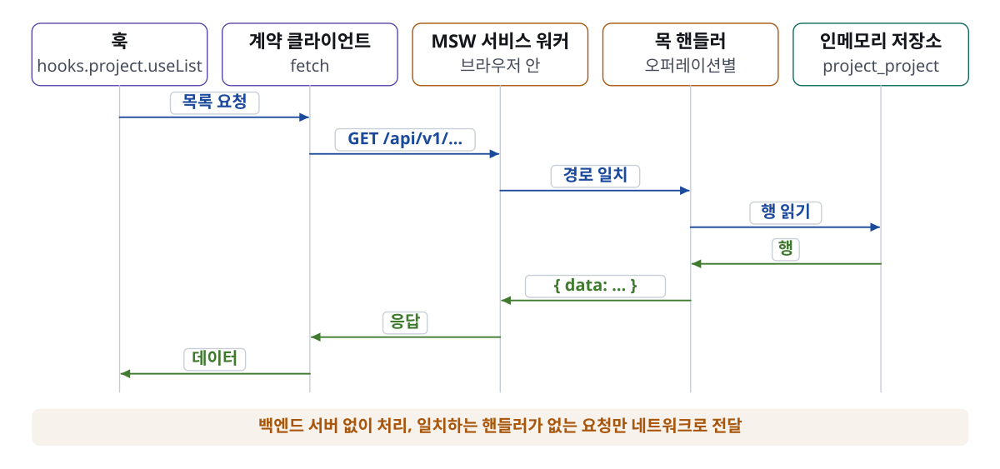
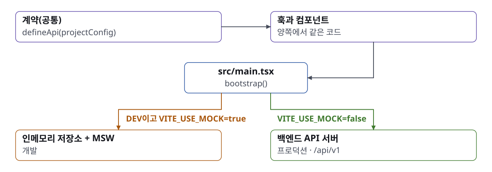

# 풀스택 목 개발 환경 만들기

[English](/en/tutorials/full-stack-mock.md) | **한국어**

> 이 튜토리얼을 마치면 인메모리 목(mock) 저장소와 MSW 서비스 워커로 동작하는 프론트엔드 애플리케이션이 완성됩니다. 백엔드 서버는 필요하지 않습니다.

## 사전 준비

- Node.js 20 이상
- 전역으로 설치한 pnpm
- React, TypeScript, TanStack Query 기초 지식
- Vite 기반 React 프로젝트(없으면 아래 1단계를 따르세요)

## 1단계: 의존성 설정

프로젝트를 새로 만들고 simplix-react 패키지를 피어 의존성과 함께 설치하세요.

```bash
pnpm create vite mock-demo --template react-ts
cd mock-demo
pnpm add @simplix-react/contract @simplix-react/react @simplix-react/mock @tanstack/react-query @tanstack/react-query-persist-client @tanstack/query-sync-storage-persister zod
pnpm add -D msw
pnpm add -D @types/react @types/react-dom
```

public 디렉터리에 MSW 서비스 워커를 초기화하세요.

```bash
pnpm dlx msw init public/ --save
```

`mockServiceWorker.js` 파일이 생성되었는지 확인하세요.

```bash
ls public/mockServiceWorker.js
```

**예상 결과:** `public/mockServiceWorker.js` 파일이 있고, 패키지가 모두 설치됩니다.

## 2단계: 계약 정의

프로젝트와 작업 엔티티(entity)를 담은 API 계약(contract)을 만드세요. 작업 엔티티는 `parent`로 프로젝트 아래에 중첩됩니다. 목 핸들러가 생성한 레코드에 숫자 `id`를 부여하므로 `id` 필드는 숫자입니다.

`src/contract.ts`를 만드세요.

```ts
import { z } from "zod";
import { defineApi, simpleQueryBuilder } from "@simplix-react/contract";

const projectSchema = z.object({
  id: z.number(),
  name: z.string(),
  description: z.string(),
  status: z.enum(["active", "archived"]),
  createdAt: z.string(),
  updatedAt: z.string(),
});

const createProjectSchema = z.object({
  name: z.string(),
  description: z.string(),
  status: z.enum(["active", "archived"]).default("active"),
});

const updateProjectSchema = z.object({
  name: z.string().optional(),
  description: z.string().optional(),
  status: z.enum(["active", "archived"]).optional(),
});

const taskSchema = z.object({
  id: z.number(),
  projectId: z.string(),
  title: z.string(),
  completed: z.boolean(),
  createdAt: z.string(),
  updatedAt: z.string(),
});

const createTaskSchema = z.object({
  title: z.string(),
  completed: z.boolean().default(false),
});

const updateTaskSchema = z.object({
  title: z.string().optional(),
  completed: z.boolean().optional(),
});

export const projectApi = defineApi({
  domain: "project",
  basePath: "/api/v1",
  entities: {
    project: {
      schema: projectSchema,
      operations: {
        list: { method: "GET", path: "/projects" },
        get: { method: "GET", path: "/projects/:id" },
        create: { method: "POST", path: "/projects", input: createProjectSchema },
        update: { method: "PATCH", path: "/projects/:id", input: updateProjectSchema },
        delete: { method: "DELETE", path: "/projects/:id" },
      },
    },
    task: {
      schema: taskSchema,
      parent: {
        param: "projectId",
        path: "/projects",
      },
      operations: {
        list: { method: "GET", path: "/tasks" },
        get: { method: "GET", path: "/tasks/:id" },
        create: { method: "POST", path: "/tasks", input: createTaskSchema },
        update: { method: "PATCH", path: "/tasks/:id", input: updateTaskSchema },
        delete: { method: "DELETE", path: "/tasks/:id" },
      },
    },
  },
  queryBuilder: simpleQueryBuilder,
});
```

**예상 결과:** 파일이 오류 없이 컴파일됩니다.

## 3단계: 목 핸들러 파생

`deriveMockHandlers`로 계약에서 MSW 핸들러를 파생하세요.

`src/mock/handlers.ts`를 만드세요.

```ts
import { deriveMockHandlers } from "@simplix-react/mock";
import { projectApi } from "../contract";

export const handlers = deriveMockHandlers(projectApi.config, {
  project: {
    defaultSort: "createdAt:desc",
  },
  task: {
    defaultSort: "createdAt:desc",
  },
});
```

이 호출 하나로 오퍼레이션(operation)마다 핸들러를 하나씩 파생합니다. 작업 엔티티의 `list`와 `create` 오퍼레이션은 상위 엔티티 경로 아래에서 응답합니다.

| 엔티티 | 메서드 | 경로                                       |
| ------- | ------ | ------------------------------------------ |
| project | GET    | `/api/v1/projects`                         |
| project | GET    | `/api/v1/projects/:id`                     |
| project | POST   | `/api/v1/projects`                         |
| project | PATCH  | `/api/v1/projects/:id`                     |
| project | DELETE | `/api/v1/projects/:id`                     |
| task    | GET    | `/api/v1/projects/:projectId/tasks`        |
| task    | GET    | `/api/v1/tasks/:id`                        |
| task    | POST   | `/api/v1/projects/:projectId/tasks`        |
| task    | PATCH  | `/api/v1/tasks/:id`                        |
| task    | DELETE | `/api/v1/tasks/:id`                        |

핵심 사항:

- `tableName`을 지정하지 않습니다. 저장소 이름은 `{domain}_{snake_case_entity}` 형식으로 파생합니다(예: `project_project`, `project_task`)
- `defaultSort`는 camelCase 필드 이름을 쓰는 `"field:direction"` 형식이며, 기본값은 `"createdAt:desc"`입니다
- 요청에 `id`, `createdAt`, `updatedAt`이 없으면 생성한 레코드에 저장소의 다음 숫자 `id`와 `createdAt`, `updatedAt` 값을 채웁니다. 수정하면 `updatedAt`을 갱신합니다
- 응답 본문은 `{ data: <payload> }`이고, 계약의 기본 fetch가 이 구조를 풀어 데이터만 반환합니다

**예상 결과:** `handlers`는 MSW `HttpHandler` 인스턴스 배열입니다. 각 핸들러는 인메모리 저장소를 읽고 씁니다.

## 4단계: MSW 워커 시작

`setupMockWorker`로 인메모리 저장소와 MSW를 함께 시작하세요.

`src/mock/setup.ts`를 만드세요.

```ts
import { setupMockWorker } from "@simplix-react/mock";
import { handlers } from "./handlers";

export async function startMockEnvironment(): Promise<void> {
  await setupMockWorker({
    domains: [
      {
        name: "project",
        handlers,
      },
    ],
  });
}
```

렌더링 전에 목 환경을 시작하도록 `src/main.tsx`를 수정하세요.

```tsx
import { StrictMode } from "react";
import { createRoot } from "react-dom/client";
import App from "./App";

async function bootstrap() {
  // Start mock environment in development
  if (import.meta.env.DEV) {
    const { startMockEnvironment } = await import("./mock/setup");
    await startMockEnvironment();
  }

  createRoot(document.getElementById("root")!).render(
    <StrictMode>
      <App />
    </StrictMode>,
  );
}

bootstrap();
```

`setupMockWorker`는 다음 순서로 동작합니다.

1. `enabled !== false`인 도메인만 고릅니다
2. 인메모리 저장소를 초기화합니다
3. 도메인의 시드 데이터가 있으면 엔티티 저장소에 넣습니다
4. 사용 중인 도메인의 핸들러를 합쳐 MSW 서비스 워커를 시작합니다

`setupMockWorker`는 워커를 `quiet: true`로 시작하므로 콘솔에 시작 메시지를 출력하지 않습니다. `onUnhandledRequest: "bypass"`도 지정하므로 일치하는 핸들러가 없는 요청은 그대로 네트워크로 전송합니다.



**예상 결과:** 개발자 도구의 Network 탭에서 `/api/v1/*` 요청에 서비스 워커가 응답하고, 인메모리 저장소가 그 요청을 처리한 것을 확인할 수 있습니다.

## 5단계: 훅 파생과 UI 작성

훅(hook)을 파생하고, 전체 흐름을 시험할 간단한 UI를 만드세요.

`src/hooks.ts`를 만드세요.

```ts
import { deriveEntityHooks } from "@simplix-react/react";
import { projectApi } from "./contract";

export const hooks = deriveEntityHooks(projectApi);
```

`src/App.tsx`를 수정하세요.

```tsx
import { useState } from "react";
import { QueryClient, QueryClientProvider } from "@tanstack/react-query";
import { hooks } from "./hooks";

const queryClient = new QueryClient();

function ProjectManager() {
  const { data: projects, isLoading } = hooks.project.useList();
  const createProject = hooks.project.useCreate();
  const deleteProject = hooks.project.useDelete();
  const [selectedId, setSelectedId] = useState<string | null>(null);

  const handleCreate = () => {
    createProject.mutate({
      name: `Project ${Date.now()}`,
      description: "A test project",
      status: "active" as const,
    });
  };

  if (isLoading) return <p>Loading...</p>;

  return (
    <div>
      <h1>Project Manager (Mock)</h1>

      <button onClick={handleCreate} disabled={createProject.isPending}>
        Create Project
      </button>

      <ul>
        {projects?.map((p) => (
          <li key={p.id}>
            <button onClick={() => setSelectedId(String(p.id))}>{p.name}</button>
            <button onClick={() => deleteProject.mutate(String(p.id))}>
              Delete
            </button>
          </li>
        ))}
      </ul>

      {selectedId && <TaskPanel projectId={selectedId} />}
    </div>
  );
}

function TaskPanel({ projectId }: { projectId: string }) {
  const { data: tasks, isLoading } = hooks.task.useList(projectId);
  const createTask = hooks.task.useCreate(projectId);
  const updateTask = hooks.task.useUpdate();
  const deleteTask = hooks.task.useDelete();

  const [title, setTitle] = useState("");

  const handleAdd = (e: React.FormEvent) => {
    e.preventDefault();
    if (!title.trim()) return;
    createTask.mutate(
      { title, completed: false },
      { onSuccess: () => setTitle("") },
    );
  };

  if (isLoading) return <p>Loading tasks...</p>;

  return (
    <div>
      <h2>Tasks</h2>

      <form onSubmit={handleAdd}>
        <input
          value={title}
          onChange={(e) => setTitle(e.target.value)}
          placeholder="Task title"
          required
        />
        <button type="submit">Add</button>
      </form>

      <ul>
        {tasks?.map((t) => (
          <li key={t.id}>
            <label>
              <input
                type="checkbox"
                checked={t.completed}
                onChange={() =>
                  updateTask.mutate({
                    id: String(t.id),
                    dto: { completed: !t.completed },
                  })
                }
              />
              {t.title}
            </label>
            <button onClick={() => deleteTask.mutate(String(t.id))}>
              Remove
            </button>
          </li>
        ))}
      </ul>
    </div>
  );
}

export default function App() {
  return (
    <QueryClientProvider client={queryClient}>
      <ProjectManager />
    </QueryClientProvider>
  );
}
```

훅은 아이디를 문자열로 받으므로 컴포넌트에서 `String(p.id)`와 `String(t.id)`를 전달합니다.

**예상 결과:** 앱에서 프로젝트와 작업을 생성 · 조회 · 수정 · 삭제할 수 있습니다. 데이터는 모두 메모리에 저장되고 MSW가 처리합니다.

## 6단계: CRUD 동작 확인

개발 서버를 시작하고 오퍼레이션을 하나씩 시험하세요.

```bash
pnpm dev
```

브라우저를 열고 다음 순서대로 실행하세요.

| # | 동작 | 예상 결과 |
| - | --- | --- |
| 1 | 「Create Project」 클릭 | 목록에 새 프로젝트가 표시됩니다 |
| 2 | 프로젝트 이름 클릭 | 아래에 작업 패널이 열립니다 |
| 3 | 작업 제목을 입력하고 「Add」 클릭 | 목록에 작업이 표시됩니다 |
| 4 | 작업 확인란 전환 | 작업이 완료로 표시됩니다 |
| 5 | 작업의 「Remove」 클릭 | 목록에서 작업이 사라집니다 |
| 6 | 프로젝트의 「Delete」 클릭 | 목록에서 프로젝트가 사라집니다 |

개발자 도구의 Network 탭을 여세요. `/api/v1/*` 요청은 서비스 워커가 응답한 요청으로 표시됩니다.

> **참고:** 데이터는 메모리에 저장되므로 페이지를 새로 고칠 때마다 초기화됩니다. 목 계층은 개발과 테스트용이며 데이터를 보존하지 않도록 설계했습니다. 시드 레코드로 데이터를 미리 채우는 방법은 7단계를 참고하세요.

**예상 결과:** 표의 동작이 모두 성공합니다. 페이지를 새로 고치면 빈 상태(시드 데이터를 설정했다면 시드 데이터)에서 다시 시작합니다.

## 7단계: 시드 데이터 추가

`MockDomainConfig`의 `seed` 옵션으로 목 저장소를 예제 데이터로 미리 채우세요.

시드 데이터를 넣도록 `src/mock/setup.ts`를 수정하세요.

```ts
import { setupMockWorker } from "@simplix-react/mock";
import { handlers } from "./handlers";

export async function startMockEnvironment(): Promise<void> {
  await setupMockWorker({
    domains: [
      {
        name: "project",
        handlers,
        seed: {
          project_project: [
            {
              id: 1,
              name: "Website Redesign",
              description: "Redesign the company website",
              status: "active",
              createdAt: "2025-01-15T09:00:00Z",
              updatedAt: "2025-01-15T09:00:00Z",
            },
            {
              id: 2,
              name: "Mobile App",
              description: "Build a mobile application",
              status: "active",
              createdAt: "2025-01-10T09:00:00Z",
              updatedAt: "2025-01-10T09:00:00Z",
            },
            {
              id: 3,
              name: "Legacy Migration",
              description: "Migrate legacy systems",
              status: "archived",
              createdAt: "2025-01-05T09:00:00Z",
              updatedAt: "2025-01-05T09:00:00Z",
            },
          ],
          project_task: [
            {
              id: 1,
              projectId: "1",
              title: "Create wireframes",
              completed: true,
              createdAt: "2025-01-16T09:00:00Z",
              updatedAt: "2025-01-16T09:00:00Z",
            },
            {
              id: 2,
              projectId: "1",
              title: "Design mockups",
              completed: false,
              createdAt: "2025-01-17T09:00:00Z",
              updatedAt: "2025-01-17T09:00:00Z",
            },
            {
              id: 3,
              projectId: "1",
              title: "Implement homepage",
              completed: false,
              createdAt: "2025-01-18T09:00:00Z",
              updatedAt: "2025-01-18T09:00:00Z",
            },
            {
              id: 4,
              projectId: "2",
              title: "Set up React Native",
              completed: true,
              createdAt: "2025-01-11T09:00:00Z",
              updatedAt: "2025-01-11T09:00:00Z",
            },
            {
              id: 5,
              projectId: "2",
              title: "Build navigation",
              completed: false,
              createdAt: "2025-01-12T09:00:00Z",
              updatedAt: "2025-01-12T09:00:00Z",
            },
          ],
        },
      },
    ],
  });
}
```

핵심 사항:

- 시드 데이터는 일반 JavaScript 객체입니다. SQL도 마이그레이션도 필요하지 않습니다
- 저장소 이름은 `{domain}_{snake_case_entity}` 규칙을 따릅니다(예: 도메인 `"project"`와 엔티티 `"project"`는 `"project_project"`, 엔티티 `"task"`는 `"project_task"`)
- 각 레코드에는 `id`, `createdAt`, `updatedAt`을 포함해 스키마가 요구하는 필드를 모두 넣어야 합니다
- 작업의 `projectId`는 문자열로 저장합니다. 핸들러가 경로 매개변수에서 쓰는 형태와 같고, 작업 목록은 이 값으로 필터링합니다
- 숫자 아이디를 시드로 넣으면 저장소의 아이디 카운터가 가장 큰 값으로 바뀌므로, 다음에 생성하는 프로젝트의 아이디는 `4`입니다
- 페이지를 새로 고칠 때마다 시드 데이터를 다시 넣으므로 항상 같은 상태에서 시작합니다

**예상 결과:** 페이지를 불러올 때마다 시드로 넣은 프로젝트와 작업이 표시됩니다.

## 8단계: 실제 API로 전환

백엔드가 준비되면 계약, 훅, 컴포넌트를 바꾸지 않고 실제 API로 전환할 수 있습니다. 바꿀 곳은 부트스트랩 코드뿐입니다.

`src/main.tsx`를 수정하세요.

```tsx
import { StrictMode } from "react";
import { createRoot } from "react-dom/client";
import App from "./App";

async function bootstrap() {
  // Only use mock in development
  if (import.meta.env.DEV && import.meta.env.VITE_USE_MOCK === "true") {
    const { startMockEnvironment } = await import("./mock/setup");
    await startMockEnvironment();
  }

  createRoot(document.getElementById("root")!).render(
    <StrictMode>
      <App />
    </StrictMode>,
  );
}

bootstrap();
```

목 모드용 `.env` 파일을 만드세요.

```bash
VITE_USE_MOCK=true
```

프로덕션용 `.env.production` 파일을 만드세요.

```bash
VITE_USE_MOCK=false
```

전환 구조는 다음과 같습니다.



`defineApi`가 표준 HTTP 클라이언트를 파생하므로 컴포넌트는 MSW 목 계층과 실제 API 서버 양쪽에서 동작합니다. 두 환경이 같은 계약을 사용합니다.

**예상 결과:** `VITE_USE_MOCK=false`로 설정하면 목 설정을 완전히 건너뜁니다. fetch 요청은 모두 `/api/v1/*`의 실제 백엔드로 바로 전송됩니다.

## 요약

이 튜토리얼에서 진행한 작업은 다음과 같습니다.

1. `@simplix-react/contract`, `@simplix-react/react`, `@simplix-react/mock`, `msw`를 설치했습니다
2. 프로젝트와 작업 엔티티를 담은 계약을 정의했습니다
3. `deriveMockHandlers`로 MSW 핸들러를 파생했습니다
4. `setupMockWorker`로 목 환경을 시작했습니다
5. 인메모리 저장소만으로 동작하는 CRUD UI를 만들었습니다
6. 일반 JavaScript 객체로 시드 데이터를 추가했습니다
7. 환경 변수로 실제 API 전환을 제어하도록 설정했습니다

목 환경이 제공하는 기능은 다음과 같습니다.

- CRUD 오퍼레이션을 자동으로 처리하는 가벼운 인메모리 저장소
- 기본으로 제공하는 정렬, 필터링, 오프셋 기반 페이지네이션
- MSW의 네트워크 수준 가로채기(개발자 도구 Network 탭에서 확인 가능)
- 페이지를 불러올 때마다 같은 시드 데이터로 시작하는 안정적인 개발 환경
- 실제 백엔드로 전환할 때 코드 변경 없음(백엔드가 페이로드를 `data` 필드나 본문 전체로 반환하고 아이디 타입이 같을 때)

---

<p class="page-source"><a href="https://github.com/simplix-framework/simplix-react/blob/main/docs/ko/tutorials/full-stack-mock.md" target="_blank" rel="noopener noreferrer">GitHub에서 편집</a></p>
