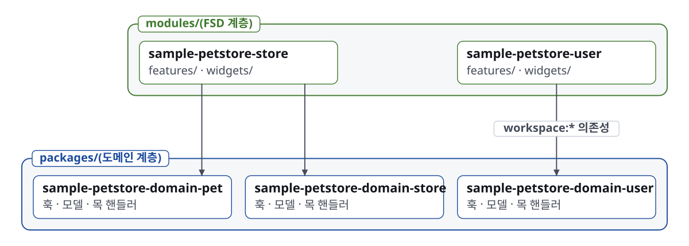
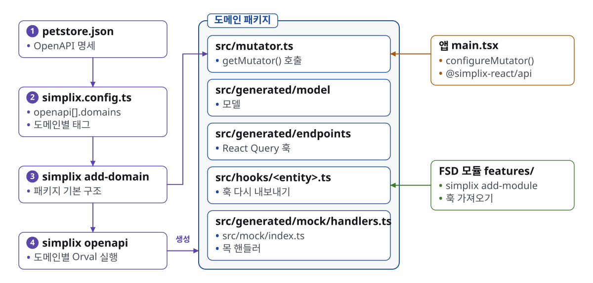

# OpenAPI로 Petstore API 클라이언트 만들기

[English](/en/tutorials/petstore-openapi.md) | **한국어**

> 이 튜토리얼을 마치면 Swagger Petstore OpenAPI 명세에서 생성한, 타입이 지정된
> 다중 도메인 모노레포가 완성됩니다. TypeScript 모델, React Query 훅(hook),
> MSW 목 핸들러(mock handler)는 모두 `simplix openapi`가 생성합니다.

## 사전 준비

- Node.js 20 이상
- pnpm 9 이상
- 전역으로 설치했거나 `pnpm dlx`로 실행하는 `@simplix-react/cli`

```bash
pnpm add -g @simplix-react/cli
```

## 1단계: 프로젝트 초기화

새 simplix-react 모노레포를 만드세요.

```bash
simplix init sample-petstore -y
cd sample-petstore
```

`-y`를 주면 스코프는 `@sample-petstore`가 되고 데모 앱, i18n(`en`, `ko`, `ja`), 인증, 접근 제어가 모두 포함됩니다. 생성되는 구조는 다음과 같습니다.

```text
sample-petstore/
  apps/
    sample-petstore-demo/     # Vite + React demo application
  config/
    typescript/               # Shared TypeScript configs
  modules/                    # FSD modules (empty)
  simplix.config.ts           # Project configuration
  package.json                # Root monorepo config
  pnpm-workspace.yaml
  turbo.json
  tsconfig.json
```

핵심 파일인 `simplix.config.ts`의 내용입니다(주석 생략).

```ts
import { defineConfig } from "@simplix-react/cli";

export default defineConfig({
  plugins: ["@simplix-react-ext/simplix-boot-cli-plugin"],
  api: {
    baseUrl: "/api",
  },
  http: {
    environments: {
      development: { baseUrl: "http://localhost:3000" },
    },
  },
  i18n: {
    locales: ["en", "ko", "ja"],
    defaultLocale: "en",
  },
  codegen: {
    header: true,
  },
});
```

`plugins` 항목은 SimpliX Boot 백엔드용 명세 프로필을 등록합니다. 이 튜토리얼은 명세 프로필을 쓰지 않으므로 이 항목은 아무 영향이 없으며 그대로 두어도 됩니다.

의존성을 설치하세요.

```bash
pnpm install
```

첫 빌드를 확인하세요.

```bash
pnpm build
```

빌드가 오류 없이 끝납니다.

## 2단계: OpenAPI 명세 내려받기

Swagger Petstore 3.0 명세를 프로젝트 루트에 내려받으세요.

```bash
curl -sL "https://petstore3.swagger.io/api/v3/openapi.json" -o petstore.json
```

명세에 있는 태그를 확인하세요.

```bash
node -e "
  const s = JSON.parse(require('fs').readFileSync('petstore.json','utf8'));
  console.log('Title:', s.info.title);
  console.log('Tags:', s.tags.map(t => t.name).join(', '));
"
```

예상 출력:

```text
Title: Swagger Petstore - OpenAPI 3.0
Tags: pet, store, user
```

태그 하나가 도메인 패키지 하나가 됩니다.

## 3단계: 도메인 분할 설정

`simplix.config.ts`에 `openapi` 항목을 추가하세요. `openapi`는 명세별 설정의
배열입니다. 각 항목의 `spec`은 프로젝트 루트 기준 명세 경로이고, `domains` 맵의
키는 도메인 이름, 값은 포함할 OpenAPI 태그 패턴(정확한 태그 또는 `/regex/`)의 배열입니다.

```ts
import { defineConfig } from "@simplix-react/cli";

export default defineConfig({
  plugins: ["@simplix-react-ext/simplix-boot-cli-plugin"],
  api: {
    baseUrl: "/api",
  },
  http: {
    environments: {
      development: { baseUrl: "http://localhost:3000" },
    },
  },
  i18n: {
    locales: ["en", "ko", "ja"],
    defaultLocale: "en",
  },
  codegen: {
    header: true,
  },
  openapi: [
    {
      spec: "petstore.json",
      domains: {
        pet: ["pet"],
        store: ["store"],
        user: ["user"],
      },
    },
  ],
});
```

CLI는 `openapi[].domains` 매핑에 따라 OpenAPI 오퍼레이션(operation)을 태그별로
나누어 도메인 패키지별로 코드를 생성합니다.

## 4단계: 도메인 패키지 생성

`simplix openapi`는 이미 있는 도메인 패키지에 코드를 씁니다. 도메인마다 패키지를
하나씩 만드세요.

```bash
simplix add-domain pet -y
simplix add-domain store -y
simplix add-domain user -y
```

`simplix.config.ts`가 각 도메인을 실제로 있는 명세의 태그에 매핑하므로
`add-domain`은 OpenAPI용 뼈대를 만듭니다. `orval`을 개발 의존성으로 두고
`codegen` 스크립트를 넣은 `package.json`, `src/index.ts`, `src/mutator.ts`,
i18n 파일이 그 내용입니다. 첫 패키지의 예상 출력은 다음과 같습니다.

```text
✔ Domain package created: @sample-petstore/sample-petstore-domain-pet
  → Location: packages/sample-petstore-domain-pet/
  → i18n: locales/ with en, ko, ja
```

새 패키지의 의존성을 설치하세요. 이때 Orval이 설치됩니다.

```bash
pnpm install
```

## 5단계: 도메인 코드 생성

OpenAPI 코드 생성기를 실행하세요.

```bash
simplix openapi petstore.json -y
```

예상 출력(명세 버전은 다를 수 있습니다):

```text
✔ Loaded: Swagger Petstore - OpenAPI 3.0 v1.0.27
i Multi-domain mode: pet(1), store(2), user(1)
✔ Generated code for: @sample-petstore/sample-petstore-domain-pet
  → Location: packages/sample-petstore-domain-pet/
  → Entities: pet
  → Generated: src/generated/, src/hooks/, src/mock/
```

`store`와 `user` 패키지도 같은 형식으로 출력합니다. `store` 태그에는 `order`와
`inventory` 엔티티(entity)가 있고, `pet`과 `user`에는 엔티티가 하나씩 있습니다.
각 패키지의 구성은 다음과 같습니다.

```text
packages/
  sample-petstore-domain-pet/
    package.json
    tsup.config.ts
    tsconfig.json
    vitest.config.ts
    crud.config.ts                    # CRUD role → hook name map
    .openapi-snapshot.json            # Snapshot compared on the next run
    src/
      index.ts                        # Package entry point
      mutator.ts                      # Request function the generated code calls
      translations.ts
      locales/                        # en.json, ko.json, ja.json
      generated/
        endpoints/                    # Orval React Query hooks and request functions
        model/                        # Orval TypeScript models
        mock/
          handlers.ts                 # MSW handler factories
      hooks/
        pet.ts                        # Re-exports the hooks of the pet entity
        index.ts
      mock/
        index.ts                      # Mock entry point (createPetMock)
        seeds.ts                      # Mock seed data
    http/
      pet.http                        # HTTP request samples
      http-client.env.json
  sample-petstore-domain-store/
    ...  (same structure)
  sample-petstore-domain-user/
    ...  (same structure)
```

### 생성되는 파일

| 파일 | 작성 시점 | 설명 |
| --- | --- | --- |
| `src/generated/endpoints/` | 실행할 때마다 | 오퍼레이션마다 훅 하나씩 만든 Orval React Query 훅과 요청 함수 |
| `src/generated/model/` | 실행할 때마다 | 엔드포인트가 쓰는 스키마의 Orval TypeScript 모델 |
| `src/generated/mock/handlers.ts` | 실행할 때마다 | 엔티티별 MSW 핸들러 팩토리 |
| `src/hooks/` | 실행할 때마다 | 엔티티별로 훅을 다시 내보내는 파일 |
| `http/` | 실행할 때마다(`--no-http`를 주면 생략) | HTTP 요청 예제와 환경 설정 |
| `src/index.ts` | 실행할 때마다 | 패키지 진입점. 직접 추가한 export 줄은 유지 |
| `src/mock/index.ts` | 처음 실행할 때, 이후에는 재정의 영역이 비어 있는 동안 | 저장소와 핸들러를 연결하는 목 진입점 |
| `src/mock/seeds.ts` | 처음 실행할 때만 | 인메모리 저장소의 시드 데이터 |
| `crud.config.ts` | 처음 실행할 때 또는 `-f`를 줄 때 | `simplix scaffold-crud`가 읽는 CRUD 역할 매핑 |
| `src/mutator.ts` | 파일이 없을 때 | `@simplix-react/api`의 `getMutator()`를 호출하는 요청 함수 |

## 6단계: 빌드

모든 패키지를 빌드하세요.

```bash
pnpm build
```

모든 도메인 패키지와 데모 앱이 오류 없이 빌드됩니다.

## 7단계: 생성된 코드 살펴보기

### 훅(`src/hooks/`)

Orval은 오퍼레이션마다 React Query 훅을 하나씩 만들고, 명세의 operation ID 앞에
`use`를 앞에 추가해 이름을 정합니다. `GET` 오퍼레이션은 쿼리 훅이 되고, 나머지 메서드는
뮤테이션(mutation) 훅이 됩니다. `pet` 도메인의 훅은 다음과 같습니다.

| Operation ID | 메서드와 경로 | 훅 |
| --- | --- | --- |
| `findPetsByStatus` | `GET /pet/findByStatus` | `useFindPetsByStatus`(쿼리) |
| `findPetsByTags` | `GET /pet/findByTags` | `useFindPetsByTags`(쿼리) |
| `getPetById` | `GET /pet/{petId}` | `useGetPetById`(쿼리) |
| `addPet` | `POST /pet` | `useAddPet`(뮤테이션) |
| `updatePet` | `PUT /pet` | `useUpdatePet`(뮤테이션) |
| `updatePetWithForm` | `POST /pet/{petId}` | `useUpdatePetWithForm`(뮤테이션) |
| `deletePet` | `DELETE /pet/{petId}` | `useDeletePet`(뮤테이션) |
| `uploadFile` | `POST /pet/{petId}/uploadImage` | `useUploadFile`(뮤테이션) |

`src/hooks/pet.ts`가 이 훅들을 다시 내보내고, 패키지 진입점이 `./hooks`와
`./generated/model`을 내보냅니다. 따라서 사용하는 쪽은 패키지 이름으로 훅과 타입을
가져옵니다.

### 요청 함수(`src/mutator.ts`)

생성된 요청은 모두 `src/mutator.ts`의 `customFetch`를 거치고, `customFetch`는
`@simplix-react/api`의 `getMutator()`를 호출합니다. 애플리케이션은
`configureMutator()`로 이 요청 함수를 한 번 등록합니다(9단계).

### 목 핸들러(`src/mock/index.ts`)

목 진입점은 `createPetMock()`을 내보냅니다(다른 패키지에서는 `createStoreMock()`,
`createUserMock()`). 이 함수는 `src/generated/mock/handlers.ts`의 핸들러를 담은
`@simplix-react/mock`의 `MockDomainConfig`를 반환합니다. 재정의 영역에서 생성된
핸들러 위에 추가한 핸들러는 코드를 다시 생성해도 유지됩니다.

## 8단계: 명세가 바뀐 뒤 다시 생성(선택)

OpenAPI 명세가 갱신되면 같은 명령을 다시 실행하세요.

```bash
simplix openapi petstore.json -y
```

CLI는 새 명세를 각 도메인 패키지에 저장된 `.openapi-snapshot.json`과 비교합니다.
바뀐 것이 없는 패키지는 `No changes detected. Package is up-to-date.`를 출력하고,
바뀐 패키지는 차이를 출력한 뒤 `src/generated/`와 `src/hooks/`를 다시 생성합니다.
`-y`를 주지 않으면 다시 생성하기 전에 확인을 요청합니다. `src/mock/seeds.ts`와
`src/index.ts`에 직접 추가한 export 줄은 유지됩니다. 바뀐 것이 없어도 다시
생성하려면 `-f, --force`를 주세요. `-f`를 주면 `crud.config.ts`도 다시 씁니다.
도메인 하나만 다시 생성하려면 `-d, --domain <name>`을 주세요.

## 9단계: FSD 모듈 생성

도메인 패키지는 타입이 지정된 훅과 모델을 제공합니다. FSD(Feature-Sliced
Design) 모듈은 도메인 패키지를 사용해 애플리케이션을 기능 단위의 독립된 묶음으로
구성합니다.

pet과 store 도메인을 쓰는 `store` 모듈과 user 도메인을 쓰는 `user` 모듈을 만드세요.

```bash
simplix add-module store -y
simplix add-module user -y
```

예상 출력:

```text
✔ Module created: @sample-petstore/sample-petstore-store
  → Location: modules/sample-petstore-store/
  → FSD layers: features/ widgets/ shared/
  → i18n: locales/ with en, ko, ja

✔ Module created: @sample-petstore/sample-petstore-user
  → Location: modules/sample-petstore-user/
  → FSD layers: features/ widgets/ shared/
  → i18n: locales/ with en, ko, ja
```

모듈은 `modules/` 아래에 생성됩니다.

```text
modules/
  sample-petstore-store/
    package.json
    tsup.config.ts
    tsconfig.json
    vitest.config.ts
    src/
      index.ts              # Module entry point
      features/index.ts     # Feature layer: domain-driven use cases
      widgets/index.ts      # Widget layer: compose features into UI blocks
      shared/               # Shared layer: lib, ui, config
      locales/              # i18n translations (features/, widgets/)
  sample-petstore-user/
    ...  (same structure)
```

### 도메인과 모듈의 관계

모듈은 도메인 패키지를 사용해 기능을 만듭니다. `store` 모듈은 `pet`과 `store`
도메인 패키지를, `user` 모듈은 `user` 도메인 패키지를 사용합니다.



모듈에서 도메인 훅을 쓰려면 모듈 `package.json`의 `dependencies`에 도메인
패키지를 추가하세요.

```json
{
  "dependencies": {
    "@sample-petstore/sample-petstore-domain-pet": "workspace:*",
    "@sample-petstore/sample-petstore-domain-store": "workspace:*"
  }
}
```

그런 다음 기능 코드에서 훅을 호출하세요.

```tsx
// modules/sample-petstore-store/src/features/available-pets.tsx
import { useFindPetsByStatus } from "@sample-petstore/sample-petstore-domain-pet";

export function AvailablePets() {
  const { data: pets } = useFindPetsByStatus({ status: "available" });

  return (
    <ul>
      {pets?.map((pet) => <li key={pet.id}>{pet.name}</li>)}
    </ul>
  );
}
```

앱이 렌더링하기 전에 요청 함수를 한 번 등록하세요. 예를 들어
`apps/sample-petstore-demo/src/main.tsx` 맨 위에 둡니다. 앱의 의존성에
`@simplix-react/api`가 없으면 추가하세요.

```ts
import { configureMutator } from "@simplix-react/api";

configureMutator(async (url, options) => {
  const res = await fetch(`https://petstore3.swagger.io/api/v3${url}`, options);
  if (!res.ok) throw new Error(`Request failed: ${res.status}`);
  return res.json();
});
```

설치하고 빌드하세요.

```bash
pnpm install
pnpm build
```

## 정리

이 튜토리얼에서 수행한 작업은 다음과 같습니다.

1. `simplix init`으로 simplix-react 모노레포를 **초기화**했습니다
2. Swagger Petstore OpenAPI 명세를 **내려받았습니다**
3. `simplix.config.ts`에 태그 기준 도메인 분할을 **설정**했습니다
4. `simplix add-domain`으로 `pet`, `store`, `user` 도메인 패키지를 **만들었습니다**
5. `simplix openapi`로 모델, 훅, 목 핸들러를 **생성**했습니다
6. 프로젝트 전체를 **빌드**했습니다
7. 생성된 훅, 요청 함수, 목 진입점을 **살펴보았습니다**
8. 스냅샷 비교로 명세 변경 뒤에 코드를 **다시 생성**했습니다
9. `simplix add-module`로 `store`와 `user` FSD 모듈을 **만들고** 기능 코드에서 도메인 훅을 호출했습니다

### 생성 파이프라인



### 다음 단계

- [풀스택 목 애플리케이션 만들기](/ko/tutorials/full-stack-mock.md): React 애플리케이션에서
  훅과 목 핸들러를 사용합니다
- [CLI 참조](/ko/guides/cli-usage.md): 사용할 수 있는 CLI 명령과 플래그를 모두 살펴봅니다

---

<p class="page-source"><a href="https://github.com/simplix-framework/simplix-react/blob/main/docs/ko/tutorials/petstore-openapi.md" target="_blank" rel="noopener noreferrer">원본 보기</a></p>
