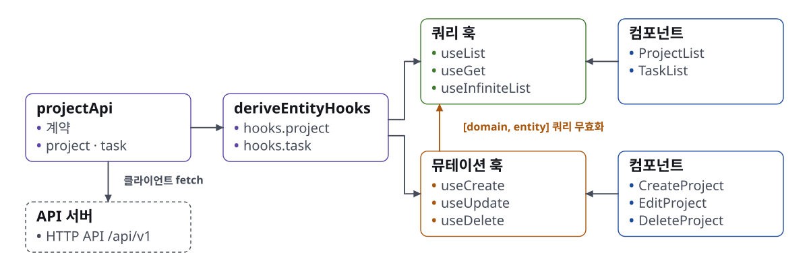

# 프로젝트 관리 앱 처음부터 만들기

[English](/en/tutorials/project-app.md) | **한국어**

> 이 튜토리얼을 마치면 프로젝트와 작업을 생성 · 조회 · 수정 · 삭제할 수 있는 프로젝트 관리 앱이 완성됩니다. 앱 전체를 simplix-react로 만듭니다.

## 사전 준비

- Node.js 20 이상
- 전역으로 설치한 pnpm
- React, TypeScript, TanStack Query 기초 지식
- 2단계와 8단계의 엔드포인트를 앱과 같은 출처의 `/api/v1` 아래에서 제공하는 HTTP API, 또는 [풀스택 목 튜토리얼](/ko/tutorials/full-stack-mock.md)의 인메모리 목. 기본 fetch는 응답에 `data` 필드가 있으면 그 값을, 없으면 JSON 본문 전체를 데이터로 읽습니다

## 1단계: 프로젝트 설정

React 프로젝트를 새로 만들고 필요한 simplix-react 패키지를 설치하세요.

```bash
pnpm create vite project-manager --template react-ts
cd project-manager
pnpm add @simplix-react/contract @simplix-react/react @tanstack/react-query @tanstack/react-query-persist-client @tanstack/query-sync-storage-persister zod
pnpm add -D @types/react @types/react-dom
```

설치 결과를 확인하세요.

```bash
pnpm list @simplix-react/contract @simplix-react/react @tanstack/react-query zod
```

**예상 결과:** 나열한 패키지가 모두 버전과 함께 의존성 목록에 표시됩니다.

## 2단계: 프로젝트 엔티티 계약 정의

Zod 스키마와 `defineApi`로 프로젝트 엔티티(entity)를 정의하는 API 계약(contract)을 만드세요. 엔티티에는 `schema`와 `operations` 맵이 있습니다. 이름이 `list`, `get`, `create`, `update`, `delete`인 오퍼레이션(operation)은 이름에서 CRUD 역할을 얻습니다.

`src/contract.ts`를 만드세요.

```ts
import { z } from "zod";
import { defineApi, simpleQueryBuilder } from "@simplix-react/contract";

const projectSchema = z.object({
  id: z.string(),
  name: z.string(),
  description: z.string(),
  status: z.enum(["active", "archived"]),
  createdAt: z.string(),
  updatedAt: z.string(),
});

const createProjectSchema = z.object({
  name: z.string(),
  description: z.string(),
  status: z.enum(["active", "archived"]).default("active"),
});

const updateProjectSchema = z.object({
  name: z.string().optional(),
  description: z.string().optional(),
  status: z.enum(["active", "archived"]).optional(),
});

export const projectApi = defineApi({
  domain: "project",
  basePath: "/api/v1",
  entities: {
    project: {
      schema: projectSchema,
      operations: {
        list: { method: "GET", path: "/projects" },
        get: { method: "GET", path: "/projects/:id" },
        create: { method: "POST", path: "/projects", input: createProjectSchema },
        update: { method: "PATCH", path: "/projects/:id", input: updateProjectSchema },
        delete: { method: "DELETE", path: "/projects/:id" },
      },
    },
  },
  queryBuilder: simpleQueryBuilder,
});
```

**예상 결과:** 파일이 TypeScript 오류 없이 컴파일됩니다. `projectApi` 객체에는 `config`, `client`, `queryKeys`가 있습니다.

## 3단계: React Query 훅 파생

`deriveEntityHooks`로 계약에서 타입이 지정된 React Query 훅(hook)을 파생하세요.

`src/hooks.ts`를 만드세요.

```ts
import { deriveEntityHooks } from "@simplix-react/react";
import { projectApi } from "./contract";

export const hooks = deriveEntityHooks(projectApi);
```

이 호출 하나로 오퍼레이션마다 `use` 뒤에 오퍼레이션 이름을 이어 쓴 훅을 파생하고, list 오퍼레이션에서는 `useInfiniteList`도 함께 파생합니다.

- `hooks.project.useList()`: 프로젝트 전체 조회
- `hooks.project.useGet(id)`: 프로젝트 하나 조회
- `hooks.project.useCreate()`: 프로젝트 생성
- `hooks.project.useUpdate()`: 프로젝트 수정
- `hooks.project.useDelete()`: 프로젝트 삭제
- `hooks.project.useInfiniteList()`: 프로젝트를 페이지 단위로 조회



**예상 결과:** 파일이 컴파일되고 `hooks.project`에 엔티티 훅이 모두 타입과 함께 들어 있습니다.

## 4단계: ProjectList 컴포넌트 작성

`useList`로 프로젝트 목록을 표시하는 컴포넌트를 만드세요.

`src/components/ProjectList.tsx`를 만드세요.

```tsx
import { hooks } from "../hooks";

export function ProjectList({
  onSelect,
}: {
  onSelect: (id: string) => void;
}) {
  const { data: projects, isLoading, error } = hooks.project.useList();

  if (isLoading) return <p>Loading projects...</p>;
  if (error) return <p>Error: {error.message}</p>;

  return (
    <div>
      <h2>Projects</h2>
      {projects?.length === 0 && <p>No projects yet. Create one below.</p>}
      <ul>
        {projects?.map((project) => (
          <li key={project.id}>
            <button onClick={() => onSelect(project.id)}>
              {project.name}
            </button>
            <span> ({project.status})</span>
          </li>
        ))}
      </ul>
    </div>
  );
}
```

**예상 결과:** 컴포넌트가 프로젝트 목록을 표시하고, 프로젝트 이름을 누를 수 있습니다. `project` 변수에는 `id`, `name`, `description`, `status`, `createdAt`, `updatedAt` 필드의 타입이 지정됩니다.

## 5단계: 프로젝트 생성 추가

`useCreate`로 프로젝트를 추가하는 폼 컴포넌트를 만드세요.

`src/components/CreateProject.tsx`를 만드세요.

```tsx
import { useState } from "react";
import { hooks } from "../hooks";

export function CreateProject() {
  const [name, setName] = useState("");
  const [description, setDescription] = useState("");
  const createProject = hooks.project.useCreate();

  const handleSubmit = (e: React.FormEvent) => {
    e.preventDefault();
    createProject.mutate(
      { name, description, status: "active" as const },
      {
        onSuccess: () => {
          setName("");
          setDescription("");
        },
      },
    );
  };

  return (
    <form onSubmit={handleSubmit}>
      <h3>Create Project</h3>
      <div>
        <label htmlFor="project-name">Name</label>
        <input
          id="project-name"
          value={name}
          onChange={(e) => setName(e.target.value)}
          required
        />
      </div>
      <div>
        <label htmlFor="project-desc">Description</label>
        <textarea
          id="project-desc"
          value={description}
          onChange={(e) => setDescription(e.target.value)}
          required
        />
      </div>
      <button type="submit" disabled={createProject.isPending}>
        {createProject.isPending ? "Creating..." : "Create"}
      </button>
      {createProject.isError && (
        <p>Error: {createProject.error.message}</p>
      )}
    </form>
  );
}
```

**예상 결과:** 폼을 제출하면 POST 요청으로 프로젝트를 생성합니다. `useCreate`가 프로젝트 엔티티의 쿼리를 모두 무효화하므로, 생성에 성공하면 프로젝트 목록을 자동으로 다시 불러옵니다.

## 6단계: 프로젝트 수정 추가

`useUpdate`로 기존 프로젝트를 수정하는 편집 폼을 만드세요.

`src/components/EditProject.tsx`를 만드세요.

```tsx
import { useState, useEffect } from "react";
import { hooks } from "../hooks";

export function EditProject({
  projectId,
  onClose,
}: {
  projectId: string;
  onClose: () => void;
}) {
  const { data: project, isLoading } = hooks.project.useGet(projectId);
  const updateProject = hooks.project.useUpdate();

  const [name, setName] = useState("");
  const [description, setDescription] = useState("");

  useEffect(() => {
    if (project) {
      setName(project.name);
      setDescription(project.description);
    }
  }, [project]);

  if (isLoading) return <p>Loading...</p>;
  if (!project) return <p>Project not found</p>;

  const handleSubmit = (e: React.FormEvent) => {
    e.preventDefault();
    updateProject.mutate(
      { id: projectId, dto: { name, description } },
      { onSuccess: () => onClose() },
    );
  };

  return (
    <form onSubmit={handleSubmit}>
      <h3>Edit Project</h3>
      <div>
        <label htmlFor="edit-name">Name</label>
        <input
          id="edit-name"
          value={name}
          onChange={(e) => setName(e.target.value)}
          required
        />
      </div>
      <div>
        <label htmlFor="edit-desc">Description</label>
        <textarea
          id="edit-desc"
          value={description}
          onChange={(e) => setDescription(e.target.value)}
          required
        />
      </div>
      <button type="submit" disabled={updateProject.isPending}>
        {updateProject.isPending ? "Saving..." : "Save"}
      </button>
      <button type="button" onClick={onClose}>
        Cancel
      </button>
    </form>
  );
}
```

**예상 결과:** 폼이 기존 프로젝트 데이터를 불러오고, 바꾼 필드를 PATCH 요청으로 보냅니다. `useUpdate` 훅은 뮤테이션 변수로 `{ id, dto }`를 받습니다.

## 7단계: 프로젝트 삭제 추가

`useDelete`로 프로젝트를 삭제하는 버튼을 추가하세요.

`src/components/DeleteProject.tsx`를 만드세요.

```tsx
import { hooks } from "../hooks";

export function DeleteProject({
  projectId,
  projectName,
  onDeleted,
}: {
  projectId: string;
  projectName: string;
  onDeleted: () => void;
}) {
  const deleteProject = hooks.project.useDelete();

  const handleDelete = () => {
    if (!confirm(`Delete "${projectName}"?`)) return;
    deleteProject.mutate(projectId, {
      onSuccess: () => onDeleted(),
    });
  };

  return (
    <button onClick={handleDelete} disabled={deleteProject.isPending}>
      {deleteProject.isPending ? "Deleting..." : "Delete"}
    </button>
  );
}
```

**예상 결과:** 삭제 버튼을 누르면 DELETE 요청을 보냅니다. 삭제에 성공하면 프로젝트 목록을 자동으로 다시 불러옵니다.

## 8단계: 하위 엔티티인 작업 추가

`parent` 필드를 사용해 프로젝트에 속한 작업 엔티티를 계약에 추가하세요.

`src/contract.ts`에 작업 엔티티를 추가하세요.

```ts
import { z } from "zod";
import { defineApi, simpleQueryBuilder } from "@simplix-react/contract";

const projectSchema = z.object({
  id: z.string(),
  name: z.string(),
  description: z.string(),
  status: z.enum(["active", "archived"]),
  createdAt: z.string(),
  updatedAt: z.string(),
});

const createProjectSchema = z.object({
  name: z.string(),
  description: z.string(),
  status: z.enum(["active", "archived"]).default("active"),
});

const updateProjectSchema = z.object({
  name: z.string().optional(),
  description: z.string().optional(),
  status: z.enum(["active", "archived"]).optional(),
});

const taskSchema = z.object({
  id: z.string(),
  projectId: z.string(),
  title: z.string(),
  completed: z.boolean(),
  createdAt: z.string(),
  updatedAt: z.string(),
});

const createTaskSchema = z.object({
  title: z.string(),
  completed: z.boolean().default(false),
});

const updateTaskSchema = z.object({
  title: z.string().optional(),
  completed: z.boolean().optional(),
});

export const projectApi = defineApi({
  domain: "project",
  basePath: "/api/v1",
  entities: {
    project: {
      schema: projectSchema,
      operations: {
        list: { method: "GET", path: "/projects" },
        get: { method: "GET", path: "/projects/:id" },
        create: { method: "POST", path: "/projects", input: createProjectSchema },
        update: { method: "PATCH", path: "/projects/:id", input: updateProjectSchema },
        delete: { method: "DELETE", path: "/projects/:id" },
      },
    },
    task: {
      schema: taskSchema,
      parent: {
        param: "projectId",
        path: "/projects",
      },
      operations: {
        list: { method: "GET", path: "/tasks" },
        get: { method: "GET", path: "/tasks/:id" },
        create: { method: "POST", path: "/tasks", input: createTaskSchema },
        update: { method: "PATCH", path: "/tasks/:id", input: updateTaskSchema },
        delete: { method: "DELETE", path: "/tasks/:id" },
      },
    },
  },
  queryBuilder: simpleQueryBuilder,
});
```

`parent` 필드는 작업이 프로젝트 아래에 중첩된다는 것을 프레임워크에 알립니다. 프로젝트 아이디를 전달하면 `list`와 `create` 오퍼레이션은 자기 경로 앞에 `parent.path`와 아이디를 추가해 `/api/v1/projects/:projectId/tasks`를 만듭니다. `get`, `update`, `delete` 오퍼레이션은 자기 경로인 `/api/v1/tasks/:id`를 그대로 사용합니다.

**예상 결과:** `hooks.project` 옆에 `hooks.task`가 생깁니다. 작업 훅이 상위 엔티티 범위를 처리합니다. `useList`는 `projectId`를 받고, 그 값이 있어야 조회를 실행합니다. `useCreate`는 지정한 프로젝트 아래에 새 작업을 생성합니다.

## 9단계: parentId를 사용하는 TaskList 컴포넌트 작성

특정 프로젝트의 작업을 표시하는 작업 목록 컴포넌트를 만드세요.

`src/components/TaskList.tsx`를 만드세요.

```tsx
import { useState } from "react";
import { hooks } from "../hooks";

export function TaskList({ projectId }: { projectId: string }) {
  const { data: tasks, isLoading } = hooks.task.useList(projectId);
  const createTask = hooks.task.useCreate(projectId);
  const updateTask = hooks.task.useUpdate();
  const deleteTask = hooks.task.useDelete();

  const [newTitle, setNewTitle] = useState("");

  const handleAddTask = (e: React.FormEvent) => {
    e.preventDefault();
    if (!newTitle.trim()) return;
    createTask.mutate(
      { title: newTitle, completed: false },
      { onSuccess: () => setNewTitle("") },
    );
  };

  const toggleComplete = (taskId: string, currentValue: boolean) => {
    updateTask.mutate({ id: taskId, dto: { completed: !currentValue } });
  };

  if (isLoading) return <p>Loading tasks...</p>;

  return (
    <div>
      <h3>Tasks</h3>

      <form onSubmit={handleAddTask}>
        <input
          value={newTitle}
          onChange={(e) => setNewTitle(e.target.value)}
          placeholder="New task title"
          required
        />
        <button type="submit" disabled={createTask.isPending}>
          Add Task
        </button>
      </form>

      <ul>
        {tasks?.map((task) => (
          <li key={task.id}>
            <label>
              <input
                type="checkbox"
                checked={task.completed}
                onChange={() => toggleComplete(task.id, task.completed)}
              />
              <span
                style={{
                  textDecoration: task.completed ? "line-through" : "none",
                }}
              >
                {task.title}
              </span>
            </label>
            <button onClick={() => deleteTask.mutate(task.id)}>
              Remove
            </button>
          </li>
        ))}
      </ul>
    </div>
  );
}
```

핵심 사항:

- `hooks.task.useList(projectId)`는 상위 프로젝트에 속한 작업을 조회합니다
- `hooks.task.useCreate(projectId)`는 지정한 프로젝트 아래에 작업을 생성합니다
- `hooks.task.useUpdate()`와 `hooks.task.useDelete()`는 엔티티 아이디만으로 동작합니다

**예상 결과:** 선택한 프로젝트의 작업 목록이 표시됩니다. 작업을 추가하고, 완료 여부를 바꾸고, 삭제할 수 있습니다. 모든 뮤테이션이 작업 쿼리 캐시를 자동으로 무효화합니다.

## 10단계: 전체 연결

컴포넌트를 React Query 프로바이더와 함께 메인 `App` 컴포넌트에 조립하세요.

`src/App.tsx`를 수정하세요.

```tsx
import { useState } from "react";
import { QueryClient, QueryClientProvider } from "@tanstack/react-query";
import { ProjectList } from "./components/ProjectList";
import { CreateProject } from "./components/CreateProject";
import { EditProject } from "./components/EditProject";
import { DeleteProject } from "./components/DeleteProject";
import { TaskList } from "./components/TaskList";

const queryClient = new QueryClient();

function AppContent() {
  const [selectedProjectId, setSelectedProjectId] = useState<string | null>(
    null,
  );
  const [editingProjectId, setEditingProjectId] = useState<string | null>(
    null,
  );

  return (
    <div>
      <h1>Project Manager</h1>

      <CreateProject />

      <ProjectList onSelect={setSelectedProjectId} />

      {selectedProjectId && (
        <div>
          <h2>Selected Project</h2>
          <button onClick={() => setEditingProjectId(selectedProjectId)}>
            Edit
          </button>
          <DeleteProject
            projectId={selectedProjectId}
            projectName={selectedProjectId}
            onDeleted={() => setSelectedProjectId(null)}
          />
          <TaskList projectId={selectedProjectId} />
        </div>
      )}

      {editingProjectId && (
        <EditProject
          projectId={editingProjectId}
          onClose={() => setEditingProjectId(null)}
        />
      )}
    </div>
  );
}

export default function App() {
  return (
    <QueryClientProvider client={queryClient}>
      <AppContent />
    </QueryClientProvider>
  );
}
```

**예상 결과:** 앱에 프로젝트 생성 폼, 프로젝트 목록, 선택한 프로젝트의 작업이 표시됩니다. 모든 CRUD 오퍼레이션이 자동 캐시 무효화와 함께 연결됩니다.

## 요약

이 튜토리얼에서 진행한 작업은 다음과 같습니다.

1. Zod 스키마로 프로젝트와 작업 엔티티를 담은 API 계약을 `defineApi`로 정의했습니다
2. `deriveEntityHooks` 호출 하나로 타입이 지정된 React Query 훅을 파생했습니다
3. CRUD 컴포넌트를 만들었습니다(`useList`, `useGet`, `useCreate`, `useUpdate`, `useDelete`)
4. `parent` 필드로 프로젝트와 작업의 상위-하위 관계를 모델링했습니다
5. `parentId`로 작업 조회와 뮤테이션의 범위를 특정 프로젝트로 한정했습니다

모든 타입은 Zod 스키마에서 추론합니다. 스키마를 바꾸면 영향을 받는 컴포넌트를 TypeScript가 컴파일 시점에 모두 찾아냅니다.

**다음 단계:**

- `@simplix-react/mock`으로 목 백엔드를 추가하세요([풀스택 목 튜토리얼](/ko/tutorials/full-stack-mock.md) 참고)
- `useList`에 `ListParams`를 전달해 필터와 정렬을 추가하세요
- `useInfiniteList`로 무한 스크롤을 추가하세요

---

<p class="page-source"><a href="https://github.com/simplix-framework/simplix-react/blob/main/docs/ko/tutorials/project-app.md" target="_blank" rel="noopener noreferrer">원본 보기</a></p>
